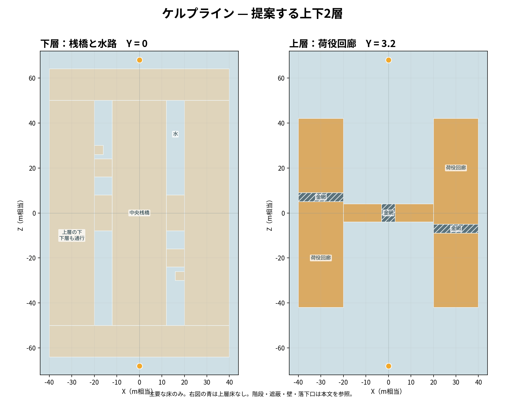

# Kelpline Terminal 新設計案 — 二層の荷役水路

**設計案。実装、実走、対戦バランス、本家実機比較は未実施。** 海上の荷役桟橋を下層とし、その上に長い鋼製ガントリーを架ける。下層だけでも両陣地・中央・両側を通れ、上層も四つの階段と中央の連絡橋で連続する。地面全面の盛土に箱を貼る構成ではない。基底は分岐した桟橋で、建築物は梁・桁・床板・部分壁を持つ実際に通行できる構造とする。




図は主要な床だけを示す。階段・壁・遮蔽・落下口の詳細は以下の座標と断面図を参照。
## 規模と座標

X 左右、Z 試合方向、Y 高さ。単位は INKWAVE の world unit（コード中のメートル相当）。境界 `x=[-44,44], z=[-72,72]`、88×144。スポーンは Alpha `(0,2.6,-68)` と Bravo `(0,2.6,68)`、距離136。180度回転 `(x,z)→(-x,-z)` で地形・目標・射線条件を対応させる。回転は単純な左右反転ではない。旧設計（外形88×144、開始間136）を維持し、前回指定の原典中央値12,480 m²・開始間134は**規模の参照値**として扱う。原典の塗り面積は取得しておらず、同等とは言えない。

水面 `y=-1.6`、落下死閾値 `-1.45`。下層床上面を `y=0`、上層上面 `y=3.2`・下面 `y=2.9` とする。下層頭上2.9、立位1.45に対し静止時の余裕1.45。上層・下層の存在を形だけにせず、上層の床の下に歩ける下層床を通す。上層は中実の巨大な台ではない。

### 重複を除いた床の矩形分割

以下は**上面の同一高さの重複を禁止**する部材表。各行が他行と同高さで内部面積を共有しないよう、分岐点も矩形に分割する。端点が接するだけにし、継ぎ目の欠落と衝突を実測する。`B(x0,x1,y0,y1,z0,z1)` の下層床厚は `-0.6..0`、上層は `2.9..3.2`。同じ XZ に別高さの床を架けるのは上下層として意図するもの。

| 下層の部材 | X | Z | 面積 |
|---|---:|---:|---:|
| 中央桟橋 | −12..12 | −50..50 | 2,400 |
| 側桟橋2本 | 20..40、−40..−20 | 各 −50..50 | 4,000 |
| 基地の荷役場2枚 | 各 −40..40 | −64..−50、50..64 | 2,240 |
| 中央十字の接続床2枚 | −20..−12、12..20 | 各 −8..8 | 256 |
| 自陣側の乗換床 | 12..20 | −24..−16 | 64 |
| 回転側の乗換床 | −20..−12 | 16..24 | 64 |
| 降下口の着地張り出し | 16..20 | −30..−26 | 16 |
| 回転側の着地張り出し | −20..−16 | 26..30 | 16 |
| 合計 | | | **9,056** |

中央桟橋と側桟橋の間は基本的に水。中央十字の接続床と乗換床でのみ繋がる。各基地の荷役場は前後14の短い岸壁で、マップ全域を覆う平床ではない。下層に `x=-40..40,z=-8..8` の一枚床を重ねない。十字中央は既存の中央桟橋の一部、両端は既存の側桟橋の一部で、その間の空白だけを表の接続床で埋める。

| 上層の部材 | X | Z | 面積・仕様 |
|---|---:|---:|---|
| 東側廊の塗れる床 | 20..40 | −42..−9、−5..42 | 1,600 |
| 東側廊の金網 | 20..40 | −9..−5 | 80、塗れない |
| 西側廊の塗れる床 | −40..−20 | −42..5、9..42 | 1,600 |
| 西側廊の金網 | −40..−20 | 5..9 | 80、塗れない |
| 横断橋左板 | −20..−3 | −4..4 | 136 |
| 横断橋中央金網 | **−3..3** | −4..4 | 48、塗れない |
| 横断橋右板 | 3..20 | −4..4 | 136 |
| 塗れる床の合計 | | | **3,472** |

橋は `x=-20..20` に留め、`x=20..40` / `-40..-20` の上層側廊に端で接する。側廊に重なる `x=20..40` の橋床は作らない。金網の中心範囲は一貫して `x=-3..3`。上面が同高さで重なる床や、金網の下に通常の床を置くことは禁止。

上表の塗れる水平床の幾何学的上面積は下層9,056＋上層3,472＝**12,528 WU²**。旧Kelplineの概算 turfArea 約13,104の約95.6%、差576 WU²。原典中央値12,480は取得方法が異なり、これは比較可能な実塗り面積ではない。これらは**部材の数学的な平面上面積**であり、スポーン床・階段・壁・遮蔽、隠れた床、金網、集計セル丸めを含まない。実際の `turfArea` や順位は構築後に計測する。上層は二本の幅20の作業廊として柱・遮蔽・視線の変化を与え、床を広くした分が一つの無特徴な広場にならないよう設計する。結果の実塗りが旧値を大幅に下回れば、まず側桟橋の y=0 に分岐した塗れる係船腕（各10×12、両陣営点対称）を増やして候補を再計算し、単一広床へ戻さない。

`Level` に CSG・面統合はない。単純な面重ねは塗りセル二重計上を生むため、この分割を維持する。部材が端で接する内部側面は `noPaint` 等で内部塗りを防ぎ、部分接合なら対応箇所で矩形を更に分割して各側面を指定する。`noPaint` は衝突や描画の結合を意味しないため、同一面の描画・法線・内部側面の漏れ・高さ継ぎ目は実行時に別途確認。段差回避のため床同士を安易に面積重複させない。

## 入口と上下接続

- 全接続は `R` の代わりに軸平行の箱階段 `B` で作る。1段の高さは0.2（ヒト `stepUp=0.35`、イカ `squidStepUp=0.24` より小さい）。有効幅は以下に示す。上下移動時に潜行が継続するか、botの1単位格子やカメラを含めて実走で確認し、数値上の範囲だけで通過可能と断定しない。
- スポーン床は `x=-8..8,z=-71..-64,y=2.6` と180度回転。前方階段は幅5、`z=-64..-56` の8を13等分し、荷役場側 y=0 からスポーン側 y=2.6 へ0.2ずつ上がる。左右階段は `z=-70..-66` の幅4、`x=-14..-8`（およびX反転）の6を13等分して0から2.6に上がる。側方の足元は `x=-18..-14,z=-70..-66,y=0` とX反転、さらに `x=-18..-14,z=-66..-64,y=0` とX反転で荷役場へ接続。これらの小床と階段は面積表に含まない。Bravoは180度回転。帰還点 `(0,0,-54)` と回転側は荷役場上で床・遮蔽・着地空間を確認する。
- 上層後方階段は `x=28..32,z=-52..-42`、16段で0から3.2へ上がる。1段の奥行0.625、等価勾配32%・約17.7°。回転側にも置く。幅20の側桟橋内で階段両側に各8の空きがあり、下層は階段の脇を連続する。
- 上層前方階段は `x=10.5..20,z=-16.5..-11.5`、16段で0から3.2へ上がる。1段の奥行0.59375、等価勾配約33.7%・約18.6°。下端は中央桟橋と接し、上端は上層側廊と接する。回転側にも置く。床のない縁の外は水と見えるよう明示する。ジャンプ・壁登りを必須にしない。
- 低い側から数えた各段 i=1..N は、対応する奥行区間を底 y=0、上面 y=0.2i の箱とする。隣の段とは垂直接触のみで正体積を共有しない。最上段は上層板の端に接し、上層板内へ食い込まない。階段幅内の支持床は**踏面平面で接する状態のまま塗り面を残さず、階段領域の足元に合わせて床を矩形分割し切り欠く**。必要な底支持は階段箱自体が担う。階段や隣床が部分接合する箇所はその接合範囲で箱を追加分割し、重なり・内側の塗り面・露出する隙間を前処理する。元の床を残したまま上に階段を重ねない。上表の面積はこの切欠き前の床の**設計上の上限**であり、階段占有域を差し引いた実面積を製作時に再集計する。
- 上層の東側廊は `z=-9..-5`、西は回転した `z=5..9` が金網。ヒトは渡り、イカ・弾・インクは通過。上層の塗り潜伏が中断される代わりに、金網から下層へ退避できる。下は必ず側桟橋。中央橋の金網も直下に下層中央桟橋がある。

箱階段の一段ずつの寸法、開始・終了位置、隣床の切欠き、接触面と露出した踏面・蹴上げ面の塗りを確認する。特に `squidStepUp=0.24` と0.2段差の余裕は0.04しかないため、フレーム間隔・衝突丸め・接地ずれの実測が必須。登れない場合は段数と奥行きを再設計する。下層の南北通行は階段の側方、上層は後方階段→側廊→横断橋→反対側廊→回転側後方階段で連続する。各陣営は自陣側の後方・前方から上層へ入れる。

## 平面・断面（縮尺略）

```text
      z=+72       Bravo spawn (0,2.6,+68)
        +64  ┌────────── 下層荷役場 ──────────┐
        +50  │ L側桟橋       L中央       L側桟橋 │
        +42  │ U+L            L           U+L    │
        +24  │ U+L ── L乗換 ─ L           U+L    │
         +8  ├───────── 下層十字岸壁 ─────────┤
          0  │ U+L ==== 板 金網 板 ==== U+L     │
         -8  ├───────── 下層十字岸壁 ─────────┤
        -24  │ U+L            L ─ L乗換 ─ U+L    │
        -42  │ U+L            L           U+L    │
        -50  │ L側桟橋       L中央       L側桟橋 │
        -64  └────────── 下層荷役場 ──────────┘
        -72       Alpha spawn (0,2.6,-68)
                -40 -20    -12 12   20 40  x
         L=下層、U=上層。中央と側桟橋の隙間は水。

横断面 z=0：
 y=3.2   [U側廊]────板────[金網]────板────[U側廊]
 y=2.9          板の下面。中央 x=-3..3 は厚さ0.3の金網下面
                 （下層の頭上2.9。金網はイカ・弾・インク透過）
 y=0     ━━━━━━━━━━ 下層十字岸壁 ━━━━━━━━━━
 y=-1.6  ~~~~~~~~~~~~~~~~~~ 水 ~~~~~~~~~~~~~~~~~~~
       x=-40     -20  -3  +3  +20          +40
```

## 落下・壁・遮蔽

中央橋の南北側の `x=7..11,z=4..8` と `x=-11..-7,z=-8..-4` は、床付き安全着地帯。さらに点対称の `x=-11..-7,z=4..8` と `x=7..11,z=-8..-4` を同様に確保し、合計4箇所。実際の床は上の下層中央桟橋および接続床の該当部分で、重ね床ではない。橋の `z=±4` の縁はこれら4箇所を幅4開口とし、それ以外は高さ1.1の非塗装の実体柵で区切る。柵は敵弾・イカを通す `rail/grate` ではなく通常の `B` とし、ジャンプ越えや落下を完全防止するものとはしない。橋中央金網 `x=-3..3,z=-4..4` の直下も下層中央床がある。安全着地帯の端からは水まで少なくとも4の奥行きを確保し、慣性・足半径・カメラを含む着地点は未検証。側廊の内外縁や上層階段の周囲は、下層床がなければ水落ちとする。側廊の内縁の降下口は `x=20,z=-30..-26` と回転側に設け、下層の着地帯は追加床 `x=16..20,z=-30..-26,y=0` とその回転側。追加床は下層側桟橋に x=20 の面で接し、正体積は共有しない。縁の内側へ降りる際は x=16..20 の着地帯内に収まる操作を想定する。幅4のため慣性や足半径を含む着地可能性は実測し、失敗すれば水に落ちる。水に面する場所と脱出できる場所を色、柵の切れ目、水面で識別させる。

壁登りを選択肢として成立させるため、東側の下層側廊内側に `B(20,20.3,0,2.9,-22,-18)` の幅4の塗れる垂直壁と、回転側に `B(-20.3,-20,0,2.9,18,22)` を設ける。前者は乗換床上の下層 `x=16..20,z=-22..-18` から +X 向きに接触して登り、上端では `x=20.3..24,z=-22..-18,y=3.2` の上層側廊に着床する。壁の上端 y=2.9 は上層床下面と面で接し、正体積は重複しない。壁は上層床の側端に連続し、壁表面から上層側へ乗り越えできる向きに調整する。上層床が壁を覆って登頂を妨げないか、`ledgePopClear=0.42`、カメラ、弾塗りとActorで確認する。壁は階段の代替短縮路であり必須ではない。壁の足元には歩行幅を確保し、落下先を水上にしない。

下層遮蔽の初期案は `x=-10..-7,z=-20..-19,y=0..1.3`、`x=7..10,z=-29..-28,y=0..1.3`、`x=24..27,z=-25..-24,y=0..1.3` および180度回転。エリア候補 `(0,-12),8×6` の外周 `x=-4..4,z=-15..-9` と接しない。中央長射線を遮る1.8高の短壁は `x=-11..-8,z=-5..-4` と回転側。中央・両側での最小必須通路幅は3、実測時はプレイヤー半径0.38とbotのクリアランスを加味。上層遮蔽は `x=36..39,z=-28..-25,y=3.2..4.5` と回転側など、橋とヤグラ通路から離して設置。上層側廊に沿う柱・倉庫壁・積荷コンベヤを部分配置し、ただの長い平面に見せない。見た目と衝突は一致させる。

狙いは中央や基地出口を一箇所で全て直射できず、近距離側が下層と遮蔽を使って接近できる構成。チャージャーやスピナーは上層の長い見通しを得る一方、側方や金網下から反撃される。ローラー・短射程は下層の塗りと曲がり角を使えるが、十字の開口では射線にさらされる。曲射・爆風は上下の端に圧をかけられる一方、部材・退避口の配置が効く。高さ1.0と1.4の射線、カメラ、実弾と爆風を別に測るまで、どのブキにも公平と断定しない。3.2の落下は現行ハード着地閾値を越えうる。

## 各ルールの配置案

現行 `patches/splatoon3/runtime/ranked/stages.mjs` は旧地形用の座標で、最高床 `groundHeight` を使う。ヤグラは半幅1.4に対する周囲の最高床も採るため、新地形と同時に再較正する。

- ナワバリ：上下を塗れるが金網と水は塗れない。上下に重なった塗りの実際の集計とミニマップの表示を検証。
- エリア：下層 `center=(0,0,-12),(0,0,12)`、各8×6。上層橋・金網・階段の直下を避け、両側から攻防できる。
- ヤグラ：全て上層の `[(30,-42),(30,-5),(30,0),(0,0),(-30,0),(-30,5),(-30,42)]`、中央 index=3。橋・側廊の上面は一貫して3.2。チェックポイント進捗0.42、0.78を仮置き。全補間点で、ヤグラ周辺の最高床に障害物・柱・階段を拾わないか、旋回掃引と人の乗降を検査する。中央金網を通るヤグラの動的床と、イカ・弾の通過は別途確認する。
- ホコ：中央は対称軸の金網上 `center=(0,3.2,0)` とする。最高床採用で上層金網を拾う方針に統一する。金網上でバリアやホコの生成・取得・イカでの落下・弾の通過が成立するかは**未検証**であり、実装時の必須受入条件とする。チェックポイント `(0,0,±24)`、ゴール `(0,0,±40)` は下層床の最高面。
- アサリ：ゴール `(0,0,±40)`。発生候補 `(±30,±16),(0,±30)`。側廊候補は下層ではなく上層 `y=3.2` の最高床を採る。金網帯の上には発生させない。拾得・投擲・水没リセットを確認。
- ボス：細い桟橋と上下構造に対し、ボスの通行、攻撃と落下、カメラを別途確認するまで互換と断定しない。

## 実装・検証条件

`maps.js` の `single` と `half` の180度複製で組み、金網は `grate:true` で通常床に重ねず置換する。上層下面・下層上面・壁の見た目と塗りを確認する。ボットのナビは1WU格子で、隣接の高さ差0.5以下を歩行扱いし頭上を1.4まで検査する。`PLAYER.radius=0.38`, `height=1.45`, `stepUp=0.35`。階段は高さ0.2ずつだが、イカの0.24という許容値と近く、通行は実測する。

実Actorで両軍・両層・四つの階段・金網のヒト/イカ/弾・塗壁・指定着地帯・水死を30/60/120Hzで確認。全ルールの初期化、生成、取得、得点、チェックポイント、ボット、オンライン同期、ヤグラの全経路と掃引を確かめる。床の各上面面積・塗り点・二重カウント、両陣営の回転対称、最短移動距離、全出口の射線と視認、各ブキ・ボム・スペシャルの実戦を確認し、問題があれば設計を戻す。これらはすべて未検証。

## 本家参照と限界

比較対象は Splatoon 3 Ver.11.3.0。任天堂の[ナワバリバトル案内](https://www.nintendo.com/jp/switch/av5ja/battle-nawabari/index.html)は塗り・移動・射撃、[ルール案内](https://www.nintendo.com/jp/ichikara/av5ja/03_en.html)はエリア・ヤグラ等の目的の参考であり、寸法・金網動作・この架空港の構造の根拠ではない。詳細は [既存の挙動比較記録](../actions/reports/inkwave-splatoon3-behavior-2026-10-02.md) を参照。寸法・地形・ブキ対策は設計者の提案で、本家ステージの復元値ではない。本家の同条件実機計測は未実施で、INKWAVEの実走やバランスも未証明。実装後は関連する移動・塗り・射撃の差分と条件を既存の比較記録に追記する。
