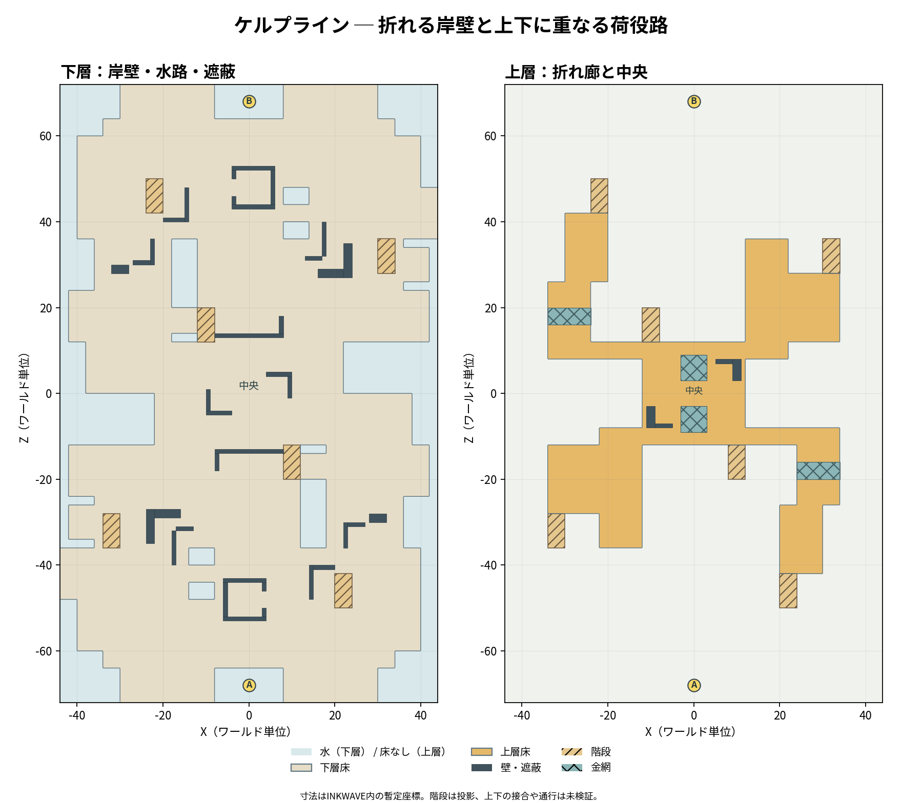

# Kelpline Terminal 平面再提案：折れ曲がる荷役岸壁

設計案。実装・実走・本家同条件比較は未実施。前案の問題は、広い横断橋を除くと、下層の3本と上層の2本がほぼ全長同じ幅で真っすぐ伸びていたこと。今回は水の入り江を交互に差し込み、岸壁自体を折り、中央の重なった上下広場と自陣の袋小路を作る。下層を常時通り抜けられ、上層も一端から他端まで連続する。高さだけを記号で表す1枚床ではない。




平面図は設計座標から作成したもの。高さと接合の詳細は以下を参照。
## 確認した画像と観察の範囲

- [チョウザメ造船のナワバリ上面図](https://img.altema.jp/splatoon3/kakudai/2022y10m05d_154357753.jpg)（[掲載ページ](https://altema.jp/splatoon3/chozamezousen)）を画像として表示して確認。自陣の外形に張り出しと凹みがあり、中央の高い部分の周囲には階段、短い遮蔽、網目の小部分が点在する。細い区画が同じ幅で全長並んではいない。画面は斜めの見下ろしなので、陰で隠れた床、通行可能性、金網のルールや正確な距離は読み取れない。
- [海女美術大学のナワバリ上面図](https://img.altema.jp/splatoon3/kakudai/2022y10m05d_174202035.jpg)（[掲載ページ](https://altema.jp/splatoon3/umijobijutudaigaku)）を画像として表示して確認。中央広場を囲む段差と物体、両陣の折れた壁や段階的な外形が見える。中心から見て相手側が概ね半回転で対応する構成に見えるが、この画像だけで厳密な対称や上下の全接続は確定できない。
- この案への翻訳は「区画の凹凸・曲がり・分岐・中央の高さと短い遮蔽」であり、実在ステージの縮尺復元ではない。水面や金網の衝突・塗り性能は画像だけでは確認していない。更新日2024年1月11日の攻略画像で、ゲーム版や現在との差分は不明。画像の出典は上のリンクを参照。

## 座標と記号

境界 X=−44..44、Z=−72..72 の88×144 WU、Alpha スポーン `(0,2.6,-68)`、Bravo `(0,2.6,68)` で距離136。床は下層上面 Y=0、上層上面 Y=3.2・下面 Y=2.9、水面 Y=−1.6・落下死閾値 Y=−1.45。上層下の下層は頭上2.9ある。正確な外形は座標表を優先する。全体は `(x,z)→(-x,-z)` の180度回転で対応し、各陣営からは同じ左右関係。Zの正方向が図の上、X正方向が右。

両図は同じ格子で表示し、横1文字・縦1行は4 WUおきの中心点を示す。凡例: `L` 下層塗床、`U` 上層塗床、`#` 金網、`X` 遮蔽物、`S` スポーン、`^` 下層側階段、`E` 上層の階段出口、`~` 水または上層床なし。Z正が上、X正が右。4 WU間隔の点サンプルであり、狭い遮蔽や幅4の網・階段は一部消えるほか、端や対称性の見え方がずれる。接続の正確な判定は座標表を優先する。上層図の `~` は直下が水とは限らない。

```text
下層（左からX=-42,-38,...,42）
+70 ~~~LLLLLLSSSSLLLLL~~~~
+66 ~~~LLLL^^SSSS^LLLL~~~~
+62 ~~LLLLLLLL^^LLLLLLL~~~
+58 ~LLLLLLLLL^^LLLLLLLLL~
+54 ~LLLLLLLLLLLLLLLLLLLL~
+50 ~LLLLLLLLLLLLLLLLLLLL~
+46 ~LLLL^LLLLLLL~LLLLLLLL
+42 ~LLLL^LLLLLLLLLLLLLLLL
+38 ~LLLLLLLLLLLL~LLLLLLLL
+34 ~~LLLL~~LLLLLLLLXL^L~~
+30 ~~LLXL~~LLLLLLLLXL^LL~
+26 ~~LLLL~~LLLLLLLLLLLLL~
+22 LLLLLL~~LLLLLLLLLLLLL~
+18 LLLLLLLL^LLLLLLLLLLLL~
+14 LLLLLLLL^LLLLLLLLLLLL~
+10 ~LLLLLLLLLLLLLLL~~~~~~
 +6 ~LLLLLLLLLLLLLLL~~~~~~
 +2 ~LLLLLLLLLLLLLLL~~~~~~
 -2 ~~~~~LLLXLLLLLLLLLLL~~
 -6 ~~~~~LLLLLLLLLLLLLLL~~
-10 ~~~~~LLLLLLLLLLLLLLL~~
-14 LLLLLLLLLXXXX^~LLLLLL~
-18 LLLLLLLLLLLLL^LLLLLLL~
-22 LLLLLLLLLLLLLL~LLLLLL~
-26 ~~LLLLLLLLLLLL~LLLLL~~
-30 LL^LLLLLLLLLLL~LLLXL~~
-34 LL^LLLXLLLLLLL~LXLLL~~
-38 LLLLLLX~~LLLLLLLLLLLL~
-42 LLLLLLLLLLLLLLXLLLLLL~
-46 LLLLLLL~~XLLLLXL^LLLL~
-50 ~LLLLLLLLXLLLLLL^LLLL~
-54 ~LLLLLLLLLLLLLLLLLLLL~
-58 ~LLLLLLLLL^^LLLLLLLLL~
-62 ~~LLLLLLLL^^LLLLLLL~~~
-66 ~~~LLLLLLSSSSLLLLL~~~~
-70 ~~~LLLL^^SSSS^LLLL~~~~
上層（同じ縮尺）
+70 ~~~~~~~~~~~~~~~~~~~~~~
+66 ~~~~~~~~~~~~~~~~~~~~~~
+62 ~~~~~~~~~~~~~~~~~~~~~~
+58 ~~~~~~~~~~~~~~~~~~~~~~
+54 ~~~~~~~~~~~~~~~~~~~~~~
+50 ~~~~~~~~~~~~~~~~~~~~~~
+46 ~~~~~~~~~~~~~~~~~~~~~~
+42 ~~~~~~~~~~~~~~~~~~~~~~
+38 ~~~UUE~~~~~~~~~~~~~~~~
+34 ~~~UUU~~~~~~~~UU~~~~~~
+30 ~~~UUU~~~~~~~~UU~~~~~~
+26 ~~~UUU~~~~~~~~UUUUE~~~
+22 ~~UUU~~~~~~~~~UUUUU~~~
+18 ~~###~~~~~~~~~UUUUU~~~
+14 ~~UUU~~~~~~~~~UUUUU~~~
+10 ~~UUUUUUEUUUUUUU~~~~~~
 +6 ~~~~~~~~UU##UX~~~~~~~~
 +2 ~~~~~~~~UUUUUU~~~~~~~~
 -2 ~~~~~~~~UUUUUU~~~~~~~~
 -6 ~~~~~~~~XU##UU~~~~~~~~
-10 ~~~~~UUUUUUUUEUUUUU~~~
-14 ~~UUUUUU~~~~~~~~~UU~~~
-18 ~~UUUUUU~~~~~~~~~##~~~
-22 ~~UUUUUU~~~~~~~~~UU~~~
-26 ~~EUUUUU~~~~~~~~~UU~~~
-30 ~~~~~UUU~~~~~~~~UU~~~~
-34 ~~~~~UUU~~~~~~~~UU~~~~
-38 ~~~~~~~~~~~~~~~~UU~~~~
-42 ~~~~~~~~~~~~~~~~EU~~~~
-46 ~~~~~~~~~~~~~~~~~~~~~~
-50 ~~~~~~~~~~~~~~~~~~~~~~
-54 ~~~~~~~~~~~~~~~~~~~~~~
-58 ~~~~~~~~~~~~~~~~~~~~~~
-62 ~~~~~~~~~~~~~~~~~~~~~~
-66 ~~~~~~~~~~~~~~~~~~~~~~
-70 ~~~~~~~~~~~~~~~~~~~~~~
```

上層入口 E は各陣営に3箇所。後方（Alpha 20..24, Z=−42）、中央（8..12, Z=−12）、左枝（−34..−30, Z=−28）から上層に登る。`^` の登り方向は後方・中央・左枝とも Alpha はZ正、Bravoは回転したZ負。スポーンからは中央階段がAlphaでZ正、両側階段は外側から中央方向に登る。1 WUの遮蔽物は図に現れない場合がある。各行末の水や周囲の背景は境界外を含む。

## 下層の部材分割

各行は同一高さの内部面積を共有しない矩形。表は Alpha 側を先に示す。Bravo 側は表の各行を180度回転、中央だけ単独。端が接する接続は十分な幅があるか実装時に検査する。下層床厚 −0.6..0。下層床を全域に敷いて水を塗り替えない。

| 部材 | X | Z | 意味 |
|---|---:|---:|---|
| 中央 | −22..22 | −12..12 | 44×24、上層の真下も通れる |
| 手前中央出口 | −30..12 | −24..−12 | 中央につながる幅広の折れ |
| 手前右岸・前 | 18..36 | −24..−12 | 水を挟む側道、中央側に直結 |
| 乗換橋 | 12..18 | −20..−14 | 幅6、手前出口と側道を接続 |
| 荷役広場 | −36..12 | −36..−24 | 左岸から中央へ絞られる |
| 手前右岸・後 | 18..36 | −36..−24 | その右側を並ぶ短い側道 |
| 左の係船岸 | −36..−14 | −48..−36 | 水の入り江を抱く |
| 荷役広場・後 | −8..30 | −48..−36 | 基地から二方向に分岐 |
| 左岸への小橋 | −14..−8 | −44..−40 | 4 WU幅、左岸と後方広場を接続 |
| 基地広場 | −30..30 | −60..−48 | 床外周に段階的な凹凸 |
| 基地口 | −18..18 | −64..−60 | スポーンへ接続 |
| 左行止り係船腕 | −42..−36 | −34..−26 | 荷役広場に接続、外端は水 |
| 右行止り係船腕 | 36..42 | −22..−16 | 右岸に接続、外端は水 |
| 上層折れ廊の着地床 | 22..34 | −12..−8 | 中央と側道に接し、上層下を安全にする |
| 基地の左右外縁 | −30..−8、8..30 | 各 −72..−64 | スポーンの両脇を回る下層床。階段用に切欠く |
| 基地口の左右 | −34..−18、18..34 | 各 −64..−60 | 外縁を基地広場に接続 |
| 基地広場の両肩 | −40..−30、30..40 | 各 −60..−48 | 対称な荷物区画、基地広場に端接続 |
| 後方荷役の外縁 | −44..−36、30..40 | 各 −48..−36 | 外周に回り込む張出し |
| 前方荷役の外縁 | −42..−30 | −24..−12 | 荷役広場・前方出口に接続 |
| 右岸の小拡幅 | 36..42 | −24..−22、−16..−12 | 既存係船腕と端接続 |
| 中央の右張出し | 22..38 | −8..0 | 中央広場右端の短い岸壁 |
| 同・手前接続 | 34..38 | −12..−8 | 既存の着地床・右岸に端接続 |

上記の X=12..18, Z=−36..−20 の大部分や、X=−14..−8, Z=−48..−44 / −40..−36 は水。水際は実体のある床縁・荷役柵・水面で認識できるようにする。係船腕は本当に行き止まりであり、対面岸へのジャンプ必須ルートではない。中央下層は建屋と入口壁を迂回すれば基地側から中央へつながる（直線では通れない）。下記「3方向の通路と階段の点検」の通過候補を参照。側道は基地から右岸、乗換橋または中央への2接続を持つ。回転側も同様。連続性は設計上の見込みで、衝突・移動は未検証。

## 上層と上下接続

上層も矩形を分割し、同一高さの正面積重複を作らない。Alpha 側と回転側は中央に接続する。上層床の下に下層を残すので別ルートとして存在する。網と通常床は置換し、網の直下にも上層の通常床を重ねない。

| 上層の床 | X | Z | 仕様 |
|---|---:|---:|---|
| 中央 左 | −12..−3 | −12..12 | 塗れる床 |
| 中央 右 | 3..12 | −12..12 | 塗れる床 |
| 中央 手前 | −3..3 | −12..−9 | 塗れる床 |
| 中央 中央 | −3..3 | −3..3 | 塗れる床。ホコ初期位置候補 |
| 中央 奥 | −3..3 | 9..12 | 塗れる床 |
| 中央 奥網 | −3..3 | 3..9 | 金網、直下は下層中央 |
| 中央 手前網 | −3..3 | −9..−3 | 金網、直下は下層中央 |
| Alpha 側 後 | 20..30 | −42..−26 | 塗れる10幅の作業床 |
| Alpha 側 中 | 24..34 | −26..−20 と −16..−12 | 塗れる10幅の折れ廊 |
| Alpha 側 網 | 24..34 | −20..−16 | 金網、直下は下層右岸 |
| Alpha 側 連結 | 12..34 | −12..−8 | 塗れる床、中央に端接続 |
| Alpha 左枝・連結 | −22..−12 | −12..−8 | 中央の左端と接続 |
| Alpha 左枝・入口 | −22..−12 | −20..−12 | 折れて手前側に伸びる |
| Alpha 左枝・内 | −22..−12 | −28..−20 | 荷役区画の上 |
| Alpha 左枝・外 | −30..−22、−34..−30 | 各 −28..−12 | 枝側の連続床 |
| Alpha 左枝・手前 | −22..−12 | −36..−28 | 手前に折れた短い袋状の塗床 |

Alpha側の全行と網を180度回転複製。網は現行案の `grate:true` を想定し、ヒト・イカ・弾・インクの挙動を実測する。金網の向こう側に上層床が存在し、網下にも床が存在することを検証。中央連結床上の射線が長くなりすぎないよう下記の遮蔽を設ける。

- スポーン床：X=−8..8, Z=−71..−64, Y=2.6。X=−4..4, Z=−64..−56 に13段、各高0.2の前方階段。さらに X=−14..−8 と 8..14、Z=−70..−66 に各13段の側方階段を置く。外側の下層からスポーンへ登り、同じ範囲の下層床は階段に置換する。Bravoは回転。
- 後方上り：X=20..24, Z=−50..−42 を16段、1段高0.2、上端は上層後方床の Z=−42 に端接続。Alpha下層から上層に入り、回転側にも設ける。
- 左枝上り：X=−34..−30, Z=−36..−28 を16段、1段高0.2、上端は左枝外側の Z=−28 に端接続。回転側も設ける。これにより左枝は袋小路の床を持ちつつ、外側階段と中央連絡の両方からアクセスできる。
- 中央上り：X=8..12, Z=−20..−12 を16段、1段高0.2、Z=−12 で中央上層に端接続。回転側も設ける。幅4、階段両脇の下層を確保する。階段は下層床を切り欠いて置換し、通常床と踏面を重ねない。
- 上層は「後方上り→折れ廊→中央→回転した折れ廊→回転側後方上り」で連続し、左枝階段からも中央に接続。下層は中央階段脇から引き続き中央を通る。階段とは別に、中央上層 X=−4..4, Z=−12 の開口から下層に降りられる案。直下は床だが落下3.2 WUの着地・慣性は未検証。水側に面する縁に柵、指定開口だけを目立たせる。回転側も同様。
- この0.2段は既存のイカ段差許容0.24に近く、歩行・潜行・ボット・フレーム間隔で確認が必要。上層下面の高さ2.9で、階段途中の頭上クリアランスを階段と上層床の端で別途検査する。

## 遮蔽と塗り

すべて案。高さは床上、回転複製する。遮蔽は床と同高さの別床を重ねる意味ではない。占有部分の塗面と接触面は構築時に床をさらに分割して内面・重複を除去する。

- 下層中央のL字荷物壁：X=−10..−4, Z=−5..−4、および X=−10..−9, Z=−4..1、高さ1.5。後者は前者と端接続。回転側も同様。中央中央上り X=8..12, Z=−20..−12 は塞がない。
- 荷役広場の倉庫壁：X=−24..−22, Z=−35..−27 と X=−22..−16, Z=−29..−27、高さ2.0。L字に折れ曲がり、回り込んで両側から通過できる。係船腕付近の岸は残す。
- 右岸のコンテナ：X=28..32, Z=−30..−28、高さ1.2。側道の幅18の一部で、両脇に幅を残す。回転側にも設置。
- 上層中央の短壁：X=−11..−9, Z=−8..−3 と X=−9..−5, Z=−8..−7、高さ1.2。回転側にも置く。中央の金網を塞がない。上記下層の壁とは高さが異なる。

ナワバリは通常床・露出した階段・塗れる壁を塗面候補、網・水は非塗装候補。重複チェックした矩形の下層上面は **10,152 WU²**、上層通常床は **2,144 WU²**、合計 **12,296 WU²**。上層の網152 WU²は除く。階段切欠き前、スポーン床・階段踏面・遮蔽の占有・垂直壁・集計セル丸めを含まない幾何学的上面積で、実際の turfArea ではない。前案の比較値13,104 WU²の約93.8%で、目標の90%を矩形上面の段階では超える。階段はその占有域の通常床を置き換えるため、階段の塗り判定・遮蔽下の集計次第で実値は変わる。原典の実塗り面積は不明で、本家と実面積が同等とは言えない。矩形の同一高さの正面積重複は `check_kelpline_area.py` で検算した。


## 荷役区画を分節する追加実体壁

前の平面積は維持したまま、下層の床上に以下の高さ1.8 WUの実体壁を追加する。Alpha 側の値であり、すべて180度回転複製する。隣接壁は端だけで接し、壁同士・既存遮蔽とは正面積を重ねない。壁は低い床に置き、上層床下面 Y=2.9 より低い。壁外側・内側は衝突を持ち、表面の塗装可否は後で面指定する。開口を塞ぐ装飾や床を追加しない。

| 区画 | X | Z | 関係・開口 |
|---|---:|---:|---|
| 基地前の建屋・手前壁 | −6..4 | −53..−52 | スポーン正面からの長射線を遮る |
| 同・左壁 | −6..−5 | −52..−44 | 両端壁に接する |
| 同・奥壁 | −6..4 | −44..−43 | 中央への直射を遮る |
| 同・右壁の前後 | 3..4 | −52..−50、−46..−44 | Z=−50..−46 に4幅の東向き開口。コの字の内側を実際に歩ける |
| 左貨物帯・縦壁 | −18..−17 | −40..−32 | 左側の係船岸と中央荷役床の間に角を作る |
| 同・折れ壁 | −17..−13 | −32..−31 | 縦壁と端接続。近くの旧倉庫壁とは分離 |
| 右貨物帯・後縦壁 | 14..15 | −48..−40 | 後方階段への直線視界を区切る |
| 同・折れ壁 | 15..20 | −41..−40 | 階段 X=20..24, Z=−50..−42 とはZ方向に離れる |
| 右岸の縦壁 | 22..23 | −36..−30 | 右岸に内側4幅・外側13幅を残す |
| 右岸の短い折れ壁 | 23..27 | −31..−30 | 既存コンテナ X=28..32, Z=−30..−28 と分離 |
| 中央入口・縦壁 | −8..−7 | −18..−14 | エリア候補 X=−4..4 に入らない |
| 中央入口・横壁 | −8..8 | −14..−13 | 正面直射を遮る。右端は中央階段の左端に接する |

同じ床高上の新壁の接地面積は両陣営合計 **174 WU²**。前節の12,296 WU²は壁占有を除く前の床矩形で、実塗りがこの分だけ正確に減るという意味ではない。実装では床を接地面ごとに分割して重複した内部面・セルの塗りを防ぐ。壁側面が塗れるか、隠れた床を集計するかも含めて再計測する。水路や既存床はこのために削らない。

### 3方向の通路と階段の点検

下層はスポーン先の `(−0.5,−53.5)` を共通起点とし、1 WU格子、床周囲と壁から各軸0.45 WUの点サンプルを要求し、階段範囲は下層通路として塞いで探索した。以下は通過候補の順序で、各点を結ぶ経路が存在するという離散検査であり、直線でつなぐ意味ではない。回転側も同条件。

- 左岸：`(−30.5,−39.5)→(−28.5,−31.5)→(−15.5,−19.5)→(−15.5,−0.5)`。倉庫壁と貨物帯の間を折れ、中央左へ入る。
- 中央：`(8.5,−47.5)→(5.5,−34.5)→(9.5,−21.5)→(0.5,−9.5)→(0.5,−0.5)`。建屋を右から回り、入口壁を迂回する。
- 右岸：`(27.5,−45.5)→(30.5,−33.5)→(30.5,−17.5)→(17.5,−9.5)→(17.5,−0.5)`。片側貨物帯を越えて側岸から中央へ接続。

これらは同じ床で相互に接続し、完全独立の3レーンを意味しない。左貨物帯近傍では旧倉庫壁の右端 X=−22 と新縦壁左端 X=−18 の間に4 WU、右岸では床左端 X=18 と縦壁左端 X=22 の間に4 WUを残す。中央上りも幅4で、その左壁と端接続する。実Actorの半径・移動・カメラ・ボットを含めた通過は未検証。

階段の下端手前 `(21.5,−50.5)`、`(9.5,−20.5)`、`(−32.5,−36.5)` へも同じ起点から下層で到達可能。これらはそれぞれ後方・中央・左枝の入口。階段自体と上層への乗り移りは、この平面格子検査には含めていない。

### ルール・上下干渉

新しい壁は下層に限定し、上層の金網と塗床の下にくる箇所も上面Y=1.8で上層Y=3.2に達しない。平面上、新壁と階段矩形の正面積重複はゼロ。両陣営のエリア8×6、ホコの中央・下層チェックポイント・ゴール、アサリ候補点は新壁と重ならない。遮蔽により射線や移動時間は変わるため、ルール上の公平性は実走で再確認する。

上層のヤグラ候補は新壁の上方を通る箇所があるが、上層床が最高面という設計上の想定であり、ヤグラの最高床検索、半幅、壁頂との判定、方向転換の連続掃引は実動作で確認する。従来の離散サンプル検査は新壁の上面 Y=1.8 を動的な障害として検証したものではない。金網・上下の弾やインクの挙動も未検証。検査スクリプトは `check_kelpline_walls.py`。

## 全ルールの位置の再点検

前案は旧地形用であるため、その座標を流用しない。以下は新地形に対する候補であり、座標と矩形上の衝突確認のみ。最高床判定、動体の形状、スポーン・塗り・得点などは実装で要検証。

- ナワバリ：上下面積は別々に計測し、網と水は対象外。スポーン・各階段出口、両陣の帰還点も確認。
- エリア：前案の `(0,±12)` では中央上層の真下と重なるため、下層候補を `(0,±20)`、8×6へ移動。X=−4..4、Z=−23..−17 と回転側は下層に載り、上層床・網・指定遮蔽・階段の直下にない。支配判定・境界は実測する。
- ヤグラ：前案の `(30,-42)...` は変更後の折れ廊と整合しない。新候補は `(25,-40)→(27,-26)→(28,-20)→(28,-10)→(6,-10)→(6,0)→(-6,0)→(-6,10)→(-28,10)→(-28,20)→(-27,26)→(-25,40)`。中央寄りの2つの網を避けて通るが、両側廊の網は横断する。上層の中央遮蔽を上記位置に移動し、経路中心とは交差させていない。半幅1.4を含む最高床・旋回時掃引、狭い連結床の縁、金網上の移動床判定は未検証。経路上の中央は `(0,0)`、チェックポイント位置は距離を計算し直す。
- ホコ：旧案の `(0,3.2,0)` は金網上だったが、今回そこを塗床に変更。新案も同じ位置を候補にし、バリア形状と遮蔽の接触を確認。チェックポイント `(0,0,±24)` とゴール `(0,0,±40)` は下層があり、上層の直下でないことを座標上確認。ホコの生成・取得・ゴール判定は未検証。
- アサリ：ゴール `(0,0,±40)` は下層、発生候補 `(0,±30)` は下層。旧 `(±30,±16)` の一部は追加した上層や網と重なるため使わない。上層候補は `(−28,−24)`、`(28,−24)` とそれぞれの回転位置に変え、いずれも通常床上。投擲・取得・上限・水没リセットは未検証。
- ボス：新しい狭い接続・階段・天井・水際の通行と攻撃は未検証。互換を断定しない。

## 未検証・引継ぎ

1. 本家の寸法、塗り面積、中央の立体接続、落下・金網挙動および操作条件を実機で比較していない。観察画像だけで公平性や一致を断定しない。
2. この案はナワバリ優先。上記の全ルール位置は候補であり、新地形の highest-floor 判定、各スポーン位置、ヤグラの掃引と落下、ボスを検証する。
3. 接地・床の端合わせ・上下階天井・塗りセル二重計上・柵の視認性・金網透過・水死・安全着地点、30/60/120Hzでの実Actorとボット通行を検証。床と階段の矩形分割・内部側面 noPaint は衝突の結合を意味しない。
4. 中央高台から基地出口を一方的に撃てないか、長短射程・ボム・カメラ・スポーン復帰を実射と対戦で確認。画面上の面積と移動経路を再計測し、問題なら水路・遮蔽・接続を調整する。
