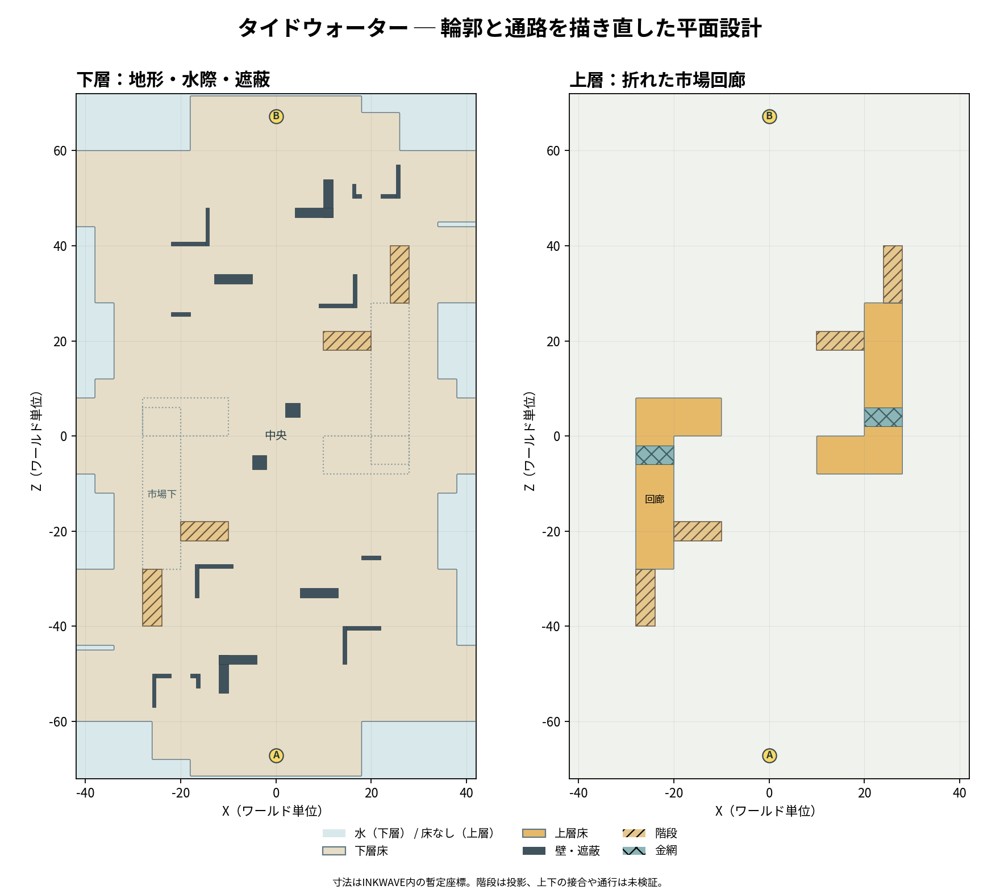

# Tidewater Plaza 平面の再提案：折れた水際と市場の小路

設計案・未実装。前案 `stage-redesign/tidewater.md` の「矩形帯の地面に左右二本の直線高架」を置き換える。以下は地形を読み替える提案で、既存 geometry、ゲームコードは変更していない。寸法は INKWAVE 単位、画像から本家の実寸を計測したものではない。




平面図は設計座標から作成したもの。高さと接合の詳細は以下を参照。
## 参照画像を実際に見て得たこと

2026-10-31 に Inkipedia の以下の Splatoon 3 ナワバリバトルのゲーム内マップ画像そのものを閲覧した。画像は斜めの投影なので見えていない床、正確な高さ、通行可否、塗り面、寸法、マッチでの公平性までは判定できない。バージョン番号は各画像のファイル名に従う。

- [Hagglefish Market 8.0 ナワバリ](https://splatoonwiki.org/wiki/File:S3_Map_Hagglefish_Market_Turf_War_8.0.jpg)：横長の領域の中でも、両端の陣地は切り欠きや壁で区画され、中央は細い障害物・小さな箱・格子が混在。中央周囲には暗く抜けた側帯があり、単一の大広場ではない。[画像原寸](https://cdn.wikimg.net/en/splatoonwiki/images/d/de/S3_Map_Hagglefish_Market_Turf_War_8.0.jpg)
- [MakoMart 3.0 ナワバリ](https://splatoonwiki.org/wiki/File:S3_Map_MakoMart_Turf_War_3.0.jpg)：中央の二つの長い什器と、その両端で曲がる通路が目立つ。端の広場も凹凸や内向きの壁が入り、空間の幅と密度が一様でない。[画像原寸](https://cdn.wikimg.net/en/splatoonwiki/images/5/5b/S3_Map_MakoMart_Turf_War_3.0.jpg)
- [Scorch Gorge 8.0 ナワバリ](https://splatoonwiki.org/wiki/File:S3_Map_Scorch_Gorge_Turf_War_8.0.jpg)：端から中央に近づくにつれ外形が段状に広がり、中央は格子帯・箱・短壁で分節される。両端の輪郭と局所配置には180度回転で対応するように見える。[画像原寸](https://cdn.wikimg.net/en/splatoonwiki/images/9/99/S3_Map_Scorch_Gorge_Turf_War_8.0.jpg)

これらは画像上の形状の観察であり、地形や配置を複製しない。左右対称な二本の直線回廊や全幅を貫く同一の帯を避け、陣営交換に使う180度回転対称は維持する。

## 図の読み方

X 左右、Z 縦、Y 高さ。Alpha の発射点 `(0,2.2,-67.2)`、Bravo は `(0,2.2,67.2)`、間隔 134.4。bounds は X `[-42,42]` × Z `[-72,72]`（84×144）。下図は位置関係を示す概略、縮尺ではない。床は座標表を正とし、水と「上階がない」は別。`#` は遮蔽物、`s` は上階への階段、`g` は格子、`~` は水、`.` は基本の下階床、`+` は追加した下階床、`=` は上階床。上下は別々に重なる。

```text
下階：. 基本床  + 追加床  s 上り階段  # 遮蔽  ~ 水
  70 ~~~~~~~~~~~~..................~~~~~~~~~~~~
  66 ~~~~~~~~~~~~........BB........++++~~~~~~~~
  62 ~~~~~~~~~~~~..................++++~~~~~~~~
  58 ++++................................++++++
  54 ++++......................#.........++++++
  50 ++++......................#..#..##..++++++
  46 ++++...................####.........++++++
  42 ~~....................................++++
  38 ~~...............................ss...++++
  34 ~~............#####..........#...ss...++++
  30 ~~...........................#...ss...++++
  26 ~~~~......##..........................~~~~
  22 ~~~~......................sssss.......~~~~
  18 ~~~~......................sssss.......~~~~
  14 ~~~~..................................~~~~
  10 ~~++++..............................++++~~
   6 ++++++................##............++++++
   2 ++++++..............................++++++
  -2 ++++++..............................++++++
  -6 ++++++............##................++++++
 -10 ~~++++..............................++++~~
 -14 ~~~~..................................~~~~
 -18 ~~~~.......sssss......................~~~~
 -22 ~~~~.......sssss......................~~~~
 -26 ~~~~..........................##......~~~~
 -30 ++++...ss...#...........................~~
 -34 ++++...ss...#..........#####............~~
 -38 ++++...ss...............................~~
 -42 ++++....................................~~
 -46 ++++++.........####...................++++
 -50 ++++++..##..#..#......................++++
 -54 ++++++.........#......................++++
 -58 ++++++................................++++
 -62 ~~~~~~~~++++..................~~~~~~~~~~~~
 -66 ~~~~~~~~++++........AA........~~~~~~~~~~~~
 -70 ~~~~~~~~~~~~..................~~~~~~~~~~~~
     -42                 0                  42  X

上階：= 床  g 格子  s 階段（空白は上階なし、下階がない意味ではない）
  42
  38                                  ss
  34                                  ss
  30                                  ss
  26                                ====
  22                           sssss====
  18                           sssss====
  14                                ====
  10                                ====
   6        =========               gggg
   2        =========               gggg
  -2        gggg               =========
  -6        gggg               =========
 -10        ====
 -14        ====
 -18        ====sssss
 -22        ====sssss
 -26        ====
 -30        ss
 -34        ss
 -38        ss
 -42
     -42                 0                  42  X
```

図は X 約2、Z 約4 WU ごとのサンプルのため小さな切り欠きや柱を表せない。上階各 L 字は中央に向かう短い張り出しを持つが、中央で互いに接続しない。階段は下表と180度回転複製が正。

## 地上の輪郭と高さ

連続範囲の境界は共有。下階の基本形は以下の各 Z 区間の X 範囲とし、さらに直後の追加床を足す。それ以外で bounds 内は水、端 71.4<|z|≤72 も水。切り欠きの四隅は足場の面として処理し、通常歩行に跳躍を要求しない。

| Z 区間 | 地上床 X 範囲 | 空間 |
|---|---|---|
| -71.4..-60 | -18..18 | Alpha 駅前とスポーン |
| -60..-44 | -30..34 | 少し右に寄った自陣前庭 |
| -44..-28 | -34..38 | 市場への広い取り付き |
| -28..-12 | -34..34 | 高架下と中央の接続 |
| -12..12 | -30..30 | 水が両側から入り込む中央 |
| 12..28 | -34..34 | 高架下と中央の接続 |
| 28..44 | -38..34 | 取り付きの回転対応 |
| 44..60 | -34..30 | 前庭の回転対応 |
| 60..71.4 | -18..18 | Bravo 駅前とスポーン |

### 水際の追加床：基本形との和集合

各行は Alpha 側の座標で、すべてを `(x,z)→(-x,-z)` で回転複製する。海にはみ出す細い通路ではなく、それぞれ隣接する基本床に長い辺でつながる市場床・桟橋。追加床同士は境界を共有するだけで重ならない。地面と同じ段状高さを持ち、既存の地上面を除去しない。外周は視認できる低い縁石で落水を示し、通行幅を侵す連続柵は置かない。

| 新設部材（Alpha 指定） | X | Z | 水平面積 | 形と接続 |
|---|---:|---:|---:|---|
| 左発着脇の桟橋 | -26..-18 | -68..-60 | 64 | x=-18 で駅前につながる。スポーン台・階段から離す。 |
| 左前庭の外側 | -42..-34 | -60..-45 | 120 | 右隣の次行とつながる市場床。z=-45..-44 の左端に 8×1 の水の切り欠きを残す。 |
| 左前庭の内側 | -34..-30 | -60..-44 | 64 | x=-30 の辺で元の前庭に連結。 |
| 右前庭の小桟橋 | 34..42 | -60..-44 | 128 | x=34 の辺で元の前庭に連結。左と形が異なる。 |
| 左肩の脇道 | -42..-34 | -44..-28 | 128 | x=-34 の辺で元の取り付きに連結。左前庭とは x=-34..-30 の基本床側を迂回してつながり、水の切り欠きを越える必要はない。 |
| 左中央の水際路 | -38..-30 | -12..12 | 192 | x=-30 の辺で中央床に連結。 |
| 中央の張り出し | -42..-38 | -8..8 | 64 | 上の水際路に接し、z=-12..-8 と 8..12 の外角に各4×4の水の切り欠きを残す。 |

片側合計 760、回転複製込み 1,520 WU²。上の輪郭表の床に重なる面積はゼロ（境界接触のみ）、追加床同士も正の面積では重ならない。中央では左右が別々の追加床であり、水の角と、基本形外で追加していない部分が残る。端と片方の肩、前庭側には幅の異なる水際が残り、全区間を同じ矩形に拡大しない。

下階は前案と同じ高さ原則：`|z|≤28` が y0、`28..28.5` y0.2、`28.5..29` y0.4、`29..38.5` y0.6、`38.5..39` y0.8、`39..39.5` y1.0、`39.5..71.4` y1.2。切り欠きと各階段・台は地盤から除去して置き換える。スポーン台 `x=-9..9,z=-71.4..-63,y=2.2`、左右階段は前案どおり（Bravo は回転）。このため床は全面同じ矩形ではなく、中央では z=-12..-8 と 8..12 の両側に水の切り欠きが入り、前庭から中央への幅が変わる。|z|<8 の中央は x=-42..42 が床である。

## 上階・接続と障害物の座標

指定は Alpha 側。`(x,z)→(-x,-z)` で Bravo 側を必ず生成。床の高さは上面、矩形は閉じた領域として、共有端は重複面を生成しない。

| 部材 | Alpha 側の座標・性質 |
|---|---|
| L 字上階 | `x=-28..-20,z=-28..6` と `x=-28..-10,z=0..8` の和集合。上面 y3.2、下面 y2.8。重なりは1回生成。中央への張り出しは短く、左右2本の通し帯にはしない。下の地上 y0 は通過可能、天井高 2.8。|
| 格子 | 上階の `x=-28..-20,z=-6..-2` を固体床から置換。人型歩行可、イカや弾は通過する前案の `grate` 想定、塗れない。格子下も y0 の床。挙動は実機未検証。|
| 駅前から上階への階段 | `x=-28..-24,z=-40..-28`。z=-40 で y1.2 から z=-28 の y3.2 へ 10段、蹴上0.2、踏面1.2。床を切り欠き置換、上端は L 字と面接続。階段下は通れないが x=-24..-20 に幅4の迂回を残す。|
| 中央から上階への階段 | `x=-20..-10,z=-22..-18`。x=-10 の y0 から x=-20 の y3.2 へ 16段、蹴上0.2、踏面0.625。地面を切り欠いて置換、上端は L 字 x=-20 の外縁と接続。高架下の x=-28..-20 は塞がない。踏面・接合の実挙動要検証。|
| 降下口 | 上階張り出しの端 `x=-16..-12,z=8`。真下は地上 `x=-18..-10,z=8..14` の無障害着地帯。落下は一方向で、復帰には中央階段を使う。その他の縁には落水防止の柵を連続させるのではなく必要部分に配置。硬直の有無は未検証。|
| 前庭の L 字遮蔽 | `x=-12..-10,z=-54..-46` と `x=-12..-4,z=-48..-46`。高さ 1.6、壁厚2。駅前を直射で貫く見通しを分けつつ周囲を回れる。|
| 小壁 | `x=5..13,z=-34..-32` 高さ1.4。前庭から中央への視線をずらす。階段とは離す。|
| 中央の小遮蔽 | `x=-5..-2,z=-7..-4` 高さ1.2、加えて回転複製 `x=2..5,z=4..7`。中央の対角線に二つをずらす。広場の中心 `(0,0)` を塞がない。|
| 柱 | 上階外縁 `x=-28..-27.4,z=-25..-24.4` の1か所と回転複製。高架の残りは意匠上の梁や外側支持。下の連続通路を塞がない。構造表現の成立は別途確認。|

例として Alpha からは、①地上中央を小壁の脇から進む、②左の駅前階段から L 字上階、③その下の市場通路を進み中央階段から上階へ、の分岐がある。左上階は相手側の回転した右上階に直接つながらないため、上階間移動にはいったん下階へ降りて反対側の階段を使う。上階ルートには `grate` で歩行形態の選択が発生する区間があるが、渡ることを必須にせず地上に代替路がある。

## 前庭から市場へ：建屋と曲がり壁の追加

以下は既存の L 字遮蔽・小壁に**追加する実体壁**。A を列挙し、全てを `(x,z)→(-x,-z)` で B に複製する。壁厚 0.8、上端は局所床から高さ 1.8 を仮定。建屋は屋根なしで床を残し、部材同士は端だけ共有し体積重複しない。高さ段差を横切る壁は該当地面の蹴上ごとに下端を分割して接地し、見かけだけの貫通や埋まりを作らない。床は対応する壁断面の位置を切り欠いて衝突面・塗面の重複を避ける。

| 施設 | 壁の直交矩形：X, Z | 接続と見通し |
|---|---|---|
| 開口付き U 字の売場 | 左壁 `[-26,-25.2]×[-57,-50]`、前側左 `[-25.2,-22]×[-50.8,-50]`、前側右 `[-18,-16.8]×[-50.8,-50]`、右壁 `[-16.8,-16]×[-53,-50]` | 開口は中央へ向かう前側 x=-22..-18 の幅4、駅側 z=-57 から内部への幅8.4。右側 z=-57..-53 も幅4で開き、隣の広場が見える。内法は x=-25.2..-16.8 で幅8.4。開口を抜けると右側の既存 L 字遮蔽の外周へ曲がれる。正面の２本の短壁で一直線の視線を区切る。 |
| 右の折れ角 | 縦壁 `[14,14.8]×[-48,-40]`、折れ壁 `[14.8,22]×[-40.8,-40]` | 正面と側面の見通しを分け、前庭から x>22 側を回り込める。右経路 x=25 との距離は3、向こう側の床端 x=42 との通路幅は20。x<14 側にも床があり袋小路にしない。 |
| 市場手前の折れ角 | 縦壁 `[-17,-16.2]×[-34,-27]`、折れ壁 `[-16.2,-9]×[-27.8,-27]` | 市場の手前で前後と横方向の視線を切り替える。中央階段 z=-22..-18 との Z 方向の離隔は5。東の x=-9..0 は幅9の通り、西の高架入口への x=-24..-17 は幅7で、いずれも通過できる。 |
| 水際側の短い壁 | `[18,22]×[-26,-25.2]` | 右の側道に小さな待避場所を設ける。x=25 の経路を塞がず、壁端から経路中心まで3。|

売場は駅側から中央側へ、中央上の4幅の開口または右の4幅の開口を通って外へ出られる。右の折れ角はその逆側から回り、さらに市場前の折れ角を避けて中央へ進むため、各陣営の進行中に遮蔽との位置関係が複数回変わる。両チームが同じ形を反対向きに見るため、左右を同一にするのでなく180度対応を守る。壁上には格子や看板を重ねず、全壁の平面矩形は上階床と格子、上階への階段、従来の遮蔽や柱、スポーン台と正の面積で重ならない。先の3ルートの線分にも当たらない。壁の角と陸の外縁・他の遮蔽のあいだを通れるようにするため、幅はすべて物体間の平面上の公称値であり、身体半径を含む実効幅ではない。

壁の新たな床占有は片側 U字11.52、右折れ12.16、市場前11.36、短壁3.2、合計38.24 WU²。回転分を含め76.48。水平塗面候補からこれを控除すると **10,904.32 WU²**（約90.44%）。これは既存の遮蔽物・柱や塗りセル丸めを控除していないため、90%を確約しない。格子・薄スラブと地上壁の高さ衝突、床の分割によるデッドセル、カメラと射線、イカ・人型の幅と通り抜けは未検証。配置はナワバリ用の案で、ホコ・ヤグラ・エリア・アサリの既存目標、経路と全ルールへの影響は未確認。ルール物と重なるなら無条件に設置せず、位置を再設計する。

## 塗面・水・公平性

下階の基本形は 8,788.8、新設床 1,520 を加えて **10,308.8 WU²**。範囲全体 12,096 のうち床以外の水は 1,787.2。スポーン台や階段は床と置換するため二重加算しない。上階は L 字一つにつき 8×34 + 18×8 − 8×6 = 368、2つで736。そのうち格子 2×8×4=64 を除いた固体上面は 672。よって地上＋上階の概算水平塗面候補は **10,980.8 WU²** で、旧計画の約12,057 に対し約91.1%（90%の目標10,851.3を129.5 WU²超える）。追加の実体壁の占有を控除した候補は上節の 10,904.32。既存の柱・壁の床占有、実際の塗装可能設定、塗りセル、縦壁、スポーン台の仕様は未反映のため実塗面はこの閾値を下回る可能性がある。原典と同じ面積やプレイ時間の証明ではない。水は歩行不能・塗装不可の落水領域であり、高架下には含めない。

全床・水・高さ・格子・階段・遮蔽は180度回転で対応する。これは同等の幾何と経路を与える設計であり、試合の勝率を保証しない。前案同様、既存ヤグラ経路やホコ中心が x=6.5 のままならルール全体は対称にならない。今回はナワバリの平面提案のため、その座標は移動していない。別ルールを適用する前に衝突、到達、経路と公平性を再設計する必要がある。

## 座標による追加床と３方向の確認

矩形の静的な位置関係の確認であり、キャラクター半径を使ったゲーム内経路探索ではない。A の歩行経路の例を示す。いずれも床領域内に収まり、各経路は回転複製で B に対応する。座標の高さは上記の地盤の段に従う。座標は通過点であって長方形を対角線で横切る指示ではなく、矢印は軸平行の区間でつなぐ。

1. 中央路：スポーン台の y2.2 から駅前 y1.2 へ降り、`(0,-63)→(0,-60)→(0,-44)→(0,-28)→(0,0)`。L字壁 x=-12..-4、中央小遮蔽 x=-5..-2、駅前階段 x=-28..-24 を避ける。
2. 左の市場下：`(0,-60)→(-31,-60)→(-31,-28)→(-31,-16)→(-25,-16)→(-25,0)→(-10,0)`。z=-60 の -31 は追加床内で、z=-60..-28 の x=-31 は追加床または基本床。(-31,-16) は基本床上。高架下の柱は x=-28..-27.4 にあり x=-31 と離れる。z=0 で x=-25→-10 に進む場合の y0 は高架下を抜ける。中央階段は z=-22..-18 なのでこの横断と重ならない。
3. 右の前庭・中央路：`(0,-60)→(25,-60)→(25,-28)→(25,-16)→(15,-16)→(15,-10)→(8,-10)→(0,-10)`。障害の小壁は z=-34..-32 で x=5..13 のため x=25 の縦路を塞がず、中央小遮蔽は z=-7..-4 のため横断 z=-10 と重ならない。

駅前→左上階の階段 `x=-28..-24,z=-40..-28`、中央→左上階の階段 `x=-20..-10,z=-22..-18`、スポーン `x=-9..9,z=-71.4..-63`、中央小遮蔽の範囲と、追加床の矩形は面積として交差しない。追加床は高架・階段の切り欠きを埋めず、当初水として残した角を跨ぐ必要もない。x=-31 の左ルートは階段外側を通り、障害物と水際両側からの最小の公称余裕を実機で検査する。前庭の床が広がる一方、実際に塗れる床や経路の有効幅を測る前に「３方向通行を保証」とは扱わない。

## 未検証・次の作業

- ASCII 図は概略。座標上の階段端の接地、全通路の実効幅、半径付き経路、接合面の隙間や重複、格子・落下の挙動は実装して検証する必要がある。前案にある Level の部分面除去は現行機能ではなく必要な実装作業。
- 高架下 y2.8 の視界とカメラ、塗面の可視性、落水の視認性、正確な到達時間と射線、AI の上下移動、スポーン安全性は未計測。水と柵を含む境界や復帰経路は実プレイで確認する。
- 中央の高さ差や中央階段の y3.2 の上端は接触条件の検証が必要。格子両側で人型になれる余裕を確認する。上階の描画と下階の塗りの表示・重なりは階層切替などの UI 対応が必要。
- 画像を見て抽出したのは局所的な空間の分節、輪郭と密度の変化、回転対応という一般的な特徴。原典の配置や輪郭は複製しない。本家側の実寸・ルート・プレイ体験の同等性は主張しない。
