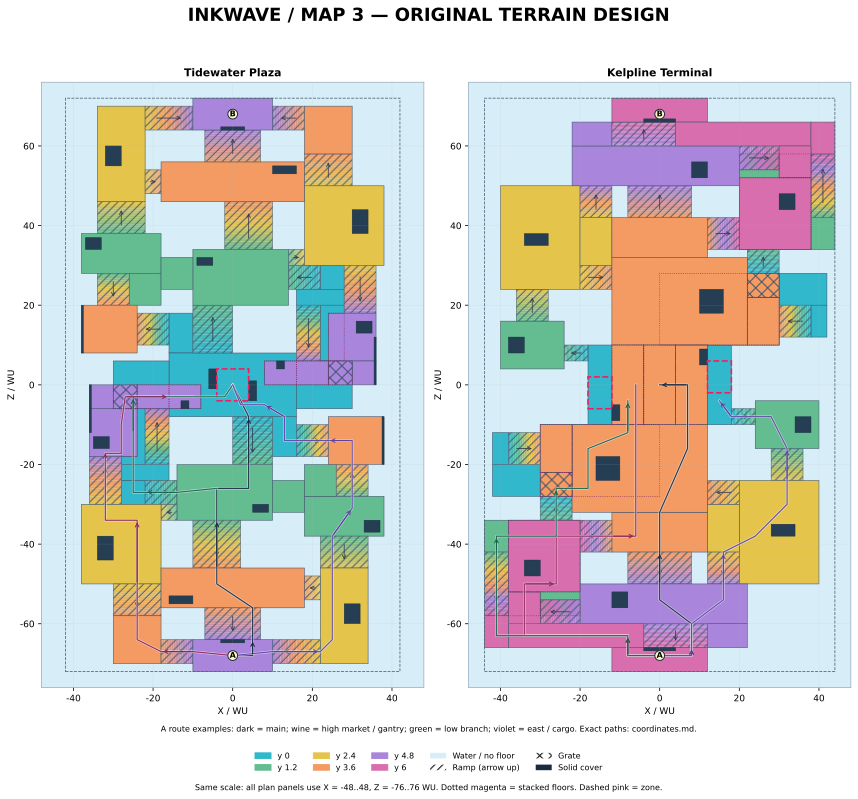

# Tidewater Plaza / Kelpline Terminal — MAP3 立体地形設計

PR #1985 の前案を再構成した、**ゲーム本体と分離した設計・検証用モデル**です。図・座標・面積・接続・ブロックアウトは同じ座標データから生成します。設計案として通行・接合・上下関係を具体化しましたが、実ゲームへ組み込んだ完成ステージ、対戦バランス検証済みの製品とは扱いません。

対象の読み取り基準は `b208addacc61009fba44ae973d5288b6f315f303`。今回の追加対象はこの `map3/` と資料の入口だけです。`inkwave-public/` の途中拡張、移動・塗り・ルールコード、既存のネイティブ移植ステージは変更していません。PRが以前から含む途中実装と、この新案は別です。

## 開く資料

| 内容 | ファイル |
|---|---|
| 高さ・経路・ステージを切り替える分離モデル | [blockout.html](blockout.html) — ダウンロードしてブラウザで開く、外部通信不要 |
| 両ステージの同縮尺全体図 | [overview.svg](figures/overview.svg) |
| Tidewater の5高度別平面図 | [tidewater-layers.svg](figures/tidewater-layers.svg) |
| Kelpline の6高度別平面図 | [kelpline-layers.svg](figures/kelpline-layers.svg) |
| 上下の空間・水位・床厚が分かる断面図 | [sections.svg](figures/sections.svg) |
| 高さ付きの接続図 | [connectivity.svg](figures/connectivity.svg) / [全接合座標・幅](connections.csv) |
| 高さ別面積と経路の高低差 | [height-distribution.svg](figures/height-distribution.svg) |
| 床・坂・障害物・スポーン・ルール物・経路の全座標 | [coordinates.md](coordinates.md) / [design.json](design.json) |
| 本家4ステージ・8画像の実観察記録 | [reference-observations.md](reference-observations.md) |
| 現行実装・ネイティブ23ステージの監査 | [source-audit.md](source-audit.md) |
| 別実装による独立検算・設計批評 | [independent-review.md](independent-review.md) / [design-cross-review.md](design-cross-review.md) |



図の青は「投影上の床がない場所」、薄灰は「その高さ以外に床がある場所」です。高架の投影があっても真下が陸地とは限りません。空中の床・下層の実床・水を、層別図と断面で併せて確認してください。全平面図の範囲を X=-48..48、Z=-76..76 WU にそろえ、縦横比を変えていません。

## 前案と実装を分けた診断

- 公開版の `maps.js` は、Tidewater 84×144、Kelpline 88×144 の大きな基底床を持つ途中拡張です。新案の実装済み地形ではありません。同じ上向き衝突面投影の方法で調べると、設定範囲の約98.94% / 100%が面で覆われています。
- 初期設計と `map2/` は別の資料です。`map2/height-audit.md` では、Tidewaterの下層の約82%が y=0/1.2、Kelplineは下層が y=0、上層が y=3.2 に集中していました。壁の追加と輪郭の小さな凹凸では、この地形上の単調さは解消していません。
- MAP3 は基底床を残して箱や二階を増やす方式をやめ、各床の高さと幅、坂の方向、戻り口、水際を初めから組み直しています。ネイティブとの面積比較のために水を埋める調整はしていません。

## 本家から学び、独自設計へ移したこと

ザトウマーケット Ver.3.0 表記のナワバリ俯瞰、ヒラメが丘団地 Ver.8.0 表記の俯瞰と公式予告由来静止画、マヒマヒ Ver.3.0 / 5.1 / 5.1低水位の俯瞰、コンブトラックのナワバリ俯瞰と公式予告由来静止画を実際に閲覧しました。動画全編の視聴、本家実機での通行計測は行っていません。各出典・日時・版・観察限界は観察記録にあります。

| 観察した特徴 | 設計への反映 |
|---|---|
| ザトウの棚の端、局所的な絞り、その先の展開面 | 坂の前後に異なる幅の待機面を作り、遮蔽端を回った後の合流位置を変える。一定幅の3本廊下にしない。 |
| ヒラメで見える高い面・低い街路・連絡床 | 高架下を本当の経路にし、下層の出口と上層への戻りを別に用意する。画像から隠れた通行可否や高さ数値は推測しない。 |
| マヒマヒの版・水位ごとに異なる床配置・面の見え方 | 水際の切れ目を意味のある選択にし、落下先と復帰を指定する。今回は動く水位を採用せず、静的な構造だけを設計する。 |
| コンブの起伏による露出・視界の連続変化 | 平面内だけで曲がらず、上り下りの途中で見る方向と合流する高さを変える。曲面や輪郭そのものはコピーしない。 |

任天堂の[Ver.8.0.0](https://support.nintendo.com/jp/switch/software_support/av5ja/800.html)には中央進入と要所での選択肢を増やす地形変更、[Ver.3.0.0](https://support.nintendo.com/jp/switch/software_support/av5ja/300.html)には遠方攻撃武器の影響力を下げるための地形変更が記されています。図形の部品数だけでなく、「どこから進入し、どこで露出し、どこへ逃げて戻れるか」を評価軸にしました。これは独自設計上の判断で、原作の配置・寸法の再現ではありません。

## Tidewater — 折れた段丘市場

5高度の床を、海へ下る一律の帯にせず、左右と前後で組み替えました。

| 場所 | 構造と選択 |
|---|---|
| 自陣 | y=4.8の出発面から、正面 y=3.6 の到着広場、西の y=3.6→2.4、東の y=2.4 に分岐。前面スクリーンの両脇に幅4の出口を持つ14幅の坂。 |
| 正面 | 到着広場から局所の12幅坂で y=1.2 の再集合広場へ下り、中央 y=0 へ進む。途中で東のテラスや西の低街路へ切り替えられる。 |
| 西市場 | y=2.4のテラスから y=4.8 の市場ホール・短い橋へ上る。その下を y=0 の街路が連続し、最小4.2の頭上空間を持つ。上り口は西テラス側と低街路側の2か所。 |
| 東展望面 | y=1.2 のテラスから外側の局所坂で y=3.6 へ上り、横向きの坂で中央の低い腕へ下る。西と同じ高架レーンを複製しない。 |
| 中央 | y=0 の盆地と左右の橋下の進入口。上層の橋端から圧をかける選択、下層を通って接近する選択、東から横向きに降りる選択が別の地点へつながる。 |

高架の金網は実床を置換し、下には空いた街路があります。橋の端からの降下は一旦端の外へ動く経路として指定し、実床を垂直に貫通する指示にしていません。各着地点からの復帰折線も個別に記録しました。4.8 WUの落下の硬直・慣性・AIの任意降下は実ゲーム未確認です。

独立レビューでは当初、選択した高所などから両スポーン中心へ10本の直線が通りました。前面スクリーンと通行幅を設計し直し、同じ10本が全て遮られることを再確認しました。スポーン全域や空中発射・敵の全位置まで守れることの証明ではありません。

## Kelpline — ずれた船溜まりと乗換デッキ

6高度を、自陣の出発、低い岸壁、貨物側、中央上層・下層に割り当てました。詳細は [Kelpline設計説明](kelpline-design-notes.md) にあります。

| 場所 | 構造と選択 |
|---|---|
| 自陣 | y=6の出発テラス、y=4.8のコンコース、y=2.4の貨物面へ分配。大きな一枚の後方広場にしない。 |
| 高い側路 | y=6のガントリーが y=1.2 の岸壁を越え、前方で y=3.6 の乗場へ横から合流。上下の進入口と保持位置が別。 |
| 低い側路 | 外周坂から岸壁に入り、y=0のサービス街路へ。高架下を抜け、低い中央へ進む。 |
| 貨物・フェリー側 | y=2.4の展開面から上層乗場へ横移動するか、y=1.2のフェリー岸壁を経て中央下層へ入るかを選ぶ。 |
| 中央 | y=3.6の実床の乗換橋、その下の y=0 の街路。床に遮られ、下層へ直接見通せない区間がある。エリアは上層投影の外の低い両脇へ置く。 |

金網は中央目標の必須通路から外し、既存の復帰坂に近い乗船バルコニーへ配置しました。金網からの戻り道を初案の約81 WUから約37.77 WUへ短縮。端からの指定降下は約28.27 WUで戻れます。床を埋める追加工事や別の迷路を作らず、落下場所と戻り口の関係を修正したものです。

最小頭上高は中央・横坂下で3.0 WU、ガントリー下で4.2 WU。静的な身体の収容は確認しましたが、特に3.0の部分はジャンプ・見上げ・壁際旋回での実カメラ評価が必要です。

## 寸法と面積 — 同じ方法で比較する値

1 WU=1 mとする較正根拠は確認できませんでした。コードのmeters表記や原典OBJの無変換読み込みは、現実のメートルや本家との単位一致を証明しません。以下は全てWU / WU²です。

比較用の幾何面積は、上向き面 `normal.y ≥ 0.68` を設定XZ範囲で切り、0.25 WU格子中心で投影和集合を数えます。現行2ステージ・ネイティブ・新案の全てで遮蔽物上面や埋まった面を含みます。新案は名目スラブから生成した面で、実ゲームのRヘルパーが生成した衝突面ではありません。

| 対象 | 設定幅×Z長 | 外接面積 | スポーン距離 | 同一方法の上向き面XZ和集合 |
|---|---:|---:|---:|---:|
| ネイティブ23ステージ中央値 | 各軸の中央値88×145（同一ステージとは限らない） | 12,480 | 134.16 | 8,037.125 |
| 現行Tidewater・途中拡張 | 84×144 | 12,096 | 134.4 | 11,968 |
| 現行Kelpline・途中拡張 | 88×144 | 12,672 | 136 | 12,672 |
| MAP3 Tidewater | 84×144 | 12,096 | 136 | 8,104 |
| MAP3 Kelpline | 88×144 | 12,672 | 136 | 9,032 |

設定境界と地形そのものの外接範囲も区別します。MAP3 Tidewaterの名目床・坂の外接範囲はX=−38..38、Z=−72..72（76×144 WU）で、84×144の設定範囲の内側です。Kelplineは88×144 WUで設定範囲と一致します。ネイティブの全衝突頂点の外接範囲はJSONに保存していますが、範囲外の背景などを含み、到達可能な床の輪郭とは見なしません。

新案の投影和集合はネイティブ中央値に対して約100.83% / 112.38%。外接規模とスポーン間隔も同程度の範囲を維持しています。「本家公式の床面積基準に合った」という意味ではありません。ネイティブ側の範囲とスポーンは移植側の推定設定で、原典実機の配置として検証済みではありません。

ネイティブの0.5→0.25 WU刻みの再計算では中央値が8,011.147→8,037.125、最大の個別変化は約1.001%。現行2ステージも0.25 WUで再計測し、Tidewater 11,968 / Kelpline 12,672 WU²で両刻み同値です（[計測結果](ordinary-quarter-metrics.json)）。新案の同一方法による和集合も両刻みで同値です。格子の収束は通行可能性や塗り面判定の正しさを保証しません。全23件、形状ファイルのハッシュ、計算式、抽出条件は [source-audit.md](source-audit.md) とJSONに記録しました。

## 設計の床面積 — 比較用の生の面積とは別

こちらは遮蔽物が接地する占有を控除し、箱の上面を地形の床に加えず、全矩形境界で正確に分割した値です。同じXZに通れる上下床がある場合は、和集合では1回、各床の合計では各階1回数えます。

| 指標 | Tidewater | Kelpline |
|---|---:|---:|
| 設計床・坂のXZ和集合（占有控除後） | 7,874.4 | 8,887.2 |
| 上下を別々に足す水平投影床面積 | 8,226.4 | 11,095.2 |
| 上下床が同じXZを使う面積 | 352.0 | 2,208.0 |
| 水平の塗装対象床候補（坂・金網・箱上面を除く） | 5,986.4 | 9,487.2 |
| 金網の投影面積（塗装対象外の案） | 72.0 | 96.0 |
| 坂の水平投影 / 斜面そのものの面積 | 2,168.0 / 2,221.626 | 1,512.0 / 1,556.974 |
| 最小の上下通路の公称頭上高 | 4.2 | 3.0 |

縦壁の塗り面、実装時の面分割・不可視面・セル丸め・ゲームのTurf集計はここに含めません。したがって上記をそのまま「実塗り面積」と呼びません。また外接面積からXZ和集合を引いた値は「どの高さにも床投影がない範囲」であり、高架下の水を含む水面全体の面積ではありません。

### 高さへの偏りを再集計

階段の途中・坂の途中・遮蔽物上面・金網を除いた、実体の水平床だけを分母にしています。

| Y | Tidewater 床面積 / 比率 | Kelpline 床面積 / 比率 |
|---:|---:|---:|
| 0 | 1,284 / 21.45% | 2,000 / 21.08% |
| 1.2 | 1,288 / 21.52% | 1,280 / 13.49% |
| 2.4 | 1,288 / 21.52% | 1,196 / 12.61% |
| 3.6 | 1,308 / 21.85% | 2,560 / 26.98% |
| 4.8 | 818.4 / 13.67% | 928 / 9.78% |
| 6 | — | 1,523.2 / 16.06% |

最多高度は約21.85% / 26.98%。高さは前後の帯だけでなく、同じZにある左右の床と上下面で分かれます。等分すること自体を品質基準とはせず、各面を上記の滞在・進入・回復・攻防の役割と対応させました。単調さの再評価では、直角の多い形状と高所の強さは残る検討点として独立レビューに記録しています。

## 確認結果と、確認していないこと

| 区分 | 実施したこと | 限界 |
|---|---|---|
| 静的座標・面積 | 図・台帳・JSONの共通生成、矩形分割面積、同高二重床・交差面・上下空間の検査 | スラブの名目形状。ゲームの衝突面生成とは別 |
| 接続 | 両マップの全床・坂が各1つの共有辺グラフへ接続。各82接合を座標・高さ・幅で記録 | 床中心間を直線に走れるという意味ではない。全平面の任意点の到達証明でもない |
| 指定経路 | Tidewater14、Kelpline12の両陣営の折線。計8,868サンプル、最大0.25 WU間隔、半径0.675・高さ1.6の保守的な身体モデルで支持・干渉違反0 | 実Actor、加速、泳ぎ、敵インク、慣性、30/60/120 Hzの操作試験ではない |
| ヤグラ候補 | ソースで確認した床・柱・乗員の寸法に基づく専用検査。回転時の隅、周囲の床と遮蔽物上面を含む高さサンプルで干渉0 | 実ランタイムの経路生成間隔・補間・得点処理・連続掃引とは別 |
| 目標 | 独立コードでスポーン、ホコ・チェックポイント・ゴール・かご・アサリ配置点を検査。3エリアの全矩形の支持、占有、別階の重複0 | 実オブジェクト全形状、投擲、得点、同期は未検証 |
| 公平性 | 地形・障害物・ルール候補を180度回転で対応。両陣営の指定折線距離も対応 | 勝率、編成、先行保持、打開力の均衡を保証しない |
| 射線 | 別実装の線分交差で代表視点を検査。Tidewaterの選択した10本のスポーン中心への線を修正 | 全位置、全方向、弾道・射程・当たり判定の試験ではない |
| 分離ブロックアウト | 同じ座標から作る閲覧用モデル。Chromiumで初期描画、XYZ経路再生、下層表示、部材座標への注視、390px幅表示を確認。5項目、ページ例外・外部通信0（[記録](browser-qa.json)） | 座標の補間と表示操作。実ゲームの描画・物理・塗りエンジンは読み込まない。390px表示は実モバイル機の性能試験ではない |
| 実ゲーム / 本家実機 | 実施していない | ゲームへの組込み・実戦評価・原典との同条件操作比較が必要 |

### 採用前に残る具体的な問題

1. **坂の変換**：現行Rヘルパーは法線方向の厚みと低い端の0.6 WU延長を持ちます。今回の名目スラブと異なるため、実装時に足元の余分な面・接合・下層への侵入・塗りセルを再検査します。
2. **カメラ**：Kelplineの3.0 WU下層は、身体が入ってもジャンプ・レンズ・probe・boomが収まるとは限りません。最高速、見上げ、壁際、射撃を含む実カメラ試験が残ります。
3. **AI**：現行navの一般的な降下上限3.4 WUに対し、指定降下は4.8 / 3.6 WUです。全主要床は坂で戻れますが、botが任意の落下を使えるかは別です。AIへ未確認の降下edgeを自動で許可しません。
4. **塗り・UI**：塗り自体は面別ですが、ミニマップは同一XZの上面に寄る制約があります。上下の味方・塗り・目標の表示と、ルールの高さ帯を整合させる必要があります。
5. **戦術・視認性**：Tidewater橋端の保持圧力、Kelpline上層の押し込み、水際の認知、短射程の接近、投擲・爆風・長射程の射線を、両陣営・複数編成・ルールごとの対戦で評価する必要があります。

## 再生成と検証

```bash
python docs/stage-redesign/map3/build.py
python docs/stage-redesign/map3/independent_validate.py
python docs/stage-redesign/map3/measure_proposal.py
```

Python 3、NumPy、Matplotlibを使用します。設計生成と検査は外部通信不要です。ネイティブ比較の再計算には、`measure_baseline.py` に記載した固定版の形状ファイルが別途必要です。`build-manifest.json` と各検査JSONに入力ハッシュを保存します。

閲覧モデルの機能確認はNode.js、Playwright、Chromiumを用いて `node docs/stage-redesign/map3/qa_browser.cjs` で実行します。通常はインストール済みの `playwright` とそのChromiumを使い、別配置の場合は `PLAYWRIGHT_MODULE` と `CHROMIUM_PATH` で指定できます。検査時は外部要求を遮断し、生成したHTMLのSHA-256、結果、画面を記録します。`blockout.html` 自体は単一ファイルで、これらの検査ツールを入れずにブラウザで開けます。

閲覧モデルにはNoto Sans JP由来の日本語フォントを必要字形に限定して同梱しました。[出典・ライセンス](font-license.txt) と [字形検査記録](font-coverage.json) を添付し、単一HTML内にもライセンスを含めています。

ゲームへ変換して採用する場合の手順は、実衝突面・面別塗り・nav・カメラ・ルール・実対戦の検査を経てから別変更として扱います。この設計追加をマージしてもよいことと、PRが元々含む途中のゲーム変更を公開してよいことは同一ではありません。
