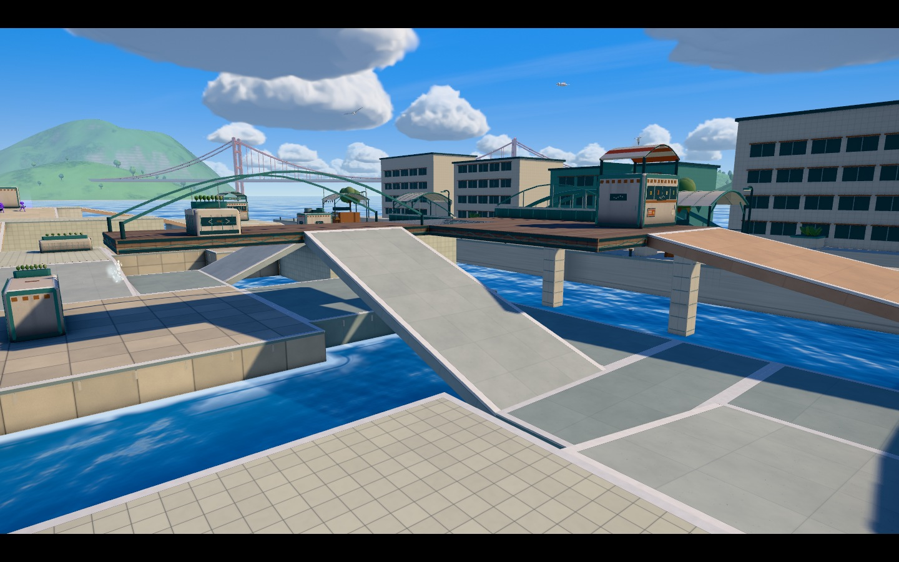
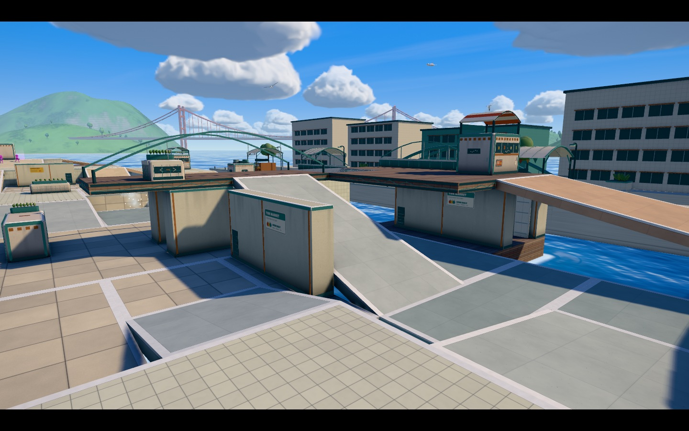
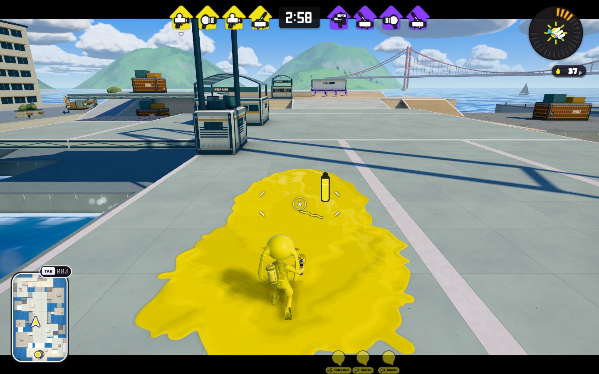
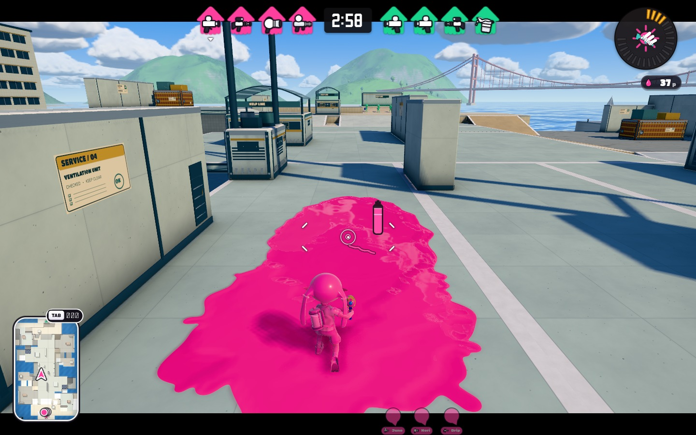

# MAP3 追補：壁・街路・岸壁でプレイ領域をつなぐ

2026-10-31 / PR #1985 / 基準 head `d57ec104668ea38af760cb0569ef326f5d585fa8`

## 改善した内容

「背景やステージ外の装飾ではなく、遊ぶ場所に壁が少なく、海が多すぎる」という追加依頼に対応した。Tidewater Plaza と Kelpline Terminal のプレイ領域へ、実際に塗れて弾を遮る壁36枚、地面38区画、坂10本を追加した。新しい12経路は既存通路へ再合流する。既存MAP3の座標記録、橋、段差、ルール目標を保持し、追加の建築を別の凍結レコードとして管理する。

**Tidewater**は市場の裏回廊、東の前庭、中央への低い街路、市場下の地面を接続した。店の長壁と段丘の建物壁が通路に接し、橋の下にも厚い壁が立つ。下道の開口は幅2.4 WU、高さ4.2 WUで、従来の横断路を通れる。

**Kelpline**は乗り場の下の地面と荷役路をつなぎ、貨物場→桟橋→サービス通路の回遊経路を作った。倉庫の側壁、乗り場の隔壁、中央橋の部分壁が長い射線を切る。壁端と既存の経路から回り込める。

追加壁の根元・笠木・柱間・閉じた保守扉を既存材質で描き、細部の投影は実壁から0.035 WU以内に収めた。主要な塗れる壁面を広く残す。背景の建物・外周の小物・native港など、対象外ステージを今回の改善物として数えていない。

実画面レビューで、埋めた通路の端から旧来の海しぶきが噴き出す不具合を発見して修正した。旧判定は上面が高さ0付近の床だけを海岸とみなしていたため、高い岸壁やランプを水面と誤認した。対象2ステージでは水面を貫く陸塊の外周を構築時に求め、実Levelで床・ランプに覆われた位置を除外する。外海のしぶきは維持し、フレームごとの地形照会は増やしていない。

## 本家の画像と比べて分かったこと

[任天堂の公式ステージ紹介](https://www.nintendo.com/jp/switch/av5ja/battle-nawabari/index.html)に掲載されたヤガラ市場・ゴンズイ地区・マサバ海峡大橋の原画像を直接確認した。

| 観察した違い | 今回の設計への反映 |
|---|---|
| ヤガラは店舗の長い壁、高台、低い道が一体になり、海は主に外縁に見える | 内部の水穴の一部を街路・市場下の地面へ置き換え、高台の壁と接続 |
| ゴンズイは歩道橋の下にも建物の壁と遮蔽のある地上空間がある | 橋の下に壁の開口と実通路を持たせ、上下の場所の関係を明確化 |
| マサバは通路に接する太い構造や壁面で、次の区画が部分的に隠れる | 中央・乗り場・貨物路へ高さ3〜5 WU級の厚い壁を配置 |
| 元PRは淡い床、白い縁、低い箱の繰り返しと水の隙間が目立つ | 地形を陸塊としてつなぎ、壁の基部と柱間で建築単位を読みやすくした |

[任天堂のVer.8.0.0更新記録](https://www.nintendo.com/en-gb/Support/Nintendo-Switch/Game-Updates/How-to-Update-Splatoon-3-2266003.html)では、マサバ・タラポートの中央への経路と拠点の選択肢、キンメダイの中央周囲の壁形状が地形変更の対象になっている。壁を進路・遮蔽・再合流に使うという判断の参考にした。今回の寸法はINKWAVEの独自設計であり、本家の実測寸法ではない。本家のマップ配置・画像・テクスチャをゲームへ転用していない。

添付研究ZIPのREADMEとTeXを確認した範囲では、主題は弾道・命中率で、地形の壁・高低差は分析の対象外だった。今回の地形設計の直接的な根拠には使用していない。

## 同じ視点の実画面

前回確定ビルド `a86a7ac2…` と今回の製品ビルドを、1440×900、昼、同じカメラ座標で撮影した。手動カメラの視点と実Actorを配置した通常プレイ視点をJSONで区別している。インク配色・Bot名はゲームが選ぶため、画素単位の完全同条件比較ではない。

### Tidewater：市場の壁と下道

| 改善前 | 改善後 |
|---|---|
|  |  |

[通常プレイ 前](built-space-evidence/before/tidewater-play.jpg) / [後](built-space-evidence/after/tidewater-play.jpg) · [全体 前](built-space-evidence/before/tidewater-overview.jpg) / [後](built-space-evidence/after/tidewater-overview.jpg)

### Kelpline：通路に接する隔壁

| 改善前 | 改善後 |
|---|---|
|  |  |

[貨物街路 前](built-space-evidence/before/kelpline-street.jpg) / [後](built-space-evidence/after/kelpline-street.jpg) · [全体 前](built-space-evidence/before/kelpline-overview.jpg) / [後](built-space-evidence/after/kelpline-overview.jpg)

## 面積と物量

| 指標 | Tidewater | Kelpline |
|---|---:|---:|
| 新しい地面 / 坂 / 壁 | 22 / 4 / 18 | 16 / 6 / 18 |
| 新しい再合流経路 | 8 | 4 |
| 床・坂で覆われない平面領域 WU² | 3,992 → 2,584 | 3,640 → 3,016 |
| 上記の減少率 | 35.27% | 17.14% |
| 実Level block数 | 301 → 345 | 176 → 216 |
| 実CPU turfArea WU² | 8,462.83 → 9,982.01 | 11,351.95 → 12,381.63 |
| 装飾の描画メッシュ数 | 7 → 7 | 8 → 8 |
| 装飾の三角形数 | 130,596 → 135,836 | 128,102 → 133,342 |

平面領域は設定境界内で床・坂のXZ矩形和集合を0.25 WU格子で測り、上下の重なりは一度だけ数えた値。画面に写る海のピクセル割合、通行可能面積、塗り得点面積とは異なる。CPU turfAreaも独立した実装指標として示す。描画メッシュ数は装飾のみで、フレーム全体の描画数や実機FPSを意味しない。

## ゲーム動作の検証

追加建築に対する構造・挙動・美術・ミニマップと既存回帰の**58テストが成功**した（失敗0、skip0）。

- 既存26経路と追加12経路。歩行・泳ぎ・射撃中移動を30/60/120 Hzで計336通行。既存市場の金網2経路では泳ぎを通行ではなく落下検査へ分離し、既存228＋追加108として数える。
- 既存848件と新設床152件、計1,000件の有向経路探索。
- 既存金網降下12件、落水6件。追加経路からの敵スポーン接近12件でも既存排除範囲を維持。
- 基底では開いていた8射線を実壁が遮る。実WeaponRunnerから発射した4着弾でCPUインクが壁へ付く。
- 新しい壁の壁登り12件、既存54＋新しい36＝90カメラ条件でlens/near-planeの固体侵入なし。
- 新しい下道と上層の同じXZで、上下別のインク所有、実Actorに追従するミニマップ、層のキャッシュを確認。
- ヤグラ1,196位置・64,584固体照会・4,784乗員カプセルに干渉なし。実Botのエリア確保、ヤグラ移動、ホコの拾得・発射・チェックポイント、両ステージのアサリ得点を確認。
- 塗れる主面・壁の外形と装飾の境界、両軍180度対称、追加床の同高重複なし、共有テクスチャの寿命を確認。
- 新しい衝突面に合わせて2ステージのAOを再生成し、face hash・collider digest・PNGの一致を確認。
- 海しぶき638候補すべての実ambient発生を確認。乾いた床・ランプ・上層に覆われた発生点0、毎フレームの追加地形照会0。対象外ステージは既存の海岸判定を維持。

射撃検査初版はテスト入力がaimDirだけで、Actor更新により既定yaw/pitchへ戻った。テストの正式入力を修正し、最終の追加挙動8件は全成功。ゲーム実装の閾値緩和やskipは行っていない。自律AIのNode VMログには既存のoptional source motion import警告があり、ブラウザのページ例外とは分けて記録している。

## 最終製品ビルドでの確認

通常のminified製品ビルド、互換性チェック、起動予算が成功した。最終コードを使ったChromium/SwiftShaderで、Tidewater/Kelplineのナワバリ・エリア・ヤグラ・ホコ・アサリ、計10組すべてがplayingに到達。ページ例外0、HTTP失敗0、古いAO警告0。SwiftShaderの `KHR_parallel_shader_compile` 未対応警告が1件あり、警告0とは扱わない。

通常の射撃入力で塗りcountはTidewaterが0→517、Kelplineが0→503へ増加した。両ステージの橋下でlowerミニマップを確認。ルール切替では同じアートを再利用し、ステージ間3回の切替で旧アートのdetachとgeometry/materialの破棄を確認した。各ルールの試合終了までの検証ではない。補助撮影10枚のハッシュも確認し、比較用として保存する画像は別途before/after各6枚にまとめた。

| 記録 | 識別子 |
|---|---|
| 比較元PR head | `d57ec104668ea38af760cb0569ef326f5d585fa8` |
| 地形・美術・AOの実装 | `3f26301ef553e57a37eb8a0a58d29d629feeeb66` |
| 実動作検査・海しぶき修正 | `213efe3a962aa61d61d6a663e2204d708ec39c5b` |
| Before build revision | `a86a7ac2cba38b551bf47f974ac0dca56e006e75f55195ff7f8b76778014d804` |
| After build revision | `87563b318e4dd290914e3db5a248bfcd919526f4520f66e4cafcebea9293ba2c` |
| After content hash | `dfb970c90250495aa016af0168091445a9cd56a358fb92af92024d771e87ec8c` |

PRはDraftのまま更新し、mainへのマージは行わない。上記は保存したローカル実行結果であり、GitHubホストCIの成功とは区別する。

## 保存した証拠

- [検証の集計・ビルド識別子](built-space-evidence/verification-summary.json) / [最終ブラウザの生データ](built-space-evidence/browser-validation.json)
- [製品ビルド](built-space-evidence/production-build.log) / [起動予算](built-space-evidence/startup-budget.json)
- [既存地形・追加構造10件](built-space-evidence/terrain-structure-tests.log)
- [形状・面積・入力ハッシュ](built-space-evidence/geometry-metrics.json)
- [追加経路・実射撃・壁登り・カメラ](built-space-evidence/architecture-gameplay-tests.log)
- [ルール・既存移動・自律AI](built-space-evidence/ranked-movement-tests.log)
- [造形・寿命・AO一致](built-space-evidence/art-tests.log) / [上下の実塗りとミニマップ](built-space-evidence/minimap-tests.log)
- [AO生成](built-space-evidence/ao-bake.log)
- [海しぶきの外周・実ambient・対象外分離](built-space-evidence/water-edges-tests.log)
- [改善前の実ブラウザ記録](built-space-evidence/before/liveliness-validation.json) / [改善後](built-space-evidence/after/liveliness-validation.json)

物理iPad/SafariのFPS、4対4の武器・ルール別バランス、本家実機との同条件操作比較は未実施。ソフトウェア描画のブラウザ検証を物理端末の性能保証には使わない。
