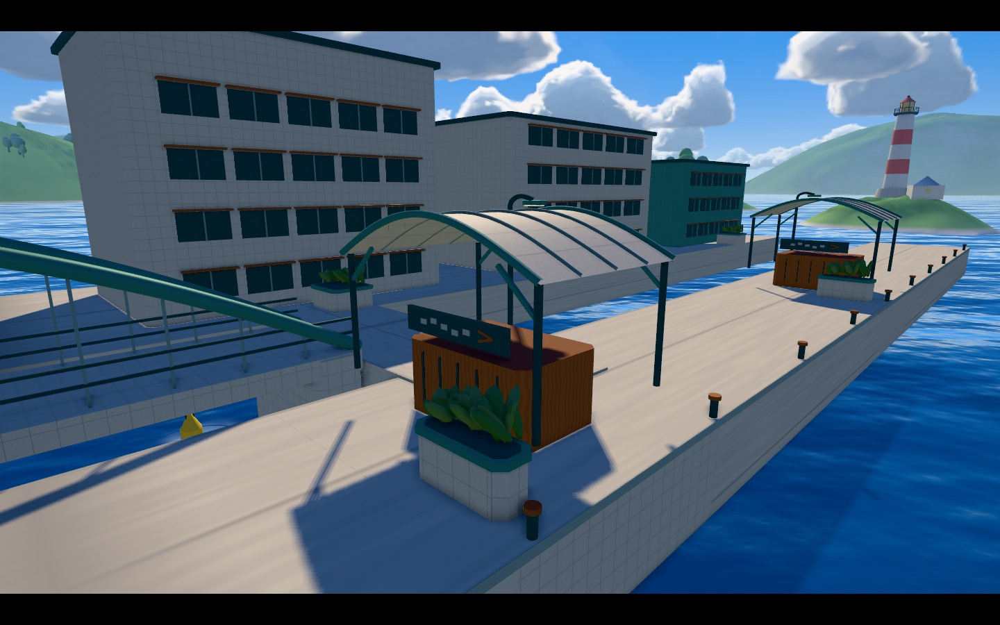
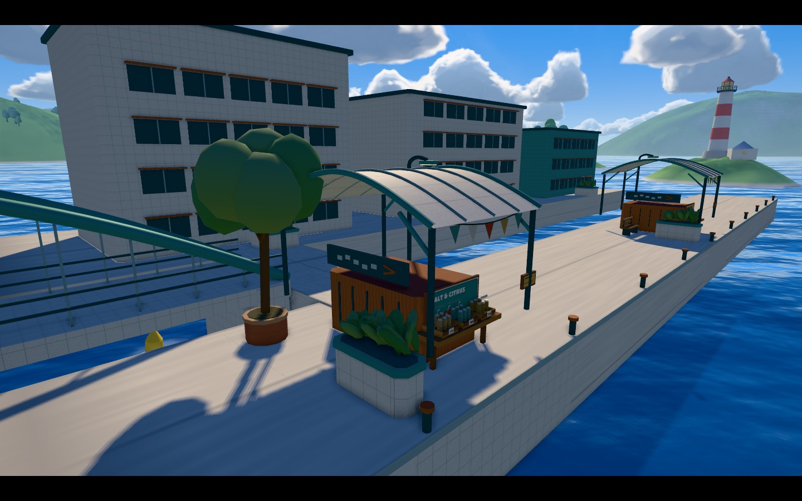
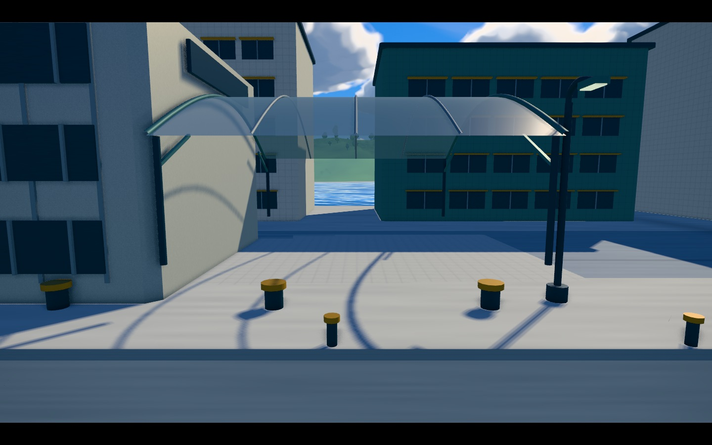
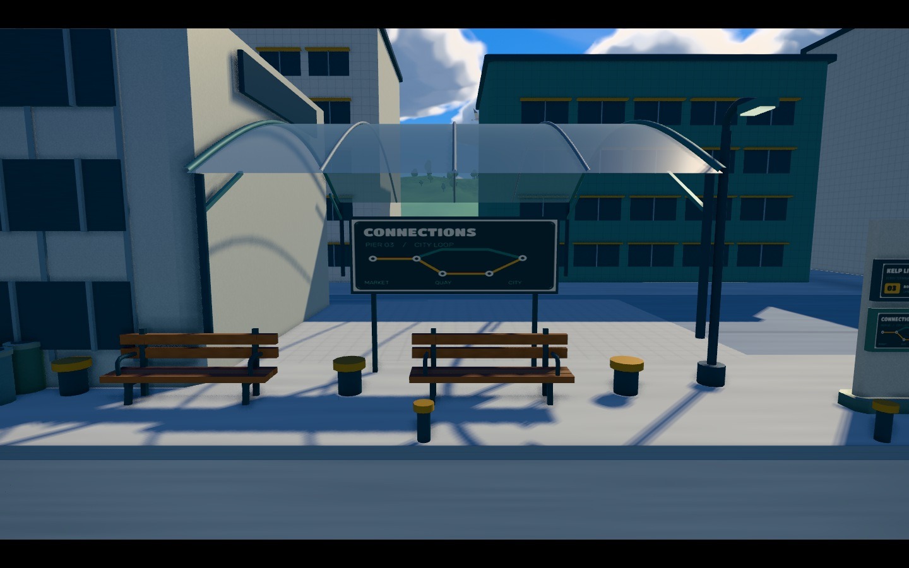

# MAP3 景観追補：市場とターミナルの生活感

2026-10-31 / PR #1985 / 実装コミット `d6bafc28fbaaeef6c516ce7981f0ee2d94c9b83d`

## 結果

Tidewater Plaza と Kelpline Terminal の既存地形へ、場所の用途が読める美術を追加した。市場は商品・店名・布・木・植栽、ターミナルは番線・乗換図・待合・荷役・保守設備を中心にした。通常プレイと近景の両方を製品ビルドで確認し、強すぎた床の反射、横長看板の文字の伸び、ベンチと既存係留柱が重なって見える配置を修正した。

基準は PR head `2258fb970d8741dd1fe6a90e9de833c9757474ae`。地形の寸法・経路・当たり判定・塗り領域は維持。Native ステージ専用ソースと資産への変更はない。PR は Draft のまま更新し、main へのマージは行っていない。

## 同じ視点の比較

以下は生成イメージではなく、通常の minified 製品ビルドを Chromium / SwiftShader で実行した画像。比較用の固定カメラであり、実機 FPS の測定ではない。各画像のカメラ位置・実 actor 位置・描画資源数・SHA-256 は JSON に保存した。

### Tidewater：商品と布旗のある市場

| 改善前 | 改善後 |
|---|---|
|  |  |

### Kelpline：路線案内と木製ベンチのある待合所

| 改善前 | 改善後 |
|---|---|
|  |  |

通常プレイの比較： [Tidewater 前](liveliness-evidence/before/tidewater-play.jpg) / [後](liveliness-evidence/after/tidewater-play.jpg)、[Kelpline 前](liveliness-evidence/before/kelpline-play.jpg) / [後](liveliness-evidence/after/kelpline-play.jpg)。

橋と全体構成： [Tidewater 後](liveliness-evidence/after/tidewater-bridge-context.jpg)、[Kelpline 後](liveliness-evidence/after/kelpline-gantry-context.jpg)。屋台・小屋の近景： [市場](liveliness-evidence/after/tidewater-market-stall.jpg)、[乗り場](liveliness-evidence/after/kelpline-boarding-kiosk.jpg)。

## 実装した内容

| 場所 | 内容 |
|---|---|
| Tidewater の既存屋台 | 商品シルエット、メニュー、納品票、店名。庇は市場の赤茶・市民広場のくすんだ緑・到着側の黄土で描き分けた。 |
| Tidewater の外周8店 | 果物・パン・飲料・布地の4業種。木のカウンター、浅い商品籠、値札、折り畳んだ布、庇の布旗。 |
| Tidewater の広場 | 掲示板、4本の鉢植え樹木、4台の外周ベンチ。既存プランターの均等な球列を、重なった葉群へ変更。 |
| Kelpline の既存小屋 | 駅名、番線、乗換図、運行案内、票券返却口。横長の駅名は共有画像のタイトル部分を切り出し、文字の縦横比を維持。 |
| Kelpline の貨物・設備 | 荷締め帯とバックル、配送ラベル、点検票、限定した補修塗装。 |
| Kelpline の外周 | 木製ベンチ、時刻表、桟橋標柱、分別ごみ箱、低木と樹木、救命環、ホースリール、パレットとケーブルドラム。 |
| 両ステージの床 | 既存のインク対応材質を用途別に選択。市場の木床、広場のタイル・舗石、保守街路のアスファルト、貨物床、滑り止め床、乗り場の艶消しコンクリート。床の上へ画像板を重ねていない。 |

近景の小物は既存遮蔽物と看板の実体範囲内、外周装飾はプレイ範囲外へ配置した。広い塗り面と移動経路へ新しい物体を置かず、常時アニメーション・追加光源・新しい半透明材質は導入していない。

看板はオリジナル8種類と駅名用の切り出しを、512×512の共通アトラス1枚へまとめた。ゲーム内でフォントを読み込んだり Canvas 描画したりせず、リポジトリ内の OFL フォントで事前生成する。生成元は `scripts/generate-map3-sign-atlas.py`、実行時は静的 RLE を一度だけ RGBA に展開する。複数の MAP3 所有者で共有し、最後の破棄時に解放する。

## 物量と維持した範囲

| 指標 | Tidewater 前 → 後 | Kelpline 前 → 後 |
|---|---:|---:|
| 装飾の描画メッシュ数 | 6 → 7 | 6 → 8 |
| 装飾の三角形数 | 113,656 → 130,596 | 113,452 → 128,102 |
| 装飾 geometry buffer 増分 | +1,373,120 B | +1,361,324 B |
| 実 Level block 数 | 301 → 301 | 176 → 176 |
| 実 Paint cell 数 | 305,104 → 305,104 | 389,000 → 389,000 |
| 実 CPU turfArea (WU²) | 8,462.82947 → 同値 | 11,351.95189 → 同値 |

既存の美術予算 **8描画メッシュ未満または同数 / 150,000三角形未満**を満たした。共通アトラスの基底 RGBA は 1 MiB。上の数値は装飾の物量であり、フレーム全体の負荷や実機 FPS の改善率を意味しない。

起動予算検査は前後とも成功。初期 JS リクエスト数は146のまま、初期 JS bytes は1,890,444 → 1,890,977（+533 B）。プリキャッシュは8,078,658 → 8,228,450 B（+149,792 B）。写真などの本報告の証拠ファイルはゲーム配布物に含まれない。

## 検証

- **20件の関連テスト成功**：造形・skin境界・ルート空間・180度対称・AO一致・資源寿命9件、実地形8件、実塗りと上下ミニマップ3件。
- 共有アトラスも含め、2所有者の一方だけを破棄しても生存し、最後の所有者で一度だけ解放されること、再入場時に生存する新しいアトラスが生成されることを確認した。
- 既存の AO face hash、全 collider digest、PNG bytes と一致。追加の物理形状はなく、AO 再生成は不要。
- 通常 minified ビルド、11.3.0 upstream 互換性検査、起動予算検査、図面・座標レポートの再生成一致が成功。
- 製品ビルドで2ステージが playing、実発射による塗り、通常 HUD、近景・外周・橋の計8画角を確認。改善前8枚と合わせて16画像を保存。ページ例外0、HTTP失敗0、古いAO警告0。
- 通常プレイ撮影では初回スポーン飛行が自然に着地するまで待ち、指定位置から3 WU未満であることを確認。初回の撮影条件不備は修正・再撮影しており、最終画像に混在させていない。
- 独立した美術レビューで、床の大きな反射、看板比率、ベンチ配置を指摘・修正した後、最終8画角を再確認した。
- GitHub の実ツリーを読み戻し、実装コミットの変更が意図した10ファイルだけであること、その他11,330ファイルが元の blob SHA のままであることを確認した。

今回の追補ではルールの実装を変更していない。以前の10ルール起動検査の結果を、今回再実行したものとしては扱わない。物理 iPad / Safari の FPS、全インク配色・夕方の混戦、4対4の対戦評価は今回未測定。

### 最終ビルド

- revision: `a86a7ac2cba38b551bf47f974ac0dca56e006e75f55195ff7f8b76778014d804`
- content hash: `a765c9e89155153db865d48bce17ea280d58b01abf545983984768838946fc04`
- 検査環境の警告：`KHR_parallel_shader_compile` 非対応。ブラウザ検査の記録に保持している。

### 証拠

- [改善前の実ブラウザ記録](liveliness-evidence/before/liveliness-validation.json)
- [改善後の実ブラウザ記録](liveliness-evidence/after/liveliness-validation.json)
- [検証まとめ](liveliness-evidence/verification-summary.json)
- [造形テスト](liveliness-evidence/art-tests.log) / [地形・塗りの回帰テスト](liveliness-evidence/regression-tests.log)
- [製品ビルド](liveliness-evidence/production-build.log) / [起動予算](liveliness-evidence/startup-budget-after.json)
- [GitHubソース照合](liveliness-evidence/github-source-verification.json)

## 参照と設計判断

[任天堂のステージ紹介](https://www.nintendo.com/jp/switch/av5ja/battle-nawabari/index.html) のヤガラ市場・ゴンズイ地区、[タカアシ経済特区／オヒョウ海運の公式紹介画像](https://www.nintendo.com/jp/topics/article/c365f79f-5fff-406a-81c5-50b25af8a349)を参照した。「屋台で扱う物が分かる」「居住・交通・荷役の用途が形に現れる」という観察を、独自の店・路線案内・道具へ落とし込んだ。特定の原作マップの配置・テクスチャを複製したものでも、原作の挙動と同等であると確認したものでもない。

添付の `splatoon3_research_v3_audited.pdf` と `splatoon3_research_v3_sources.zip` は射撃・弾道・命中率の研究であり、今回の景観美術の直接的な出典には使用していない。
