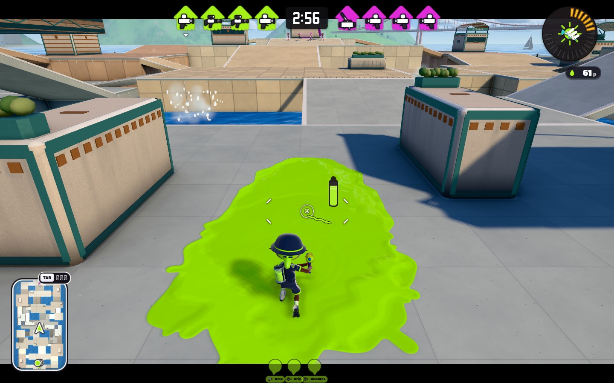
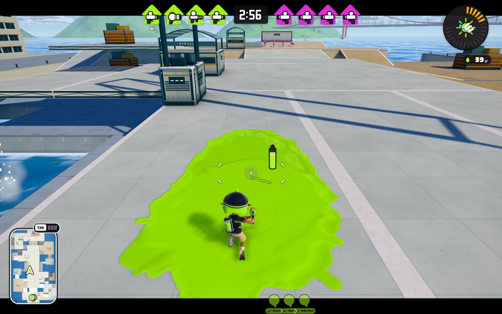

# PR #1985 — Tidewater / Kelpline 実ステージ実装

2026-10-31。分離して完成させた MAP3 の地形を、利用者の追加指示に従って公開版 `inkwave-public/` の通常ステージ `tidewater` / `kelpline` へ実装した。橋、遮蔽物の造形、材質、周辺建築、衝突、塗り、ミニマップ、AI、ルール物まで接続する。分離設計の `design.json` と図面は保存し、今回の実装・検証を本書で区別する。

**実装と、下記の静的・実ロジック・製品ビルドのブラウザ検証まで完了した。人間同士の全ルール対戦、物理端末での性能、本家実機との同条件操作比較は未実施であり、「商用品質を全面保証した」という判定にはしない。** GitHub の反映先は [PR #1985](https://github.com/rhgrive3/actions/pull/1985)。main への統合・一般公開の状態は PR の履歴と区別する。

## 入口と画像

| 内容 | 成果物 |
|---|---|
| 実ゲームの通常カメラ・塗り・HUD | [Tidewater](runtime-evidence/tidewater-play.jpg) / [Kelpline](runtime-evidence/kelpline-play.jpg) |
| 実ゲームの橋を見渡す検査カメラ | [Tidewater](runtime-evidence/tidewater-bridge.jpg) / [Kelpline](runtime-evidence/kelpline-bridge.jpg) |
| 実ゲームの橋下・通常カメラ | [Tidewater](runtime-evidence/tidewater-underpass.jpg) / [Kelpline](runtime-evidence/kelpline-underpass.jpg) |
| 実ゲームの俯瞰と夕方 | [Tidewater 全体](runtime-evidence/tidewater-overview.jpg) / [Kelpline 全体](runtime-evidence/kelpline-overview.jpg) / [Tidewater 夕方](runtime-evidence/tidewater-dusk.jpg) / [Kelpline 夕方](runtime-evidence/kelpline-dusk.jpg) |
| 追加した造形・衝突の同縮尺図と断面 | [runtime-art-plan.svg](runtime-art-plan.svg) / [runtime-art-sections.svg](runtime-art-sections.svg) |
| 実装から抽出した装飾座標・材質・境界 | [runtime-art-coordinates.json](runtime-art-coordinates.json) |
| 元の床・坂・経路・高度の設計 | [設計記録](README.md) / [全体図](figures/overview.svg) / [Tidewater 高度別](figures/tidewater-layers.svg) / [Kelpline 高度別](figures/kelpline-layers.svg) / [断面](figures/sections.svg) / [接続](figures/connectivity.svg) |
| 本家の観察、素材決定、第三者レビュー | [参照画像の観察記録](art-reference-observations.md) / [art-direction.md](art-direction.md) / [runtime-art-review.md](runtime-art-review.md) |
| 地形・移動・AI・ミニマップの実装詳細 | [runtime-terrain.md](runtime-terrain.md) |
| 同一手法による実装面積、ブラウザ生データ | [current-runtime-common-metrics.json](current-runtime-common-metrics.json) / [browser-validation.json](runtime-evidence/browser-validation.json) / [startup-budget.json](runtime-evidence/startup-budget.json) |
| 最終ビルド・実行記録・追加入力資料 | [verification-summary.json](runtime-evidence/verification-summary.json) / [添付研究PDF・ZIPの関連性確認](attachment-research-audit.md) |





画像は実ゲームの描画である。`play` / `underpass` は通常 CameraRig、`overview` / `bridge` / `dusk` は検査用の任意カメラ。撮影ではボットを止め、指定した支持床へプレイヤーを移している。通常の発射処理で塗ったことと、歩行入力だけでその場所へ到達したことは別の検証にする。カメラ座標、塗りセルの増加、build revision、画像 SHA-256 は JSON に保存する。

## 本家から観察して採用した考え方

追加調査では **Crableg Capital、Hammerhead Bridge、Shipshape Cargo Co.、Hagglefish Market、Manta Maria、Flounder Heights、MakoMart** の7画像を実際に視認した。出典台帳の英語名と対応させて記録する。画像の取得日と撮影版は別で、発売前宣伝画像を現在の全ルール配置として扱わない。

参考にしたのは、(1) 梁・縁材・支持材が床の構造を説明すること、(2) 広い塗り面の模様を抑え、売店や保守設備の垂直面に細部を集めること、(3) 安全色や金属の色を用途に沿って反復すること、(4) 周辺建築が用途と場所を伝えること、(5) 上下の通路を別の射線と復帰先にすること。元のアセット、ロゴ、看板、ステージ配置を複製していない。

任天堂の [Ver.8.0.0 更新記録](https://support.nintendo.com/jp/switch/software_support/av5ja/800.html)は、マサバの中央への経路や要所の選択肢を増やす変更と、複数ステージの小変更を明示している。前回の [地形観察記録](reference-observations.md) と今回の [造形観察記録](art-reference-observations.md) は、版・出典・画角・見えない部分を個別に記録する。動画全編の視聴や、本家の寸法・通行可能性の実測は行っていない。

追加で提供された54ページの `splatoon3_research_v3_audited.pdf` と50項目の sources ZIP も確認した。主題は弾道・ブレ・命中率・TTKで、実ステージの高さ・壁はモデル範囲外と明記する。PDFの「50 DU = 5 m」はその射撃モデルの単位規約であり、INKWAVE WUとの較正を与えない。今回のWU表記や地形寸法をその記述から変更していない。ページ・ハッシュ・確認範囲は関連性確認に記録した。

## 2つの異なる場所として完成させた構造

### Tidewater Plaza — 段丘市場と短いアーチ橋

5高度の街区を局所の坂でつなぎ、自陣から中央へ下る経路、西の市場へ上る経路、東の展望面から横向きに中央へ入る経路を分けた。西市場の y=4.8 の橋の下には y=0 の街路があり、別々の入口・出口・上り直す坂を持つ。全幅が一斉に段上がりする地形にはしていない。

実際に渡れる橋へ、細い青緑のアーチを左右一対ずつ設置した。アーチ中心線の頂点は y=7.8、衝突の保守的外形は最大 y=7.875。四隅の小さい柱と少数の吊材で橋を識別し、両端の出入口と指定した降下口を開けている。橋下の天井を深い装飾梁で狭めず、薄い下面パネルで構造を表現する。

遮蔽物には、曲面の縞庇を持つ売店、前側へ乗れる植栽付きの腰掛け、筋交い付きの積み荷、二つの円形ファンを持つ設備を割り当てた。既存の単純な箱に細い枠を付けただけだった初期アートは、実描画レビューで棄却して作り直した。水上の市場には実衝突を持つ4本の支持柱を置き、下層街路を塞がない位置に限定する。

### Kelpline Terminal — 乗換デッキと保守岸壁

6高度の出発面、コンコース、荷役側、渡船側、中央上層と下層を組み合わせた。上層は射線と乗換、下層は接近と横断、外側は別方向からの合流と復帰を担う。金網は通常床の上に重ねず、その区間の床を置換している。ヒトは立ち、イカと弾は下の実床へ通る。

中央には高い鋼製の斜め門形フレームを2本設置した。柱は既存の橋端遮蔽物内に収め、実 OBB の横梁下面を y=12.76 に置いた。y=3.6 の床から9.16 WUを空け、広い屋根を張らずにターミナルの輪郭を作る。両ステージで同じ橋の形を複製していない。

設備は青灰色の保守箱、円形ファン、ガラス付きの小屋、荷役用の積み荷、端部金具とボルトを中心にした。外周は独立した建物の島を並べる初期案から、岸壁・建物列・渡船待合所が連続する構成に変更した。遠景は境界外に離して置き、行ける床として誤認させる見えない支持床を作らない。

## 確定した材質・色・実装上の扱い

| 用途 | Tidewater | Kelpline |
|---|---|---|
| 石・広い基調面 | 温かい石色 `#e7dfcd` | 淡い灰緑 `#d9ddd3` |
| 構造の暗部 | 深い灰緑 `#435b5b` | 濃い青灰 `#344e5c` |
| 橋・設備の主アクセント | 青緑 `#6c9b92` | 鈍い青緑 `#5e8586` |
| 限定する暖色 | 焼物・木質 `#b77f59` | 黄土色の金具 `#c6a057` |
| 金属の明部 | `#bdc6bb` | `#a9b6b9` |
| ガラス系 palette 値 | `#a6c2bd`（定義のみ、現在の描画では未使用） | `#93afb6`（半透明の庇に使用） |

これは実装のアート用 palette であり、塗り床の全ピクセルがこの色になるという指定ではない。通常床と坂は既存の Level 材質と塗りシェーダーを使う。主要坂は控えめなコンクリート、市場床は舗装・木質、荷役側は作業床として区別し、インクより強い細密模様で全面を覆わない。

アートの石は roughness .84、金属 .51 / metalness .35、木 .88、ゴム .95、植栽 .93、庇 .64、ガラス .38 / opacity .73。石・金属・木の64×64の微細テクスチャ3枚は手続き生成・共有し、外部アセットの通信を増やさない。各ステージのアートを6メッシュへまとめ、毎フレームのアート更新や追加の点光源を導入しない。

アートの描画は Tidewater 113,656 / Kelpline 113,452 三角形。これは追加アートだけの数で、ゲーム画面全体の描画負荷ではない。実ブラウザの全体 draw / triangle 数は画像ごとの JSON にあり、ソフトウェア描画の結果を端末 FPS に換算しない。ステージ切替で旧アートの描画に使用した6 geometry / 6 material が解放されること、共有テクスチャの最後の所有者での解放を確認する。

## 寸法と面積 — 混同しない4つの集計

1 WU と現実の m の較正根拠は確認できないため、長さは WU、面積は WU²で記載する。境界矩形、上向き衝突面の投影和集合、設計通行床、塗りセル面積を同じ値として扱わない。

| 指標 | Native 23ステージの中央値 | Tidewater 実装 | Kelpline 実装 |
|---|---:|---:|---:|
| 設定外接矩形の面積 WU² | 12,480 | 12,096（84×144） | 12,672（88×144） |
| 設定スポーン中心間 WU | 134.16 | 136 | 136 |
| 共通手法による上向き面 XZ 和集合 WU² | 8,037.125 | 8,104 | 9,032 |
| 実装の上向き面 XZ 投影の単純和 WU² | この表では未比較 | 8,990.71 | 12,049.98 |
| 実 PaintSystem の turfArea WU² | 同条件未算定 | 8,462.83 | 11,351.95 |

共通手法は、固体衝突面のうち法線 y≥.68 を選び、設定境界へ切り、.25 WUの格子中心で投影和集合を算定する。箱の上面、重なって埋まった面、橋部材・屋根・手すりの上面も対象となるので「全て歩ける床」とは呼ばない。今回の実 Level と全アート collider を再抽出した値であり、ネイティブ中央値に対する比は約1.008 / 1.124。装飾や低端延長で面の単純和は増えるが、この解像度での投影和集合は凍結設計と同じだった。

ネイティブは既存の23ステージの抽出記録を再利用し、117件の LFS hash / size と不変のソース・資産パスを照合した。今回もう一度本家実機や native バイナリを計測したとは扱わない。範囲・スポーンは移植側の設定である。前回の .5→.25 WU 比較では個別ステージの最大差約1.001%があり、格子誤差と定義差を残す。

| 凍結設計の床だけの集計 | Tidewater | Kelpline |
|---|---:|---:|
| 遮蔽物占有を控除した床 XZ 和集合 | 7,874.4 | 8,887.2 |
| 各階を別々に足した床 XZ 投影 | 8,226.4 | 11,095.2 |
| 同一 XZ に異なる階の床がある面積 | 352 | 2,208 |
| 坂の水平投影 / 実斜面積 | 2,168 / 2,221.626 | 1,512 / 1,556.974 |
| 金網面積 | 72 | 96 |
| 最小の名目頭上高 | 4.2 | 3.0 |

上表は `design.json` の名目床と遮蔽物からの厳密な矩形分割であり、新しい橋柱の床占有まで控除した最終プレイヤー可動面積ではない。実装の衝突面を抽出する共通指標、実塗りセル、実身体の通行検査を併記して限界を示す。塗りの上下セルも別々で、面積の和は XZ 和集合より大きくなる。実 scoring の水平投影セル面積はさらに別で、8,408.05 / 11,305.99 WU²である。

### 高さと単調さの最終再評価

| 水平床の高度 WU | Tidewater の平床比率 | Kelpline の平床比率 |
|---|---:|---:|
| 0 | 21.45% | 21.08% |
| 1.2 | 21.52% | 13.49% |
| 2.4 | 21.52% | 12.61% |
| 3.6 | 21.85% | 26.98% |
| 4.8 | 13.67% | 9.78% |
| 6.0 | — | 16.06% |

分母は名目の水平な固体床で、坂、金網、遮蔽物の頂部を除く。丸めで100%からわずかにずれる。凍結設計の全床と全坂の高度が公開版の生成データに一致することを検査し、装飾の屋根や箱を新しい床高度として水増ししない。Tidewater の最多高度は21.85%、Kelplineは26.98%。本家の基準値を作って合否を決めた値ではなく、以前の y=0 / 一律二階への偏りを避けたかの内部監査である。[配置と分布図](figures/height-distribution.svg)を参照。

各高度は両端と中央に一律の横帯として置かず、横向きの坂、下層出口、異なる幅の待機面で役割を変えた。部品数の多さを複雑さの代わりにせず、通常カメラから次の入口と主要な橋を識別できることをレビューした。短射程の打開、長射程の保持、両軍の勝率については、人間同士の対戦による再評価が残る。

## 実装時に見つけて直した問題

- **坂の厚さ**：通常の R をそのまま使うと下層へ侵入する。薄い坂へ変換し、法線方向の厚みを補正して垂直厚 .6 WUを保った。既存 R の低端 .6 WU延長は残し、実 OBB と接合を検査した。
- **AI の探索上限**：旧6,000回の探索では到達可能な14件が失敗した。MAP3だけ12,000回を指定し、全床と指定経路の848件の有向探索を通した。他ステージの既定値を変えない。
- **アサリの経路判断**：見通しのないかごを、歩行経路があっても AI が諦めた。MAP3に限り支持・身体空間・A* を確認する目標経路を接続した。投擲と得点は既存の実処理を通し、両ステージの60秒試験で拾得→パワー化→投擲→得点を確認した。
- **ヤグラが別階へ浮く**：単に XZ の最高面を取ると、Kelpline の門の横梁を床と誤認し、ヤグラが約 y=13.64 へ持ち上がった。設計の経路高度と対象床・坂を使って支持面を選び、装飾屋根・別階を除外した。実床の傾斜には追従するが、障害物を床として持ち上げて衝突を隠さない。
- **ルールの高さと攻撃先**：エリアは y±.35 の帯を使い、別階の塗りを数えない。設計の「自陣のかご・ゴール」とルール配列の「攻撃側の目標」の向きを区別して接続した。
- **上下のミニマップ**：上面と下層の塗り投影を分け、実際に橋下へ入ると .18秒の安定判定後に下層へ切り替える。上下の塗りセル、テーマ、向きのキャッシュ更新を検査した。全アイコンの在階表示と任意の手動階選択は未実装。
- **古い影と小物**：旧ステージの dressing は対象2ステージで停止し、古い位置の衝突物を残さない。全追加 collider を含めて AO を再焼きし、face hash、完全な collider digest、PNG digest を検証する。

## 検証結果の層を分ける

| 層 | 結果と範囲 |
|---|---|
| 静的設計・計算 | 同縮尺の層別図、座標、接合、面積、180度対称性。凍結設計ハッシュと公開データ一致。元の分離モデルを保存 |
| 実 Level / Physics | 50坂の実 OBB、26経路10,770点の支持・身体空間、6断面の頭上高。全追加アート collider 込み |
| 実 Actor | 歩行26・泳ぎ24・射撃移動26経路 ×30/60/120 Hz =228通行。約224,532 tick。12金網降下、6水死。金網経路をイカ連続支持と誤って扱わない |
| 実 CameraRig | 地上・ジャンプ・yaw・pitch の54条件、lens / near-plane の固体侵入0。全位置・全ブキのスコープ等の保証ではない |
| 実 Nav / Bot / Ranked | 848有向探索。金網のヒト進入と落下後の復帰。両ステージのアサリ得点、Tidewaterのエリア・ヤグラ・ホコ自律操作 |
| ヤグラ連続経路 | 1,196サンプル、64,584固体照会、4,784乗員カプセル。柱・床・乗員の干渉と別階への誤上昇を拒否 |
| アート・資源 | 実ジオメトリの有限値、境界、全追加衝突の回転対称性、現在6メッシュ・上限8メッシュの予算、所有者の破棄、AO整合性 |
| 製品ビルドの実ブラウザ | 両ステージのナワバリ、エリア、ヤグラ、ホコ、アサリが playing。実発射の塗り増加、下層選択、ステージ切替、夕方の描画。ページ例外・HTTP失敗・古いAO警告0 |
| 原典実機・対人対戦 | 未実施。今回のロジック、ソフトウェアGPU、静止画レビューで代用しない |

テスト名や数を合算して全ゲームの網羅率にはしない。新地形と無関係な旧 y=-2 dry trench 等の回帰は、旧形状を明示した fixture で保持する。旧MAP2の坂や位置を参照する既存テストは、実処理の検証目的を保って現行座標へ移す。失敗した検査の閾値を下げたり、古いレコードを現行成功と読み替えたりしない。

最終配信物の content hash は `b243a420ac7daf666704dbaaa2cd6c54224ec6d5afa7cac33129e29c3a24926d`、immutable build revision は `d9cf386e6bae56dc14479a8daf7a23a71a60b9cfa76b68df78ff04dc85319b24`。GitHubのコミットSHAとは別である。実ブラウザはこのrevisionを読み、10画像すべてのバイトハッシュを再照合した。初回は任意ミニマップが既定で無効な検査設定、次に俯瞰用 `display:none` がHUDのCSS登場アニメーションを再開始する撮影不備が判明した。前者は通常の設定API、後者はアニメーションを再開始しないvisibility切替と実DOM表示のアサーションで直した。初回失敗JSONとレビュー履歴を保持し、最終の橋下2画像はHUDの実表示を再視認した。

GitHub親コミットに既にあった旧地形テストも復元して照合した。移動11件・経路/AO1件・塗りバッチ7件が現行座標と全アート衝突で成功した。古い座標で失敗する条件を先に再現し、実壁登り・射撃塗り・金網通過・局所経路・同一斜面上の高さ帯除外を保持している。boot diagnosticsは29件成功。互換性検査、通常minifiedビルド、起動予算、AO照合、アート図面のバイト単位再生成照合も成功した。

## 再実行

リポジトリ既定の依存環境で、主な検査は以下。テストごとの限定事項は各ファイルと `runtime-terrain.md` に記録する。

```bash
node --experimental-vm-modules patches/local-quality/tests/map3-terrain.test.mjs
node --experimental-vm-modules patches/local-quality/tests/map3-terrain-minimap.test.mjs
node --experimental-vm-modules patches/local-quality/tests/map3-art-geometry.test.mjs
node --experimental-vm-modules patches/local-quality/tests/map3-ranked.test.mjs
node --experimental-vm-modules patches/splatoon3/tests/ranked-autonomy-integration.test.mjs
node --experimental-vm-modules scripts/bake-map3-ao.mjs --verify
python docs/stage-redesign/map3/measure_current_runtime.py
node --experimental-vm-modules scripts/document-map3-art.mjs
node scripts/check-inkwave-patches.mjs --quick
node scripts/build-inkwave.mjs inkwave-public _site
node scripts/check-inkwave-startup-budget.mjs _site
node scripts/check-inkwave-map3-browser.mjs --site _site --evidence-dir docs/stage-redesign/map3/runtime-evidence
```

最終2コマンドは実配信物を確認する。ブラウザ検査には Playwright と Chromium が必要で、`INKWAVE_PLAYWRIGHT_MODULE` / `CHROMIUM_PATH` で環境に合わせられる。ソース用の `scripts/lib/map3-source-server.mjs` は開発補助であり、最終の製品ビルド証拠と混同しない。

## 残る評価と採用判断

1. 両軍・短長射程混成・全ルールの人間4対4で、橋端の保持、下層への打開、水際の落下認知、復帰、かご前とホコ経路の攻防を確認する。幾何学的180度対称は勝率の等しさの証明ではない。
2. 昼夕、全インク組合せ、敵味方が重なった混戦、下層の暗い設備前での輪郭を評価する。撮影した視点では読み取れるが、Kelpline の暗い下層は混戦時の確認を残す。
3. 物理モバイル機・Safari・タッチ・ゲームパッド、長時間の反復対戦で負荷と操作を計測する。今回の SwiftShader の draw 数を実端末の60 FPS保証にしない。
4. 全スペシャル・投擲・爆風・スーパージャンプ・壁登り位置の組合せを拡張して確認する。今回検証した経路・入力・射線以外の全組合せまで成功としない。
5. ミニマップの全 actor / 目標アイコンを階ごとに表現するかは追加のUI判断を要する。現在は塗り背景の階を切り替え、アイコンの基本投影は XZ のまま。

追加の面積や装飾でこれらを解決したことにはしない。現段階の視覚レビューは、実際に観察した通常画角・橋・橋下・夕方を条件として採用し、さらに小物を増やす作業は止めた。

## 最新mainとの統合

初回反映 `c4f49f567b2d05cf7a7d7d75d56978e305d06cfc` の後、GitHub上でPRが最新mainと競合することを検出した。main `fdb74165bc1a1668afe6f674db064474655fd05f` は元の共通親から1コミット進み、髪・キャラクターの7ファイルと共有checksum管理1ファイルを更新していた。PRブランチへそのmainを取り込み、main側の7ファイルを完全に保持し、checksum管理だけを統合した。mainへのPRマージではない。

統合した管理ファイルは、main側のcharacter-geo checksumと過去のレビュー記録を保持し、MAP3の2行追加を含むmain.js checksumとレビュー記録を併記する。チェックを無効化せず、互換性、通常ビルド、起動予算、実製品ブラウザを再確認した。両ステージの全5ルール・10画像が成功し、ページ例外・HTTP失敗0、HUD実表示と画像ハッシュの一致を確認した。独立レビューではwave9 GPU12件、実source pose1件、実Explosher銃口1件が統合後に成功した。地形・アートの入力と寸法は変更していない。

初回の実ブラウザ記録はc4f49f5に保存されている。現在のbrowser-validationと画像はmain統合後の配信物を対象とする。元のbuild revision `1b75e184…` / content `a3be056c…` と現行ビルドを混同しない。
