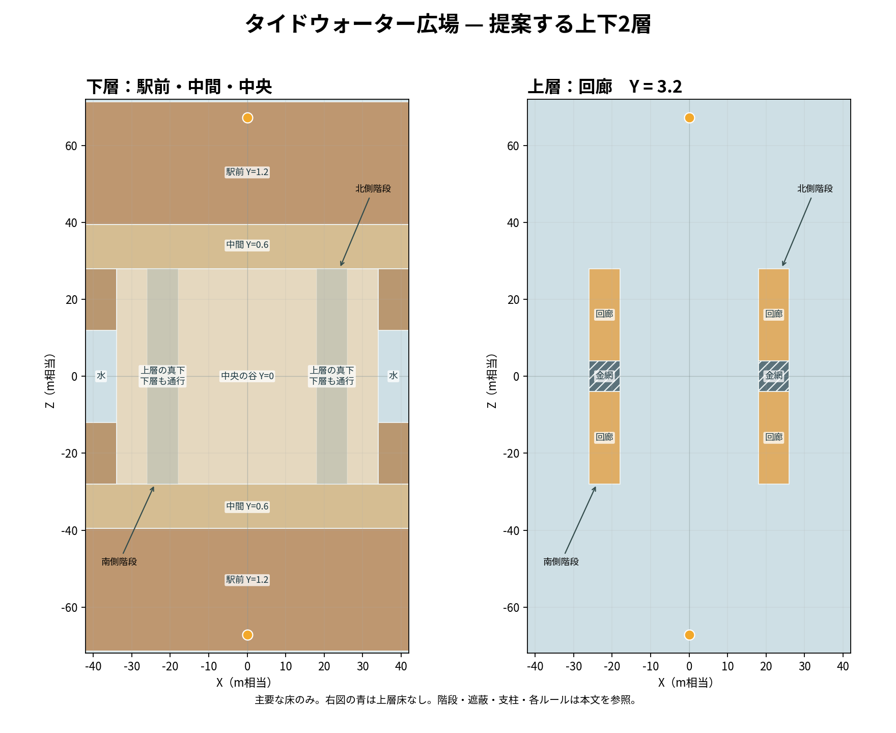

# Tidewater Plaza 改修設計案 — 海辺の段状街区

状態：設計案。既存実装や本家の寸法を復元したものではない。数値は INKWAVE のワールド単位（以下 WU）。実機・ブラウザでの移動、射撃、カメラ、AI、各ルールは未検証。設計の実装先は既存 TIDEWATER の置換を想定するが、この文書だけでは製品コードを変更しない。




図は主要な床だけを示す。階段・壁・遮蔽・落下口の詳細は以下の座標と断面図を参照。
## 今回の再構成

前版の低層全面 y0 を撤回。駅前 y1.2、中間 y0.6、中央と市場下 y0 の地形を別々に組み、0.2ずつの遷移で連結する。上階市場・金網・既存ランク X/Z は維持し、スポーン脇・高架入口の段数とホーム着地高、ホコ/アサリのゴール高、面積内訳を更新した。下記は構造と面積の設計値であり、実動作・塗装量・AI・ルールは未検証。

## 狙いと読み方

海に向かって段々に降りる公共広場と、その両側を貫く高架の市場回廊。中央は低い石畳の広場、両翼は実際に下を通れる街区の床、背後はそれらに連続する上段の駅前。構造の断面・床の高さが街区を作る。全面の一枚床の上に台や箱を追加する構成にはしない。目視上は石垣に沿う階段、橋脚、店の壁、排水路、木製張り出しを一体化し、各面の接合を意匠上もつなぐ。装飾は通路を塞がない。

座標は X が左右、Z が縦、Y が高さ。Alpha は -Z、Bravo は +Z、地形は `(x,y,z) → (-x,y,-z)` の180度回転対称。ただし既存ヤグラ経路とホコ中心は x=6.5 であり、ルール目標を含めた完全対称ではない。下表では指定のない床は塗れる実体。隣接する体積は内部で重ならず、面だけを共有する。Level は CSG や面統合を行わないため、後述の面分割処理を実装要件とする。明示の「薄いスラブ」は箱の上下を指定し、下階を空ける。経路幅は壁の内面間の設計値、キャラクター半径は含まない。

## 平面と断面

```text
                           Bravo +Z
 z=72           ┌────────── リスポーン B ──────────┐
 z=60           │ スポーン y2.2 → 駅前 y1.2       │
 z=40     ┌─────┴──────────────────────────────────┴─────┐
          │ 駅前 y1.2 → 中間 y0.6 → 中央 y0 / 高架階段 │
 z=28     │  ┌──────── 高架回廊 y3.2 ────────┐            │
          │  │   下は y0 の屋内市場通路      │   中央 y0 │
 z= 8     │  │  鉄格子 G（歩行可、塗れない）│            │
 z= 0  海 ≋  │      市場回廊        │  [目標区域]  │ 回廊 │  ≋ 海
 z=-8     │  │  + 階段で上階に接続  │              │      │
 z=-28    │  └──────── 高架回廊 y3.2 ────────┘            │
 z=-40    │   中央 y0 → 中間 y0.6 → 駅前 y1.2             │
 z=-60          │ スポーン y2.2 → 駅前 y1.2       │
 z=-72          └────────── リスポーン A ──────────┘
           x=-42  -34 -26 -18       0       18 26 34 42
```

図は関係図であり縮尺ではない。左右の高架は各々 `x=-26..-18`、`x=18..26`、`z=-28..28`。中央の競技面は `x=-18..18`。外側 `x=±26..±34` は屋外の海辺通路。高架の上と下は連続した別経路であり、下の床の上に土台を詰めない。

```text
中央横断面 z=-8（格子外）（左右対称、WU）
           屋外縁      上段市場         開放中央広場         上段市場     屋外縁
 y=3.2              ┌────────┐                           ┌────────┐
 y=2.8              └────────┘ ←薄スラブ/下面            └────────┘
                     高さ2.8の空間                         高さ2.8の空間
 y=0     ────────────┴────────┴───────────────────────────┴────────┴─────────
         -34        -26      -18                          18       26       34
             海側通路  下階市場通路        目標面            下階市場通路
```

```text
縦断面 x=0、Alpha→Bravo（高架に重ならない地形本体）
 y=2.2      ┌スポーン┐                                              ┌スポーン┐
 y=1.2  ────┴────────┴─────────▖                              ▗─────┴────────┴───
 y=0.6                         ▝━━━━━━━▖              ▗━━━━━━━▘
 y=0                                   ▝━━━━━━━━━━━━━━▘
 z       -71      -63         -40 -38.5 -29.5 -28    0    28 29.5 38.5 40   71
                 駅前             中間      中央の谷          中間        駅前
               段差各0.2×3                  段差各0.2×3
```

```text
縦断面 x=-24（中央高架およびその下。階段切り欠きのない z を図示）
 y=3.2                      ┌────実床────┬金網┬────実床────┐
                       ▟▟▟  │            │    │            │
 y=1.2  ──────────────▟     │            │    │            │        ┌─────
 y=0                        └─床下の y0 市場通路────────────┴──段差──┘
 z                   -40  -28           -4    4            28    40
```

x=-24 の z=-40..-28 は上階へ行く階段を示し、この区間の足元は地形から階段へ置き換わる。反対側の z=28..40 の上階への階段は x=-20 にあり、この断面には現れない。図の床下は abs(z)≤28 の水平床で、各端は下記の段差で中間へ続く。

橋脚は通路内に置かず市場回廊の側縁に設ける。高架下の物理的天井高 2.8、立ち姿 1.45 に対し余裕 1.35。カメラの快適さまでは計算で保証しない。

## 地形・建築の座標表

| 部位 | 幾何、接続・意匠 |
|---|---|
| 範囲 | `bounds = [-42,42] × [-72,72]`。両端の崖と海は背景まで延長し、プレーできる床と視覚的な海を区別。 |
| スポーン | `spawnPads=[[0,2.2,-67.2],[0,2.2,67.2]]`、`homeSuperJumpPoints=[[0,1.2,-61.5],[0,1.2,61.5]]`、`spawnBarrier=4.2`。上段 `x=-9..9,z=-71.4..-63, y=2.2`、正面は駅前 y1.2 へ安全な着地、左右に幅4.2の階段。現行 pad y の意味とバリア向きは実際の起動で要確認。 |
| 後方の駅前 | `abs(z)=39.5..71.4`、x=-34..34 と外側桟橋の陸地を地面そのもの上面 y=1.2 とする。スポーン正面、両脇階段、後方広場に続く。スポーン脇 `[-16,1.2,-67.2]→[-9,2.2,-67.2]`、`[16,1.2,-67.2]→[9,2.2,-67.2]` は幅4.2、5段、蹴上0.2、踏面1.4、回転複製。 |
| 中間テラス | `abs(z)=29.5..38.5` の陸地は上面 y=0.6。駅前 y1.2 とは `abs(z)=38.5..40` の3段、中央 y0 とは `abs(z)=28..29.5` の3段でつなぐ。各段は蹴上0.2、踏面0.5で、最後の段は中間テラスと同じ y0.6。正確な高さは下の床分割表を優先する。 |
| 中央の谷・市場下 | `abs(z)≤28` の陸地は上面 y=0。x=-18..18 は競技広場、x=±18..±26 は上階下を通る市場、x=±26..±34 は海辺通路。通常の建築より低い街路という意匠で、両側の中間から中央へ段状に降りる。 |
| 高架市場 | `x=-26..-18` および `18..26`, `z=-28..28`。上面 y=3.2、下面 y=2.8、厚み0.4。上下面を持つ薄い箱スラブで下階を空ける。支柱は端の x=-26..-25.4 に配置し、`z=-25..-24.4, 24.4..25` の2箇所だけ、反対側は回転複製。下を通れる幅は通常部7.4、中央縁階段の切り欠き区間は6。端縁は連続した石の梁、店の壁、舗装目地として造形。 |
| 回廊の金網 | 各高架 `z=-4..4` は実床を除去し、同一面積・高さの薄い `grate:true` を張る。すなわち各側 `x=-26..-18` / `18..26`, `z=-4..4`, y=3.05..3.2。両端の実床と接続。人は立てるが、イカは網に支持されず真下の y0 市場通路に落ち、弾とインクも通過する。網の手前で人型になって歩いて渡るか、下階に落ちて市場通路を進み、H の階段または z=±28..40 の階段で上階に戻る。落下後の実際の硬直と復帰は要検証。 |
| 回廊への4本の階段 | Alpha側中心線 `[-24,1.2,-40]→[-24,3.2,-28]` と `[20,1.2,-40]→[20,3.2,-28]`、幅4、10段、蹴上0.2、踏面1.2、平均勾配16.7%（9.5°）。両方を180度複製し Bravo側から両回廊へ同等に入れる。階段下は充実部であり通れない。各段は箱で、床との切り欠きを下記で定義。 |
| 中央縁の上り階段 | Alpha側中心線 `[-13.6,0,-22]→[-20,3.2,-22]`、z=-24..-20、幅4、16段、蹴上0.2、踏面0.4、平均勾配50%（26.6°）。180度複製。下階と上階をつなぐ対抗路。中央に張り出すがルール座標から離す。x=-20..-18, z=-24..-20 の高架を切り欠き、該当範囲は階段の充実部とする。金網に落ちた後にも利用できる。 |
| 意匠 | 実段の鼻先に石目のライン、側面には石積みと排水溝。見かけ上だけの階段ではなく、各段の当たり判定を持つ。イカの stepUp 0.24 に対し蹴上0.2 の余裕は0.04なので、特に境目を実測する。 |
| 水際 | 中央の両側 `x=34..42` / `-42..-34`, `z=-12..12` は床を作らず海。境界には段差と明るい縁石、局所的な低い柵を設け、自由に落ちられる窓を明示。`12<abs(z)≤71.4` の同じ外帯は同じ段状地形に接続した幅8の木桟橋、床端 `abs(x)=42` に柵。橋の端を飛び越えることを必須経路にしない。 |
| 高低差の処理 | y3.2 上段から y0 下段への自由落下は床が真下にある場所のみに限定。片側の明示的な降下口は `x=-18` の市場内縁、`z=-14..-10` とし、真下の中央広場を x=-18..-12, z=-16..-8 の無障害着地帯にする。180度複製。高架のそれ以外の縁も着地領域を調べ、海や柱に直接落ちる場所には非連続のパラペットを置く。y差3.2は hardLand が出る可能性があり、障害物のない床があるという意味での安全であって硬直なしを保証しない。 |

床端、階段端は図面座標の一致で足りない。接合、2面の食い込みと穴を実 `Level` と `Physics` で確認する。半径0.38の身体が通る位置について、有効幅 3.0 WU 以上、旋回・待避のある場所 4.0 以上、入口高 2.8 以上とする。支柱、柵、看板、dressing の衝突箱も含め測る。装飾配置の従来座標は新地形に整合しないので再配置し、古い隠し衝突を残さない。

## 塗れる床の面積概算

面積は上から見た水平投影の WU²。低地と上階が重なる部分は、異なる高さの各々の塗り床として各1回数え、同じ階で重なる部分は数えない。手すり・遮蔽・支柱の占有、スポーン面の実際の paint 設定、面分割と塗り格子の端数はこの概算に含めない。

| 分類 | 根拠 | 面積 |
|---|---|---:|
| 地上・駅前・スポーン台・全階段の上面 | 中央谷 abs(z)≤28 は 4,320、中間・遷移帯 28<abs(z)<39.5 は 1,932、駅前帯 39.5≤abs(z)≤71.4 は 5,359.2。外側桟橋を含み、スポーンと階段は各帯の床から切り欠いて置換するので追加で数えない。 | 11,611.2 |
| 上階の塗れる床 | 2側×8×56 = 896、金網2枚の 128 と階段切り欠き2か所の 16 を引く。 | 752.0 |
| 合計 | 金網を除外し、上階と下階を別面として集計。 | 約12,363.2 |

前回の turfArea 約12,057 と比べ **約306 WU² 増、約2.5%増**。これは設計矩形の粗い投影面積で、遮蔽物の足元、塗装不可面、実際の turf 判定やデッドセルを差し引いた実測値ではない。原典ステージの実塗り面積は未取得のため、本家と同等とは断定しない。実装後は `paintFaces` の turf フラグと有効セルから高さ別・陣営半分別に面積を測り直し、目標との差を報告する。

## 床・階段の切り欠きと面の生成（実装要件）

R の斜め OBB は厚みと低端の0.6延長で床に張り出す。今回は接合を確定するため **R を使わず、全傾斜路を直方体の階段に固定する**。下記の床領域は意匠上の領域であって、1個の大箱を先に敷き、その上に階段を重ねる指示ではない。指定された矩形を XY/Z の仕切り線で分割し、重複領域を差し引いた箱だけを作る。

1. 地面全体は x=-34..34 と、`abs(x)=34..42, 12<abs(z)≤71.4` の外桟橋を使い、単一箱を敷かず、次の `abs(z)` ごとの互いに重ならない箱に分割する。各箱の下面は y=-1.2、上面は `0..28→0`、`28..28.5→0.2`、`28.5..29→0.4`、`29..38.5→0.6`、`38.5..39→0.8`、`39..39.5→1.0`、`39.5..71.4→1.2`。境界面は共有、3段の連続した蹴上は各0.2。中央の谷を形成する低い床と両側の高い床は最初から別の地形体であり、全面 y0 を下に残さない。陸地から、回廊入口の階段フットプリント x=-26..-22 または x=18..22、z=-40..-28 と180度回転範囲を除外する。各階段は10個の連続矩形 `z=[-40+1.2(i-1),-40+1.2i]`、i=1..10、上面 `1.2+0.2i`、下面-1.2、幅4。終点 z=-28 は上階床と面で接し、隣接地形・階段と体積を共有しない。
2. 中央縁階段 x=-20..-13.6、z=-24..-20 を低地床から除外し、xが-13.6から-20へ向かう長さ0.4の16箱、上面0.2i、下面-1.2とする。上階スラブも x=-20..-18、z=-24..-20 の部分を矩形に分割して除外する。階段が占める場所は下階の通路にならないが、x=-26..-20 の下は幅6、上端とその先の上階は通れる。反対側は180度複製。
3. 上階の各矩形 x=±18..±26、z=-28..28 はまず z=-28..-4 / -4..4 / 4..28 に分割。中央部分は通常床を生成せず、格子箱 y=3.05..3.2 のみ。通常床は y=2.8..3.2。さらに2の階段切り欠きを矩形分割して除去。格子に体積が重なる飾り枠を作らない。床の接続は隣の実床端と格子端が同座標の面で接する。
4. スポーン台 x=-9..9,z=-71.4..-63 は低地床から除いて y=-1.2..2.2 の箱とし、左右階段 x=-16..-9 / 9..16、z=-69.3..-65.1 は5等分、上面1.2+0.2iで同様に駅前床から差し引く。支柱や遮蔽も底面が支持床の上面と接するだけで床にめり込ませない。階段と柱・装飾の重なりを禁止。
5. 箱を隣接させても Level は隣接境界の一部だけを切り取らない。`_faceHidden` は全標本が覆われた面を省く処理であり、部分面のCSGではない。したがって実装では境界面を隣接箱の上下端で分割し、内部に面した部分を描画・塗り対象から除外する前処理を必須とする。上向き面・外向き蹴上・格子・下面のみ一度生成し、衝突箱は別に保持する。追加機能の設計要件であり現行機能ではない。

実際の Level の全箱を列挙して、体積の正の重なり0、上面の重複0、床縁の穴0、階段の各段接地と両側の接続をテストする。もし `R` を再導入する場合はこの設計からの変更であり、`level.js` の算出した OBB の8頂点・AABB と実断面を用いて、隣接体積への侵入と低端0.6の張り出しを検査し、面クリッピングと足元の連続性を再設計する。静的矩形の境界が合うだけでは承認しない。

## ミニマップの暫定表示方針

現行 `minimap.js` は X/Z ごとに最高の固体表面を地形としてラスタ化し、そこより下の塗りを通常表示しない。上下のどちらの人物かも平面投影だけでは判別できない。今回の実装方針として、通常 HUD は上階を表示し、拡大マップには「上階 / 下階」の明示切替を設ける。各ピクセルは選択階の最も高い床の塗りのみ描く。下階選択では高架の輪郭と網を細い点線で重ね、実際の床・水・床なしを区別する。人のマーカーは既存の表示権限・敵の秘匿条件をそのまま守り、表示が許された人物だけを X/Z に置く。選択中の階にいる人物は通常記号、別階は枠線のみと上下矢印で示す。床との高さ比較と空中/落下中の切替閾値は `support block` を優先し、空中は最後の接地階を使う。落下・着地・同 X/Z の二人・ジャンプ・スーパージャンプ時の表示を検証する。現行ミニマップの機能ではなく、階別の地形/塗りサンプリングとアイコン表現の追加実装が必要。集計値や実際の塗り状態はこの表示切替で変更しない。

## 進路・遮蔽・攻防

Alpha のノード（逆側は180度回転。座標は足元を想定）：

| ノード | 座標 (x,y,z) | 接続と役割 |
|---|---|---|
| A | (0,2.2,-67.2) | 出撃。正面に y1.2 へ落下、左右に階段で駅前へ。 |
| B | (0,1.2,-56) | 駅前中央。C と D/E に分岐。 |
| C | (0,0.6,-30) | 中央広場への直進、同時に両下階へ転進。 |
| D | (-24,1.2,-40) | 階段を進み F に上る。 |
| E | (20,1.2,-40) | 反対側の回廊へ階段で進む。 |
| F | (-24,3.2,-28) | 上階へ、(-24,3.2,-8) を経由し金網上へ。網上をイカで進むと下階に落ちる。網の手前で人型になって歩くか下階に進む。 |
| G | (-22,0,-24) | 高架下の市場、(-22,0,0)→(-22,0,24) とつながり Bravo側まで歩ける。支柱を避けて移動可。 |
| H | (-13.3,0,-22) | 中央縁の階段で (-20,3.2,-22) へ。上から撃つ相手に対する塗り返しと追撃路。階段自体は遮蔽ではなく横からの射線に晒す。 |
| I | (0,0,0) | 中央。左右の両翼下階と進退を選べる。 |
| J | (-15,0,-12) | 上段からの明示降下着地点。縁から先は足元の有無をプレーヤーが視認可能。 |

上階の支配者に対し、下階側は (1) 上り階段 H で同じ高さから挑む、(2) 金網越しに上へ射撃、(3) 遮蔽付き下階 G から反対出口に回り込む、の3択を持つ。対抗能力のバランスは試遊まで仮説。回廊には全長を狙える安全な狙撃台を作らず、上面の半透明ではない袖壁を `x=-26..-25.4, z=-16..-13, y=3.2..4.6` と回転位置に設け、銃撃を遮りつつ空き幅7.4を残す。下階は柱列を通路中央に置かず、中央低地には壁状の常設遮蔽を小さく分散させる。例 `x=-14..-11,z=-32..-31,y=0.6..2.0`、`x=10..13,z=-25..-24,y=0..2.2` とそれぞれ回転複製。ランク区域・ヤグラ掃引半径・ゴールと重ねない。遮蔽から次の遮蔽までの実際の直線距離と射線は武器別に検証する。低い壁は足元を守り、高い袖壁は長い射線を切り、いずれも全通路を封鎖しない。

中央は明るい石とチームインクが見分けられる低彩度、上階は木・暖簾、下階は明るい壁と間接光で、敵のシルエットを暗闇に埋めない。中央から遠距離が見えても回廊の袖壁と駅前の建築の角で射線が切れる構成。短射程は下階と階段、長射程は複数の射線が開く上階、曲射は中央縁や金網を活用する設計意図であり、武器間優劣は未測定。高架外縁を無遮蔽の長い射撃棚にせず、水側は手すりと袖壁で区切る。

## 全ルールと互換条件

現行の `patches/splatoon3/runtime/ranked/stages.mjs` を踏まえ、既存座標を採用し、設計の地面がそこにある状態で評価する。`groundHeight` は最高床を取得するため、上下階が重なる座標にエリア等を重ねると意図せず上階を参照する。以下は目標座標の設計であって、ゲームが実行されたという意味ではない。

- ナワバリ：中央の低地、上階、屋根下、市場から海辺への接続を塗れる。金網は塗れず通過する。狭い橋だけでなく複数の塗れる接続路を用意。上下階の塗り集計の実挙動、陣営塗り面積と初動時間は要実測。
- エリア：既存 `(-9,0)` と `(9,0)` を中心とする 6×7、上面 y0 の区域を確保。領域 `x=-12..-6` と `6..12`、`z=-3.5..3.5` 内に壁・高架・穴・非塗装面を置かない。両側から等距離のアクセス・遮蔽を確認する。
- ヤグラ：既存ノード `(6.5,-18)→(6.5,-9)→(6.5,0)→(6.5,9)→(6.5,18)`、`halfSize=1.4`、床上自動オフセット0.4。経路の双方に幅 3.38 以上の床・空間を取り、床高と障害物、頭上の干渉を掃引検査する。中心線 x=6.5 は180度対称ではないため、進行向きによる有利不利を個別検証する。自動高さ計算は半径約3.38内の最高床を使うため、その範囲に袖壁や階段を入れない。
- ホコ：既存中央 `(6.5,0)`、関門 `(6.5,10),(0,22)` と `(-6.5,-10),(0,-22)`、ゴール `(0,±30)` は中間テラス y0.6、中央・関門は y0。両者は0.2ずつ3段で連続する。両陣営の関門が180度対応すること、目標の衝突体と近傍の床・接続路、運搬中の上下移動を確認。特に既存中央が x=6.5 である非対称を評価する。
- アサリ：既存の発生点 `(-12,-9),(12,-9),(-12,9),(12,9),(0,-20),(0,20)` は中央の谷 y0 に置き、ゴール `(0,±30)` のみ中間テラス y0.6 に置く。最高床の上に出現しないよう該当点と周辺を開放。落下物の着床・跳ね返り、格子を経由した上下移動と回収、ゴールアクセスを実行検証。

既存ルール座標を採用することは適合保証ではない。両陣営・全モードを検証する。参考としてヤグラとホコの中心を x=0 にする対称化案はあるが、今回の設計では採用せず、別変更としてのみ評価する。`NavGraph` は同じ X/Z の複数高さにノードを生成し、クリアランスを調べ、エッジを無向扱いした最大連結成分を有効とする。最高床しか使わないわけではない。ただしその有効成分内で上下階が双方向に移動できるとは限らない。実グラフの各階ノードおよび人型/イカでの経路追従・金網落下後の復帰を検証する。

## 実装根拠・未検証・受け入れ

公開版 `inkwave-public/src/world/maps.js` は `single` と `half` を使い、後者を180度複製する。既存 Tidewater は上面 y0 の一枚の主床、中央の塊、盛土状のテラスが主体で、提案はそれを置換する設計。`src/world/level.js` の通常 `R` は底まで厚い OBB、`thin` でのみ自厚を維持、`grate:true` は塗装不可・イカ/射撃通過。`src/game/physics.js` は WALKABLE=0.68（法線 y、約47°まで）で、参考の平均勾配9.5°・26.6°はその角度を下回るが、実体は階段なので歩行可能性を角度から保証できない。`src/config.js` は人型 radius 0.38、height 1.45、イカ高 0.55、stepUp 0.35 / squidStepUp 0.24、waterY -1.6、fallDeathY -1.45。水際は床がないと死亡するが、actor.js は水面下でも真下に床がある場合は即死亡しない。提案の最低通行床 y0 は水面より上。これらはコード上の事実であり、階段や網の実走可能性を保証しない。

本家比較の参照条件は Splatoon 3 Ver.11.3.0、任天堂の[ルール案内](https://www.nintendo.com/jp/ichikara/av5ja/03_en.html)にある確保・運搬というルールの目的まで。Tidewater は独自ステージであり、形状、寸法、階段、速度、射程および配置を本家の確定値と主張しない。基準ブキ・ギア・入力・各ゲームの FPS を記録した実機比較は未実施。

受け入れは (1) 全部位の床上面/下面・接合の断面、支柱/階段の衝突、落下先、全ルールの座標とヤグラ掃引を自動検査、(2) 人/イカ、歩行/射撃/ジャンプ、金網の出入り・上下射撃、30/60/120Hzをロジック測定、(3) ブラウザ実動作で全経路・カメラ・ボット・スポーン・水没と全ルールを両陣営で試遊、(4) 本家実機との条件付き挙動比較、の順。狙撃位置から中央/下階へ射線と反撃路、短射程の到達時間、床・壁の塗り、リスキル、画面での敵判別、同期とリスポーンを記録する。どの段階も未実施。対称性、接続、実際のゲーム性は検証結果を受けて調整する。
