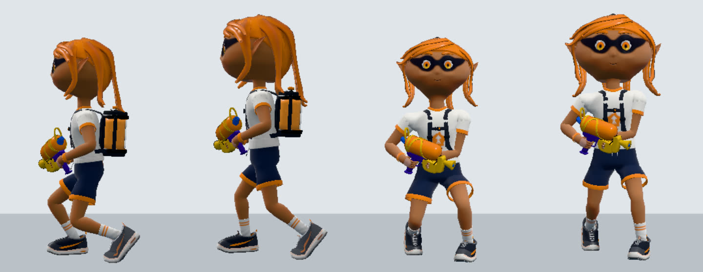

# ヒトの体型と武器持ち待機の比較（2026-10-16）

試合中のヒトの体型（頭・首・胴・脚の比率）と、ブキを持って立ち止まった時の待機姿勢（脚の曲げ、足の置き方、上下の弾み）を、スプラトゥーン3の公式映像と比べた。射撃・弾の発射位置、移動速度、当たり判定は変えていない。

## 比較対象と条件

- 本家の参照バージョンは Ver.11.3.0（`profile.json`）。映像の収録バージョン、入力、ギアは公開されていない。映像の値を 11.3.0 の実機で測った値としては扱わない。
- ブキはシューター。映像の型番は metadata にない。INKWAVE 側は `shooter`、ギアなし、平地。
- 本家の根拠は[任天堂公式のブキ紹介](https://www.nintendo.com/jp/character/splatoon/fashion/index.html)のシューター動画 `y7Zl26Zl12n`（2 セグメント連結の SHA-256 `6fd20313b229072b55aca46805afc943cc22c3358620b37ed7dceee674ee76b7`、過去の記録と一致）。1920×1080、60 fps、最初のフレームを n=0 とする。
  - 体型: n=390（ほぼ真横の立ち姿）。n=366〜402 は撃つ合間にブキを下ろして立ち止まった区間で、足は動かない（n=414 で再び撃つ）。
  - 待機: n=366〜402 と n=596〜668（射撃をやめて立ち止まった区間）。
- INKWAVE 側は本番と同じビルド（`scripts/build-inkwave.mjs`）の Character を Chromium で直接動かして描画し、数値は本番インストーラーを一つの VM で動かして測った。どちらも Switch 実機との比較ではない。試合中のプレイヤーそのものをブラウザで描画する試みは、テスト用の駆動でスポーン後に Actor が更新されず、使っていない。

## 体型

本家 n=390 の画素で、髪の頂点から足裏まで約 570 px。INKWAVE は本体のジオメトリ（髪の頂点 1.408 m、あご 1.067 m、襟 1.001 m、股 0.560 m）から測った。

| 部位（身長比） | 本家 | INKWAVE 修正前 | INKWAVE 修正後 |
| --- | --- | --- | --- |
| 頭（髪頂〜あご） | 0.28（160 px） | 0.24 | 0.28 |
| 首（あご〜襟） | 0.02（10 px） | 0.05 | 0.02 |
| 胴（襟〜股） | 0.33（190 px） | 0.31 | 0.33 |
| 脚（股〜足裏） | 0.37（210 px） | 0.40 | 0.37 |

画素の読み取りは ±10 px 程度の誤差があり、1 フレームの読み取りなので確定値ではない。

最初は初代（Wii U）`Player00` の骨格（股関節の高さが足首〜頭骨の 0.365）に合わせて股関節を 18 cm 下げたが、肩を固定したまま股だけを下げたため胴が伸び、本家と比べて胴長になった。初代の骨格は頭骨の位置と頭の大きさが本家 3 の見た目と対応しないので、脚の長さの根拠には使わない。

### 実装（`runtime/body-proportion.mjs`）

- 脚: 股を 3.5 cm 下げる（脚 : 胴 = 210 : 190、襟の高さは固定）。服・靴・手足は本体の高さに合わせて作られているので作り直さず、作った後の頂点と rest の骨を一つの滑らかな上下方向の写像で動かす。足首から股関節までを縮め、股関節から肩までが同じ長さだけ伸びる。肩より上（腕、首、頭、髪、顔、ブキの持ち位置）と足首より下（靴）は動かない。頂点は脚と胴の骨のスキンウェイトの合計だけ写像に従う。
- 頭: 頭の骨を 1.174 倍に拡大し（頭 : 胴 = 160 : 190）、首の上で 4 cm 下げる。顔、目、髪、帽子は頭の骨の子なので、作られた形とシェーダーの座標はそのまま保たれる。毎回のポーズ更新の後に掛け直す。
- 接続: `body-proportion-adapter.mjs` が `character-geo.js` の `getKidShared` / `getRestPositions` を包み、`character.js` の `_buildRig` で骨を作る直前の rest に写像を掛ける（本番構成では issue-483 の差し替えで rest が別経路になるため。二重には掛からない）。`character-geo.js` のハッシュを `upstream-lock.json` に追加した。

## 武器持ち待機

| 項目 | 本家の根拠 | 修正前の INKWAVE | 修正後 | 確認状態 |
| --- | --- | --- | --- | --- |
| 前足 | n=366〜402、n=596〜668。前足はすねが地面に対してほぼ垂直で、膝もほぼ伸びている。足は骨盤の真下付近 | `WaitHold_Nrml`（初代）は前足の膝を前へ大きく曲げたジグザグの脚（膝 80〜87°） | 待機中だけ、前足首を膝の真下（股関節から太もも × sin 24° 前）に置き、足裏を平らにし、上下動の頂点で膝 24° になる高さへ骨盤を合わせる。リターゲットは脚を長さの 0.97（膝 28°）までしか伸ばさないので、これが「ほぼまっすぐ」の上限 | 映像と描画で確認。関節角は映像からの読み取り |
| 後ろ足 | 腰から斜め後ろへほぼまっすぐ伸び、かかとを上げてつま先で立つ。前後の足の間隔は身長の約 0.23（斜めからの映像で短く写る） | 初代クリップのまま 0.24 m 後ろ。太ももが後ろへ伸び、後ろ膝が胴より後ろへ出る | かかとを 6 cm 上げ、上下動の頂点で膝 30° になる距離に置く（前後の間隔は身長の約 0.24） | 映像と描画で確認 |
| 足の滑り | 足裏は動かない | ― | 両足首の位置は待機に入った時に kid 空間で固定する。骨盤の横揺れと上下動は固定した足の上で動く | VM 測定で後ろ足首の移動 2 mm 以内 |
| 上下の弾み | 胴のテンプレート追跡で約 30 フレーム周期、上下幅は身長の約 4%（頭は首の動きが加わり約 6%）。足裏は動かない | 同じ周期で 2.8%（頭 3.3 cm） | 0.5 秒周期で骨盤を 4.5 cm 上下させる。撃っている間（射撃クリップへの切り替え重み）は外す | 映像と VM 測定で確認。周期は本家の映像 1 区間のみ |
| ネイティブ待機（ローラー、ソースモーション読込前・失敗時） | 同上 | 腰を 3.6 cm 下げるだけで、両足がほぼそろう（前後のずれ 2.4 cm）。弾みなし | 試合中に静かに立ち止まっている間だけ、腰の落としを 2 cm 戻して脚をほぼ伸ばし、0.5 秒周期で腰を 4.5 cm 上下させる（頭の上下 4.9 cm）。撃つ・サブ・変身・ジャンプ・歩き出しでは毎秒 8 の速さで解除する。足を前後にずらす案は、ネイティブの足の踏み直し（しきい値 6.8 cm）を誘発したので入れていない | VM 測定で確認。ローラーの本家の待機は比べていない |

最初の修正では、本家の待機を「膝を深く曲げる」と読み、前後の開きを縮めて上下動を頭の動きで 2 倍にしていた。n=366〜402 を見直すと前足はほぼまっすぐで、後ろ膝が出て見えたのは足の開きではなく後ろ太ももの向きが原因だった。上下動も胴で測り直した。

数値はすべて INKWAVE の校正値で、任天堂から抽出した値ではない。

## プレイへの影響

- 見た目だけの変更。Actor の位置・速度、当たり判定、入力、インク、通信は変えていない。
- 弾の発射位置は見た目の銃口から決まる。肩より上は写像で動かないが、胸の骨の rest が 0.9 cm 下がり、腰の高さも変わるため、銃口は少し動く。本番インストーラーの VM で体型の補正あり・なしを比べると、立ち止まりと止まって撃つ時は 3〜4 mm、歩き撃ちは 3〜5 mm（スロッシャーは 14 mm）、スピナーの止まり撃ちは最大 13 mm。待機の足の配置と弾みの補正は射撃中に外すので、発射位置には影響しない（`source-posture.test.mjs` で 0.01 mm）。
- 脚が短くなったので、歩き・走りの歩幅は脚の長さに合わせて短くなる（ソースモーションの `legScale` は脚の長さから決まる）。

## 残る差分と未確認事項

- 本家の靴は大きく背が高く、シャツは長く短パンがほとんど隠れる。INKWAVE の服・靴の形は変えていない。
- 本家の頭は髪のボリュームが大きいドーム形。INKWAVE は頭全体を拡大しただけで、髪型の形は変えていない。
- 本家の待機でブキは胸の前で立てて持つ。INKWAVE は初代クリップの両手持ちのまま（2026-10-12 の記録と同じ）。
- 正面から見た足幅、シューター以外のブキの待機、ローラーの待機、横歩き・後ろ歩き、坂・段差での体型は本家と比べていない。待機の前足は初代クリップに合わせて左に固定している。
- VM には地面の当たり判定がないので、接地後の足首の高さはブラウザ描画で確認した。試合中のプレイヤーそのものでは確認していない。
- Switch 実機、iOS、実際のネットワーク試合での見た目は確認していない。
