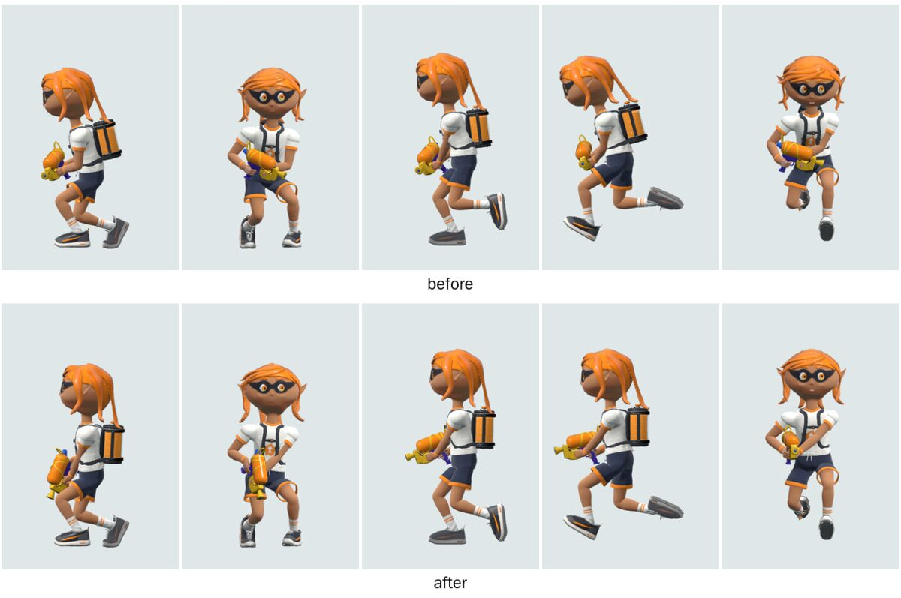

# 立ち方・ブキの持ち方・足運びの比較（2026-10-12）

試合中のヒトの姿勢を、スプラトゥーン3の公式映像と比べた。対象は待機の立ち方、射撃していない時のシューターの持ち方（腕・ブキの向き）、歩き・走りの上体と足運び。射撃中の姿勢、弾の発射位置、移動速度・加速、接地判定は変えていない。

## 比較対象と条件

- 本家の参照バージョンは Ver.11.3.0（`profile.json`）。ただし下の映像の収録バージョン、入力、ギアは公開されていない。映像の姿勢を 11.3.0 の実機で測った値としては扱わない。
- ブキはシューター。映像の型番は metadata に書かれていない。INKWAVE 側は `shooter`（S3 スプラシューターのモデル）で、ギアはなし。
- 本家の根拠は[任天堂公式のブキ紹介](https://www.nintendo.com/jp/character/splatoon/fashion/index.html)にあるシューター動画 2 本。過去の比較でも使った動画で、取得し直したファイルの SHA-256 が過去の記録と一致した。
  - `y7Zl26Zl12n`（`0000855_…_1080.m3u8`、2 セグメントを連結、`6fd20313b229072b55aca46805afc943cc22c3358620b37ed7dceee674ee76b7`）。側面から見た歩き（0.0〜0.75 秒）、射撃、射撃後に立ち止まった待機（10.0〜11.2 秒）が映っている。
  - `9LnjRgbl2Ng`（`0000920_…_1080.m3u8`、`0d7f648e677dde37fadb82804dd9561389b0dbf2b80a5780218913fe0095706d`）。射撃しながら走る姿を背後から映している（2.0〜3.6 秒）。
  - 同じページの他のシューター動画は、埋め込み URL がリファラーなしで 403 を返した。制限を迂回して取得していない。
- INKWAVE 側は本番と同じビルド（`scripts/build-inkwave.mjs`）を使い、実 Character と非同期読み込みの Wii U 版ソースモーション（`Player00`）を Chromium で描画した。数値はロジック単独の測定、画像はブラウザでの描画で、どちらも Switch 実機の比較ではない。

### 調べて分かったこと: 実際の見た目を決めているのは Wii U 版クリップ

試合中のヒトの体（射撃していない時の上半身と、常に脚）は、`src/game/motion/source-controller.js` が初代（Wii U）`Player00` のクリップをリターゲットしたものになる。射撃・チャージ・サブなどの間は `runtime/source-weapon-owner.mjs` により上半身だけが本体の手続き姿勢に戻る。`HumanRetarget.apply` はソース骨の**ワールド方向**をそのまま写すので、クリップの姿勢がそのまま出る。

ソースバンクを直接測ると、初代の「Hold」系クリップは上体（spine1→chest）が 16〜31°、首が最大 25°前に傾いている（`WaitHold_Nrml` 16〜21°、`WalkHold_Nrml` 19〜31°、`RunHold_Nrml` 23〜28°、`Run` の首は 37〜48°）。基準姿勢どうしの方向差は 6°以下で、リターゲットの誤差ではなくクリップの姿勢である。

ブキと腕の非同期読み込みを待たずに描画すると本体の手続き姿勢になり、見た目がまったく違う。以前の静止画比較はこの状態を見ていた可能性がある。

## 差分と対応

| 項目 | 本家の根拠 | 変更前の INKWAVE（再現操作・実装箇所） | 変更と影響 | 確認状態 |
| --- | --- | --- | --- | --- |
| 待機の上体と頭 | `y7Zl26Zl12n` 10.0〜11.2 秒。射撃後に立ち止まると上体は直立し、頭も起きている。膝は曲がり、足は前後にずれる | 試合中に止まる。上体 13°、首 19°前傾し、頭が胸より前へ出て下を向く（`retarget.js` `apply`。クリップ `WaitHold_Nrml`） | 前傾を立ち止まり時 20%、移動時 40% に縮める。首は 25%。頭は首と同じ角度だけ戻す。待機は上体 4.7°、首 4.8° | 映像と描画で確認。関節角・待機周期は未確認 |
| 歩き・走りの上体と頭 | `y7Zl26Zl12n` 0.0〜0.75 秒（側面の歩き）、`9LnjRgbl2Ng`（背後からの走り）。上体はほぼ直立し、頭はまっすぐ上にある | 歩き 1.6 m/s で上体 11°、首 11°、走り 6 m/s で上体 15°、首 22° 前傾 | 歩きは上体 3°、首 2°、走りは上体 9°、首 6°。腕はワールド方向を保つので、ブキの向きは変わらない | 同上。走りの側面映像はない |
| 射撃していない時のシューターの持ち方 | 歩き: 右手で腰の高さに持ち、銃身はほぼ水平で前向き。待機: 右ももの前に下げ、銃口は下向き | 銃身が体の左へ 63〜72°横向きで、ほぼ水平にお腹の前を横切る（`source-controller.js` `alignWeapon`。初代クリップのブキ骨の向き） | 射撃していない時だけ、ブキを持ち手の周りで回す。移動時は前向き・少し下、停止時は下向き（ソースの揺れを 15% 残す）。歩きは銃口ピッチ −10°・ヨー 16°、停止時は −56° | 映像と描画で確認。左手の位置（両手持ち）は既存の carry パッチのまま |
| 足の上がり方 | `y7Zl26Zl12n` の歩き。後ろ足のかかとは上がるが、すねは水平まで上がらない。走りの後ろ足は高く上がる（`9LnjRgbl2Ng`） | 0.8 m/s の弱い入力でも足首が地面から 0.25 m 上がり、膝が 100°曲がる。どの速さでも 0.29〜0.32 m、107〜109°（クリップの持ち上がりは脚の長さの 0.60、走りは 0.70） | 遊脚の足首の高さを歩き 50%、走り 70% に縮める。停止中は効かない。歩き 1.6 m/s は足首 0.19 m、膝 93° | 映像と描画で確認。かかと・つま先の角度、歩幅、歩調は未変更・未確認 |

### プレイへの影響

- 見た目だけの変更。Actor の位置・速度・加速、入力、接地と着地、ブキ、インク、通信は変えていない。
- 弾の発射位置は見た目の銃口（`weapons.js` `_muzzle`）から決まるため、補正の有無で比べた。射撃中は上半身が本体の手続き姿勢になるので、差は初弾 0.000 mm、1 秒後 0.010 mm（止まって撃つ時も、歩きながら撃つ時も）。
- 接地中の足首は滑らない（補正なしの値以下）。補正は idle/move 状態だけにかかり、それ以外へは毎秒 8 の速さで切り替わる。30/60/120 Hz で同じ切り替えになることもテストした。ジャンプ、着地、変身、勝敗ダンス、手動で再生するクリップには補正をかけない。

## 実装

- `runtime/source-posture.mjs`: 数値と三つの補正。すべて INKWAVE の校正値で、任天堂から抽出した値ではない。
- `adapter.mjs`: `retarget.js` の 2 箇所（照準ピッチを掛ける前の上体・首、脚 IK の前の足首目標）と、`source-controller.js` の `alignWeapon` 1 箇所に接続する。接続先がなくなったり重複したりするとビルドが止まる。2 ファイルのハッシュを `upstream-lock.json` に追加した。
- `tests/source-posture.test.mjs`: 実際のソースバンク、実 Character、本番インストーラーを一つの VM で動かす（他の VM テストは動的 import がないため、本体の手続きモーションにフォールバックしている）。接続、元クリップの前傾、補正後の上体・首、ブキの向き、射撃時の発射位置、足の滑り、膝の曲がり、30/60/120 Hz、手動クリップを確認する。

## 残る差分と未確認事項

- 射撃中にブキを体から離して構える（腕をほぼ伸ばす）。本家は胸の近くに引き寄せて肘を曲げている（`y7Zl26Zl12n` 10.0 秒前後）。射撃姿勢は本体の手続き姿勢とブキモデル別の `hold.aim` が決め、その銃口が弾の発射位置になる。発射位置を変えるとゲームの挙動が変わるため、今回は変えていない。
- シューター以外（ブラスター、チャージャー、スピナー、スロッシャー）にも上体・首・足の補正がかかる。描画が崩れないことは確認したが、各ブキの本家映像とは比べていない。持ち方の補正はシューターだけ。
- 待機の立ち方（深めにしゃがみ、片足のかかとを上げる）は初代クリップのまま。本家映像でも膝を曲げ、足を前後にずらしているが、深さは測っていない。
- 歩幅、歩調、かかと・つま先の角度、横歩き・後ろ歩き、方向転換、坂・段差は今回比べていない。横歩きと後ろ歩きにも同じ補正がかかる。
- 照準ピッチは射撃していない時も上半身全体を傾ける（ソースコントローラーの仕様）。本家との違いは未確認。
- Switch 実機、iOS、実際のネットワーク試合での見た目は確認していない。
