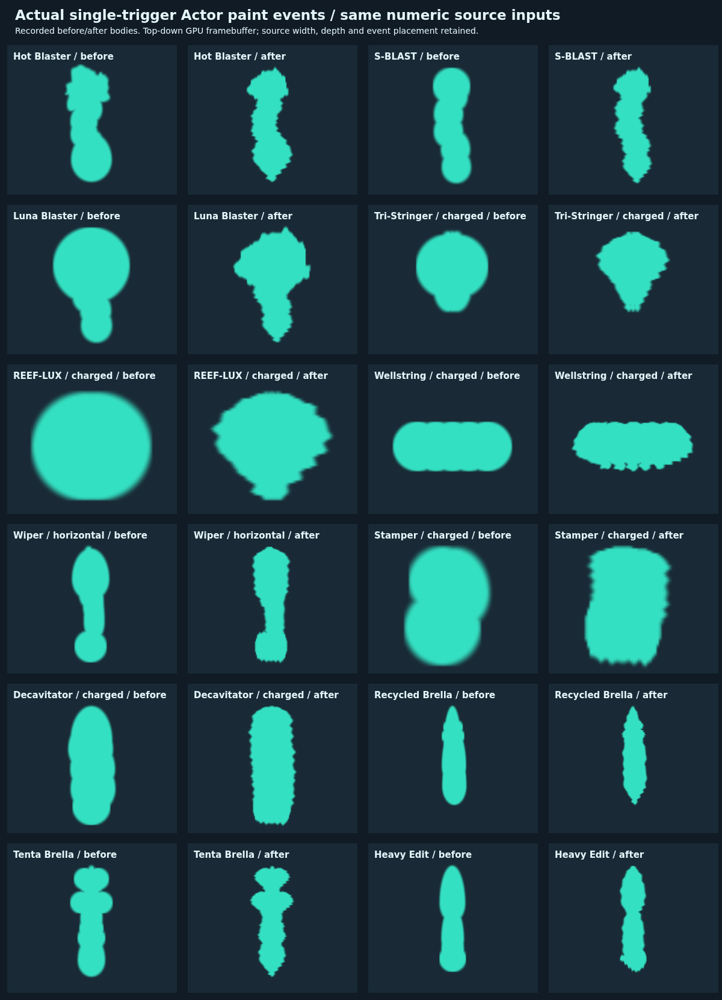
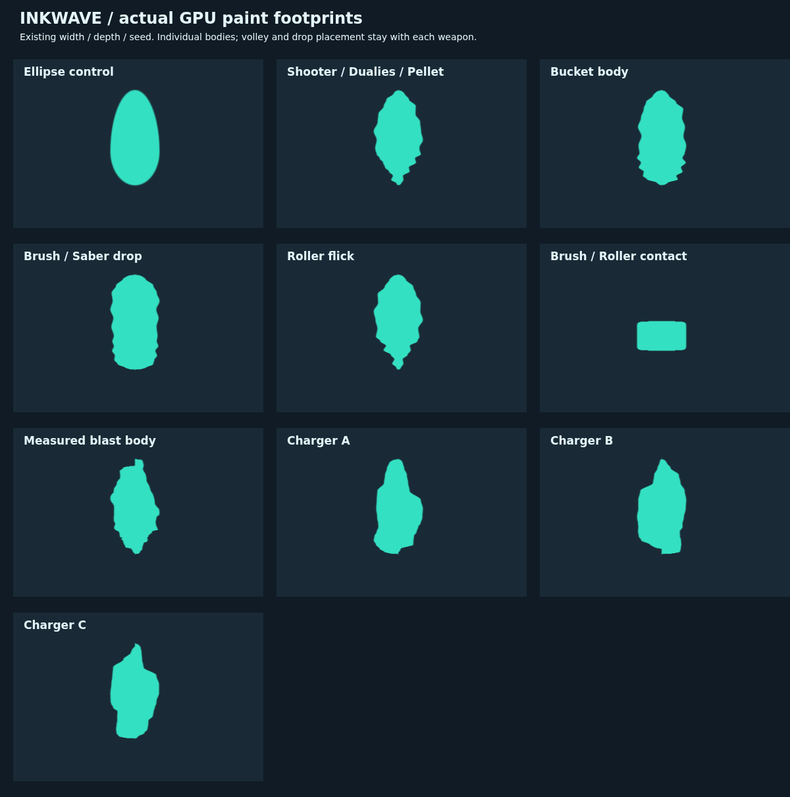

# 残っていた円・楕円の塗り経路と爆発輪郭

対象は公開版 `inkwave-public/`、開始点 `b4c17e8f7`。数値は既存の Splatoon 3 11.3.0 固定テーブル。これは円形へのフォールバック解消と画像を用いた輪郭改善であり、本家との完全一致を認定する変更ではない。

## 実画像の読み取りと限界

[画像台帳](../../patches/splatoon3/reference/added-ink-images-20261018.json) に、実際に表示した20点のURL、SHA-256、寸法、GIFの表示フレームを記録した。第三者の写真・GIFはランタイムにもこのレポートにも同梱していない。

- [Wikiのクマサン印ブラスター](https://wikiwiki.jp/splatoon3mix/ブキ/クマサン印のブラスター) の床写真は、先端の池の外周全体が見える。青成分を抽出し、最大の連結成分だけを取り出した。周辺の独立飛沫5成分は除き、310×166画素の外周から左右の断面を測定した。抽出は [スクリプト](../../scripts/extract-inkwave-ink-contours.py) で再現でき、[測定値](../../patches/splatoon3/reference/added-ink-contours-20261018.json) を保持する。クロップで連結成分の縁が切れたら抽出を拒否する。
- [アルテマのS-BLAST実戦GIF](https://altema.jp/splatoon3/sblast92) は、円に近い中心に不揃いな肩・突起が付くことの定性確認に使用。重なった実戦塗りから通常・ジャンプ各モードの独立マスクは回収できない。上記のクマブラスター輪郭を通常ブラスターや他系統の爆発へ移すことは**近似**であり、ブキ別の原マスクを取得したという意味ではない。
- [ファミ通のトライストリンガー試し撃ち写真](https://www.famitsu.com/news/202208/28273691.html)、[アルテマの弓](https://altema.jp/splatoon3/tristringer) と [LACT](https://altema.jp/splatoon3/lact450) のGIFで、複数の矢と途中の飛沫・着弾・爆発が重なって全体を作ることを照合。一射の全外周を一発の矢に貼り付けない。個々の通常弾には既存の `ink-shot` を選択し、冷却弾の爆発を別の `ink-blast` にする。弓固有の原マスクは未取得。
- [Insideのドライブ試し撃ち写真](https://www.inside-games.jp/article/2022/10/02/140854.html) と [ジムの試し撃ちGIF](https://altema.jp/splatoon3/jimwiper) では、不揃いな左右の辺を持つ連続した帯を確認。ジムの先端池を直接切り出す候補は、首の部分や画面上の遮蔽で単独形状を確定できないため採用しなかった。個々の落下飛沫に既存の丸端・波打つ `ink-brush` を選び、全体の長さ・幅は各ブキの既存パラメータと飛沫配置が担当する。ワイパー固有のマスク復元ではない。
- [シェルターのGIF](https://altema.jp/splatoon3/parashelter) は散弾・途中の塗り・パージ軌跡の分離を確認する補助資料。個々の弾・共有飛沫に既存の `ink-shot` を適用。スピナーも同じ独立ショット輪郭を選択する。24式張替傘やイグザミナーなど、新ブキそれぞれの孤立した原マスクは未確認。
- ホット・ノヴァ・S-BLAST・ドライブの公式紹介コラージュも表示したが、ブキ外観や空中VFXを床塗りの寸法根拠にはしない。

写真のゲーム版・ギア・入力・射角は未確定であり、11.3.0の実機定量計測とは扱わない。透視変形を含む写真の両軸を正規化して外周の特徴を使い、ゲーム内の半径・塗り面積を画素幅から逆算していない。穴、独立した小飛沫、ブキ・種ごとの本家マスク選択、壁専用輪郭の完全一致は残件。

## 実装

`main-ink-footprints.mjs` の共通断面テーブルを使い、発射時に決まった形状を着弾まで保持する。追加対応はブラスター7、スピナー6、シェルター4、弓3、ワイパー3の23基本ブキ。既存の他42基本ブキと合わせ、全65基本ブキが形状を選択する。

| 経路 | 修正 |
| --- | --- |
| ブラスターの足元・途中の飛沫 | `ink-shot` を保持 |
| ブラスターの爆発球・爆発後の落下塗り | `ink-blast` を明示。落下塗りがkind未指定で汎用の円形・装飾に戻る経路を廃止 |
| 弓 | 通常着弾、冷却弾が刺さる瞬間、途中の落下飛沫は `ink-shot`。時限爆発は別の `ink-blast` |
| ワイパー | 足元・落下飛沫・通常着弾は `ink-brush`。射程先端の落下塗りには `ink-blast` を保持 |
| シェルター | 散弾着弾、全散弾で共有する途中の飛沫、傘の足元とパージ軌跡を接続 |
| スピナー | 既存の弾道と塗りの幅・伸びに `ink-shot` を適用 |
| 壁の落下塗り | 開始時のブキと発生位相から形状を保存。途中の持ち替えで再選択しない |
| エクスプロッシャーの爆発 | バケツの通常シートとは分けて `ink-blast` を選択 |

元の8輪郭の4096バイトは変更前と同一（SHA-256 `bc7891eb92c01e3215d6f8c1620f383ffe50b141173b8bb27f39cca522a13d7c`）。チャージャーの3種の選択・インデックスも維持。共通テクスチャは128×16 RGBA8の8192バイトになり、追加割り当ては4096バイト。GPU参照1回とCPUの同じバイト列による境界判定を維持し、新たな飛沫・スタンプ・通信フィールドは増やさない。塗られる面積は円の時と変わる。

比較画像の実アトラス読取で、急な輪郭断面で `fwidth(sd)` が膨らみ、池の外に半透明の水平線が生じる不具合を発見。断面テーブルはユークリッド距離場ではないため、テーブル形状だけAA幅をアトラスの1テクセル幅以下に制限した。既存の汎用形状はそのまま。半透明画素も元の塗り範囲の矩形＋AA境界を越えない実GPU検査を追加した。

通信は確定したkindを送る。`ink-blast` の受理を追加し、現在の装備から再推測しない。既存v2圧縮辞書に新語は追加せず、このkindは既存の未圧縮行にフォールバックする。

## 検証

- 本番合成Actor→WeaponRunner→Projectiles→CPU Paintで全65基本ブキを通す。チャージャー3種の形状とソース寸法、塗りの二重加算防止、接触帯と通信再生を含む形状テスト8件成功。
- 爆発断面テーブルを、抽出外周の独立した点内包判定と比較。画像空間での正規化外周に対するIoUは99%以上、楕円の負の対照より8ポイント以上高い。これは写真全体・実機とのIoUではない。
- [位相別比較46ケース](phase-summary.json)：23基本ブキの1F入力・85F保持をそれぞれ240 tick追跡。変更前のminify生成物と変更後で、塗り位置・半径・種・伸び・面指定・回数が一致。変更後に塗りが発生した全ケースで、輪郭なしの通信イベントは0。1Fでは発射閾値に届かないスピナー2ケースは両方とも塗り0。
- 新規系統の落下・冷却弾の二段階塗り・ワイパー先端・共有シェルター飛沫・死亡後の飛沫・30/60/120Hz・ghost無権限を検証する28件成功。既存回帰216件成功。
- 新kindを実際の送信→受理→再描画経路で検査する1件成功。装備情報に依存せずCPUグリッドが一致。
- [Chromiumでの実Character・Physics検証](browser-cadence.json)：15ブキ×30/60/120Hzの45ケース成功。CPUの最終所有、途中時刻の飛沫位置、着地時刻と一度だけの塗り加算を確認。
- ソース合成と本番minify生成物の両方で実WebGLを検証。986条件のCPU/GPU境界は明確な不一致0（float32の境界同値17点を別計上）。既存の124条件・1512ハッシュ問合せも保持。写真との実機一致やSwitch/iPad上のFPSを証明するものではない。

再現コマンド：

```sh
node --experimental-vm-modules --test patches/splatoon3/tests/main-ink-footprints.test.mjs patches/splatoon3/tests/added-ink-contour.test.mjs
node --experimental-vm-modules --test patches/splatoon3/tests/catalog-added-family-paint.test.mjs
node --experimental-vm-modules --test --test-name-pattern='measured blast contour' patches/network-replication/tests/paint-canonical-order.test.mjs
node scripts/build-inkwave.mjs inkwave-public _site
node scripts/check-inkwave-paint-mask.mjs --site _site --main-ink-captures reports/added-ink-shapes-20261018/volley-captures.json --exact-source
```

元の写真は再配布せず、取得したファイルを一時ディレクトリに置いて次を実行すると断面測定を再現できる。

```sh
python scripts/extract-inkwave-ink-contours.py reference-directory output.json
```

## 未解決

全ブキ・全射角・全チャージ量・壁面について、本家の原マスクまたは条件を揃えた実機の俯瞰画像を取得し、投影補正した輪郭・穴・独立飛沫を比較する必要がある。今回は共有輪郭と円への復帰経路を修正した段階で、ブキ別の正確な塗りマスクを完璧に再現したとは言えない。この残件を解消済みにしない。

## 実際のGPU出力

[コミット固定の検証結果](verification.json)、[完全なGPU結果（gzip JSON）](paint-mask-result.json.gz)。





## 最新mainとの統合

作業中にmainへ入った `2630ce48f` のメニュー画像メモリ修正を統合。ビルド成功、GPU検証済みのpaint本体・共通輪郭・カタログ・fidelity各生成モジュールはバイト一致した（[結果](integration.json)）。追加5試験も成功。取り込まれたメニューテストの二重適用検査が、実際には先にlobby-slotガードで拒否されるのに後段のエラー文を期待していたため、その期待値だけ修正した。メニューの実行時コードは変更していない。
