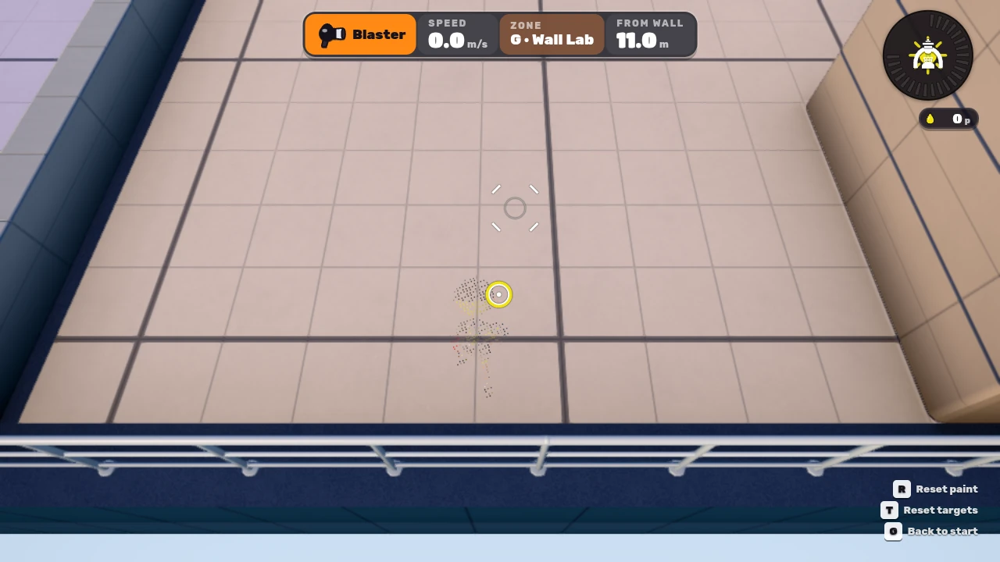
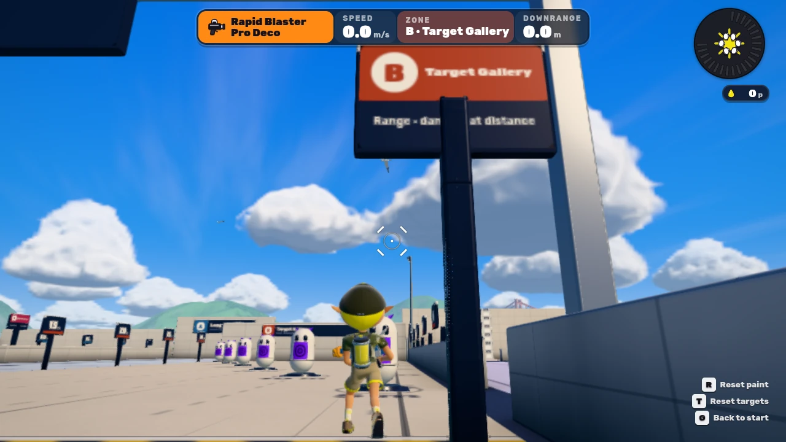

# 自キャラの照準遮りとブラスター照準の修正

## 対象と基準

- 実装対象: 公開版 `inkwave-public/` の最終ソース合成と実行時モジュール。
- 基準 main: `b60a2216a4a553be9ffa6b80f2c30c325aebfd55`。
- 武器パラメーターの参照版: Splatoon 3 Ver.11.3.0。映像は版と撮影条件が判明した範囲を個別に記録する。
- 目的: 自分のモデルが照準付近を遮るときだけ表示を透過し、ブラスターの形状・大きさ・狙い位置と着弾位置の表示を修正する。

本家の画面から測った寸法と、抽出された武器パラメーター、INKWAVE側の視覚校正は区別する。全条件での本家内部UI式や1ピクセル単位の完全一致を確認したという報告ではない。

## 自キャラの透過

ローカルの人型キャラクターの頭・胴体と、現在の照準を同じカメラで画面に投影して重なりを調べる。下向きにして照準へ重なる場合、実際の弾道ガイドが身体を横切る場合、壁際でカメラが身体へ近づく場合に、全身・髪・服・持っている武器へ共通のディザ透過を適用する。見上げる／前を向いて重なりが解けると滑らかに不透明へ戻る。イカ、死亡、マップ、観戦、所有者の交代、非表示、解放でも状態を戻す。

共有マテリアルを透過にしない。ローカル用の派生マテリアルと描画時のuniformを使い、他プレイヤーや別カメラの描画へ波及させない。実マテリアルの色・アニメーション・透過素材・描画面の状態を維持する。高画質のGTAOでは透過した体の不透明な影形状が残らないよう、対象カメラの法線パスだけを保護し、終了時と例外時に状態を復元する。

Splatoon 3の公開シェーダー情報と実プレイ画像には、カメラによる透過とディザに対応する根拠がある。ただし開始角度、最小不透明度、遷移速度、ディザパターンの正確な数値は未取得であり、実装定数はINKWAVEでの視覚校正である。[根拠・条件・実装上の境界](../../patches/splatoon3/reference/self-occlusion-reference-2026-10-31.md)。

## ブラスターの照準

旧表示の破線円弧を、原寸画像で確認できる4本の短い接線、灰色の照準円、インク色と白の着弾円へ変更した。敵を狙った状態は直線のX形状で表現する。大きさは1280×720のCSS画素を基準に、`min(幅/1280, 高さ/720)` で表示する。デバイスの画素密度を二重に掛けず、旧リコイル・距離・ターゲット用CSSから余分な拡大を受けない。

| 系統 | 地上・通常時の4本線の中心までの半幅（720p基準） | 根拠 |
| --- | ---: | --- |
| ホットブラスター | 24.2 px | 原寸実プレイ画像、1080p画像と照合 |
| ノヴァブラスター | 28.5 px | 攻略班の実プレイ映像 |
| ロングブラスター | 20.0 px | 同上 |
| クラッシュブラスター | 26.0 px | 同上 |
| ラピッドブラスター | 18.7 px | 同上 |
| Rブラスターエリート | 18.7 px | **原寸測定未達。ラピッド由来の暫定値** |
| S-BLAST | 19.1 px | 地上モードの実プレイ映像 |

表は採取した姿勢の基準寸法で、全俯角・カメラ距離に不変な本家内部定数ではない。原720pの測定幅は概ね±1 px、432pからの換算は概ね±2 px。通常の短線は長さ14 px・太さ3 px、灰色円の半径は13 px。ジャンプ時は既存の実射撃のブレ角度に応じて横方向へ開き、縦の寸法と線幅を膨らませない。通常種の10度で20.6 pxを加える表示係数は、回復フレームが不明なホットの画像を基にした視覚校正であり、本家の厳密な角度から画素への式を抽出したものではない。S-BLASTの短射程モードは別の画像測定を使い、縦半幅28.1 px・灰色円半径23 pxを基準とし、横半幅は `28.1 + 229 × tan(実ブレ角)` で拡張する。短射程の比較画像はVer.5.1.0・アクション強化10 APであり、11.3.0の同条件ピクセル一致は未確認。画像の解像度、アンチエイリアス、撮影時の姿勢による誤差がある。

灰色の照準円は本家画像でも画面中央から移動する。INKWAVEでは未遮断の弾道終点を灰色円へ、最初の地形接触点または終点を着弾円へ独立して投影する。これは観測した分離に整合する実装モデルで、本家内部の投影式を確定したものではない。HUD全体を二重に移動せず、ダメージ・撃破のフィードバックも着弾側へ揃える。

従来ガイドが存在しなかった6系統のカタログブラスターにも、実弾と同じ発射モード、慣性、重力、固定ステップ、接触判定を使う読み取り専用の軌道予測を追加した。乱数、弾の生成、塗り、ダメージ、インク消費を呼び出さず、同一フレームの照準と透過判定は同じ計算結果を使う。通常ホットの旧ガイドAPIは維持する。キット違いにも元の系統の表示を適用する。

[画像URL、武器別の測定、S-BLASTモード、除外した資料と未確認項目](../../patches/splatoon3/reference/blaster-reticle-reference-2026-10-31.md)。

## 検証

通常minifiedビルドのcontent hashは `fed7a536151ed56fa30ea1cabed832a8f673feee7472d027818beac768fe35c4`。[選択した検証と入力識別子](verification.json)、[ブラウザ集計](browser-summary.json)、[再試験の元記録](retry-notes.json)を保存した。

| 検証 | 結果 |
| --- | --- |
| 自キャラ透過・照準描画・最終HUD統合 | 45件成功（22＋15＋8） |
| 通常配信物の弾道予測・ジャンプ精度・崖の回帰 | 30件成功 |
| 正確なGit treeの入力との照合・minify・offline配信 | 11件成功、skipなし |
| 既存照準関連の選択回帰 | 31件成功 |
| 既存武器・速度継承・guideの選択回帰 | 59件成功 |
| worldのソース所有権移行と既存形状比較 | 41件成功 |
| 通常ビルド、起動予算、ソース合成、参照互換性 | 成功 |

表のグループ間には重複があり、総数を単純加算しない。新規catalog guideの10件は配信物側でも実行している。既存Hot cacheと他武器guideの21件は59件の内数として、2点分離を加えた後にも再確認した。

本番アプリへ正規メニューから入り、実際のカメラ、`computeAim`、地形、描画シェーダーを使った。制御用のguide差し替えを合格条件に使っていない。

| 条件 | ブキ選択 | 実装内の2点投影と表示の最大誤差 | 重なり時の不透明度 | 復帰後 |
| --- | ---: | ---: | ---: | ---: |
| 1280×720、DPR 1 | 16 | 0.000651 CSS px | 約0.10 | 1.00 |
| 1920×1080、DPR 1 | 16 | 0.000977 CSS px | 約0.10 | 1.00 |
| 844×390、DPR 2、touch | 16 | 0.000347 CSS px | 約0.10 | 1.00 |

この誤差はINKWAVE内部のworld guideとSVGの一致であり、本家との画素差ではない。全7系統と9キット違い、実Space入力によるホット／S-BLASTのジャンプ、透過中の武器変更を確認した。自然な下向きではカメラから頭まで約5.68 world単位あり、カメラ近接だけを理由にした合格ではない。実際に頭の輪郭へ着弾円が重なり、不透明度0.1（約90％透過）へ変化した。

非local 11体への透過、共有素材のalpha/depth状態の変更、成功scenarioのpage／console／HTTP／shaderエラーはいずれも0。同一frameの透過→HUD再読み取りでは、muzzle、aim、LOS、raycast、地形queryの追加実行は0だった。desktopのGTAOでは法線パスの除外と復帰を確認。touchでは既存RendererがAOを使用しないことを明示検査し、高画質設定でも透過と復帰を確認した。

最初の連続viewport実行では720p成功後、1080pの起動中にChromium targetが停止した。新processでの1080pは同じ一時保存先でも成功しており、原因をディスク不足とは断定していない。QAはviewportごとにbrowser processを閉じるようにした。最初のtouch単独検証にはdesktop用のAO必須assertがあり、nativeの `q.ao && !mobile.touch` を確認して検証側を修正した。初回failed receiptを成功へ書き換えず、元の失敗と最終成功のreceiptを圧縮保存した。HUD入場アニメーション開始時のscaleは0.4であり、通常寸法は入場完了後に測定している。

以下は原寸スクリーンショットの圧縮プレビュー。測定値は圧縮画像から採ったものではない。





### main取り込み時の既存gate修復

基準mainでもソース所有権監査はworld 2ファイルで失敗していた。`props-core.js` と `props-marina-vessels.js` の既存合成結果をそのままソースへ移し、adapterの2分岐を除去した。移行前の合成コードと移行後のsource／合成コードの全バイト一致を検証し、旧rawをSHA固定fixtureとして保持した。形状・塗り・物理の再校正や検査閾値の緩和はない。監査は18 ownerすべて成功へ復帰した。

GitHubの基準mainにはこの作業前から別の全体CI失敗も存在する。今回のローカル証跡は上記の対象検証の成功であり、全リポジトリCIが成功したと主張しない。新規テストは既存9 shardの再帰収集へ入り、実ブラウザQAも既存active gateへ必須stepとして追加した。CIではGit HEAD、SOURCE_SHA、配信物のsource SHA、receiptのcontent hashを照合する。

実GPU／Safari／Switch実機の描画、全俯角での本家UI寸法、敵capsuleへの実弾接触とX表示の同等性は今回の確認範囲外である。

## 再実行

```sh
node --test patches/splatoon3/tests/blaster-reticle-presentation.test.mjs patches/splatoon3/tests/blaster-reticle-integration.test.mjs patches/splatoon3/tests/self-occlusion.test.mjs
node --experimental-vm-modules --test patches/splatoon3/tests/catalog-blaster-guide.test.mjs
node scripts/build-inkwave.mjs inkwave-public /tmp/inkwave-aim-site
INKWAVE_BUILT_SITE=/tmp/inkwave-aim-site node --test scripts/tests/inkwave-build-packaging.test.mjs
node scripts/check-inkwave-startup-budget.mjs /tmp/inkwave-aim-site
```

```sh
CHROMIUM_PATH=/path/to/chromium node scripts/check-inkwave-aim-visibility.mjs /tmp/inkwave-aim-site /tmp/inkwave-aim-evidence
```

`SOURCE_SHA` を指定するとfull 40桁のGit SHAと実Git HEADの一致も要求する。ローカルで未指定の場合、receiptのsourceShaはnullとなり、content由来のrevisionをGit SHAとして扱わない。
