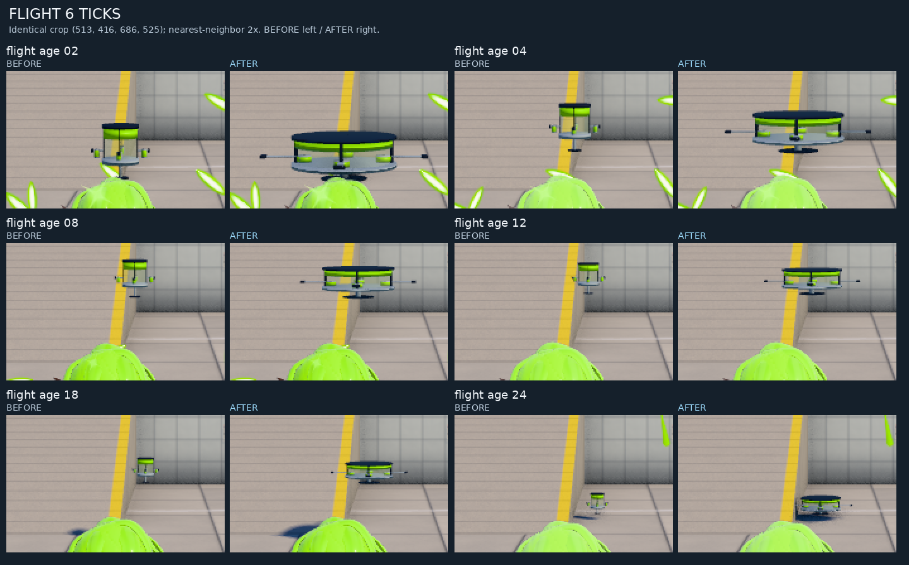
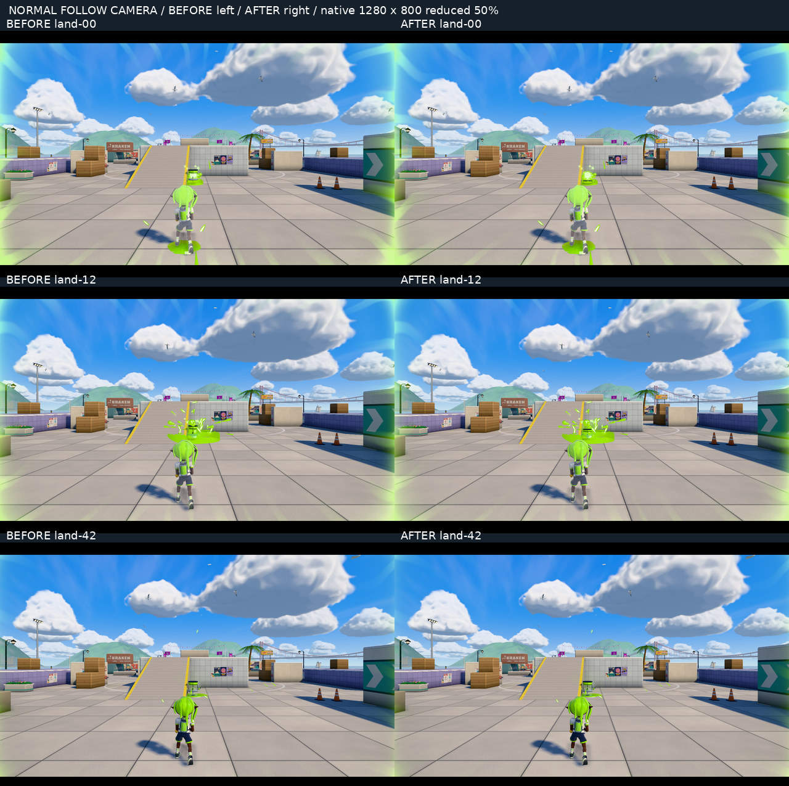
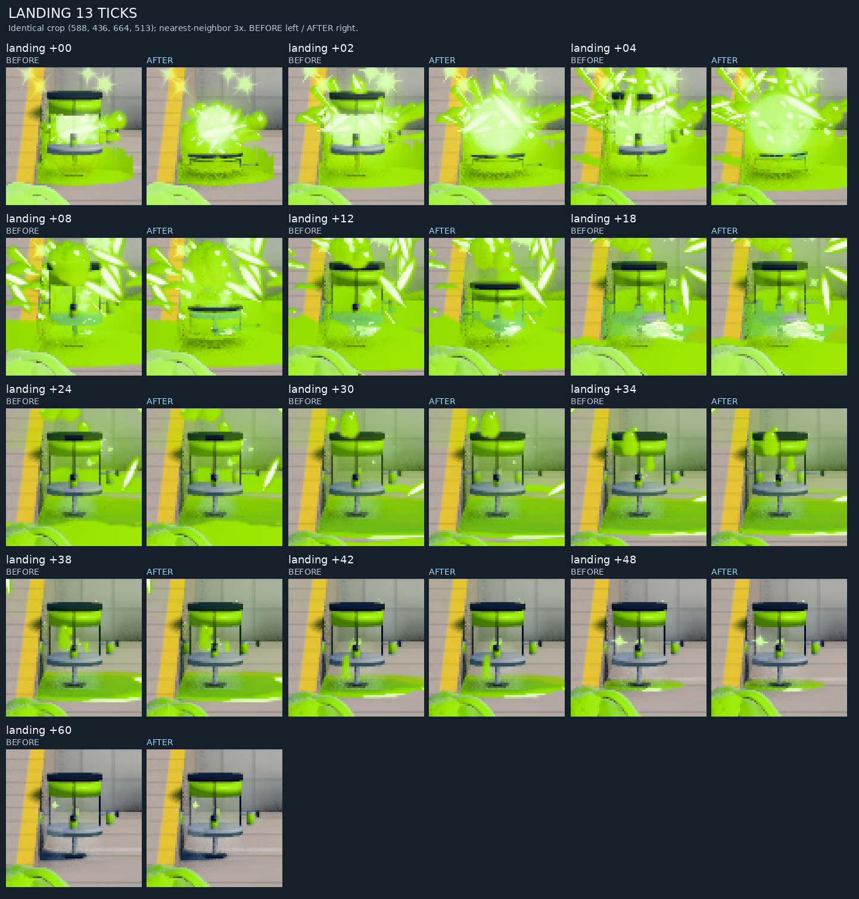
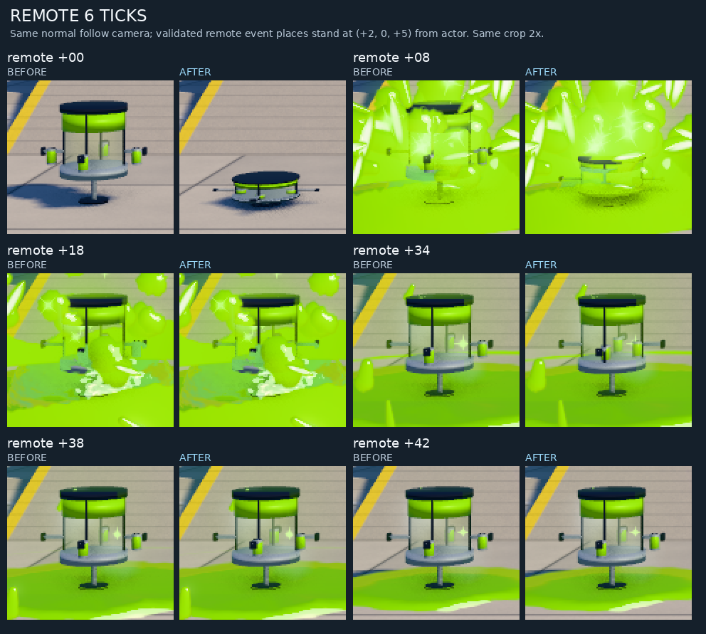

# エナジースタンド展開案：実ブラウザ before / after

**判定：現状パッチは不採用を推奨。** 二段階の順序は見えるが、台座・ガラス・缶まで縦に潰れて伸びる。固定トレイは開閉せず、缶だけが内側から外へ滑るため、剛体の組み立てとして不自然。通常カメラでは既存の強い発動エフェクトに伸長部分も隠れる。material / particle / shader の品質改善は含まれない。メッシュ数固定・ロジック等価だけを見栄えの合格理由にはしない。

## 条件と本家根拠

基準 `a4e81347906c0d60ceef76a69f476261bf8d3f86` / tree `34236683e6776aac9d8b1d4ae0b8a1b31d3f2df2` の隔離コピーと、指定 portable2-file パッチだけのコピーを比較。新mainは使用せず、runtime・既存branch・PR・認証・キャラクター・髪を変更していない。新規形状や演出も追加していない。

保存クラウド環境の実 Chromium `154.0.8037.57`、1280×800 / DPR 1。INKWAVE自作ステージ tidewater、day、high、shadow/bloom有効。同seed 20261023、同じ足元 `(0,0,-20)`、通常followカメラ yaw=0 / pitch=0、F発動→Eを2tick保持→release。着地後60tickまで静止、続いてW歩行。両方とも着地はnative tick **436**、歩行 **29tick** で飲用。primary 30時点について入力・足元・カメラ・時刻・飛行位置/速度・stand情報が一致した。

シミュレーションは固定 **60Hz native tick**。画像は指定tickで止めて撮ったPNGで、一定capture fpsの録画ではない。実時間60fpsや実GPU性能の確認ではない。本家は親が既に許可された30fps録画の120–150フレームを観察し、「薄い円筒→縦の伸長→缶の外開き」を確認したものを根拠にした。版・入力tick・内部曲線は不明。高さ0.28、18tick/42tick等は独自visual calibrationであり、本家確定フレーム値ではない。本家媒体の新規取得・再配布は行っていない。

## 画像で確認した差

同じ画面座標の切り抜きをnearest-neighborで3倍表示。元画像のピクセルを補間・描き直ししていない。beforeは高さ倍率1・缶半径0.41で固定。afterは以下。

| 着地後native tick | root高さ倍率 | 缶中心半径 |
|---:|---:|---:|
| 0 | 0.280000 | 0.240000 |
| 2 | 0.280000 | 0.240000 |
| 4 | 0.301168 | 0.240000 |
| 8 | 0.491731 | 0.240000 |
| 12 | 0.762403 | 0.240000 |
| 18 | 1.000000 | 0.240000 |
| 24 | 1.000000 | 0.240000 |
| 30 | 1.000000 | 0.240000 |
| 34 | 1.000000 | 0.241120 |
| 38 | 1.000000 | 0.331067 |
| 42 | 1.000000 | 0.410000 |
| 48 | 1.000000 | 0.410000 |
| 60 | 1.000000 | 0.410000 |

飛行中のscaleは before=(.35,.35,.35)、after=(1,.28,1)。幅/奥行は **2.857倍**、高さはbefore比 **0.8倍**。薄くなった輪郭だけで本家の格納機構再現とは判定しない。着地後は缶の寸法もroot Yに従って変わる。18tickで本体の伸長が終わり、約34–42tickで缶中心だけが0.24→0.41へ移動する。トレイ/支柱は一体meshのまま。

remoteの補助画像は同じ通常followカメラと照明で、受信イベントが足元から(+2,0,+5)に配置する代表条件。発動演出を新規追加・差し替えた画像ではない。通常発動の画像とは別条件として示す。飲用で非表示になった缶を、その後の展開更新が復活させないことも確認。

## 経路・負荷・保存同一性

- 通常発動→保持→release→実際の飛行→地面接触→13指定時点→歩行飲用→900tick寿命による自然終了を確認。
- 補助fixtureで、tacticooler保持中であることをassertしてsplat取消、standが1個存在することをassertして試合finish→0個を確認。
- 実ブラウザの既存NetMatch受信処理でremote展開を確認。外部peer/socketを開いていないので、ネットワークの往復検証とは扱わない。
- 5回のremote展開は、毎回実際に描画してからclear。各回のbirth=1 root、clear=0 rootをassert。renderer.infoのgeometry/texture/program件数は5回で増加しない。full JS heapやWeakMap内部の残留は未計測。
- 各coolerは **11 mesh / 5 geometry / 11 material / 4,296 triangles** のまま。通常着地13時点の描画呼び出しは両方 **269**。可視缶は飲用時に4→3へ減る。
- CPU参考値は、完全展開後のnative frameについて、先頭をwarmupとして除いた2標本。before **14.8–15.8ms**、after **11.0–14.0ms**。1pixel readbackによるsoftware完了待ちは別記録（約3.6–4.2秒）。標本数が少なく、展開中のコストでもないため性能改善の根拠にしない。実GPU未計測。
- 最終browser runのpage errorは0。先行するsoftware描画待ちによる画像timeoutは記録し、既存before画像の状態を再照合した。元の試合終了fixtureは再スポーンで装備が戻ったため除外し、前状態をassertする補助fixtureで確認し直した。

zero-fuzz適用と全指定ハッシュは一致。全build入力/生成artifactのハッシュを照合し、入力差分は指定の2ファイルのみ。実ブラウザに渡ったkit-support/helper/mainのbytesもmanifestと一致した。[build identity](build-identity.json) と [測定値・画像SHA256](measurements.json.gz) を保存。

before revision `838cfb268cba2b6c4ae3f13918ed0a197bbc0fa453883dfea010c1e9fa02248d` / content `e1c18a72dc8a4e358944f8a8dec59f0d4e178c2d2da9881c8af2d2946e380ab2`。

after revision `311d61e11e58ce5840372ea2bc6aa24dc47a1806d6e2781ce29e45b368a6a3fc` / content `7cebbbf9c91477ba21d6e454cd3eb78697e5b626a4929a40e15a96cbfb62cacf`。

親が報告したsource45/45・minified8/8・24条件38,256 paired updatesは補助情報であり、本報告の実browser確認の代用にはしていない。本家の実機タイミング、実GPU、peer往復通信は残件。本比較を根拠にruntimeへ採用しない。

このreport-only branchには自作ゲームの比較図・報告・測定値だけを追加し、任天堂の媒体/素材や秘密情報を同梱しない。

保存：切り抜き比較図は元PNGと復号RGBピクセルが完全一致するlossless WebP。全体図JPEGのみ共有用に圧縮。元PNGを含むPDFはLibrary保存成功 `libfile_403eb9f27d2481918c82cfbe80c12773`。測定値JSONはgzipで保存。GitHubへの大きいPDF送信は404で未保存を確認し、再送せずLibrary版を正本とする。
