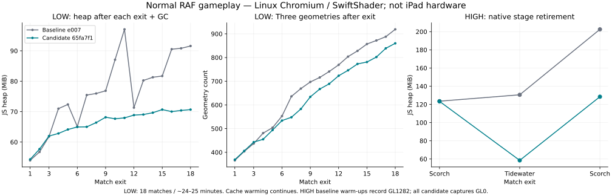

# 通常RAFのGPU・メモリ調査と修正

公開版INKWAVEを本番ビルド・完全なGame・通常RAFで調べ、資源の寿命と転送に関する7群の原因を修正した。基準mainは `e0072a749df0ec8c2d368e383bdf337baa7b44ad`、最終計測対象は `65fa7f183d2d163af798972c2ff0ced46a92868f`。局所転送量・資源解放の直接測定に、プロセスメモリ・CPU・描画性能の比較を併記する。

先行5群の修正は [PR #1883](https://github.com/rhgrive3/actions/pull/1883) の `e4bb8f934db08c14abedd41845f0799c33d936e7` までを含み、2026-10-26 06:57 UTCにmain `d0bfda9bf7cdd36da8e5a7b2b5cea19ac947b8e7` へマージされた。その後に実証したnativeの2群は [PR #1885](https://github.com/rhgrive3/actions/pull/1885) へ分離した。後者のCI・マージ結果も末尾に記録した。

## 修正した7群の原因

1. **カニタンク球形メッシュの寿命。** 球はCharacter rootやdeployable一覧の外からsceneへ追加され、球形中の退出・Actor退場で解放されなかった。対象rosterの破棄時にsceneから外し、geometry/materialを一度だけdisposeする。通常解除・別Actor・重複通知も確認した。特殊動作、物理、攻撃終了の通信イベントは維持する。
2. **Crab飛沫の過剰転送。** 最大512個分の行列・色を毎回更新していた。確保容量と最大個数を維持し、実際に書き換えたlive範囲だけを転送する。
3. **Torpedo/Fizzy飛沫の過剰転送。** 最大768個分の転送を、行列のlive範囲と従来どおり色dirty時だけの色live範囲へ限定した。プール、寿命、描画数、色、弾道、塗り、命中、通信は維持する。
4. **InkFlightプールの退役Actor参照。** 実ゲームの退出後に、再利用待ちの飛沫レコードが退役Actorをownerとして保持していた。最終の塗り・通知・traceの完了後とclear時に参照を外す。以前にプールへ戻ったレコードもclearし、既存スロット・ベクトル・順序と、再利用後の新所有者への塗り加点を維持する。
5. **非表示メニューのScreenFX参照。** ヒープで `_local` から最後のActorへの直接参照を確認した。通常updateによる解放は非表示worldで止まる。破棄rosterに属する `_local` と保留被弾攻撃者 `s.dmgAtk` の参照を外し、タイマー、被弾量、演出・レンズ状態は維持する。古いrosterの通知で新しいActorを消さない。
6. **nativeの最初のロードscopeの保持。** canvasのcontext-lossリスナーに渡すper-load predicateが、共有lexical contextを通して退役NativeLevel/data/physicsを保持していた。現在の `G.level` を読むmodule-scope関数へ替え、一canvas一リスナーと現在ステージに基づく復旧判定を維持する。
7. **native HIGHの不正な圧縮base mip。** Scorchの800×60 universal KTX2 normalが既存mobile cap後に400×30 BC7となり、GL1282を発生させていた。該当画像だけ同じ認証済みsource・選択mip・寸法のRGBA32へ再変換する。有効な圧縮画像やASTCには介入せず、capを変更したり、粗いmipやPNG再resizeへ逃がしたりしない。専用ワーカーと中断後の後着テクスチャも解放する。最新65では、実GLで確認したBC系baseの1/2 texel寸法も不正として検出する。合法な4 texel以上のbaseの下にある1/2 texelの末端mipは圧縮のまま維持し、末端mipを新しいbaseへ昇格した場合だけ例外RGBA変換へ回す。

飛沫の局所試験は、実際の `bufferData` / `bufferSubData`、GPUバッファ読戻し、RGBA画素比較で検証した。増加、圧縮、0個、再出現、上限個数、dirty色を含み、初回の確保容量を維持する。転送削減は同じ描画状態の局所比較であり、ゲーム全体のFPS改善率やGPU常駐量削減率ではない。

nativeのRGBA対照は、同sourceの独立したRGBA32変換をoracleにし、選択した400×30の全48,000 Bが一致した。BC7は非可逆圧縮なので、BC7のGPU復号値とのバイト一致を主張していない。この例外画像の9 mipは17,232 Bから63,588 Bへ増える。画像を正常に復元する修正であり、GPU容量削減ではない。

## 最終比較の条件

主結果は次の3組とする。各組で基準と候補のハーネス・依存ファイルのハッシュ、画面・品質・seed・操作条件を揃える。Crab負例の期待値だけを明示的に変更する。各組のsource/content/harnessハッシュはrawと索引へ保存する。

- **Crab 6退出:** Tidewater → Kelpline → Halyardを2周。480×300・DPR 1・タッチ/iPad UA・LOW。実在するCrabキットを装備し、準備としてゲージを満たして本来の特殊発動を呼ぶ。既存bot入力を球形保持にし、実RAFで球がsceneに現れた後に退出する。補助geometry inventoryは使用しない。旧版は `--expect-lifecycle leak-observed`、修正版は既定の `released` を要求する。
- **LOW 18連戦:** 同じ3ステージを6周、各30秒の戦闘窓。480×300・DPR 1・タッチ/iPad UA・LOW・60 Hz設定。終了時刻だけ既存debug APIで短縮し、本来のfinish/judge/resultsを経てメニューへ戻る。
- **原典HIGH 3試合:** Scorch → Tidewater → Scorch、各20秒の戦闘窓。1133×744・DPR 2・タッチ/iOS判定・HIGH・60 Hz設定。両版で同じ原典データを既存admissionに通す。ゲーム本来の動的解像度を動かし、実描画バッファ寸法も記録する。

Chromium 154.0.8037.57 / Linux / SwiftShader、AMD EPYC 9V74でのソフトウェア描画である。source混在を防ぐため各走行は新規browser context、serviceWorkers:blockで配信した。タッチ判定・UA・画面条件を合わせた検証で、物理iPad mini 6 / SafariのGPU、FPS、熱、消費電力の実測ではない。手動フレーム進行、freeze、描画抑制、ハーネスによるfence/finishは使わない。ゲーム自身のロード・描画・品質制御は動かす。既存CI idleチェッカーのフェンス対策とは別の調査である。

**native旧版の既知不具合を隠さない。** `baseline-native-final` の `warm-0` と `warm-2` はGL_INVALID_OPERATION（1282）を記録した負例である。rawをGL0へ書き換えず、正常合格とも呼ばない。この2窓だけを明示的な既知不具合の比較対象とし、他の基準窓と候補の全窓はGL0を要求する。context loss、freeze、描画抑制、その他の計測エラーは許容しない。

## 主測定の数値

| 条件 | 観測時間 秒（前 / 後） | ピークPSS MiB | ピークUSS MiB | 最終GC後JSヒープ MiB |
| --- | --- | --- | --- | --- |
| Crab 6退出 | 287.67 / 292.18 | 1,741.79 / 1,668.13 | 1,615.36 / 1,541.29 | 64.44 / 64.16 |
| LOW 18連戦 | 1,450.10 / 1,486.69 | 2,001.93 / 1,894.08 | 1,871.68 / 1,765.25 | 91.67 / 70.74 |
| 原典HIGH 3試合 | 584.17 / 600.97 | 2,420.23 / 2,248.48 | 2,291.51 / 2,119.96 | 199.60 / 125.07 |

カニ球のscene残存は6→0、geometry/materialのdisposeは各0→6。各球のCPU geometry配列は4,008 B、6球で24,048 Bであり、非表示球のGPU常駐量削減は主張しない。退出後の退役ownerはCrab組7→0、18連戦組9→0となった。修正後のプール数は戦闘経過で異なるが、全退出のowner数は0である。

| 同一描画状態の局所転送 | 従来 | 修正後 | 削減率 |
| --- | --- | --- | --- |
| Crab 1個、定常更新 | 38,912 B | 76 B | 99.80% |
| Torpedo 8個、行列のみ更新 | 49,152 B | 512 B | 98.96% |
| Torpedo 16個、色dirty | 58,368 B | 1,216 B | 97.92% |

LOW 18連戦の観測FPSは1.385→1.300、R.render GPUクエリ平均は225.27→249.89 msで、全体FPS向上は確認していない。試合軌跡・描画数・動的解像度が変わる実RAF測定なので、プロセスやFPSの差を修正単独の因果的効果としない。HIGH旧版は不正テクスチャの負例であり、正常な画像同士の性能比較とも区別する。局所転送試験は同じデータ・画素を固定した対照である。

[全数値表](measurement-tables.md)にはプロセスCPU、FPS・フレーム時間、GPUクエリ、実WebGLドロー呼出、三角形、18回の退出後資源数、GLエラーを記録した。数値の定義と丸め前値はrawと[集計JSON](final-comparison.json)で確認できる。

表の前/後は基準/修正版。FPSは戦闘フレーム数合計を戦闘窓の実経過秒数合計で割る。複数窓のp95は各窓p95の最小–最大を示し、p95の平均や架空の合成分位点は作らない。フレーム関数・GPUクエリの平均は、それぞれの標本数で重み付けする。HIGHは3窓を個別に示す。

PSS/USSは当該ChromiumのLinux親子PIDをたどり、zygoteを含めて約5秒間隔で採取する。ピークは採取点の最大値で、未採取の瞬間ピークまでは保証しない。RSS合計は共有ページを重複計上するため、物理メモリ削減率に使わない。JSヒープはboot・退出後・最終idleで明示GCを行い、戦闘窓に計測側のGCを入れない。

プロセスCPU秒はCDPの累積値について、PIDごとの観測最大−最小を合計する。最初の観測より前のCPU時間や、zygote等のCPUカウンターを持たないプロセスは含まない。GPUプロセスのCPU秒とGPUタイマークエリのミリ秒は別の指標である。

rawの `frameCpu` はフレーム関数の経過時間で、GPU/ドライバー待ちを含む。CPU実行時間だけを意味しない。GPUクエリの範囲は `R.render` のみで、`paint.flush` 等は含まない。未完了クエリは最大1個、待ちループなし、disjoint結果を除外する。1個の結果が次の窓へ渡ることはある。

seedを揃えてもRAF回数・非同期処理が違うと、試合の軌跡とcacheの使用順は完全には一致しない。全体PSS・CPU・FPSの差を今回の修正だけの因果的な改善率とは断定しない。画質・影・エフェクトを落として比較値を作る変更は行っていない。

## 退役native資源の回収を独立確認

実ゲームのScorch → Tidewaterで、旧NativeLevel、data、physics、world、triangles、nodes、mask、facesの8対象をWeakRefで観測した。最終修正版65では後続タスクGC 3回すべてで8対象の `retained` がfalseとなった。比較したe4ではlevel/data/physicsと配列が同等の最終GC後も保持されていた。

置換先の公開直後に採った最初のGCでは、65でも一部の一時参照が残った。即時解放を主張せず、回収が確認できた後続タスクの最終3採取点と区別する。採取前にCDPの強い対象handleを取得していない。これは監視した旧worldの回収を示す対照で、全ステージ・無制限の反復・GPU常駐量の証明ではない。

球のscene残存とdisposeも直接の寿命指標である。geometry配列のbyteLengthはCPU配列量で、Object3D/material等の付随量やGPU常駐量とは区別する。APIの生成−明示delete数もドライバー内の常駐バイト数ではない。WeakRefの `actorRetained` / `meshRetained` 単独で本体のリークを断定しない。derefは同じJSジョブ内で対象を生かすため、保持経路・後続タスクGC・計測参照を除いた対照を合わせて読む。

## 共有cacheと未確認範囲

ソース監査では、通常の呼出経路のブキモデル定義は最大161キー、既定InkVolumeは136 geometryコンテナと確認した。161はgeometry件数ではなく定義キー数、136も全バッファの独立コピー数ではない。外部/debug登録や未検証の呼出経路まで有限とは主張しない。

18連戦でもgeometryの初回使用・cache warmingは続き得る。増加した全geometryを個別に共有cacheへ帰属できた、全カタログのGPU常駐量やプロセスメモリがplateauへ到達した、とは主張しない。全ブキ・全ステージ・数時間・物理iPadの安定性は未確認である。既存のpaintミップ制御、FX範囲転送、composer解放等は新しい成果に数えない。

## 計測側の副作用と過去データ

初回のハーネスは `quitToMenu()` が返すMatchをPlaywrightへ返し、カメラ・地形・typed arrayを含むグラフを直列化していた。そのピークは通常UIにない計測負荷と混在するため、アプリのメモリ削減成果に採用しない。アプリの戻り値契約は維持し、ページ内でawaitしてundefinedだけ返す形へ修正し、旧callbackで失敗する回帰を追加した。

補助geometry inventoryのdisposeリスナーにも、render wrapperの引数objectをclosure scope経由で強参照する副作用があった。wrapper外factoryでの対照と後続タスクGCで歴史的Actorの回収を確認した。旧inventory付き退出組のActor保持・プロセスピークは本体の根拠に使わず、主比較はinventoryなしで再測定する。監査raw・修正factory・保持経路を分離して保存する。

歴史的LOW 6連戦、初期HIGH組、中断した中間候補の18連戦は、最終65の性能結果へ混ぜない。保存した旧データは履歴・監査用の付録として扱う。主表は上記3組のraw完了・条件照合後に生成した。

## テストとレビュー

先行e4では `npm test` 一式終了0、関連40試験はGC確認を含め全成功・skip 0、ScreenFXの実damageイベント経路を含む2試験も成功した。保留攻撃者の新規試験は修正前に失敗する。InkFlightは最終塗り・通知順、ghost/通常expiry、既存プール、再利用時の新所有者を確認した。Crab/TorpedoのChromium実WebGLプローブは各1件、成功・skip 0で再実行した。これらのsource SHAと最新65での再検証を成果物索引で区別する。

最終65のnative全体は694件中566成功・128skip・失敗0。128件は外部の原典assetがない場合の従来条件により未実行となった。新しいnative回帰は、退役scopeの回収、現ステージ判定、合法圧縮mipの維持、例外RGBAの寸法・source・中断後の解放を確認する。

CodeRabbitを含む補助レビューで、漏れがあっても終了0となる判定、保留被弾攻撃者の参照、シェルのexportと代入による失敗隠蔽を確認し、既定の厳格判定・明示的負例指定、roster限定の解除、代入とexportの分離で対応した。負例期待値で他の計測エラーを成功へ変えない。

既存SpritePool異常値試験のNode 22/V8 NaN符号ビットの揺れも独立再現した。第三試験の各ケースを新しい関数としてコンパイルし、先行試験のfeedbackから分離した。runtime・旧oracle・全入力・64粒子・全assertion・Float32バイト/renderer比較と有限値の最適化試験は維持する。NaN正規化、skip、閾値緩和、コンパイラ無効化フラグは導入していない。Node 22の独立50回とNode 24の確認を記録した。

最終65でChromiumとLinux WebKit 26.5のCrab/Torpedo計4プローブが成功し、全assertion・GPU値・画素一致、GL0、skip 0を確認した。WebKitはprivate依存ライブラリと専用launcherを使用し、assertion部分は元試験とバイト一致する。Linux WebKitでの合格も物理iPad/Safariの性能試験とは区別する。

## CIと反映

今回の修正コミットでは、従来workflow・固定ハッシュ・既存gate・閾値を変更していない。測定と受入CIの待機中、別の [PR #1884](https://github.com/rhgrive3/actions/pull/1884) がmainへCI実行入口の共通化を追加した。ゲーム本体・patch・build入力は測定した65と同一であり、合流作業ツリーの一覧・実行入口検証83件も全成功した（[合流検証](base-integration-verification.json)）。追加検証だけを専用workflowへ分離した。PRの旧走行だけを置換し、mainの各走行は独立したgroupで証跡を保持する。各PRの最終コミットとCI・反映結果を以下に記録する。

<!-- CI_RECORD_BEGIN -->

追加修正 [PR #1885](https://github.com/rhgrive3/actions/pull/1885) は、source `65fa7f183d2d163af798972c2ff0ced46a92868f` の受入CI成功後、2026-10-26 09:09:13 UTCにmainへマージされた。merge SHAは `1676aaf51008a9402851f4f878eb6b5c86d2bd43`。

[受入run #40285735967・attempt 2](https://github.com/rhgrive3/actions/actions/runs/40285735967/attempts/2) は必須20ジョブ成功。既存条件による診断3件とCircleCI補助gateはskipのままである。同じsourceの全workflowは7成功・条件付きQA 1 skip・失敗0。ジョブ・workflow・再実行の記録は [ci-verification.json](ci-verification.json) に保存した。

初回shard 1はGitHubの「hosted runnerとサーバーの通信喪失」で終了し、同じsource・8分割・並列数2・合格条件で失敗箇所を再実行した。ローカルの同条件再現も1,143成功・失敗0で完了した。条件付きのブラウザ専用2件は [実GPUプローブ](exact-gpu/summary.json) で別途実行済みであり、合格基準の緩和や既存試験の除外は行っていない。

主証拠は [PR #1886](https://github.com/rhgrive3/actions/pull/1886)（merge `af9436217f10f2a842097e69435200dc581f6c87`）でmainへ保存された。本追記は、その最終CI・合流検証・文書ハッシュを確定したもので、ゲーム本体の変更は含まない。

<!-- CI_RECORD_END -->

## 成果物

主比較のrawは次の6件。全組で同じハーネス `101a74df5a39de3730c06c3dbd677a2c0fbf702f1df9d71408b4da285170fdb2` を使用した。gzipおよび展開後のSHA-256は [evidence-hashes.json](evidence-hashes.json) に保存した。

| 組 | 基準main e007 | 修正版65 |
| --- | --- | --- |
| Crab 6退出 | [raw](baseline-crab-clean.json.gz) | [raw](candidate-crab-clean.json.gz) |
| LOW 18連戦 | [raw](baseline-raf-18.json.gz) | [raw](candidate-raf-18.json.gz) |
| 原典HIGH 3試合 | [raw](baseline-native-final.json.gz) | [raw](candidate-native-final.json.gz) |

- [独立検証receipt](independent-verification.json): source・生成物・全6走行・集計算術・索引ハッシュの照合。標準Pythonで `python3 reports/gameplay-gpu-memory-20261026/verify-evidence.py` を実行すると、[検算スクリプト](verify-evidence.py)が保存rawから再検証する。図の再生成には [plot-memory.py](plot-memory.py) とMatplotlib 3.10.8を使用する。
- [局所GPU試験](exact-gpu/summary.json)と[索引](exact-gpu/files.json): Chromium/WebKit 4件のraw、ログ、同じassertionのWebKit launcher版。
- [native保持経路](native-audit/native-retirement-audit.md)、[回収対照](native-audit/native-retirement-positive-proof.md)、[数値とハッシュ索引](native-audit/files.json): 大型ヒープ本体はローカル保管。
- [不正ミップ修正](native-audit/texture-upload/proposed-fix.md)、[実RGBA読戻し](native-audit/texture-upload/rgba-integrated-probe.json)、[薄いBC baseの実GL対照](native-audit/thin-base/README.md)。後者のrawには意図した不正呼出の1282を残す。
- [共有cache監査](cache-bound-audit.md)、[native cache監査](native-audit/native-cache-audit.md)、[原典admission](native-admission.json)。原典モデル・画像・source packは含めない。
- [計測inventory副作用の監査](instrumentation-audit/files.json)、[ローカル試験とログ索引](local-verification.json)。

`measurements.json` の歴史的 `*-raf-final` / `*-native-high` 4件は3修正時点の参考資料で、主表に使わない。中断した候補や中間e4/544は主比較へ混ぜていない。CPU profileは大きな本体をコミットせず、各 `*-cpu-summary.json` に元ファイルSHAと上位self timeを保存した。

