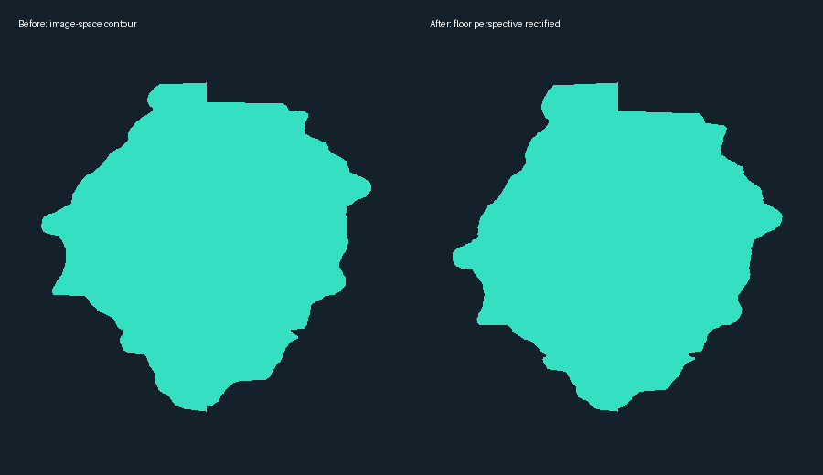
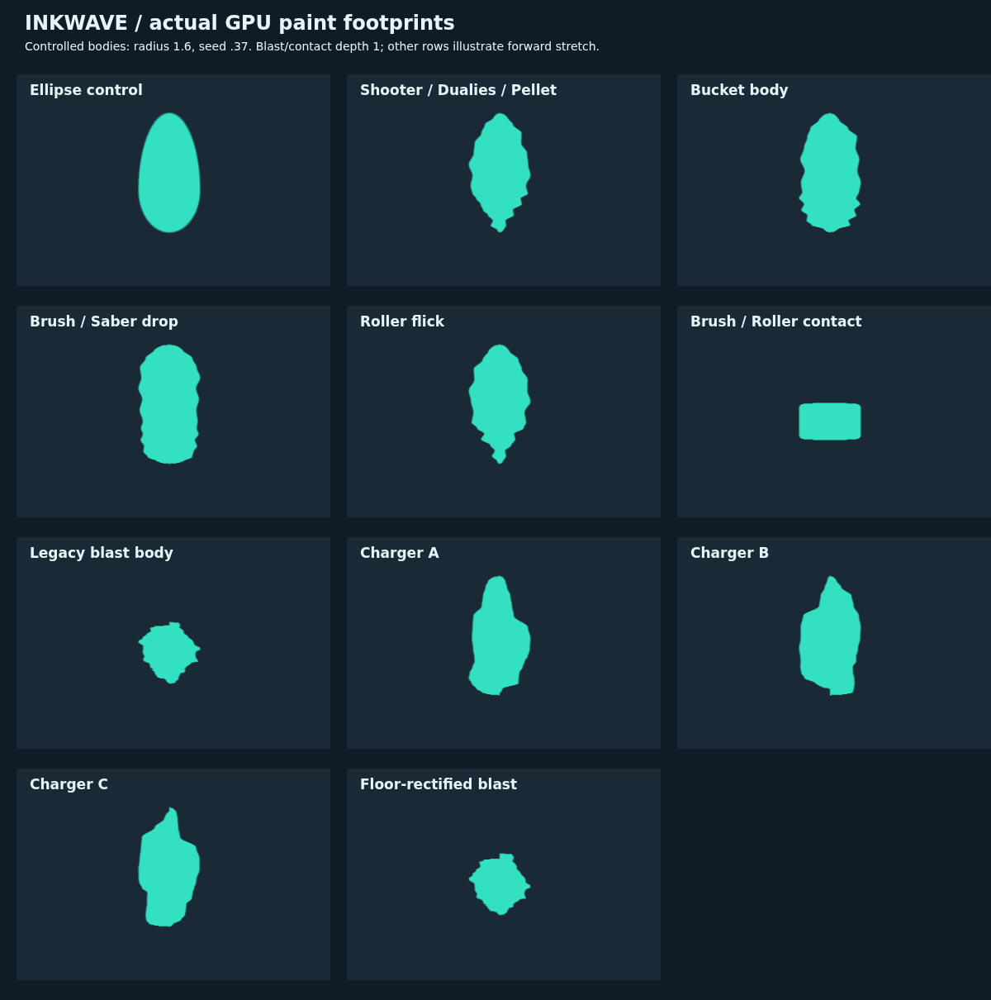
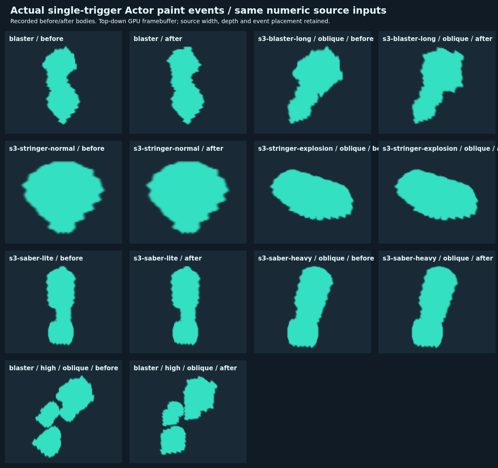

# 爆発の床輪郭・飛沫と時限爆発の向きの追補

公開版 `inkwave-public/`、開始点 `e52f1150b7debd9e4accb4e92750121f2b140c8d`。幅・深さ・弾道・個数の数値は既存の Splatoon 3 **11.3.0** 固定データ。前回の [画像比較](../added-ink-shapes-20261018/README.md) に残っていた床写真の透視変形と、方向の取り落としを改善した。

## 写真をどう読み直したか

実際にダウンロードして表示した [クマサン印のブラスターの床写真](https://wikiwiki.jp/splatoon3mix/ブキ/クマサン印のブラスター) を再測定。ファイル `grizzblast.webp`、542×720、SHA-256 `ce916106d909f671f50ac915cb20dd7ef84c2b8d2392520a8fc6fedbb1d4b89b`。前回と同じ青い先端の池の最大連結成分を使い、穴と独立飛沫は対象外とした。

等間隔に並ぶ床の横ガイド5本（画像Y=94.5、139.5、206.5、320、551.5）を用い、`y=(a*z+b)/(c*z+1)` を最小二乗で校正した。139.5の線は薄いが右側に見える。5本への再投影残差は最大 **0.257画像画素**。逆変換 `z=(b-y)/(c*y-a)` と `xPlane=(x-principalX)*(c*z+1)` で相対平面の左右外周を求め、最後に両軸を別々に正規化する。距離・半径・面積の絶対尺度を写真から推定する処理ではない。

主点X=271は中央の照準・左右対称な撮影枠からの仮定。ガイドの等間隔性、水平・無ロールの床撮影を仮定しており、カメラ内部値を取得したものではない。掲載写真のゲーム版・ギア・射角・入力も未確定。ガイド残差はこの仮定のもとでの画像座標の適合度であり、本家の塗りマスクとの誤差を表さない。

[測定値と校正係数](../../patches/splatoon3/reference/rectified-blast-contour-20261018.json) を保存し、[抽出スクリプト](../../scripts/extract-inkwave-ink-contours.py) に `--rectify-floor` を追加した。旧オプションなしの画像空間抽出も維持する。

クマブラスターの壁写真、クマストリンガーの床・壁写真も開いた。壁写真の長い垂れまで単一スタンプに取り込むと既存の壁落下塗りと二重になるため採用しない。クマストリンガー床の全外周は9本の矢・途中飛沫・爆発の合成であり、単独矢へ貼るマスクには使わない。取得URL・ハッシュ・寸法は [今回の画像台帳](../../patches/splatoon3/reference/rectified-ink-images-20261018.json)。



## 本番処理の修正

| 操作・条件 | 従来の差分と改善 | 担当 |
| --- | --- | --- |
| ブラスター・弓等の床爆発 | 写真の近側と遠側の縮尺差が残っていた。床の相対平面へ補正した輪郭を新kind `ink-blast-rectified`（19）として使う | `main-ink-footprints.mjs`、CPU/GPU共通アダプター |
| 壁と既存の記録 | 床校正を壁へ持ち込まない。新kindでも壁のサンプル行は旧18。旧kind 10〜18の全4608バイトは同一 | 同上。CPUはスタンプごと、GPUは行選択で分岐 |
| 高所から深さ1で着地する飛沫、伸びなしの先端落下 | 伸び量0のとき方向を渡さず、非対称輪郭が世界軸へ戻っていた。保存方向を渡し、伸び量は0を保持 | `blaster-flight-paint.mjs` |
| ブラスターの爆発球・爆発後落下 | 元の弾の水平進行方向を渡す。地形接触後、次tickに解決する爆発でもプールに戻る前の速度を複製 | `weapons-fidelity.mjs`、`weapon-edgecases.mjs` |
| ストリンガーの冷却弾が刺さってから爆発 | 速度を0にする前に方向を保存し、時限爆発まで保持。爆発時の所有者の照準は参照しない | `main-weapon-catalog.mjs` |
| 通信 | kind 19を明示受理し、送信元と観測者が同じ形状・方向を再生。旧18も検証し続ける | `network-replication/adapter.mjs` |

形状テーブルは既存の **8192バイト** の空き行を使うため追加テクスチャ割り当て0。GPUは引き続き1回のNearest参照、CPUは同一バイト列を補間する。新しいスタンプ・飛沫・通信フィールドは増やさない。kind 19は既存の未圧縮行で送るためv2圧縮辞書の語順は変えない。

## 確認結果

- 回帰 **67件成功**：全65基本ブキの実Actor→WeaponRunner→Projectiles→Paint、追加系統28件、ブラスターの実地形8件、輪郭・方向・旧イベント・通信を検査。30/60/120Hzでの落下位置と最終所有も含む。
- [実Character・Physicsのブラウザ検証](browser-cadence.json)：15ブキ×30/60/120Hzの **45ケース成功**。途中の飛沫表示位置、着地時刻、最終所有と一度だけの塗り加算が一致。
- [7ケースの実発射記録](volley-captures.json)：最新mainの本番minify生成物と候補ソースを固定seedで各300 tick進めた。44要求で位置・半径・team・seed・元の位相kind・面・回数は一致。輪郭と方向は意図した変更対象。全体の面積は変わる。
- 実WebGLのsource合成と本番minify生成物の両方で **1094身体条件**、既存124条件・1512ハッシュ問合せを検証。CPU/GPUの明確な内点不一致 **0/0**。旧汎用マスクのfloat32境界17点は別計上。新形状を円に戻す負の対照でも差分を確認。
- 実アトラスの半透明画素が元の幅・深さの矩形とAA境界を越えないこと、壁で旧18を使うこと、深さ1±微小値と伸びなし着地で方向が消えないこと、プール再利用・着弾後の照準変更で方向が変わらないことを確認。
- 比較ギャラリーは半径1.6の制御例。爆発と接触帯は伸びなし、他は伸びの説明用。CPUセル中央と実GPUテクセル中央を揃え、異なる位置の最近傍画素を誤比較しない。実発射の比較は下の別画像。

ビルド・検証コード・入力・写真・証跡のハッシュと個別条件は [検証台帳](verification.json)、全WebGL結果は [圧縮JSON](paint-mask-result.json.gz)。保護対象の `inkwave-public/` は変更していない。





## 再現

```sh
python scripts/extract-inkwave-ink-contours.py reference-directory output.json --rectify-floor
node --experimental-vm-modules --test patches/splatoon3/tests/rectified-ink-orientation.test.mjs patches/splatoon3/tests/main-ink-footprints.test.mjs patches/splatoon3/tests/catalog-added-family-paint.test.mjs patches/splatoon3/tests/blaster-floor-paint-1188.test.mjs patches/splatoon3/tests/added-ink-contour.test.mjs patches/network-replication/tests/paint-canonical-order.test.mjs
node scripts/build-inkwave.mjs inkwave-public _site
node --experimental-vm-modules scripts/capture-inkwave-contour-volleys.mjs after.json
INKWAVE_BUILT_SITE=baseline-site node --experimental-vm-modules scripts/capture-inkwave-contour-volleys.mjs before.json
node scripts/check-inkwave-paint-mask.mjs --site _site --main-ink-captures reports/ink-contour-refinement-20261018/volley-captures.json --exact-source
node scripts/check-inkwave-added-family-paint-browser.mjs _site browser.json
```

## 残る実機比較

クマブラスターの輪郭を他の爆発へ使うことは引き続き近似。全ブキ固有の原マスク、乱数での選択、穴、独立飛沫、壁専用マスク、全チャージ量・射角・斜面の実機一致は未確認。今回の投影補正・ロジック・ブラウザ検証を、Nintendoの原マスク復元、Switch/iPad実機の性能計測、本家との画素一致として扱わない。
