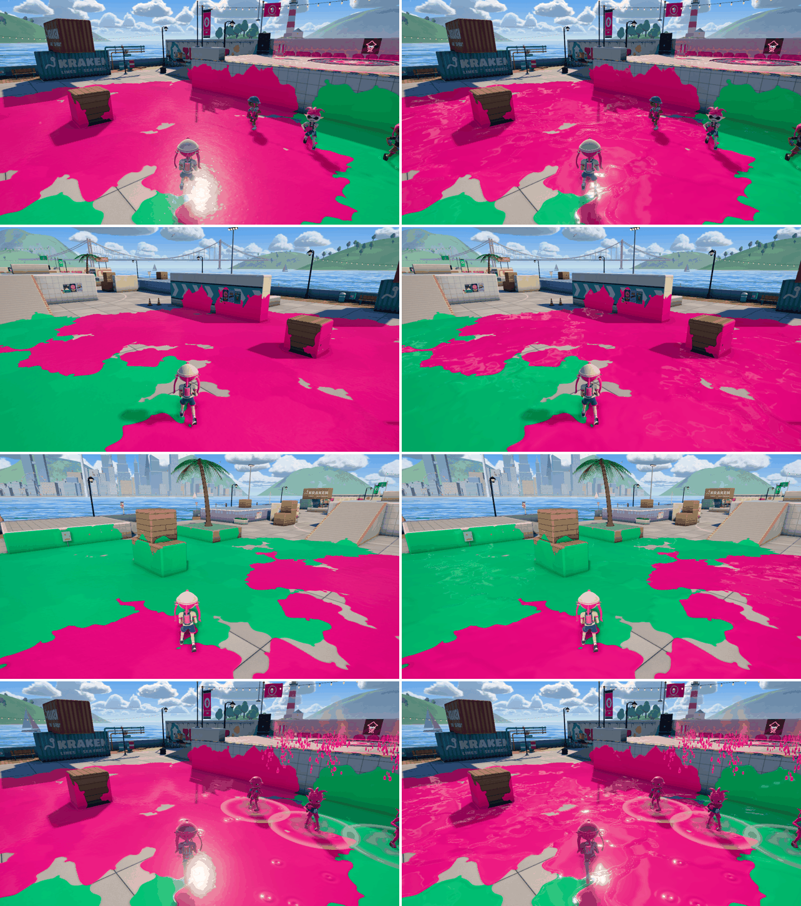
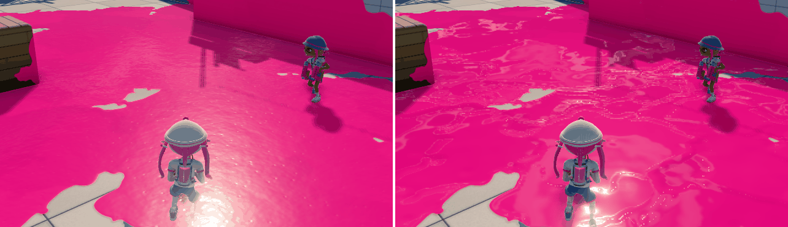

# インク表面の質感：反射の線・塗りごとの縁・乾かない艶（見た目のみ）

公開版 `inkwave-public/src/world/inkShading.js` の床・壁インクのシェーダーを変更した。塗り判定・所有・移動・射撃・カメラ・チーム色・塗りの形は変えていない。

## 本家の参照

版・ブキ・ギア・塗られてからの経過時間は、どの画像からも特定できない。シェーダーの数値や反射の作り方は公開されていない。以下は画像の見た目の観察で、数値は INKWAVE 側で見た目を合わせたもの。画像は著作物のためリポジトリには保存せず、URL・寸法・SHA-256 だけを記録する。

| 画像 | 出典 | 見たもの |
| --- | --- | --- |
| A. 試合（屋外・晴天、ナワバリ中盤） | [任天堂オーストラリア公式の紹介ページの画像](https://assets.nintendo.eu/image/upload/c_scale%2Cf_auto%2Cq_auto/v1660177274/NAL/Migration/Splatoon3/Aug-10-Update/Splatoon3_Overview_Splatted_Carousel_Scr_03.jpg) | 広い面が艶のある均一な色。白いハイライトは日陰にも出る細い波線。太陽側にぼやけた塊は無い |
| B. カニタンク（日なた、見下ろし） | [任天堂フィリピン公式 screenshot04](https://www.nintendo.com/ph/switch/av5j/img/screenshot04.png) | 水たまりの色は縁まで同じで、縁が明るい帯にならない。奥の縁に細い白線 |
| C. サーモンラン（暗い空） | [任天堂フィリピン公式 screenshot06](https://www.nintendo.com/ph/switch/av5j/img/screenshot06.png) | 塗りの縁と穴の周りが盛り上がり、細い白い反射線が縁に沿う。本体は大きくなだらかな濃淡 |
| D. 海女美術大学（Nintendo 提供、Nintendo Life 掲載） | [s32](https://images.nintendolife.com/1e0a4308bc27f/s32.large.jpg) | 一つひとつの塗りがぷっくりしたゲルの塊で、重なった塗りの輪郭を白い反射線がなぞる |
| E. ユノハナ大渓谷（同上） | [s311](https://images.nintendolife.com/f256098adfa12/s311.large.jpg) | 塗りの輪郭に沿う控えめな起伏と、縁の細いハイライト |

取得時の SHA-256（2026-10-22）：A `02e2a6a0702907ce5c50225e3aa9ea89753123d56ca0ade0de1a04e57befda21`（1278×720）、B `58a35d0cef3cbd630b264ea2c21e74f3ade20fb1b40cc15e72cb051ffafd0634`（1300×731）、C `d78961f78a98642341b523826cca4d36d7c15d0e417a3540b5fa807af8e55f58`（1300×731）、D `cdef0705507c0f4ac6187300e8ebb93b88fd4c01985d1c9fdf6cbf61802e8cb0`（1200×675）、E `8285f2b072048652594e9c1b7abf729c98728a41f777ff9430b23504d89158a5`（1200×675）。

所有者の指摘：「ハイライトは反射」。太陽の照り返しだけでなく、周囲（空・明るい物）の映り込みとして扱う。

## 変更前の INKWAVE との差と変更内容

| 差 | 原因（実ゲーム画面で光の成分を一つずつ消して特定したものを含む） | 変更 |
| --- | --- | --- |
| 太陽側に大きなぼやけた白い塊 | 透明コートの下の顔料層の鏡面反射（粗さ0.26、強さ30%、F90 0.35）が広いローブで太陽を映していた。ブルーム・コートの粗さ・空の映り込みは主因ではなかった | 顔料層の鏡面反射を3%、F90 0.02 に下げ、艶はコートだけが担う |
| 乾くとマット（約6秒で粗さ0.06の半艶） | 乾燥の設計 | 乾いた後のコート粗さ 0.06→0.034（濡れ 0.028→0.026） |
| 細かい粒状のきらめき | ゲル法線（1 m 周期、細かいさざ波と窪み）を画素相当のミップで読んでいた | ミップを3段粗く読み、配置を床で約4.7倍に広げ（0.75→0.16、うねり約1.5 m）、傾きは1.6倍 |
| 白い反射の線が無い（空が淡く均一に映るだけ） | 空の反射を全体に一律1.25倍、グレージングの F90 0.3 | 空の平均輝度の 1.55〜1.65 倍を越える狭い帯（雲の縁）だけを白く強く（最大6倍）映し、雲の中心と青空は淡いまま。帯は画素の幅でぼかし、遠くで点線にならないようにした。F90 0.3→0.45 |
| 塗りの中に起伏が無い（外周の縁と敵味方の境目だけ） | 塗りのアトラスは被覆を最大値で合成するため、重なった塗りの輪郭が高さに現れない | 塗りごとの色ばらつき（B チャンネル、新しい塗りが上書き）の段差を輪郭とみなし、丸い縁の段差として法線に加える。アトラス上の輪郭は約1テクセルと細いので、ミップ1の3テクセル幅の差分で傾きを読む（階段状のちらつき防止）。カメラの近くで、段差が近い画素だけ |
| 縁が明るい帯になる | 薄い縁を明るく・鮮やかにする設計（35%） | 10%に下げた |

追加したテクスチャ参照は、カメラ近くの塗りの輪郭付近の画素だけ1画素あたり4回（ミップ1）。新しいテクスチャ・描画パスは無い。

## 画面比較

Chromium（SwiftShader）で本番ビルドを起動し、タイドウォーターのナワバリでボットを止め、同じ乱数種で両チームのインクを撒いて撮影した（`scripts/capture-inkwave-ink-material.mjs`）。各組の左が変更前（main `144923a`）、右が変更後（`0a3ff51`）。上から、乾いた後・太陽方向、乾いた後・横、乾いた後・太陽と逆、塗った直後・太陽方向。

乾いた後・太陽方向の拡大（左が変更前、右が変更後）：

[比較動画](before-after-pan.mp4)：乾いた後の床で、カメラを太陽方向の左右±0.7 rad にパンした連続60フレーム（30 fps・2秒、左が変更前・右が変更後）。各フレームは実際にレンダリングした連続画面で、補間・合成ではない。ゲームの時刻は1フレームごとに1/30秒進む。

## 負荷

同じ撮影スクリプトで、太陽方向・乾いた後の画面を1フレーム描画するごとに1画素読み戻して GPU キューを空にし、その時間を測った（`PERF_ONLY=1`、40フレーム、各回は新しいブラウザ）。A は変更前（main `144923a`）、B は変更後（`0a3ff51`）。

| 順 | 版 | 中央値 | p10 | p90 |
| --- | --- | --- | --- | --- |
| 1 | A | 3818 ms | 3616 | 4055 |
| 2 | B | 3844 ms | 3570 | 4007 |
| 3 | B | 4067 ms | 3828 | 4239 |
| 4 | A | 4004 ms | 3800 | 4241 |

隣り合う A/B の差は +0.7%・+1.6%（平均 +1.1%）で、前半と後半のブロック間のずれ（約5%）より小さい。この環境は CPU で描画する SwiftShader で、1フレーム約4秒かかるため、実 GPU・iPad のフレーム時間とは比べられない。実機での負荷は**未確認**。追加処理は、カメラ近くの塗りの輪郭付近の画素だけのミップ1参照4回と、定数・`smoothstep`・`fwidth` 程度。

## 未確認・残る差

- **本家の実機・同条件の比較は未実施**。参照は公式静止画で、ステージ・空・カメラ・時刻が INKWAVE の画面と違う。数値は見た目の合わせ込みで、本家の値ではない。
- 本家の反射には周囲の建物・箱も映る。INKWAVE の環境マップは空だけなので、物の映り込みは無い（画面空間反射などは負荷の条件から入れていない）。
- 本家のインクが乾いて質感が変わらないかは、静止画からの推定。塗った直後の波紋・明るさの変化（INKWAVE の約4秒の濡れ表現）は残した。
- 塗りの輪郭の高さは、塗りごとの色ばらつきの段差から作る近似。色の値が近い塗りどうしでは縁が弱くなり、どちらの塗りが上に乗るかも本家どおりではない。本家が塗りの高さをどう持つかは公開されていない。
- 反射の帯は雲の縁を線にする様式化で、物理的な反射の再現ではない。曇り・夕方などの空のテーマ、原典ステージ、練習場、壁の塗り、低画質（texlib 無し）の代替経路での見え方は今回撮影していない。
- 実 iPad・WebKit・実 GPU での見た目と負荷は未確認。
