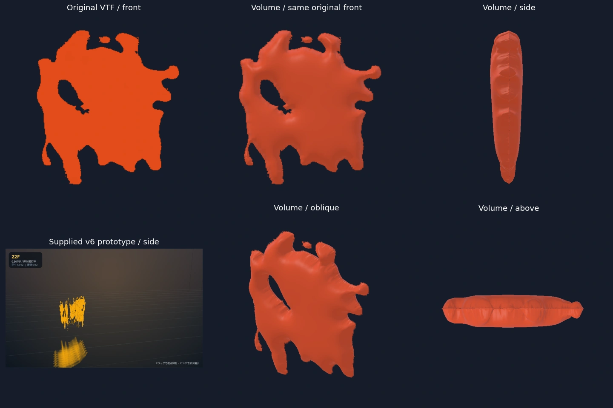
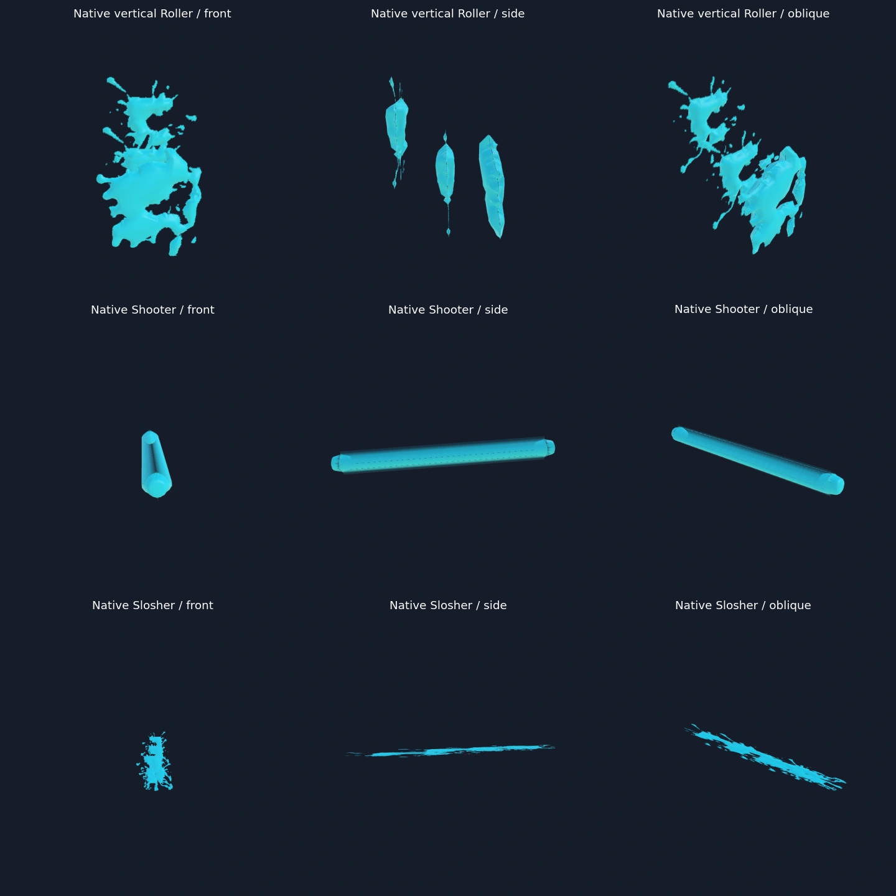

# Verification status

Both original DXT3 VTFs were decoded without changing any source byte. All RGBA channels of both 16-frame textures matched an independent Pillow DDS decode: zero differences. The SplatoonSWEPs checkout remains unchanged. Every original frame and both mesh LODs passed closed-surface winding/volume, finite/nonzero triangles, indices, UVs, normalized SNORM16 normals and opaque/fringe partition coverage checks. UV seams are welded by exact position for physical topology validation.

All 32 frames were rendered at 512×512 in Chromium and WebKit. Maximum mean absolute alpha error against the source plane was 0.163163 byte units in Chromium and 0.128987 in WebKit (0.064% / 0.051% of full alpha). Maximum support differences were 1286 / 1420 of 262144 pixels (0.491% / 0.542%). Individual boundary errors can reach 255; stored source pixels are exact, rendered edge rasterization is not pixel-identical.

The black side strip found during review was corrected before the final PR revision. The derived bevel keeps the alpha/RGB fringe thin, side vertices use dedicated source UV seams, atlas sampling is bounded to the current frame, and opaque ink writes depth before original partial-alpha blending. Both passes share the same 3D surface and buffers. All 32 frames × side/top/bottom views passed **zero black RGB pixels and zero transparent defects inside eroded opaque source regions**, in both browser engines. These assertions retain genuine source holes and transparency. Front/side/oblique/top/bottom captures and the 16-frame animation sequence were reviewed locally; the supplied v6 prototype was also rendered from four directions and its enhanced mode. Retail Ver.11.3.0 footage was unavailable.

Real native input in the emitted Practice Range produced 13 horizontal Roller heads; all 13 used the volume, with no presentation overflow. Their native positions, velocities, deceleration, landing and paint continued through existing game owners. After 90 additional ticks the volley had landed and no heads remained. Source tests also exercise actual composed `_draw()`, snapshot gameplay fields, camera-independent orientation, local/replicated shot identity, pooled generations and exact resource cleanup.

## Measured cost

The unchanged game renderer and new renderer were compared on the same paused, native 13-head volley, off/on/off/on, with four warm frames and twelve samples per block. Linux Chromium uses SwiftShader software rendering. GPU timer queries and browser frame cadence are separate from CPU submission timing. These results do **not** establish physical mobile/iPad performance or live gameplay FPS.

| Measurement | Existing renderer | Volume renderer |
| --- | ---: | ---: |
| Full compositor draw calls | 157 | 163 |
| Full compositor submitted triangles | 671,017 | 1,425,965 |
| Projectile `_draw()` median CPU ms | 0.10 / 0.10 | 0.20 / 0.10 |
| GPU timer median ms, repeated blocks | 3117.74 / 3131.37 | 3427.80 / 3353.48 |
| Paused-scene browser frame pace, FPS | 0.335 / 0.317 | 0.287 / 0.299 |

The volume increased measured software GPU time by approximately 7–10%; it is not free. The game's baseline is already extremely slow on this software GPU. Millisecond CPU submission/`gl.finish()` call timing must not be inverted into claimed gameplay FPS. The existing compositor submits the scene in multiple passes, so its triangle counter exceeds the volume's 383,440 per-view submitted triangles. A 600k per-view triangle budget, 128-instance pool, distance/frustum culling and two shared LODs bound rendering work. Over-budget presentation retains the existing game renderer.

The original pack contains 45,303,672 binary bytes (~43.2 MiB); upload-layout GPU buffer/texture estimate is 39,272,096 bytes (~37.5 MiB), including shared opaque/fringe buffers and fixed instance capacity. SNORM16 normals save 5,328,012 bytes compared with the full-precision version of the same mesh. Neither number is driver VRAM. Both LODs and every fine boundary remain resident, which is a substantial memory cost; phone/iPad memory, thermals and performance remain unverified.

Twenty native reset/clear cycles kept renderer counts at 240 geometries / 48 textures and the same volume byte estimate. Disposal reduced them to 112 / 46. This demonstrates reuse and release for that run, not an unlimited-play JS-heap leak guarantee. Numeric readbacks, scene positions and all repeated timing blocks are in [measurements.json](measurements.json).

## Tests and reproducibility

Six new suites cover original pixels, holes/islands, physical topology, UV/normal validity, frame boundaries, both depth passes, shared GPU/instance buffers, pose/position coupling, culling/capacity, pool generations, invalid packs and cleanup. Actual JSON packets from the native NetMatch recorder also replay both flick modes into an owner whose current weapon/mode changed; vertical ghosts retain the existing renderer and zero gameplay authority. Review found that classifying before metadata restore incorrectly included vertical ghosts, and moved observation to the completed native birth. The existing #1040 fixed-clock suite passed after requiring the explicit engine marker rather than accepting an arbitrary FX Proxy property. Production composition and all 14 combined source/packaging tests passed on committed inputs, including PWA replay and exact tracked Git input identity.

Earlier full local patch validation ran 4777 tests: 4757 passed, 19 skipped, one #1040 failure subsequently fixed and all 11 cases rechecked successfully. Existing focused weapons/Roller/network/FX tests passed 51 cases with one optional GC-only skip. The quality gate passed 910 cases with eight skips; a missing browser executable was resolved and all ten affected paint-mipmap cases passed. Final exact-head CI reruns the existing full gates and the new authored-fixture Chromium/WebKit rendering workflow; current statuses are linked in the PR.

The previous PR-head UI job failed one touch menu-ring visibility check with a CSS opacity transition still at zero; the other two rematch rounds passed. No pack was loaded in that job and no UI/menu code changes belong to this feature. The base-main run passed, so this is recorded as an intermittent existing-path failure rather than proven pre-existing breakage; the final-head rerun is the deciding result.

Original assets and source-based comparison images are now included following the user’s confirmation of permission. Normal startup loads the original-derived 3D packs automatically. The authored structural fixture below remains a generic topology test, separately labelled from the actual source-based images. Original partial-alpha overlap ordering, physical-device validation and retail matching remain limitations.

## 2026-10-12 extension: vertical Roller, Shooter rods and Slosher films

Implementation core: `27b0af977cb04ba92a86521bb50a5433582cfbaa`, adopting main `90b4fea7`. Detailed raw data and compiled input/content hashes are in [projectile-measurements.json](projectile-measurements.json). No original assets, derived packs or source screenshots are published. Local screenshots live under `.browser-evidence/volume-expand-measured/` and `volume-expand-webkit/`; each contains native game and front/side/oblique/top/bottom views.

- Native Actor/action/flight/draw regression for 36 supported main definitions, plus all five Roller definitions in vertical mode. The original and new runtime suites total 14 passing tests.
- Native browser input for horizontal/vertical Splat Roller, Splattershot, Slosher, Dualies, Splatling, Carbon vertical, Splattershot Jr and Tri-Slosher: all nine pass in Chromium and WebKit touch viewport. Native heads are 13/3/1/4/1/1/5/1/7 at the sampled stage; delayed Slosher births retain their native owner. Rod heads use three shared components each. No overflow. Initial heads land/retire during 150 actual fixed ticks; draw does not mutate authority.
- Both browsers: 45 perspective readbacks of the actual native effects, comparing the same opaque source regions before/after real lighting. Eroded opaque body has zero black RGB pixels and zero transparent defects. This does not turn original partial alpha into opaque pixels.
- Original Shooter line/dot are single-frame DXT5. Independent Pillow decode gives zero RGBA differences; both LODs of both images form four valid closed shells. The source beam uses UV 0.3..0.7; clipping its derived geometry avoids disconnected transparent ends. Tip width 0.75 is the OSS artwork ratio, not a claimed S3 default.
- Existing local Splatoon3 suite: 3980 tests, 3970 pass, 10 existing skip, 0 failures. Final compiled-site new+packaging: 23 pass, no skip, no failure. Source-only suites: 14 pass, no skip. No important assertion was weakened.

Linux SwiftShader, same paused native scene, off/on/off/on; four warmups and eight samples per block (seven ready GPU timer samples). CPU medians below are constrained by the browser timer resolution. rAF pacing is measured separately and is **not live gameplay or mobile FPS**.

| Scene | Calls old → new | Triangles old → new | GPU median old ms (two blocks) | GPU median new ms (two blocks) | rAF FPS old | rAF FPS new |
| --- | ---: | ---: | ---: | ---: | ---: | ---: |
| Vertical Roller, 3 heads | 157 → 163 | 699499 → 835211 | 3108.17 / 3213.47 | 3188.37 / 3117.85 | 0.339 / 0.328 | 0.323 / 0.323 |
| Shooter, 1 head | 157 → 163 | 673529 → 685585 | 3366.14 / 3126.18 | 3161.35 / 3123.90 | 0.297 / 0.297 | 0.309 / 0.313 |
| Slosher, 4 born heads | 153 → 163 | 677590 → 840366 | 3474.38 / 3293.53 | 3138.61 / 3369.91 | 0.287 / 0.303 | 0.302 / 0.299 |

Draw submission CPU medians: vertical 0.10 → 0.20 ms; Shooter 0.00 (below resolution) → 0.20 ms; Slosher 0.00/0.10 → 0.20/0.10 ms. Paired software GPU differences range from about -10% to +3%, with a large baseline scene and visible run-to-run noise. These samples do not prove a hardware GPU speedup; draw calls and geometry both increase. Prior 13-head horizontal runs cost +7–23% GPU time, as recorded above.

Owned GPU upload layout is **39,520,236 bytes (~37.69 MiB)** for sheet + rod packs, not driver VRAM. It adds 248,140 bytes to the sheet-only layout. Twenty resets keep resource counts and bytes stable; Chromium geometry/texture 330/50 → 194/46 after dispose, WebKit also retires 136 geometries and four textures. This is a bounded reset/dispose test, not long-session JS heap/thermal validation.

The original Roller VTF is applied to vertical mode using its S3 draw radius, because first-generation SplatoonSWEPs has no vertical asset. Film width/thickness and missing Shooter tail defaults remain existing INKWAVE visual calibrations. Vortex/bubble/explosive/double Sloshers need their own registered assets and have not been falsely replaced with Roller sheets. Exact retail VFX, curved-history tails, order-independent partial-alpha overlap, physical mobile/iPad measurements remain unverified.

The final emitted-build regression exposed a test setup that treated first-frame natural freefall as an accepted jump. The production build already preserves the existing 25F horizontal grace. The test now uses native jump input and asserts admission/positive jump velocity for all five Rollers; a separate negative control verifies that early natural fall remains horizontal. Assertions were retained/extended; renderer and physics code did not change. The source fixture applies the same existing freefall adapter as the emitted build. Final source 14 and emitted new+packaging 23 tests pass without skips.

On final head `393007db`, the new volume job and all 13 other applicable jobs succeeded. The existing validator executed its source/quality gates successfully (4909:4890 pass/19 existing skips; 927:919 pass/8 existing skips) and then failed to locate `paint-owned-run-scan.test.mjs`. The workflow came from the newly advanced PR merge/base definition while its explicit checkout still used the pre-update feature head; that test is present in new main `b078c379` (PR1262), not old main `90b4fea7`. The six-file main update was merged intact, with no renderer or physics edits and no weakened check. The combined emitted build passes 33 targeted tests without skip/failure: volume, packaging, exact rectangle scans, piece-local ownership and Map lifetime. Full-scene measurements above remain scoped to the measured `90b4fea7`-based implementation; volume core bytes are unchanged by the paint-only main update. CI is rerun against the combined head.

## 2026-10-12 — bundled original assets, automatic activation

The user confirmed asset permission and explicitly requested ordinary automatic activation. The four VTFs and corresponding VMTs are committed unchanged. Default FX construction loads both source-derived packs, and normal game boot waits in its existing warmup phase before shader compilation/play. The game requires no user URL or feature flag. Lossless gzip reduces 45,557,516 uncompressed bytes to 17,694,762 transport bytes (16.875 MiB); decoded SHA-256, all 34 RGBA frames and mesh bytes remain unchanged. The geometry core and measured GPU layout above are unchanged by transport/default loading.

A separate bounded two-slot cache reuses verified binary hashes across code revisions; corrupt entries are refetched and a prior slot version is evicted. Both manifests are in the existing offline snapshot. Its 10 MiB / 12 MiB and worker ceilings are retained. Offline bake-only VTF/mesh modules are excluded from the published executable graph while their source hashes remain in the build identity. New tests verify defaults, original pixels, exact gzip round trip/size limits and cache corruption/offline/eviction. First online download/startup adds material cost, and a fresh offline install without previously cached binaries falls back to the native renderer.

Normal startup without either configuration global passed the nine native actions in Chromium/SwiftShader and WebKit/Mesa touch viewport. Both registered `roller` and `shooter` before playing, with no loading or page errors. Each browser passed 45 grazing-direction checks with zero black/transparent opaque-body defects. The local-server whole startup took 105,208 ms / 27,793 ms; these include the existing large software-rendered game/world/shader warmup and are not an asset-only A/B or physical-phone network timings. [Default startup, native actions, resets and disposal](default-measurements.json) record the exact build identity and environment.

The production startup snapshot is 5,658,810 bytes, total declared core revision 10,276,777 bytes, worker 69,493 bytes, within their existing 10 MiB / 12 MiB / 68 KiB limits. The separately stored source-derived binaries add 16.875 MiB transport/cache; GPU upload layout remains 37.69 MiB estimated, not measured driver VRAM. Source and exact emitted new+packaging gates pass **27/27, no skips/failures**.

First row compares the original VTF front with the same source-derived front and side; second row includes the supplied v6 plane from the side and volume oblique/above. These controlled source comparisons predate default delivery and use the unchanged reviewed Roller geometry.

These native heads were emitted by ordinary game inputs in the final default-enabled build. Only the inspection camera/lighting environment is controlled; the head positions, ages, source frames, team colours, size and direction come from the game. This is not a Nintendo retail screenshot comparison.

The first default-delivery CI found that the older sheet-only browser probe still expected two texture releases after FX disposal. Ordinary FX now owns both two-texture packs; its observed retirement was four, as already verified by both native default runs. The probe now asserts both registered family names and exactly four texture releases. No disposal assertion was removed or relaxed. The generic loader’s 20 MiB slot ceiling also now rejects an uncompressed extension before checksum/storage; a negative-control test covers that case. Default compressed bytes, geometry and shaders remain unchanged. Full CI is rerun at the corrected head.
