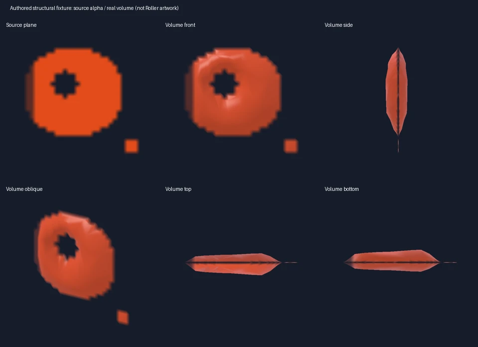

# Verification status

Both original DXT3 VTFs were decoded without changing any source byte. All RGBA channels of both 16-frame textures matched an independent Pillow DDS decode: zero differences. The SplatoonSWEPs checkout remains unchanged. Every original frame and both mesh LODs passed closed-surface winding/volume, finite/nonzero triangles, indices, UVs, normalized SNORM16 normals and opaque/fringe partition coverage checks. UV seams are welded by exact position for physical topology validation.

All 32 frames were rendered at 512×512 in Chromium and WebKit. Maximum mean absolute alpha error against the source plane was 0.163163 byte units in Chromium and 0.128987 in WebKit (0.064% / 0.051% of full alpha). Maximum support differences were 1286 / 1420 of 262144 pixels (0.491% / 0.542%). Individual boundary errors can reach 255; stored source pixels are exact, rendered edge rasterization is not pixel-identical.

The black side strip found during review was corrected before the final PR revision. The derived bevel keeps the alpha/RGB fringe thin, side vertices use dedicated source UV seams, atlas sampling is bounded to the current frame, and opaque ink writes depth before original partial-alpha blending. Both passes share the same 3D surface and buffers. All 32 frames × side/top/bottom views passed **zero black RGB pixels and zero transparent defects inside eroded opaque source regions**, in both browser engines. These assertions retain genuine source holes and transparency. Front/side/oblique/top/bottom captures and the 16-frame animation sequence were reviewed locally; the supplied v6 prototype was also rendered from four directions and its enhanced mode. Retail Ver.11.3.0 footage was unavailable.

Real native input in the emitted Practice Range produced 13 horizontal Roller heads; all 13 used the volume, with no presentation overflow. Their native positions, velocities, deceleration, landing and paint continued through existing game owners. After 90 additional ticks the volley had landed and no heads remained. Source tests also exercise actual composed `_draw()`, snapshot gameplay fields, camera-independent orientation, local/replicated shot identity, pooled generations and exact resource cleanup.

## Measured cost

The unchanged game renderer and new renderer were compared on the same paused, native 13-head volley, off/on/off/on, with four warm frames and twelve samples per block. Linux Chromium uses SwiftShader software rendering. GPU timer queries and browser frame cadence are separate from CPU submission timing. These results do **not** establish physical mobile/iPad performance or live gameplay FPS.

| Measurement | Existing renderer | Volume renderer |
| --- | ---: | ---: |
| Full compositor draw calls | 157 | 163 |
| Full compositor submitted triangles | 671,017 | 1,425,965 |
| Projectile `_draw()` median CPU ms | 0.10 / 0.10 | 0.20 / 0.10 |
| GPU timer median ms, repeated blocks | 3117.74 / 3131.37 | 3427.80 / 3353.48 |
| Paused-scene browser frame pace, FPS | 0.335 / 0.317 | 0.287 / 0.299 |

The volume increased measured software GPU time by approximately 7–10%; it is not free. The game's baseline is already extremely slow on this software GPU. Millisecond CPU submission/`gl.finish()` call timing must not be inverted into claimed gameplay FPS. The existing compositor submits the scene in multiple passes, so its triangle counter exceeds the volume's 383,440 per-view submitted triangles. A 600k per-view triangle budget, 128-instance pool, distance/frustum culling and two shared LODs bound rendering work. Over-budget presentation retains the existing game renderer.

The original pack contains 45,303,672 binary bytes (~43.2 MiB); upload-layout GPU buffer/texture estimate is 39,272,096 bytes (~37.5 MiB), including shared opaque/fringe buffers and fixed instance capacity. SNORM16 normals save 5,328,012 bytes compared with the full-precision version of the same mesh. Neither number is driver VRAM. Both LODs and every fine boundary remain resident, which is a substantial memory cost; phone/iPad memory, thermals and performance remain unverified.

Twenty native reset/clear cycles kept renderer counts at 240 geometries / 48 textures and the same volume byte estimate. Disposal reduced them to 112 / 46. This demonstrates reuse and release for that run, not an unlimited-play JS-heap leak guarantee. Numeric readbacks, scene positions and all repeated timing blocks are in [measurements.json](measurements.json).

## Tests and reproducibility

Six new suites cover original pixels, holes/islands, physical topology, UV/normal validity, frame boundaries, both depth passes, shared GPU/instance buffers, pose/position coupling, culling/capacity, pool generations, invalid packs and cleanup. Actual JSON packets from the native NetMatch recorder also replay both flick modes into an owner whose current weapon/mode changed; vertical ghosts retain the existing renderer and zero gameplay authority. Review found that classifying before metadata restore incorrectly included vertical ghosts, and moved observation to the completed native birth. The existing #1040 fixed-clock suite passed after requiring the explicit engine marker rather than accepting an arbitrary FX Proxy property. Production composition and all 14 combined source/packaging tests passed on committed inputs, including PWA replay and exact tracked Git input identity.

Earlier full local patch validation ran 4777 tests: 4757 passed, 19 skipped, one #1040 failure subsequently fixed and all 11 cases rechecked successfully. Existing focused weapons/Roller/network/FX tests passed 51 cases with one optional GC-only skip. The quality gate passed 910 cases with eight skips; a missing browser executable was resolved and all ten affected paint-mipmap cases passed. Final exact-head CI reruns the existing full gates and the new authored-fixture Chromium/WebKit rendering workflow; current statuses are linked in the PR.

The previous PR-head UI job failed one touch menu-ring visibility check with a CSS opacity transition still at zero; the other two rematch rounds passed. No pack was loaded in that job and no UI/menu code changes belong to this feature. The base-main run passed, so this is recorded as an intermittent existing-path failure rather than proven pre-existing breakage; the final-head rerun is the deciding result.

The original and derived images are **local-only** under `.browser-evidence/ink-volume-reviewed-*` and `.browser-evidence/prototype-v6`. Rights for redistributing these assets were not established. The public image below uses authored structural fixtures and is not final Roller artwork. Public activation requires an authorized pack. Original partial-alpha overlap ordering, physical-device validation and retail matching remain limitations.

