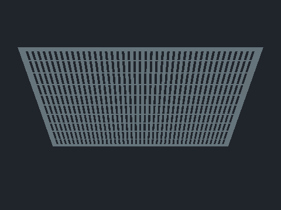
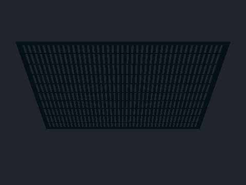

# Grate backside lighting correction — Issue #1565 subset

Base: `d5265f73d9dad69f1afd9690e374caee45195f11` (current main, including PR #1564). This is a bounded lighting-correctness change, not completion of the wider quality request or a fix for dark team ink.

The emitted `createLevelMaterial` shader replaced Three's front/back-oriented normal with a custom world normal and lost `faceDirection`. Grates use `DoubleSide`, so their visible back faces received the front's illumination. With a light above the panel, the underside was incorrectly bright; with a light below, it incorrectly remained dark. The corrected normal also flows into the existing clearcoat normal assignment.

The build-time quality adapter now normalizes the final view-space direction once and applies Three's existing `faceDirection`. The former world-space normalization was redundant: normalizing a vector before a linear transform changes its magnitude, not the final normalized direction. The temporary world normal had no other consumers. A cache-key update is composed through the existing practice-range adapter. `inkwave-public/` is unchanged.

## Reproduction and actual browser evidence

The verifier imports the real minified emitted `Level` and `createLevelMaterial` modules. It builds one authored grate box, selects the actual indexed top face, and compares its double-sided rendering to the same triangle attributes with reversed winding/normals rendered as a front-facing reference. This is authored-Level runtime geometry, **not** an imported mesh from `patches/native-stages`. The fixture uses the fallback surface branch without a generated texture library and keeps paint disabled, as real grates are not inkable.

At 480×360, the fixed shader matches the independently oriented reference in all three views:

| Browser | View | Baseline differing pixels | Candidate differing pixels | Baseline maximum channel error |
|---|---|---:|---:|---:|
| Chromium / SwiftShader | Top | 0 | 0 | 0 |
| Chromium / SwiftShader | Back, light above | 40,260 | 0 | 102 / 255 |
| Chromium / SwiftShader | Back, light below | 40,260 | 0 | 107 / 255 |
| WebKit | Top | 0 | 0 | 0 |
| WebKit | Back, light above | 40,275 | 0 | 102 / 255 |
| WebKit | Back, light below | 40,275 | 0 | 107 / 255 |

The complete visible grate coverage remains 40,260 pixels in Chromium and 40,275 in WebKit. Grate front-view pixel hashes are identical before/after in each browser. Repeated frozen draws are identical; browser/shader errors and WebGL errors are zero. The before/after PNGs were inspected. Browser rasterization differs slightly, so cross-browser pixel equality is not claimed.

Because normalization also affects ordinary front-facing level materials, four further cases use an independent test-only material that compiles the **original two-normalization expression**. The production material and served production bytes stay unchanged. These cases cover a synthetic premultiplied paint atlas with nonzero coverage-edge and team-seam derivatives, flat and tilted geometry/camera, and dry/painted relief from the actual emitted `createTextureLibrary` factory (25 layers, 64×64 diagnostic resolution). Chromium has zero changed pixels in all four cases. WebKit has zero changed pixels in three cases and one changed pixel out of 172,800, with a one-level / 255 channel difference, in the tilted dry texlib case. The explicit acceptance bound is at most one level / 255; a larger difference fails. The painted, tilted and textured images were inspected.




## Work and download budget

Each grate comparison retains the same renderer-reported draw cost: one draw, two triangles, two textures and two warmed programs; once both reference geometries are warm, two geometries. Front-material comparisons report one draw, two triangles, three geometries, six textures and four warmed programs on both sides; these include the diagnostic paint/texlib textures and independent reference materials. This direct-render fixture has no postprocessing passes. The production change adds no pass, sample, object, particle, geometry, material, dependency, or runtime allocation and preserves coverage/discard behavior. The captured `onBeforeCompile` **shader template**, before Three expands `#include` chunks, has the same 15 texture-call expressions and 13→12 normalization expressions. The saved file is `shader-template.glsl`. These template syntax counts are neither compiled GPU instruction counts nor executed texture-fetch counts; a compiler may already have optimized redundant normalization.

All 929 versioned production payload files were compared: the only changed payload is `src/world/levelMaterial.js`, 37,007→36,987 bytes (−20); gzip level 9 remains 12,363 bytes. The aggregate payload also decreases by 20 raw bytes and has zero gzip growth. Texture/image files, LOD, atlases, pools, and quality settings are unchanged.

The verifier's software draw/drain timing samples were collected with concurrent workloads and are explicitly **nonqualifying diagnostics**. They do not establish physical desktop/mobile FPS, GPU time, or a zero-degradation confidence bound. Wider full-game performance acceptance remains separate. WebKit's reported renderer string is recorded as returned; this Linux headless test is not evidence from Apple hardware.

## Checks and limits

`node --experimental-vm-modules --test patches/local-quality/tests/grate-normal.test.mjs patches/local-quality/tests/texlib-stage-pack.test.mjs` passes 16/16. Production builds complete against the pinned upstream compatibility lock. Baseline browser runs fail the new orientation assertion; candidate Chromium and WebKit runs pass. Full receipts, browser logs, build log, source-test log, and payload comparison are retained alongside this report. The verifier uses `verifyRuntimeBuild` to bind every build input to an exact committed source SHA, verifies artifact hashes and `inputHash`, and records its own SHA-256. Candidate runtime inputs correspond to `a6fcd76166b1aa887b7cbc3456833366b7d9cfe3`; subsequent evidence-only changes do not alter its `c70ff01bfc49cc9ff974336d902abaa85bf66c6e6b9752cac6dc189a21b5aba2` content hash. The final verifier hash in these receipts is `f5d937957f7497aecade84f8ea5dff45f701300073d506f5b0731425f6ecfdfd`.

Run the verifier on a production build:

```sh
ESBUILD_MODULE=/workspace/actions/node_modules/esbuild/lib/main.js node scripts/build-inkwave.mjs inkwave-public /workspace/inkwave-render-candidate
node scripts/check-inkwave-grate-normal.mjs --site /workspace/inkwave-render-candidate --source-root /workspace/render-1565 --source-sha a6fcd76166b1aa887b7cbc3456833366b7d9cfe3 --evidence-dir .ci-scratch/1565/chromium
node scripts/check-inkwave-grate-normal.mjs --site /workspace/inkwave-render-candidate --source-root /workspace/render-1565 --source-sha a6fcd76166b1aa887b7cbc3456833366b7d9cfe3 --evidence-dir .ci-scratch/1565/webkit --browser webkit --executable-path /workspace/browser-libs/webkit-headless.sh
```

The project's Splatoon 3 comparison baseline remains Ver.11.3.0. Related interaction: viewing a grate from below or through its openings while walking/jumping/swimming, with the normal gameplay camera. This patch changes only illumination, not movement, collision, shots, paint, ink recovery, damage, gear, or animation timing. The correctness reference is the shipped Three renderer's explicit facing-normal contract and the geometric front-facing control; no Nintendo internal shader curve, original-console timing, or exact original-game pixel equivalence is inferred. Matching Switch captures, imported source-stage geometry, the full generated-texlib quality/resolution matrix, gameplay team-ink readability, physical devices, long matches, and the wider Issue #1565 acceptance matrix remain unverified by this focused fixture. Current callers use FrontSide or DoubleSide; BackSide material behavior is not claimed by this change.
