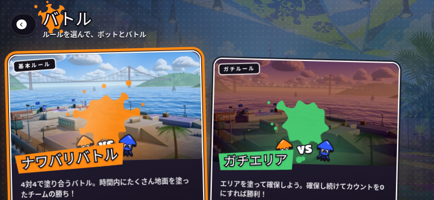
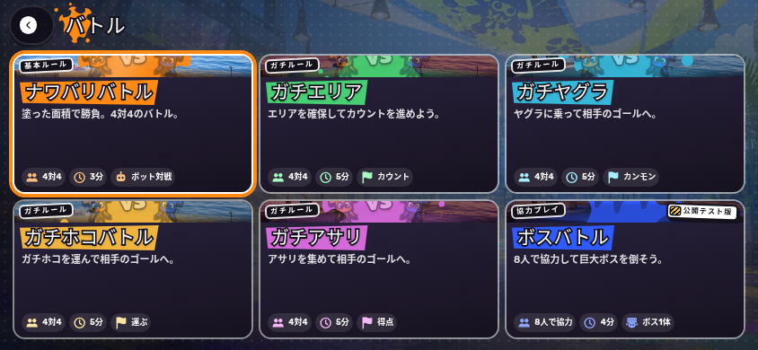
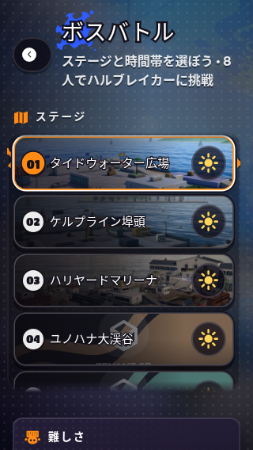
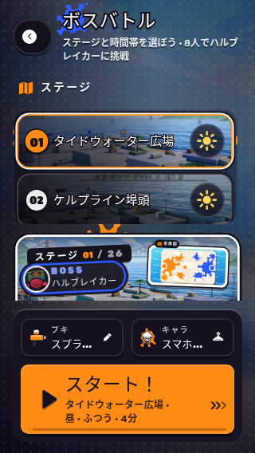
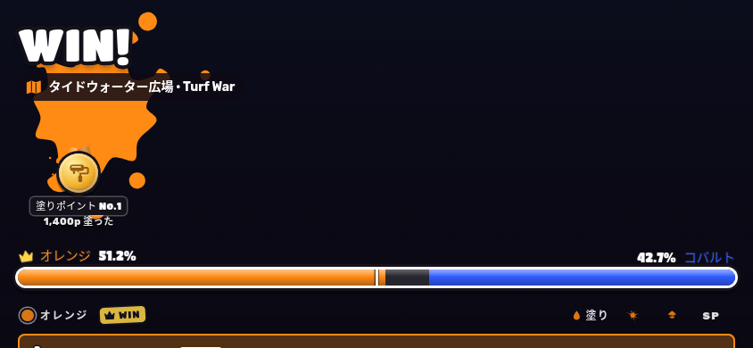
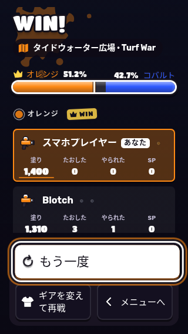

# スマホ横持ちのモード選択・ステージ選択・リザルト

## 問題と変更

横持ちでプレイするスマホを対象に、main `e781229bac5e8ba61f9bcf7f1c965e54db55afb4` を調査した。開始・装備・再戦ボタンが画面外にあり、ステージのプレビュー・設定や両チームの成績も長いスクロールが必要だった。568×320〜932×430の横画面を主な設計条件とする。

`patches/splatoon3/runtime/menu-layout.mjs` と同領域の `ui.css` で次を変更した。

- モード選択は3列×2段で6ルールを同時表示。ルールの説明を短く整え、カードを傾けずに選べる。方向キー／パッドも実際の列数に追従する。
- ステージ選択は一覧・プレビューと時間帯・難しさと試合時間の3列。全体をスクロールせずに各設定を操作でき、一覧だけをスワイプする。装備・キャラクター・開始ボタンは下部に常時表示する。
- リザルトは両チームを左右に並べ、8人分の名前・成績と再戦・装備変更・メニュー操作を同時表示する。項目名を表の上に付け、表彰・XPは成績の後に置く。ボス戦も4人ずつ左右に並べる。
- ブラウザバーで使える高さが減る場合と、セーフエリアの左右・下余白を考慮する。元の保存・開始・再戦・退出確認の部品とコールバックを使い続ける。

PCでは元のDOM配置を維持する。縦持ちでのプレイには既存の横持ち案内を使う。

## 変更前後（844×390、Chromium）

| 画面 | 変更前 | 変更後 |
| --- | --- | --- |
| モード選択 |  |  |
| ステージ選択 |  |  |
| リザルト |  |  |

## 再現・検証

`scripts/check-inkwave-mobile-menus.mjs` は最適化ビルドの実Menus・CSS・本番installerをロードする。実対戦APIはオフラインの記録用fixtureで、実対戦の成立とは区別する。再現コマンドは[開発ガイド](../docs/inkwave-development.md#ブラウザで生成物を検証する)を参照。

- 横持ち7条件：568×320、844×390、740×360、667×375、932×430、740×280、844×390＋左右44px／下21pxのセーフエリア模擬。
- タブレット1024×768とPC1440×900の回帰確認。
- 6モードの同時表示、時間帯・難しさ・試合時間の同時操作、全体スクロールなしのステージ設定、両チーム8人の成績と再戦ボタンの同時表示。
- 全26ステージの選択、装備画面との往復、変更したブキでの一度だけの再戦、二重開始、オンライン続行の一度だけの送信、退出キャンセル。
- Chromiumの実タッチイベントによる一覧スワイプと誤選択の抑止。横持ちのままブラウザバーで高さが変化した場合の選択内容・開始ボタンの保持。

最終ビルドのハッシュ、エンジン別の確認項目と結果は[検証結果](inkwave-mobile-menus-2026-10-26/validation.json)に保存する。

PlaywrightのWebKitモバイルエミュレーションは途中のリサイズで `visualViewport` とCSSのメディアクエリが旧寸法に残るため、横持ちの独立した表示と、タッチ入力・モバイルUAを保った通常viewportでの高さ変更を分けて検証する。ローカルWebKitは不足するDebianライブラリを作業ディレクトリへ展開して使用する。実機iPhone/iPad、実ブラウザバー・ノッチ・ホームインジケーター、実ネットワーク対戦は未確認。

比較基準は既存の11.3.0参照。[任天堂の更新履歴](https://en-americas-support.nintendo.com/app/answers/detail/a_id/61257/~/splatoon-3-update-history)にある継続・装備変更の操作契約を保持する。このタッチ配置はINKWAVEの独自設計で、Switchの配置・時間の再現とは扱わない。
