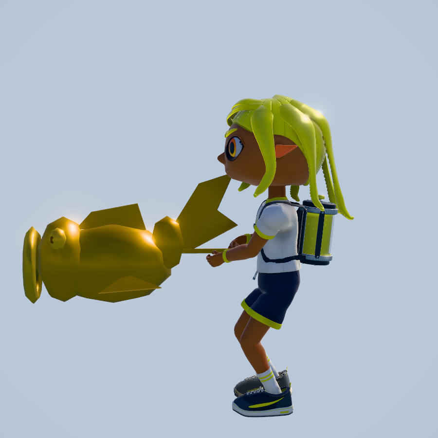
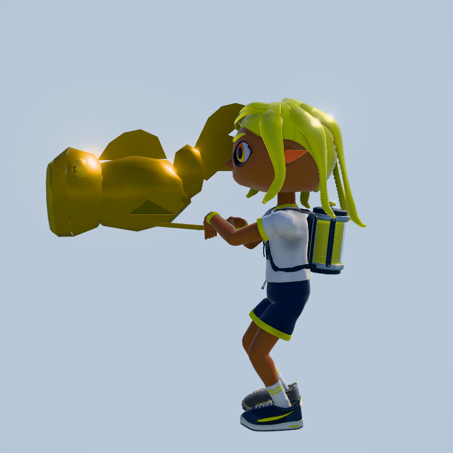

# INKWAVE PR統合の検証（2026-10-30）

対象は `rhgrive3/actions`。ユーザーのナワバリ開始カメラ修正と、既存PRをmainへ反映する依頼に対応した記録。失敗中の候補やQA専用Draftを含めて「全PR完了」とはしない。

## mainへ反映した変更

| PR | 内容 | merge commit |
| --- | --- | --- |
| [#1922](https://github.com/rhgrive3/actions/pull/1922) | GPUの独立した代数最適化 | `12fd89023090b32465df9ef2724385f1d4c724bf` |
| [#1926](https://github.com/rhgrive3/actions/pull/1926) | native sweepの不要な距離計算を遅延 | `379533f541d86346a068e397f879cb6c13590ffd` |
| [#1929](https://github.com/rhgrive3/actions/pull/1929) | 公式映像を解析したナワバリ開始カメラとQA開始待ち | `0068338861c8846832e127d1efe9ed9624bb9f5b` |
| [#1923](https://github.com/rhgrive3/actions/pull/1923) | native描画の重複削減とidle KTX2 worker解放 | `0985ce2a45174e86ae731ef2e76ba19da08957a6` |
| [#1919](https://github.com/rhgrive3/actions/pull/1919) | ホコ／ヤグラモデルと厳密な9分割CI契約 | `3913b46cbc8aedb28061340a34ea0923fa781beb` |

参照とフレームごとのPTS、16時点の変更前後は [開始カメラのレポート](turf-intro-camera-20261030.md)。任天堂公式60fps動画の209Fで相手、399Fで自陣、436FでREADY、578Fで開始エフェクトを観測した。3Dカメラ数値はINKWAVEの表示調整値で、Nintendo内部の復元値ではない。

## 統合したコードの検証

main #1926を基点に、カメラhead `983495625`、描画head `cf4c30e96`、モデルhead `29b6287fa` を隔離worktreeへmergeした。検証したtreeは `2139af94dbea4983f8eac9abd77bf6123c6c800c`。main `3913b46cbc8aedb28061340a34ea0923fa781beb` のtreeがこの値と完全一致することをfetch後に確認した。以下の記録追加は製品コードを変更しない。

| 実行範囲 | pass | skip | fail |
| --- | ---: | ---: | ---: |
| nativeソース全体 | 645 | 128 | 0 |
| 合成済みソースの開始カメラ／ホコ／ヤグラ／実Actor面交差 | 24 | 0 | 0 |
| 最適化された配信コードのカメラ／モデル | 21 | 0 | 0 |
| 配信engineのインク描画 | 19 | 5 | 0 |

128件／5件のskipは私的アセット依存で、成功に数えない。quick checks、通常の最適化ビルド、startup budgetも成功した。配信engineの検証は、既存のminified bindingをVM内だけでexportして実行し、関数本体を authored source へ置き換えない。

コマンド例（統合treeの作業ディレクトリ）:

```sh
npm run check:patches
npm run build
npm run check:budget
node --experimental-vm-modules --test --test-concurrency=2 patches/native-stages/tests/*.test.mjs
node --experimental-vm-modules --test --test-concurrency=2 patches/splatoon3/tests/turf-intro-camera.test.mjs patches/splatoon3/tests/rainmaker-model.test.mjs patches/splatoon3/tests/rainmaker-model-actor.test.mjs patches/splatoon3/tests/ranked-tower-model.test.mjs
INKWAVE_BUILT_SITE=_site node --experimental-vm-modules --test patches/splatoon3/tests/turf-intro-camera.test.mjs patches/splatoon3/tests/rainmaker-model.test.mjs patches/splatoon3/tests/ranked-tower-model.test.mjs
INKWAVE_BUILT_SITE=_site node --experimental-vm-modules --test patches/native-stages/tests/ink-chunks.test.mjs patches/native-stages/tests/ink-empty-lifecycle.test.mjs patches/native-stages/tests/ink-offscreen-chart.test.mjs
```

最適化済み統合配信の実Chromium受入も完走した。65キット、793レスポンスを照合し、移動・塗り・回避が成功、ページエラーは0。`contentHash: 38a8b21f6b68b3a1a768b64582f5c340e2ea0cb77bdcae02feb4770c7b4db75b`。同じ統合配信でRankedのエリア・ヤグラ・ホコ・アサリを実行し、全4種のオフラインと2人オンラインが完走、errorsは0だった。実WebSocketと本番RoomDurableObjectを使い、既存のスコア・終了同期・ホコ実発射／壁／フルチャージ検証を維持した。

## WebKitとモデルの追加証拠

描画PRの最終head `cf4c30e96` では、旧CIで止まったdesktopのブキ操作を含むモバイルメニュー全9画面・463チェックと、resizable-touchのphone／landscape・166チェックが成功した。これは配信済みDOM/CSSを用いるWebKitのエミュレーションで、実iPadのGPU計測ではない。

不足OSライブラリはDebianの署名済みパッケージからworkspace内にだけ展開し、必要な6種類のdlopen成功を確認した。user所有のWebKit bundleへライブラリを接続した。システムldconfigに載らないため、Playwrightのホストライブラリ事前判定だけをこの手動確認に置き換えた。製品コード、UI入力、463／166の合否条件は変更していない。

モデルPRは最終head `29b6287fa` の [object比較CI 41027285562](https://github.com/rhgrive3/actions/actions/runs/41027285562) が成功した。ホコの保持・照準・反動128、空中20、変身20、実発射位置18フレームのreceiptが全てpassed、errorsは0。GitHub連携でZIPを取得し、SHA-256 `d976a7ccd7e2c8cfa5206943e8bcdfc74b094829ed8ca84c08809f23f168073a` を照合した。保持の変更前後、上照準、下照準の反動、空中の代表画像を目視し、統合版の実ランクマッチでヤグラ表示も確認した。186画像全てを手作業で目視したという意味ではない。ホコ画像は実Actorを使った隔離シーンである。

実Actorの隔離シーン、同じ最終headの比較（本家映像ではない）:

| 変更前 | 変更後 |
| --- | --- |
|  |  |

## 既存QAの失敗と未反映のPR

原典Wahooのcamera-basisは、オフライン30/60/120Hzでカメラ軸・実マウス・着地が成功した。一方、オンライン手順は旧main `5b722cba8` と候補の両方で、2人目を検査するplaying後3.2833秒には既に着地して初期targetが無く、同じ失敗となった。1人目のland中に両peerを進める既存手順のためで、カメラの新規回帰とは切り分けた。この手順を成功に読み替えていない。

- #1925: 実Physicsを使う部分遮蔽の反例で、有効な端の弾を拒否し、遮蔽された実軌道を許す。2つの受入回帰が失敗する。現在位置の中心へのLOSだけでは、弾の軌道・接触位置・移動履歴を確定できないため、そのguardを採用していない。
- #1924／#1927: QA専用Draftで、比較・受入の未完了／失敗が残る。本番候補として反映しない。
- #1928／#1930／#1931など作業中に追加されたDraftは、今回の最初の本番PR一覧とは別の進行中QAであり、自動採用しない。

## 認定していないこと

main反映の時点では広いGitHub CIに実行中・待機中の群がある。限定検証と、広いCI全体の成功を混同しない。公開サイトへの配信完了も別の確認である。

本家の現行版Switchとの制御された比較、全ステージ・全端末、全画素・全入場モーションの一致は未確認。GO後の自動発射までの既存1秒猶予も維持しており、映像578Fの発射との完全一致は認定しない。nativeの45.4%は既存レポートの固定SHA間・SwiftShaderでの測定で、統合後の実機GPUの改善率として加算しない。モデルのCPU構築コスト増加もPRに明記した。

[数値と識別子のreceipt](inkwave-pr-integration-20261030.json)。

## 後続の本番PRと開始発射

上の表は最初の統合時点の記録である。その後、#1933の最終GPU試行を照合してmainへ反映（c1af242aa）、#1938でGO後1秒の待機を撤去し、開始前照準と578Fの8人発射を反映した（b4f84622a）。Wahooの18時点、オフライン／実relayの両teamを30/60/120Hzで確認し、以前の2人目の初期targetを失うQA手順も修正した。[カメラの最終結果](turf-intro-camera-20261030.md)。

#1925の2つの部分遮蔽反例は、中心へのLOSではなくnative弾道・field sweep・位置履歴で修正した。network source全群1,187成功と最終変更群、配信63成功、固定runtimeのfull-active65キット・796 responseの結果と各scopeを[最終receipt](crablet-native-trajectory-20261030/validation.json)に保存した。途中のlife補強があるため、全群を単一固定SHAで実行したとは記さない。広いCIの全群完了とは別の検証である。

Draftを再確認し、#1928の泳ぎ飛沫は本番向け変更として現行mainとの再検証を進めた。その他の#1924/#1927/#1930/#1931/#1934/#1935/#1936/#1937は、本文にQA専用・no main/do not mergeがあり、比較／参照回収／画像の受入が未完了である。これらを無条件で本番採用したり「全PR完了」と報告したりしない。

### 追加反映の結果

- #1933: main `c1af242aa`。最終GPU試行の固定runtimeを確認し、Chromium専用gate成功、WebKitは初回の微小悪化と順序反転でのほぼ同等の結果を両方保持した。
- #1938: main `b4f84622a`。578Fの初期発射・開始前照準と、Wahoo実relayの全30/60/120Hzを確認。
- #1925: main `806a0f286`。native弾道で部分遮蔽反例を修正し、source群・最後のlife補強群・配信・full-activeのscopeを区別して記録。
- #1928: 上記mainへ本番用の泳ぎ飛沫を統合し、配信10件と多方向177描画が成功。[最終生成物のreceipt](swim-splash-multiview-20261030/integration-validation.json)。

本番向け候補の反映と、QA専用Draft8件（#1924/#1927/#1930/#1931/#1934/#1935/#1936/#1937）の未完了を区別する。本家の現行Switch版、全stage固有カメラと全画素の完全一致は未確認。広いGitHub CIには引き続き待機・実行中の群があり、全CI完了とは報告しない。
