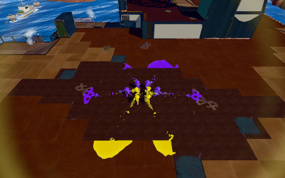

# Issue #1565: combined validation and adoption record

This is a partial implementation and validation record, not a completion claim for Issue #1565. The fixed comparison baseline is main `d5265f73d9dad69f1afd9690e374caee45195f11`, including the body proportions and weapon work merged through #1564/#1563. The local integration tree is `57e5cf61121514c8d04ac8efe059b5386fa99f27`. Main has not been changed or merged by this work. Issue #401 is excluded.

The final evidence commit adds or clarifies reports only; it does not change either tested PR head. [SHA256SUMS](SHA256SUMS) verifies every other file in this directory (`sha256sum -c SHA256SUMS` from this directory). Large original JSON is stored as lossless gzip with original hashes; decoded records retain the exact executed source/build/harness identities rather than treating the later reporting commit as a newly tested build.

Open-PR reinspection during measurement also found #1569 (four headgear/lifecycle work) and #1567 (repository documentation), both outside these changes. Headgear shares the quality-adapter entry point but does not own the contact filter or the level normal block. It is not included in the frozen baseline/candidate or counted as this work. A later merge requires new composition verification; it is not covered by the current evidence.

## Scope and decisions

| Plan item | Decision and evidence |
|---|---|
| Current source, ownership and existing patches | Audited in [audit.md](audit.md). Public source is composed through the existing build-time adapters. The old `85acc45` body is historical evidence only. |
| Visible rendering improvement | PR #1566 corrects authored-Level grate backside lighting in the `DOUBLE_SIDED` branch. The committed authored-geometry controls agree exactly with independently reversed reference geometry in Chromium/WebKit. FrontSide retains the exact original expression. See [render evidence](../inkwave-grate-normal-2026-10-17/README.md) and the separately bounded texlib component below. |
| Contact arithmetic | PR #1568 bypasses settled Hermite coefficients without changing poses, contact clocks or IK. Source/component and emitted-browser scopes are recorded separately in the [contact report](../inkwave-source-contact-optimization-2026-10-17.md). It is an optimization, not a visible locomotion improvement. |
| Sole-height visual trial | Rejected on historical base `85acc45`: the apparent proxy improvement increased actual indexed/skinned shoe penetration. Those numbers are not transferred to the new body on `d5265f7`. No sole-height change is present. |
| Global normal rewrite | Superseded. It changed unrelated FrontSide arithmetic, including a WebKit rounding difference, and did not establish whole-game nondegradation. Historical evidence is retained, not relabeled as evidence for the narrower fix. |
| Pose Search | Not implemented or adopted. A new 64-by-16 float feature table alone requires 4,096 bytes before query/storage overhead; a replacement of existing evaluations and a net memory/time benefit have not been demonstrated. This is not a failed measured prototype. |
| Distance Matching | Not implemented. Existing contact inertialization is retained. No new distance curve is inferred from clip names or guessed reference-game values. |
| Weapon/layered animation | Existing merged #1563 ownership is preserved. Its improvements are not counted as this work. |
| Wider trajectory/warping, VFX and dark-scene readability | Existing systems are preserved; broader new quality improvements have not been implemented or validated by these two patches. No extra raycast, particle, pass, texture or model is introduced. |

## Combined build

The production build verifies every committed input and emitted artifact against the integration tree. Baseline content hash: `8f56a1470c72ecf04250ba7be2cf74a3c89f7267674c840d7d63c14fa3b29775`. Combined content hash: `657671efb238bc3625cdfea9f704087307b91a8fc0687cef01f48fd0a982e974`.

The 929 versioned payload files have the same count. Only `levelMaterial.js` and `contact-transition.js` change. Together they shrink by 177 raw bytes and 43 gzip bytes using Node 24.19.0, zlib `1.3.2.1-motley-3246f1b`, gzip level 9. The contact file alone grows by 32 gzip bytes; its source shrinks by 13 bytes. Compression is reported separately from retained runtime memory.

The root-logical artifact list excluding root `index.html`/`sw.js` also has 929 files. It includes empty `.nojekyll` instead of the versioned worker's 13,185 bytes (gzip 4,799); the empty file's gzip is 20 bytes. Thus its aggregate is 13,185 raw / 4,779 gzip bytes smaller than the versioned aggregate. Shared paths and hashes are identical. The scopes have the same before/after deltas and must not be confused when comparing aggregate totals.

The startup budget passes with 146 initial JavaScript requests, 145 module preloads and 2,674,322 initial JavaScript bytes, 164 bytes below baseline. The 39 combined focused source/workflow tests pass with the repository's required `--experimental-vm-modules` flag. An earlier invocation omitted that flag and failed VM fixture initialization; it is not a runtime regression and its log is preserved in persistent scratch.

An additional 103 tests across 12 related source families pass on the combined tree: existing FK, retarget, rotation, hair, form, landing, movement, source posture, weapon hold, gait phase, foot clearance and shot footprint. Their before/after source fixtures run without `INKWAVE_BUILT_SITE`, keeping source-transform negative controls valid. These source checks are separate from emitted browser receipts and the complete remote CI suites.

Both PRs' ordinary CI completed successfully on the exact reviewed heads: #1566 `602774b9caf8a5cbb12290096a09d4d17cc756b0` and #1568 `fb33e4530b1419b5762ac180ef829360035aff4d`. The [CI receipts](ci/README.md) preserve each check name, conclusion, run identity and URL. Conditional skips are listed separately; skipped performance jobs provide no performance evidence. CI success does not qualify either candidate for adoption.

## Measured adoption decision

**Neither candidate is qualified for a global zero-degradation claim. Both PRs remain Draft, with no production adoption or merge. Issue #1565 is incomplete.**

The [eight-trial combined measurement](combined-measurement-summary.md) retains 480 frames and 480 valid software GPU queries. Gameplay, bones, paint, RNG, endpoint images and reported draw calls match. Mean completed time is 1,296.342 → 1,266.823 ms (2.277% shorter), but the paired 95% improvement interval is −1.344% to +5.882%, including degradation. CPU, GPU and pacing intervals also include zero. The candidate's worst completed frame is 1,843 ms versus 1,706.1 ms. These are serialized SwiftShader diagnostics, not ordinary display FPS.

One candidate trial reports 406 geometries /132 textures, versus 410/131 in the other seven; every window is internally stable. Main scene and recorded private-owner counts match, but the differing registration/retention history has not been identified. The same counter pattern appeared in an earlier baseline trial, so it cannot be attributed uniquely to the candidate or dismissed as resolved. Heap boundaries are recorded separately from retained/peak/driver memory. Complete raw JSON, executed harnesses, invocations and lossless archive hashes are under [combined/](combined/).

A subsequent [resource-only diagnostic](resource-inventory/README.md) retained reachable scene/private-owner inventories and matching Three.js disposal-listener signatures at lifecycle boundaries. All four ABBA trials reported 410/131/147; the earlier 406/132 state was not reproduced. The inventory still leaves 65 renderer geometries unreconciled after setup/warmup. Reachability and a matching registration-listener implementation do not identify a unique owning renderer or close a driver-resource ledger. This observation is explicitly ineligible as timing evidence and does not resolve the original mismatch.

All eight whole-game endpoint PNGs and raw RGBA buffers are byte-identical. [endpoint-aliases.json](combined/endpoint-aliases.json) records every original hash and its deduplicated lossless copy; this is endpoint parity, not a comparison of every measured image.

The [DoubleSide grate diagnostic](grate-component/README.md) checks the actual changed texlib path with fixed resources and exact GL workload. Two views shorten, while front-underlight and back-underlight completed means grow by 4.70% and 3.82%. All adverse values remain. Its independent texlib oracle has one view differing in 9/144,000 pixels by at most 1/255, within the declared component bound; this is separate from the committed FrontSide tests' strict zero-pixel criterion. No overall GPU nondegradation follows.

The [active-contact follow-up](contact-component/README.md) retains both the original short windows and the prespecified tenfold-work run. The long settled case shortens by 7.513% wall time; always-active shortens by 0.992%; irregular contact grows by 0.274% (CPU +0.279%). These small mixed effects and source-VM limits do not qualify every transition workload. No unfavorable row or mode has been removed.

The decision is therefore to preserve these as reviewable, unadopted candidates. Correctness and source-level savings do not override the requested empirical performance gate. The rejected sole trial and superseded broad shader trial remain absent from production code.

## Measurement boundaries

The diagnostic runs the unchanged production Game._frame, a real PlayerController and seven real BotBrains, native Scorch, eight live actors and continuous outward fire. The owners execute before the stationary stress fixture supplies its fixed final intents. This does not cover normal moving human input, all weapons, all maps or every requested scenario.

Chromium 141 uses SwiftShader at 480-by-300, DPR 1, medium quality, a 2048px ink atlas, fixed 60 Hz simulation and resolution scale 1. Natural service-worker activation, complete offline readiness and running audio/music are required. Full input/build/served-artifact identities, game/paint/RNG/bones/workload, repeat endpoint pixels, software GPU query completeness, draws and resources are recorded. GPU completion uses synchronous readback: these timings are serialized diagnostics, not ordinary display FPS or input latency. Heap snapshots use no forced GC and do not establish driver GPU memory or a lifetime bound.

Fresh calibration is ABBA with six measured frames per trial. The subsequent measurement, only if calibration is comparable, uses ABBA/BAAB with 60 measured frames per trial. The harness and helper are copied and hashed into each output. The new recording-only harness also captures private Showcase/portrait resources outside timed frames; it does not disable, dispose or wait differently on production owners.

The preserved [earlier calibration summary](superseded-global-experiment/calibration-summary.md) and compressed full JSON concern the **superseded global-normalization experiment**, not the final narrow or combined candidate. Its approximately 11% completed-time slowdown and resource mismatch remain unqualified. Negative results have not been dropped.

| Requested comparison | Available evidence and boundary |
|---|---|
| Practice range | Existing range regressions are retained in CI; a dedicated range performance A/B is not established here. |
| Object/stage workload | Whole-game comparison uses native Scorch only; it does not cover every authored or imported stage. |
| Eight-player battle | Eight live actors, one real PlayerController and seven real BotBrains; not eight networked humans/devices. |
| Continuous fire | Deterministic stationary outward shooter fire with unchanged game owners. Other weapons and ordinary moving human input are not covered by this timing fixture. |
| Heavy ink | Paint is active and compared exactly, but no independent long-duration saturated-ink stress gate is established. |
| Dark conditions | Grate top/bottom illumination has an independent static oracle. Enemy recognition, ink boundaries and submerged effects in a full dark gameplay scene remain unmeasured. |
| 30/60/120 Hz, irregular dt | Source-loaded Actor/component comparisons and emitted contact browser cases; whole-game performance is fixed at 60 Hz simulation. |
| Networking | Existing source/browser network regressions remain in CI. No physical multi-device network match is measured. |

Whole-game draw/triangle and geometry/texture/program counts are the renderer's reported counters. They are not a driver GPU-memory byte reading. Exact GL draw interception belongs to the separate material component diagnostic, not the whole-game timing.

## Comparison reference and unresolved gates

Splatoon 3 Ver.11.3.0 remains the project's behavioral reference. No new console capture, loadout/gear timing measurement or Nintendo shader implementation is available here. Three's shipped facing-normal contract is the correctness oracle for the grate repair; it is not proof of original-game pixel equivalence. Existing documented S3 values are unchanged.

Physical iPad mini/other mobile FPS, p95/p99, memory, thermal behavior and crashes remain unmeasured. Practice range, dense ink, dark-scene recognition, real network play, long-match stability, full quality/resolution coverage and all requested animation improvements are separate unresolved gates. Browser/source movement tests at 30/60/120 Hz and irregular dt are not a substitute for those measurements. Neither PR is ready for a global zero-degradation or Issue #1565 completion claim while those gates remain unresolved.

| Completion condition | Final status |
|---|---|
| Visible quality improvement | A narrow grate-lighting correction is demonstrated. The requested wider locomotion, shooting and VFX quality work is incomplete. |
| Game behavior preserved | Exact equality passes in the documented source, browser and deterministic whole-game scopes; all requested gameplay/device scenarios are not covered. |
| Measured performance nondegradation | **Not established.** Adverse component rows, uncertainty spanning degradation, an unresolved resource mismatch and unmeasured physical-device/lifetime memory remain. Neither patch is adopted. |
| Related regression checks | The 142 combined local source cases and both exact-head ordinary CI suites pass, including their Chromium/WebKit checks. Conditional performance skips are not passes. |
| PR creation | [#1566](https://github.com/rhgrive3/actions/pull/1566) and [#1568](https://github.com/rhgrive3/actions/pull/1568) are reviewable Drafts with explicit failed acceptance gates. Neither is merged; Issue #1565 is not complete. |

## Engine-technique references

The following primary engine documentation was retrieved on 2026-10-17; URLs, HTTP status and response hashes are in [research-receipts.json](research-receipts.json). It informs the adoption criteria, not an assertion that these engine plugins were ported or that any technique reproduces Nintendo's implementation.

- [Epic: Motion Matching](https://dev.epicgames.com/documentation/en-us/unreal-engine/motion-matching-in-unreal-engine): pose-query features and trajectory channels require a suitable indexed database. A small query loop alone is not a replacement for the current semantic/upper-body/contact owners.
- [Epic: Pose Warping](https://dev.epicgames.com/documentation/en-us/unreal-engine/pose-warping-in-unreal-engine): orientation, stride and slope warping require consistent pelvis/leg targets. Solving a second set of legs on top of the existing HumanRetarget/ground pass would violate the requested ownership and cost constraints.
- [Epic: Distance Matching](https://dev.epicgames.com/documentation/en-us/unreal-engine/distance-matching-in-unreal-engine): distance-driven playback depends on an animation curve. No unvalidated distance curve or reference-game stopping value has been fabricated here.

## Static Pose Search feasibility

The current moving path constructs 2 walk/run by 4 directions by 2 hold/shoot contributions, discards negligible weights and samples the surviving clips at a shared phase adjusted by measured foot strike. There are 1–16 base evaluations, conditionally up to two upper-layer clips and one live action; the steady forward path can already evaluate one base clip. SourceBank.sample evaluates authored curves and produces a full SourcePose/FK. The existing FK optimization has already removed unused intermediate work; those savings cannot be counted again.

The shipped catalog has 262/261 human clips and 54 locomotion profiles per variant (66/64 bones), plus 25 squid clips. Its contact/stride profile data is not a 16-component nearest-neighbor database. Runtime center poses and foot/hair paths have active balance/gait/accessory consumers, so they are not demonstrated spare storage.

A 64-by-16 Float32 table plus one 16-float query needs at least 4,160 bytes before labels or indexing, or 8,256 with separate variant tables and one shared query. Features do not reconstruct the full pose, segment-scale compensation or independently blended gait targets. Even a 64-pose Float32 position/quaternion/scale cache for 66 bones alone needs 168,960 bytes; original packs still serve other actions and manual playback. Selecting a clip/frame still needs an evaluation, while selecting one instead of blended directions changes output behavior. These are storage/ownership bounds, not runtime benchmark results.

Adoption therefore requires an explicit replacement of named sample calls and retained data, compatible output for every existing consumer, a nonpositive net memory budget, and measurements covering both the already-cheap single-clip steady state and multi-clip transitions. No such replacement has been demonstrated in this work. Search has neither been benchmarked nor proven inherently unsuitable.
