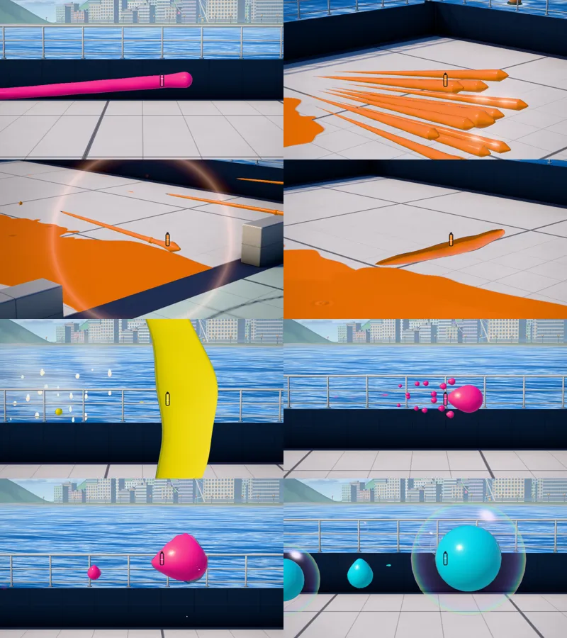
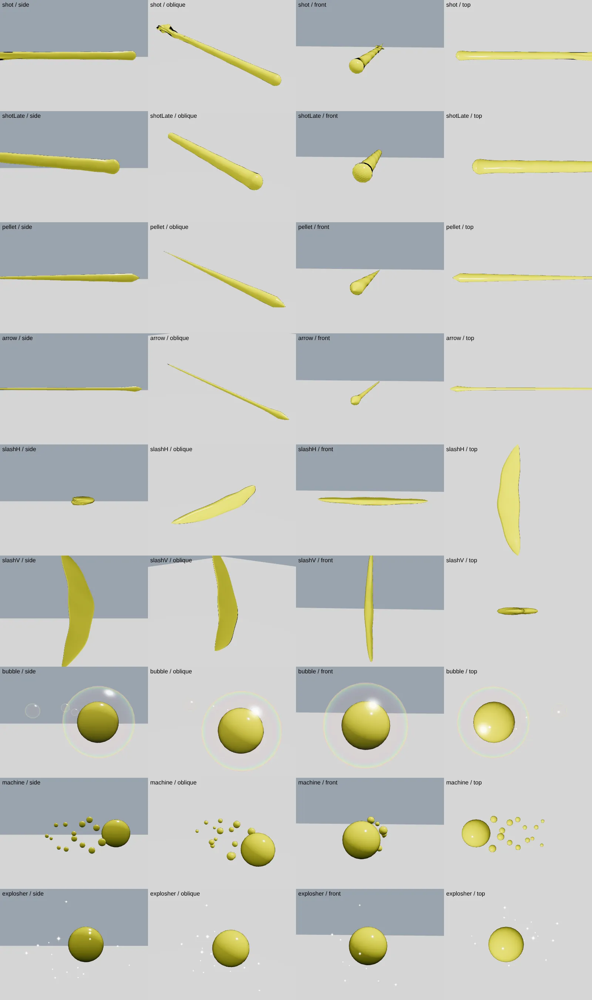
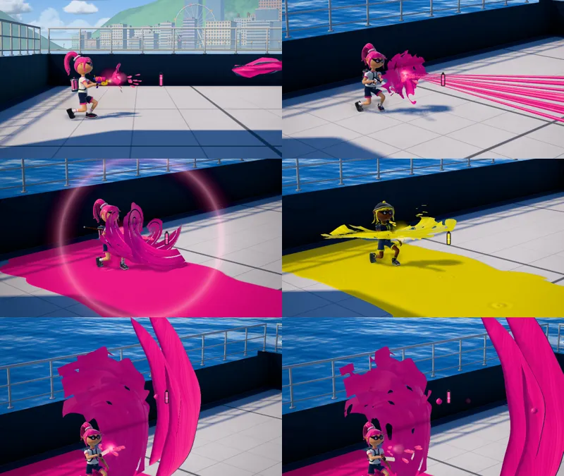
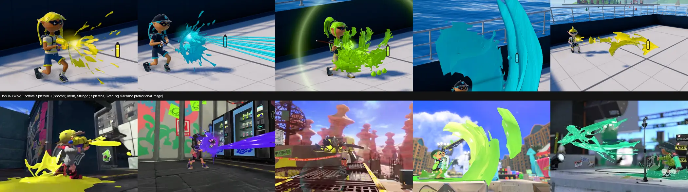

# メインウェポンの弾形状（スプラトゥーン3との比較）2026-10-15

対象：シューター全14種（カタログ追加分を含む）とその別キット（ブキ違い、同じ弾を共有）、スクリュースロッシャー、エクスプロッシャー、オーバーフロッシャー、シェルター4種、ストリンガー3種、ワイパー3種の **飛行中の弾の見た目** と、途中で落ちるインク。

本家の参照は既存記録と同じ Ver.11.3.0 の数値（Leanny/splat3 `7280ff9c`）。映像は収録バージョンが揃っていない（下記）。**見た目のシルエットを映像に合わせたものであり、任天堂のメッシュ・シェーダー・描画半径の抽出値ではない。**

## 見た本家の資料

公式映像は 60fps で1フレームずつ抽出し、横・後方・前方・俯瞰に近い場面を選んで比較した。任天堂の映像フレームはリポジトリに入れていない。

| ブキ | 資料 | 見た場面 |
|---|---|---|
| スプラシューター | Inkipedia `S3 About videos 05 - Splattershot.mp4`（任天堂公式サイトの紹介動画、1280×720 60fps） | 2.6–4.4 s の真横・斜め後方。発射後2–8フレーム |
| パラシェルター | `S3 About videos 04 - Splat Brella.mp4` | 1.45–1.65 s の真横（散弾の展開） |
| トライストリンガー | `S3 About videos 03 - Tri-Stringer.mp4` | 1.6–2.0 s（空中撃ち、カメラ方向へ飛ぶ矢） |
| ワイパー | Inkipedia `S3 Splatana Wiper promotional screenshot.jpg`（任天堂公式 1920×1080） / `S3 Mint Decavitator demonstration English.mp4` / Bilibili BV1z84y167yQ（試し撃ち場、後方視点） | タメ縦斬りの斬撃弾を真横から |
| オーバーフロッシャー | Bilibili BV1mg411z7om（試し撃ち場、後方視点 30fps） | 18.6–19.4 s。泡が近距離で4つ並ぶ場面 |
| エクスプロッシャー | Bilibili BV1zW4y1e7de（試し撃ち場、後方視点） | 34–37 s。飛行・落下インク・爆発 |
| スクリュースロッシャー | Bilibili BV15N411h7Ke（対戦映像） | 6–14 s, 72–74 s。試し撃ち場の鮮明な映像は取得できなかった |
| 落ちるインク | 上記スプラシューター紹介動画 | 着弾前に落ちる飛沫 |

YouTube はこの環境からの取得がボット判定で拒否されたため、Inkipedia 掲載の任天堂公式ファイルと Bilibili を使った。

## 本家の形状と INKWAVE の差分（変更前 → 変更後）

| ブキ | 本家で見えた形状 | 変更前の INKWAVE | 変更後 |
|---|---|---|---|
| シューター | 1本の長い滑らかな棒。先端はやや太い丸い頭、後方へ細くなる。銃口と繋がっている間（約2–4F）は後端が平たいギザギザの膜に裂ける | 初代 Splatoon（SplatoonSWEPs）の照準ライン画像を立体化した一定太さのパイプ（ink-volume） | 丸い頭＋後方に細る棒。尾の長さは既存の MaxLengthFrame（既定2F）。発射後4F以内は尾が裂ける。全シューター共通の幅（描画半径は非公開のため校正値） |
| 途中で落ちるインク | 丸い粒（落下方向にやや伸びる） | 平たくトゲのある破片（幅2.2倍） | 丸い粒（トゲ0.12、断面0.9、幅1.5倍） |
| シェルター | 銃口から円錐状に広がる、両端が尖った細い紡錘形の筋 | 両端が丸い太いソーセージ | 頭が尖り後方へ細る紡錘形。長さは2F分の移動距離、半径はプレイヤー当たり判定×0.3。減速して筋が半径4個分より短くなると丸い滴になる |
| ストリンガー | 非常に細い筋状の矢、小さく尖った頭。後ろ半分は薄く裂け、周りに丸い飛沫 | シューターと同じ太いパイプ | 細い針（頭は当たり判定×0.36、軸は頭の半分）、後ろ半分を裂く。刺さった爆発矢は短い矢として残す |
| ワイパー | 厚みのある艶のある三日月形の板。中央が先行し両端が遅れる。タメ縦斬りは縦に立ち、通常の横斬りは寝る | 細い棒 | 三日月板。幅・反りは `BulletSaber*Param.CollisionParam` の Offset/Radius（横：半幅1.32・両端の遅れ0.2、縦：半幅1.95）。縦の反り0.9・前後幅0.8はスクリーンショットに合わせた校正値。出現3Fで拡大、寿命の終わり30%で薄くなる |
| オーバーフロッシャー | 透明なシャボン玉の中に、小さいインク玉が入っている。周囲に小さな空の泡 | 不透明なインク玉 | 透明な泡（縁が光る薄膜）＋半径0.7倍のインク核＋発射直後の小さな空の泡3個。泡の半径は既存の DrawSizeParam と跳ね返り0.75倍 |
| エクスプロッシャー | 形の揃わない艶のあるインクの塊の周りに白いキラキラ。飛行中に下へインクを落とす | 平たい長い水滴（スロッシャーのシート） | ゆがんだ塊（半径0.24）＋塊の周り最大約0.9の範囲に白い光点28個。途中の飛沫7個を実際に落下させる（下記） |
| スクリュースロッシャー | インクの塊の後ろに、螺旋状に回る飛沫の列 | 描画半径0.1でほぼ見えない | 半径0.2の塊＋2本の螺旋（各7粒、毎秒24rad で回転）。DrawSize 0 の第2ユニットは描かない |

## ゲームロジックの変更（2件）

### ワイパーのタメ縦斬りが出ていなかった

実ゲームでタメ縦斬りの斬撃弾が **1フレーム目に床へ当たって消え、表示されていなかった**。弾を銃口（足元から約1m）で生成していたが、縦斬りの当たり判定（`BulletSaberVerticalParam.CollisionParam`）は中心から上下 ±1.6 に並ぶため、下側が床に埋まっていた。本家の `SwingParam.ShotBulletOffset_Vertical`（プレイヤー基準 Y 2.2、Z 0.8）から生成するように直した。横斬りは従来どおり銃口から生成しており、本家の `ShotBulletOffset_L/R`（Y 1.0、Z 1.4）との位置差は未修正の差分として残す。単体の試験環境は床がなく、この不具合を検出できていなかった（床面を入れた試験を追加し、修正前に失敗することを確認）。

### スロッシャーの飛行中の飛沫

カタログのスロッシャー（スクリュー・エクスプロッシャー・オーバーフロッシャー）は、飛行中の飛沫を **弾の真下へ即座に塗る** 処理だった。これを、既存の 60Hz 落下キュー（`spawnSplashDrop`、ネイティブのスロッシャーで PR1188 が使っているもの）へ流し、実際に落ちて着地点を塗るようにした。

- 個数・間隔・塗り半径は変更なし（`SplashAndSplashWallHitSpawnPrm` の SpawnNum / SpawnBetweenLength / PaintWidthHalf）。深さは同じ資料の PaintDepthScale。
- 落下の重力・空気抵抗は PR1188 と同じモデル値（0.016 DU/F²、0.02）。本家の値ではない。
- 落下する粒の大きさは同資料の DrawRadius（エクスプロッシャー0.1、スクリュー・オーバーフロッシャー0.2）。
- 本家のスクリュー・オーバーフロッシャーの飛沫はプレイヤーに当たり判定がある（EndRadiusForPlayer > 0）。INKWAVE は従来どおりダメージなし。**未実装の差分として残す。**

## 実装

- `patches/splatoon3/runtime/s3-projectile-shapes.mjs`：形状の判定と描画。弾の位置・速度・寿命・当たり・塗り・通信は読むだけ。
- `patches/splatoon3/weapons-adapter.mjs`：既存の汎用水滴と追従粒を、上記の弾では描かない。塊・螺旋の粒は既存の水滴メッシュへ追加する。
- `patches/local-quality/ink-volume/recipes.mjs`：シューターを ink-volume のパイプから外す。マニューバー・スピナーは従来どおり。
- `patches/splatoon3/runtime/weapons-fidelity.mjs`, `projectile-presentation.mjs`：落ちるインクを丸い粒に。
- `patches/splatoon3/runtime/main-weapon-catalog.mjs`：上記の落下飛沫、タメ縦斬りの生成位置、描画の組み込み。

重さ：専用の InstancedMesh 5個と Points 1個。弾がないときは非表示で描画されない。頂点はシューター類 15×26、斬撃 29×12、泡 25×17、泡の核 21×15。テクスチャ・ポストエフェクト・新しい WebGL 拡張は追加していない。棒と泡はシェーダーで変形するため、GTAO の上書きパスと影から外した（ネイティブのチャージャー光線と同じ扱い）。シューターの ink-volume パイプが無くなる分、シューター1発あたりの描画は軽くなる。

## 本家との並べ比較（2026-10-15 追記）

最初の版は本家の映像と INKWAVE の描画を別々に見て合わせただけで、同じ角度で並べていなかった。並べ直したところ、シェルターの筋が太すぎる、エクスプロッシャーの塊が大きく光点が少ない、オーバーフロッシャーの核が小さい、ワイパー縦斬りの反りが弱い、シューターの頭が膨らみすぎ、ストリンガーの矢の裂けがない、という差が残っていたため修正した。ストリンガーは最初に選んだフレームに矢が写っておらず、比較になっていなかった（1.78–1.82 s のフレームに差し替え）。スクリュースロッシャーは鮮明な本家映像がなく、並べ比較でも形の一致を確認できていない。

## 確認したこと・していないこと





- パッチ全体の試験：5678件中 失敗0、既存のスキップ24（`scripts/check-inkwave-patches.mjs`）。最終コードで弾・カタログ・スロッシャー・ink-volume 関連49ファイル437件を再実行し、失敗0。

- 新しい試験 `patches/splatoon3/tests/s3-projectile-shapes.test.mjs`：実際の Actor → WeaponRunner → Projectiles で全11条件（シューター3、シェルター、ストリンガー2、ワイパー横・縦、スクリュー、エクスプロッシャー、オーバーフロッシャー）を発射し、形状の分類、専用メッシュの数、汎用水滴を描かないこと、描画で状態が変わらないこと、対象外のブキを取らないこと、プールの再利用、斬撃の幅と反り、タメ縦斬りの生成高さと床での生存を確認。
- 実際にビルドしたゲームを Chromium（SwiftShader）で起動し、試し撃ち場で実入力の発射を 60Hz で進め、横・斜め・前・上・望遠の各角度で描画した（`scripts/render-inkwave-projectile-shapes.mjs`）。形状単体は `scripts/render-inkwave-shape-studio.mjs`。
- **未確認**：本家の描画半径・尾の長さ・回転速度・光点数などの数値。映像からの目視校正であり、実機の同条件比較ではない。スクリュースロッシャーは鮮明な試し撃ち映像がない。iPad/スマートフォン実機の負荷。異なるフレーム間隔での見た目は、描画が毎フレーム現在の状態だけから決まる（時間積分を持たない）ため、ロジック側の 60Hz 固定更新に従う。

## 再現

```sh
npm install --no-save --no-package-lock esbuild@0.28.2 playwright@1.62.1 meshoptimizer@1.3.0
node scripts/build-inkwave.mjs inkwave-public .built-site/shapes
node scripts/render-inkwave-projectile-shapes.mjs .built-site/shapes <出力先>          # 実ゲーム、10条件×複数角度
VIEWS=wide,tele-side,tele-oblique,tele-back node scripts/render-inkwave-projectile-shapes.mjs .built-site/shapes <出力先> shooter
node scripts/render-inkwave-shape-studio.mjs .built-site/shapes <出力.png>            # 形状単体
node --experimental-vm-modules --test patches/splatoon3/tests/s3-projectile-shapes.test.mjs
```

## 発射時のインク表現（2026-10-15 追記、PR #1449 マージ後）

PR #1449 の形は飛んでいる弾の輪郭だけで、細かいインク表現が本家より大ざっぱだった。本家の発射の瞬間を 60fps で拡大して見直した（銃口付近のフレームを等倍の1.5〜2倍に拡大）。

| ブキ | 本家で見えたもの | 変更前の INKWAVE | 追加したもの |
|---|---|---|---|
| シューター | 発射ごとに、平たく穴の空いたギザギザのインク膜が銃口から開き、鋭い指状の先端を持つ。約6フレーム（About video 05, 2.70–2.80 s） | 小さな光と飛沫5個（スプラシューターのみ。カタログのシューターは何もなし） | 穴の空いた不規則な平たい膜（半径0.46、7フレーム）＋速い粒5個 |
| シェルター | 傘の前で大きなインクの塊が弾け、下へ垂れる。約10フレーム（About video 04, 1.52–1.62 s） | なし | 2枚重ねの大きな穴あき膜（半径0.95、11フレーム）＋下へ落ちる粒8個 |
| ストリンガー | 放った瞬間に、ねじれたインクの帯が弓に巻きつき、丸い粒が空中に残る（About video 03, 1.70–1.82 s） | なし | 射線方向へ1.9m伸びる螺旋状の帯4本（14フレーム）＋ゆっくり落ちる丸い粒16個 |
| ワイパー | 振った軌跡に、筋の入った大きな波のインク膜が層になって残り、外縁が破れている。飛ぶ斬撃も筋が入り層が重なる（ワイパー公式スクリーンショット） | なし。斬撃は1枚の滑らかな板 | 縦斬りは縦、横斬りは水平に掃く3枚／2枚重ねの波膜（12／10フレーム、3本の帯に分かれ時間とともに裂ける）。飛ぶ斬撃に流れ方向の筋と、後ろに剥がれるもう1枚の層 |

オーバーフロッシャー・エクスプロッシャー・スクリュースロッシャーの発射時表現は変更していない。



実装：`patches/splatoon3/runtime/s3-ink-sheets.mjs`。最初の版は本家より小さく、ワイパーの波も一枚板だったため、並べ比較のうえで大きさと帯の分割を直した。膜は格子1枚（29×10頂点）をシェーダーで円錐または掃引帯に曲げ、輪郭のギザギザ・穴・筋はフラグメントの値ノイズで切り抜く。テクスチャなし。最大48インスタンスを1回の描画で出し、カメラから40m以上離れた発射は描かない。粒は既存のFXの飛沫プールを使う。発射の検出は弾の生成から4フレーム以内に1回だけで、シェルター・ストリンガーは1斉射につき1回。弾の位置・当たり・塗り・通信は変えていない。

未確認：膜の大きさ・寿命・粒の数は映像の目視による校正値。本家との並べ比較は銃口付近のみで、角度・距離も揃っていない。スクリュースロッシャーは引き続き鮮明な本家映像がない。

## SplatoonSWEPs を参考にした細部（2026-10-15 追記）

「細かいインク表現がざっくりしすぎ」という指摘を受け、所有者の指示で [SplatoonSWEPs](https://github.com/zerokizo/splatoonsweps)（a74592726f38、Splatoon 2 の表現を Garry's Mod で作り直したもの）を参照し、テクスチャとモデルをそのまま使った。リポジトリにライセンスファイルはなく、利用は所有者の許可による。取り込んだのは次の3点だけで、画素と頂点は変えていない（`patches/splatoon3/runtime/s3-sweps-assets.mjs`、約70KB）。

| 素材 | SWEPs の元ファイル | 使い道 |
|---|---|---|
| 銃口の飛沫テクスチャ（α 128×128） | `materials/splatoonsweps/effects/muzzlesplash.vtf` | シューター・シェルターの発射膜 |
| インク膜テクスチャ（α 128×256） | `materials/splatoonsweps/effects/inkring.vtf` | ストリンガー・ワイパーの帯、スクリューの膜 |

移植した挙動（所有者の指示により、寸法・消え方も含め SWEPs と同じ作りにした）：

- **シューター／シェルター**：`SplatoonSWEPsMuzzleSplash.lua` と同じく、銃口から前へ開く16分割の円錐2枚にテクスチャを正方形写像で貼り、α テストの基準値を寿命中に 0.1→0.9 へ上げて、薄い中心から指先へ向けて破れていく。長さ t = Lerp(f, 3, 半径×倍率)、半径 r = Lerp(4f(1−f), 半径/5, 半径)、2枚目は 2f で動き t = Lerp(1.4f)。シューターは SWEPs の値（7フレーム、倍率2、半径25 HU）。膜は SWEPs と同じく、出ている間ずっと見た目の銃口（`_muzzle`）と照準方向に付いて動く。シェルターは SWEPs にないため同じ膜を傘の前の開花の大きさ（半径0.75 m、長さ1.8 m、11フレーム）で使う。
- **スクリュースロッシャー**：SWEPs には合わせない。SWEPs の弾本体は `render.DrawBox(pos, ang, -12, 12)` で透けない紙状テクスチャの箱、周りの飛沫（`SplatoonSWEPsSloshingSpiral.lua`、sloshing_spiral.mdl）は半透明で大きく広がる渦で、どちらも本家と別物だった（一度それぞれ取り込み、所有者の指摘で外した。モデルは同梱しない）。所有者から受け取った本家の宣伝用画像（2026-10-15）では、弾は丸い塊ではなく、穴の空いたねじれたインク膜が約2〜3 m 伸び、先端はとがって裂け、後ろは銃口へ向けて細い筋になり、飛行線を軸に回転している。これを、弾の後ろへ伸びる1枚のねじれ帯（長さ2.8 m、最大半径0.5 m、1.1回転、毎秒12 rad で回転、飛んだ距離より後ろへは伸ばさない）に inkring テクスチャで穴と縁を入れて描く。前回までの丸い塊と粒の螺旋は廃止。飛行中に落ちるしずくも、同じ画像で膜から垂れる細い筋に見えるため、スクリューに限り太さ0.4倍・細長い形で描く。
- **ストリンガー／ワイパー**：SWEPs にない。帯の形は前回の映像校正のまま、穴と縁を値ノイズから inkring テクスチャに替えた。ワイパーの波は本家スクリーンショットで内側に穴がないため、内側は埋めて外縁からだけ破れるようにした。
- テクスチャの α を高さとして画面空間のバンプをかけ、指先や膜の縁に光が乗る（SWEPs は ssbump）。

寸法の換算：SWEPs 自身の換算 `ss.ToHammerUnits`（0.1×3.28084×16×1.00965/1.5 ≒ 3.53 HU/DU）と、INKWAVE の 10 DU/m をそのまま使う。

訂正：途中の版では、Bilibili BV15N411h7Ke の 9.7 s のフレームを「スクリューの輪」とみなし、それに合わせて身長比で縮小していた。所有者の指摘どおり、その場面はガチアサリのルールで（上部表示と「蓄力完成!」）、プレイヤーの前のトゲ付きの輪はアサリであり、スクリューの螺旋ではなかった。この縮小は取り消した。同じ映像の 5.9–6.9 s がプレイヤー自身のスクリューの発射で、ねじれたインクは肩幅程度の濃い柱にまとまって見える。その後、所有者から本家の宣伝用画像を受け取り、それに合わせてスクリューの弾を作り直した（上記）。



試験：`s3-projectile-shapes.test.mjs` に、円錐の長さと半径が SWEPs の式どおりになること（GMod の Lerp の端の切り詰めを含む）、取り込んだ素材の大きさ、スクリューの膜が弾ごとに1枚、飛んだ距離より後ろへ伸びず、描画回数ではなく時刻で回転することを追加。

残る差分（未確認・未解決）：

- SWEPs は Splatoon 2 の作り直しで、本家 Splatoon 3 の内部資料ではない。数値は SWEPs の値であり、本家の値としては未確認。
- シューターの膜の大きさは SWEPs の値（半径0.71 m）で、本家 About video との寸法一致は未確認。
- スクリュー：数値（長さ・幅・回転数・回転速度）は本家の宣伝画像1枚と BV15N411h7Ke 5.9–6.9 s からの目視で、実機の計測ではない。螺旋の飛沫の当たり・塗りは本家にあるが INKWAVE では表示のみ。
- 本家との比較は発射直後の数フレームのみ。iPad/スマートフォン実機の負荷は未計測（追加の描画は膜とスクリューの膜の InstancedMesh 2つ、最大48個と16個）。
