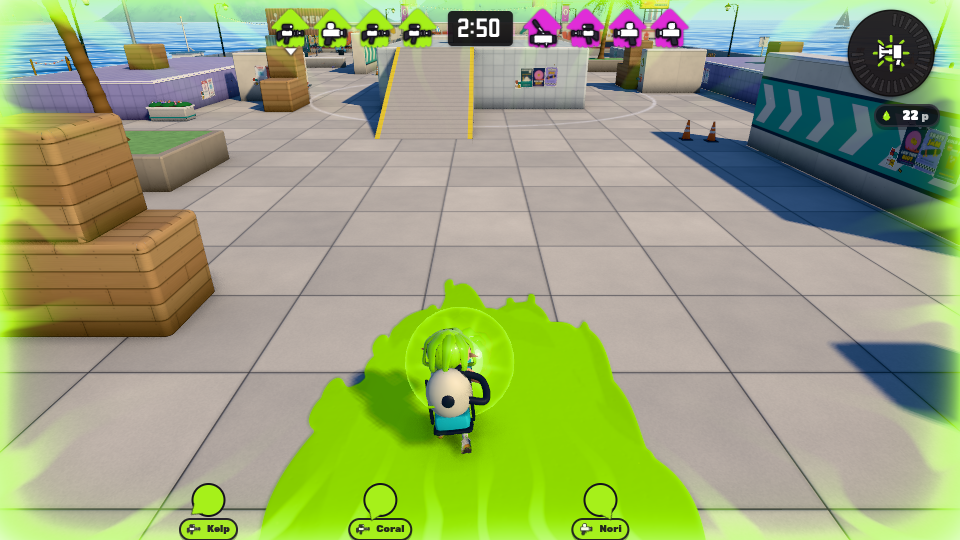
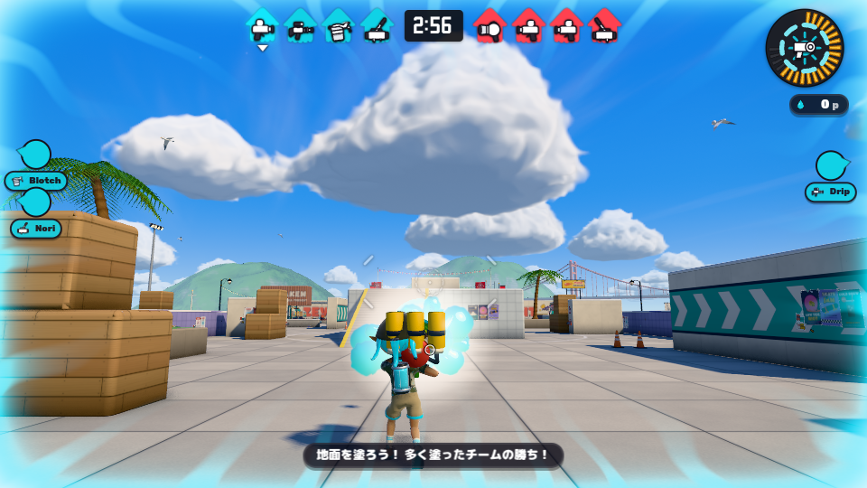
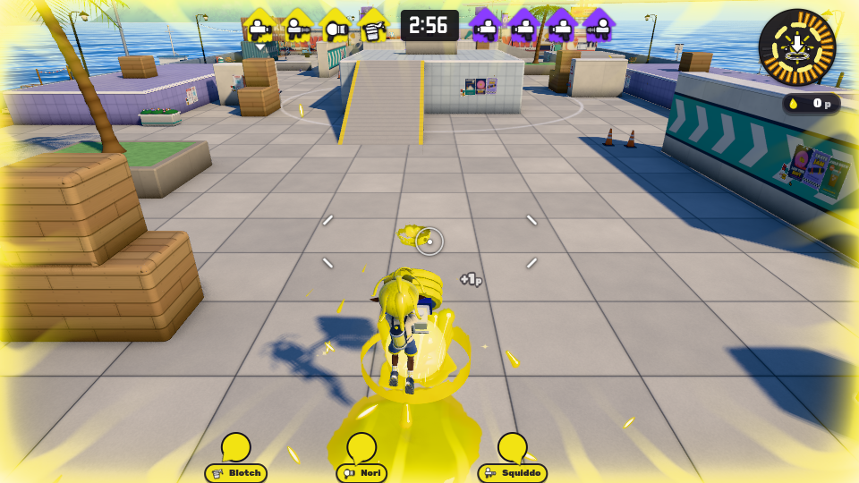
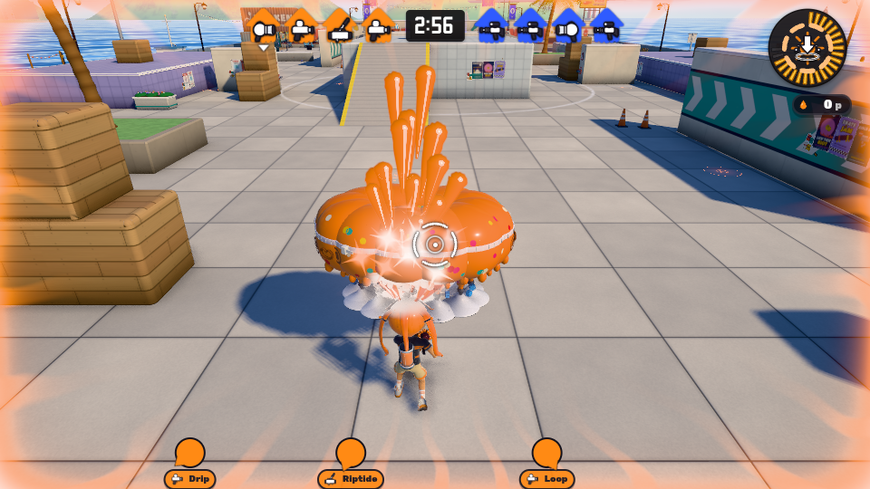

# 公開比較候補43001b8の実ブラウザ受入記録

正確なSHA: `43001b8227d89da773bcae619e0a53318b3541c2`。tree: `7288697ce1b8a9f4e2832f5780277a048d07b8af`。親: `b6a4996eb436ac6b854f944d7e5a8914abfdc9b4`。ブランチ `inkwave/special-nozzle-acceptance-20261023` を独立したdetached checkoutへ取得し、旧a4候補の実画面で代用していない。

Node22.23.4とesbuild0.28.2で標準の `node scripts/build-inkwave.mjs inkwave-public <separate-output>` を実行し成功。build revision `be9d7c7a60c8a29343331d499443e296c401709359c75505736ac7dc0ccc9e0a`、contentHash `0486209607eea29c4a55468171b11c7e995c214f833280cb7ae0f7dc79568d54`、inputHash `745e4c3b678fb259bc192f761435090f6facc8e363aec46dd92aea3a8c636891`。1364入力のhashとGit blobが一致し、2020出力artifactを起動前に照合、配信時もhashを照合した。この報告のbuild-identity.jsonを参照。完全な配信レシートはローカル証拠として保存している。

## 実行条件

Chromium154.0.8037.57、WebGL2、ANGLE Vulkan SwiftShader、viewport960×540、DPR1、high、shadow/bloom有効、Tidewater/day。tone mapping7、exposure0.94。Sunは色fff0dc・強度3.3・位置[-92.40512,100.69126,-83.20194]、SkyFillはb4d0ff・強度0.45・ground ffffe4。モデル、材質、色、光源は変更していない。試合ごとにチーム色が変わるので異なるケース間の輝度差を形や色の補正根拠としない。

製品Game._frame(1/60)を固定更新し、製品Renderer/composerで描画。発動・ジャンプ・横移動・サブ投擲はkeyboard、保持射撃は既存debug.fire。開始待ちを実時間3300ms取り、試合開始後にゲージを満たした。debug.freezeBotsでAIを止めた。通常followカメラのゲーム画面と、同じ状態でカメラだけを動かすSTATIC診断画像を区別する。連続実時間ゲームプレイのFPS合格、iPad性能、無介入性能測定の証拠ではない。

ブラウザメモリ内の受動observerはDirector.inkVacShot/trizookaShot/muzzle/sparkを元の戻り値を保ってラップし、発光時のrawモデルsocketを別途world座標へ変換した。source/runtime/guardのファイル編集はない。136状態記録には予備試行も含み、136件のテスト成功とは呼ばない。全記録でDirector errors0、glError0、context loss0。ブラウザ警告はKHR_parallel_shader_compile未対応のみ。

## 観察結果

| 対象 | 新候補で実際に確認した結果 | 主画像・記録 |
|---|---|---|
| キューインキ | 実際のexhale HOLDでcountershot発光0。release edgeでnative弾1発・muzzle1回。発光時と描画後のモデル銃口の両方が発光中心と0 WU。旧約0.5014WUのずれはこのローカル実発射では解消。HOLD中に製品Actor.splatを呼ぶ中断でも新しい発光0、120更新後対象pool/ribbon0。 | vac2-HOLD-native.png、vac2-birth-native.png、vac2-birth-STATIC.png、vac-cancel-death.json |
| ウルトラショット | 3 native birthそれぞれの白いpeakを確認。各発光時のモデル銃口距離0 WU。横移動時のlobe1/2はcommitted p.startから離れた現在の銃口を再取得。上向きaimによる通常カメラ試行でも3発を撮影。次の斉射の1発目直後に死亡させると後続2発の光なし。 | triz-F0/F4/F8-native.png、triz-level-birth-clock0/4/8-native.png、triz-pending-cancel.json |
| ウルトラハンコ | native jump開始時arc=-1.35、4更新後=-1.2555556、8更新後native jumpSwingとarc=1.2が同時成立。接触時actorは空中・y=.9475。次の地上予定nextSwing1.23333秒ではなくjumpStampAt.566667秒を基準に下降していた。敵への命中・ダメージや床接地までの完全な試験ではない。 | stamp-air-precontact-native.png、stamp-air-contact-native.png、stamp-air-contact-STATIC.png、stamp-air-contact.json |
| デコイチラシ | 受理されたballoon index0でmuzzle方向[0,1,0]、位置[.4,1.6,-27.21]。通常カメラでも上へ伸びる噴射を観察。12個のballoonイベントは同じnative更新で生成された。継続発射列や装置保持時間が本家と一致するとは判定しない。 | chump-birth-native.png、chump-plus3F-native.png、chump-birth-STATIC.png、chump-cleanup.json |
| グレートバリア | deploy14更新(t=.233333)はignited=false・pillar/halo alpha0、15更新(t=.25)でignited=true・pillar約.541696、halo.25。通常画面で柱出現を確認、別のSTATIC画像で展開全体も観察。自然終了後さらに120更新で対象pool/ribbon/dome0。 | bubbler-14-preignition-native.png、bubbler-15-ignition-native.png、bubbler-ignition-full-STATIC.png、bubble-end.json |
| テイオウイカ | local active jumpAttack・空中でink6/glow2の輪。空中の観測時304保持点、着地時368保持点だが全8記録ended。着地後30更新で輪の記録と保持点0。死亡後120更新で全対象poolも0。 | kraken-air-jump-native.png、kraken-air-jump-STATIC.png、kraken-landing.json、kraken-afterlanding30.json |
| スミナガシート | operationAge650/60と675/60でscale[1,1,1]のまま、本体opacity.6318106→.1226858、縁.135→.02875。全高が見える診断カメラで直立したまま消えることを観察。681更新でobject消失、その後対象pool0。同じ試合で再使用し、100更新でopacity.76865・縁.18へ復帰。通常followでは遠方の壁が見切れ、形状比較はSTATIC画像の観察による。 | screen-reuse100-STATIC.png、screen-reuse650-STATIC.png、screen-reuse675-STATIC.png、screen681-ended-native.png |

### 銃口の測定値と時刻の注意

Vac発射はケース更新853、Game frame1807、native clock1807、G.time30.1333333333。発光中心とrawモデル銃口はともに `[0.333795879962,0.738441345904,-26.788622587454]`。ゲームプレイp.startは `[0.404163128121,1,-27.206808091010]`、描画時の弾位置は `[0.404163128121,.839391266676,-26.716514643779]`。visual/gameplay原点距離は.4982404987WUで、原点を分けたまま視覚光だけがモデルsocketへ移っている。距離は同じworld座標系でのEuclidean距離。通常camera位置[.1241631281,3.9573449035,-31.2588200516]・FOV55。診断cameraはactor+[2,1.9,2.6]・FOV45、actor+[0,1,.4]を注視。

Trizooka横移動試行の発光中心からcommitted p.startまでの距離はlobe0/1/2で約0.000000000/0.189580953/0.483331821WU。各birth時のrawモデルsocketとの差は0。固定更新終了時にはpose/recoilや移動が更に進むため、別時刻のモデルsocketとの差とは区別する。上向き試行の最初のbirthでは同じ更新の描画後にsocketが.055WU動いていた（後続2発の描画時差は0）。これを発光時0の測定から隠さず記録している。

既存記録と呼出し順で確認した**Trizookaの観測位相差**。上向き試行のnative clockは8846/8850/8854で差分0/4/8だが、観測側のGame更新番号548/551/555とG.time147.450/147.500/147.566667は0/3/7更新、0/.050/.116667秒。初回lobe0はMatch.update中の_push observerでtick完了前に採取する。一方、後続はdelayが0となるtick終端をflushTrizookaBirthsが確定し、age0のまま、runSimulation終了後のFX.update → Director.updateRounds → ROUND_FX.trizooka.startで採取する。FixedClockはtick callbackの後にticks++するため、初回だけ採取時カウンタが同じ更新終了時より1小さい。実際に同位相のpost-tick snapshotを比べると8847/8850/8854で0/3/7となり、G.time差と一致する。この1tickのラベル差は観測位相で説明できる。生成更新でも遅延量からdtを消費し、後続birthは4回目・8回目の積算終端となる。raw値0/4/8は変更せず、経過時間の0/.050/.116667秒と併記する。本家の入力時刻・録画位相への対応は未確認。根拠はtiming-phase.jsonと固定SHAのclock.mjs、turf-finish.mjs、kit-trizooka.mjs、weapons-adapter.mjs、kit-rescue-adapter.mjs、trizooka-collision.mjs、special-vfx.mjs。コード修正・追加撮影は行っていない。

### remoteの範囲

新候補でremote Vacだけを追加確認した。実NetMatch instanceをG.netmに設定し、owner/nidを束縛した製品replayKitEventとreadyな固定snapshotによるapplyRemote、製品ghostProjectileを使用。HOLDとreleaseだけでは弾・countershot発光0。有効な27-field legacy packetでprepare=true・appended=1、次のnative frameの実画像で発光1回。発光時のremoteモデル銃口距離0WU、次の描画時にはposeが約.00593WU進んだ。終了後120更新で対象pool/ribbon0。

これは制御された受信component確認。live transport、2クライアント、所有者releaseがghostより先に届く順序、sender admission全体、遅延・補間・reconciliation、new headのremote Trizooka/Stamp/Chumpは未確認。最初の28-field packet試行は製品guardで拒否され、光も弾もなかったため受理試験から除外した。guardは弱めていない。

## 失敗・未確認・アクセス制約

予備セットアップはPTYの1行4095byte切断で失敗し、メニューの3画像をINVALIDとして隔離。最初のVac撮影は吸引中であり、HOLD/発射の証拠から除外。Screen650の通常カメラscreenshotは60000ms timeoutで保存失敗（後の独立した再使用ケースでは保存成功）。最初の675画像はnative更新により通常カメラへ戻っていたのでファイル名を修正し、再使用675で診断cameraを更新後に再適用した。`failures-and-exclusions.json`と`filename-corrections.json`を参照。

本家記事GameWith https://gamewith.jp/splatoon3/362075 へのこの環境でのproxy403は再試行・迂回していない。本家MP4はこの環境で取得・decode・観察しておらず、直接のフレーム比較は未完。親から提供された参照要約（Vac30fps f203–206、Bubbler30fps f38、Kraken60fps f111–135、Screen30000/1001fps f330–365）は親側の観察としてのみ扱う。本家のゲーム版と入力時刻は不明。録画FPSとsimulation/native FPSを同一視しない。切替・重複フレーム・本家frame numberの自身による検証は未実施。任天堂素材は含まない。

追加依頼のworkflow381040733への手動dispatchは未実行。`/usr/bin/gh`は存在するが既存 `gh auth status` がexit1、GH_TOKEN invalid。認証を新設・拡張・転送せず停止した。branch/run照合にも進んでいない。これはGitHubコネクターのdispatch機能不足を拒否と扱った結果ではない。CIの代替を主張せず、既存CIは変更・取消しなし。

Libraryの既存network失敗は再試行していない。新しいLibrary file ID・ユーザー共有リンクは得ていないため、ここでのローカルZIP保存をLibrary保存成功とは呼ばない。別環境から/workspaceのパスだけを読めない制約は残る。前回のLibrary blocker記録も保存したまま。ソース・既存ブランチ・PR・main・共通shader・髪/キャラクターモデルは変更していない。旧a4の2証拠ZIPのhashも一致している。

受入の限界は、直接の本家比較、本家とのTrizooka birth時刻境界の対応、継続的なデコイ発射・装置保持、live remote全体、敵命中/ダメージ、iPad/実GPU性能。今回の観測だけで全スペシャルの完全一致や性能合格とは判断しない。

## 公開した代表的な通常ゲームカメラ画像

以下4枚は固定候補の製品ゲーム画面を元PNGのまま保存したものです。全31採用画像のうち4枚を報告用ブランチに含め、他の画像と操作ログはローカル保存のままです。`states.json`には136件の観測記録があり、予備試行を含むため成功件数ではありません。

### vac2-birth-native.png

### triz-level-birth-clock0-native.png

### stamp-air-contact-native.png

### chump-plus3F-native.png

