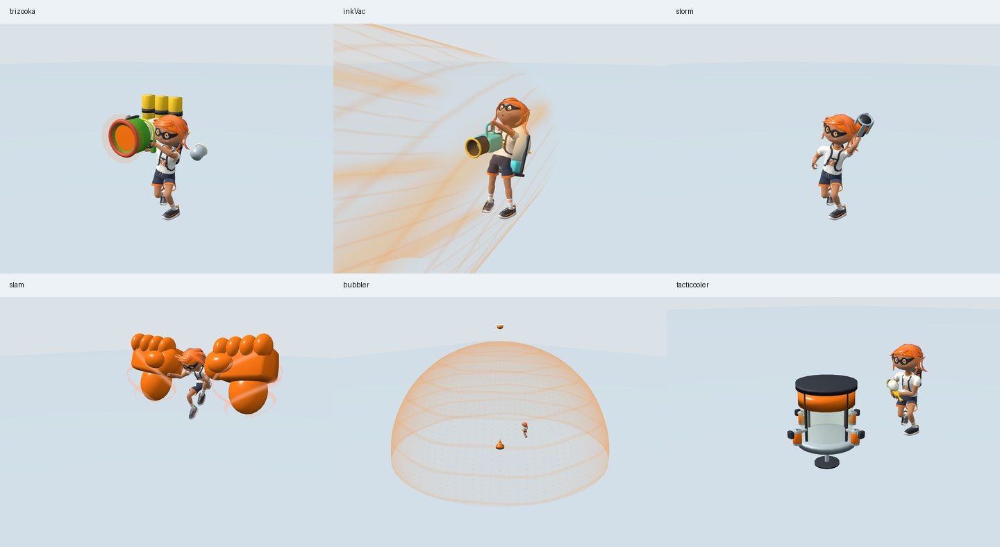

# 既存スペシャルのモデル・モーション・演出比較（2026-10-10）

公開main `d47a1d43a779b8194588c63dfa65e3d87521040f` にある5種類と、既存の任意キットのTacticoolerを対象にした。版番号付きの数値参照はSplatoon 3 **11.3.0**、Leanny抽出の固定commit `7280ff9cde8bb1c5dcef46c700c326471584d2e6` を継続する。公式の宣伝画像・デモ動画は公開時期が異なるため、11.3.0実行バイナリの完全な動作資料とは扱わない。

## 参照と実装

| 対象 | 参照 | 実装した表示・動作 | 残る実機比較 |
| --- | --- | --- | --- |
| Trizooka | [NintendoEurope公式画像](https://x.com/NintendoEurope/status/1443506022765760512)、[任天堂Direct紹介](https://www.nintendo.com/en-gb/News/2021/September/Fresh-Splatoon-3-deets-revealed-in-latest-Nintendo-Direct--2045101.html)、[Wiki](https://splatoonwiki.org/wiki/Trizooka) | 緑の砲口・赤い縁・蛇腹・後部3タンク・ホース。元のメイン武器を退避し、両手IKで上下照準。実際の専用砲口へ発射位置を接続。反動・フラッシュ・3枠の排莢。受理された遠隔3弾も1回だけ演出 | 正確な寸法/UV/テクスチャ/全関節軌道、排莢速度のworld換算と角速度の単位 |
| Ink Vac | [SplatoonNA公式モデル](https://x.com/SplatoonNA/status/1518659285248397312)、[公式デモ](https://x.com/SplatoonNA/status/1518678511610859520)、[Wiki](https://splatoonwiki.org/wiki/Ink_Vac) | 白い丸胴背負いタンク、水色エンジン/ノズル、黒い吸引管/ホース/フレーム、2つの持ち手。両手IKと充填窓、吸引側へ動く渦のシェーダー | 反撃時の元骨格曲線、動的ホース、元シェーダー/反撃エフェクトとのピクセル一致 |
| Ink Storm | [公式スペシャル紹介](https://x.com/SplatoonJP/status/1560189765986635777)、[Wiki](https://splatoonwiki.org/wiki/Ink_Storm) | 保持/投擲用カプセルと4枚の金属フィン、暗いチーム色の15パフ雲を1つのInstancedMeshへ。保持中の左手へ装置を接続 | 今回取得した公式画ではカプセル細部が見えず、細部はWiki本文の解釈。雨粒/雲の元シェーダーと正確な形状 |
| Big Bubbler | [NintendoEurope公式画像](https://x.com/NintendoEurope/status/1443183858938228737)、[Wiki](https://splatoonwiki.org/wiki/Big_Bubbler) | コマ状の発射台、ビーコン/黒いコード、上部装置と白いプロペラ、輪・点・視線角による透明膜。既存の発生器上昇/半径/HPに追従 | 台座の細部はWikiの解釈。破壊時の元エフェクト、元の膜シェーダーと全カメラ条件 |
| Triple Splashdown相当（内部`slam`） | [SplatoonNA公式モデル](https://x.com/SplatoonNA/status/1729500483956424954)、[公式デモ](https://x.com/SplatoonNA/status/1729500670653276522)、[冬季公式紹介](https://www.nintendo.com/jp/topics/article/fa3d0720-7dae-476d-badd-24a738ef8dac)、[Wiki](https://splatoonwiki.org/wiki/Triple_Splashdown) | 道具を持たない上半身、左右で反転した大きなインク拳と渦状エネルギー。上昇/滞空/降下、既存の追加着弾15Fに合わせて表示。判定トークンを観測し、遠隔は受信phaseで表示 | 元の拳メッシュ/柔らかい変形/全関節軌道、遠隔開始位置/通信遅延と二端末実機映像 |
| Tacticooler | [SplatoonJP公式モデル](https://x.com/SplatoonJP/status/1559102602662793216)、[公式デモ](https://x.com/SplatoonJP/status/1559102848981680130)、[Wiki](https://splatoonwiki.org/wiki/Tacticooler) | 円筒透明胴・縦フレーム・上部ヘッダー・4本の横アーム/缶、取得数に応じた缶の非表示 | 元の投擲→展開アニメ、缶取得時のキャラクター全関節 |

公式画像はWikiに保存された同じ宣伝画像も目視した。吸引・冷蔵庫・追加2拳の動画は静止フレームも比較した。Driveの参照フォルダには19個の独立ZIPがある。取得したpart01の `SOURCE_INFO.txt` 6–7行はゲームRomFSを含まず、HoianViewerには別途取得したRomFSが必要と明記する。`HOW_TO_RECONSTRUCT_ALL.txt` 1行もRomFS不在を明記する。収録元はSplatoon/thickのdecompと、Leanny/splat3、HoianViewer、Awesome-Splatoon3-Hackingの公開スナップショットである。取得範囲の移動素材はWii U版であり、S3のこれらの専用リグ/元シェーダーを取得した根拠にはしない。他の18本はRange取得と通常取得が失敗したため内部未確認で、元アセット候補の不存在を個別に確認したとは主張しない。

## 所有権と処理量

`patches/splatoon3/runtime/special-motion.mjs` の最終インストーラが、既存キットの状態を読んで専用モデルを表示する。武器変更、死亡、リセット、非表示、形態変更、キャンセルで旧武器の元の表示状態を復元する。動きの入力は既存Actorのphaseと`G.time`で、演出がゲームの時計・ダメージ・塗り・ネットワークイベントを新しく作らない。発射口についてはTrizookaの専用ソケットへ意図的に接続したため、旧メイン武器の銃口座標との同一性は主張しない。

モデルはThree.js名前空間ごとに共有する不変ジオメトリ、インスタンス所有の材質、統合したハードウェアメッシュを使う。個々の終了で共有ジオメトリを破棄しない。握りの制約は固定20回、ベクトル/クォータニオンを再利用する。排莢は固定3枠、雲は15パフ/1 draw。新しいランタイムURLを増やさず既存モジュールにまとめ、既存の初期ロード/オフライン予算内で構成する。

`TRIZOOKA_CARTRIDGE` の排莢30F、寿命60F、フェード5Fは固定抽出を使用。排莢移動の係数、握り位置、ポーズ角度、材質、渦/膜の周期はINKWAVE用に校正した値で、公開されていない本家の確定数値ではない。近傍/遠方/長さを持つ吸引表示、バリア半径/HP、雲の移動/雨/被害、追加2拳の着弾は既存判定を可視化し、見た目の寸法で判定値を上書きしない。

## 検証と自己レビュー

実際の最適化ビルドでネイティブCharacterのsource motionを読み込み、6種類を起動してWebGL描画した。[表示比較](inkwave-special-presentation-2026-10-10/render-review.jpg) と [機械可読結果](inkwave-special-presentation-2026-10-10/webgl-result.json) を保存した。描画fixtureは平面の衝突stubを使い、Slamの滞空位置を診断用に固定する。実機の戦闘/物理/オンラインの完全比較ではない。

- 2種類の両手保持で、専用グリップと実際の手の握り穴の最大距離は1e-5 world unit未満。Shooter/マニューバー/ローラーで極端な上下照準も検証した。
- 各専用装置/拳が描画に寄与し、キャラクターも隠れていないことを、表示/非表示で変わるピクセルから確認。渦・透明膜のシェーダーも実際にコンパイルした。
- 12巡×6種類（雲を含む）の生成/描画/破棄で、ウォームアップ後のGPU数はgeometry 45、texture 2、program 23、WebGL buffer 232のまま。雲の描画寄与は1 draw。ソフトウェアWebGLの資源数検査であり、実機FPS計測ではない。
- 30/60/120Hzの保持、キャンセル/死亡/武器変更、固定排莢フレーム、停止フレーム、受理/拒否された遠隔パケットの回帰を追加した。遠隔表示はdamage/paint/networkの権限を取得しない。
- 自己レビューで、極端な照準の手外れ、Stormの手首座標とモデル座標の混同、Slamの拳による本体遮蔽、渦の未定義smoothstep、共有ジオメトリの誤破棄、終了済み遠隔射撃による小道具再表示を修正した。

CIの27場面のモーションcatalogでは全場面が完走したが、独立rendererの終了検査がgeometry 2を残して失敗した。拳はシーン直下にあり、Character終了で切り離される一方、共有ジオメトリはrenderer生存中の再利用に必要である。検査fixtureがキャラクターrootだけを収集していたため、拳の2個をfixture自身の最終破棄対象に記録できていなかった。`scripts/check-inkwave-motion-catalog.mjs` の描画時の資源収集をscene全体へ拡げた。終了時geometry/textureが0である合格条件は維持する。

GPU解放修正版のローカルビルドのrevisionは`f16047de959abcb3d5efcb592376dd39abc6b14a2b9c25ba81a761ec62396fea`、artifact contentHashは`51681afe2d7d97eafcd1f8076a8c38088579a56ce962546c5c20680bb611f26c`。初回実装で専用表示7件を含む変更関連の回帰170件は全件成功。品質/練習場/キャッシュ回帰918件は905成功・13skip・失敗0。キャッシュPython harnessは3成功・1skip、既存workflow構成テストも成功。GPU解放修正版の専用表示8件はソースと最適化ビルドの両方で成功。Chromiumは環境にある133 headless shellで確認し、Playwright 1.62.1の実行先だけをローカルで指定した。CIはワークフローに固定されたブラウザを使用する。

初期JS 3,349,326 bytes、precache 5,121,821 bytes、worker 65,520 bytes、145 modulepreloadで既存予算検査に成功。これらは依存グラフ/ファイル量の検査で、端末のFPS/ロード時間そのものではない。CIには専用WebGL検査を追加し、実行commitとartifactを別途確認する。

追加レビューで、雲のInstancedMeshの `instanceMatrix` は共有geometry/材質と別の専用GPU bufferを持つことを確認した。元の雲終了は材質のみを破棄し、手続きモデルの汎用終了もInstancedMesh自身のdisposeを呼ばなかった。修正前ランタイムを使う負の対照で、両経路のdisposeが0回になることを再現した。汎用終了に加え、実際のProjectilesの自然消滅/明示終了/clearでインスタンスを1回だけ破棄し、共有geometryは維持する。WebGLのcreateBuffer/deleteBufferも数える検査へ拡張し、72回のモデル生成・破棄に加え、36回の実際の雲生成・描画・終了を確認した。各雲の専用bufferがGPUへアップロードされ、自然消滅/明示終了/clearの直後にbuffer数が232へ戻る。二重終了でも増減しない。

## 初回のmainと公開版の確認

[PR #1216](https://github.com/rhgrive3/actions/pull/1216)をmain `4ec8f14c63a26b43415e14629d1f60237b4e4b49` へ統合した。テスト対象PR head `06a367ccf77354519921a3fa47c2f36e79597d50` と統合直後mainのtreeは、どちらも `a301adb3df370aa4d49375e5504236304107592f` で一致する。

正規のローカル全回帰 `node scripts/check-inkwave-patches.mjs` は4,117件、4,102成功・15skip・失敗0。最適化ビルドの専用表示7件も成功した。修正後のモーションcatalogは27場面・5,310フレーム・349描画対を完走し、独立rendererの終了時geometry/textureは両方0である。

[Pages実行38086780001](https://github.com/rhgrive3/actions/actions/runs/38086780001)は成功。[公開版](https://rhgrive3.github.io/actions/)のHTML、worker、関連ランタイム5モジュールの配信内容を取得し、検証ビルドのmanifestとSHA-256で照合した。[配信照合結果](inkwave-special-presentation-2026-10-10/published-verification.json)に7ファイルのハッシュを保存する。これは検証した7ファイルの配信一致であり、公開版全ファイルの再ダウンロード比較ではない。

CI [実行38086434542](https://github.com/rhgrive3/actions/actions/runs/38086434542)では、専用WebGL・全モーションcatalog・通信・UI・練習場・起動/キャッシュを含む全ブラウザshard、およびseven_claimsとresource_paint_continuationが成功した。validateジョブの全回帰4,117件も4,102成功・15skip・失敗0で完了し、全必須ジョブが成功した。

## GPU解放修正版の最終確認

[追加自己レビューのPR #1217](https://github.com/rhgrive3/actions/pull/1217)をmain `a107422f62182036a4965c2bee65398d5af6f0fc` へ統合した。最終PR head `eb1ea8bf3fab01f4acbca436e1aa1b28535015e8` と統合直後mainのtreeは `f8009f8812d8edae5e6f23dbc795c82c5b38e4d6` で一致する。

GPU修正版の正規のローカル全回帰は4,118件、4,103成功・15skip・失敗0。専用8件はソース/最適化ビルドの両方で成功した。最終artifactの全モーションcatalogも27場面・5,310フレーム・349描画対・232ロードモジュールを完走し、終了時geometry/textureは両方0。6種のWebGL表示、72回のモデル生成/破棄、36回の実際の雲生成/描画/終了、buffer 232の安定を再確認した。[最終レビュー結果](inkwave-special-presentation-2026-10-10/review-verification.json)に検証範囲を保存する。

[最終Pages実行38088824316](https://github.com/rhgrive3/actions/actions/runs/38088824316)は成功。[公開版](https://rhgrive3.github.io/actions/)のHTML、worker、関連ランタイム5モジュールを再取得し、最終artifact contentHash `51681afe2d7d97eafcd1f8076a8c38088579a56ce962546c5c20680bb611f26c` のmanifestと7ファイルすべてのSHA-256が一致した。[最終配信照合](inkwave-special-presentation-2026-10-10/published-verification-final.json)に保存する。

追加修正版CI [実行38088524965](https://github.com/rhgrive3/actions/actions/runs/38088524965)の専用モデル/握り/シェーダー/GPU終了のWebGL stepは成功した。最終記録時点で同CIの全回帰と一部ブラウザshardは実行中であり、追加修正版CI全体の完了とは扱わない。文書の追記はランタイムや公開artifactを変更しない。

公開資料にないNintendo製の元メッシュ、テクスチャ、関節曲線、エフェクト素材との同一性は未確認であり、「完全一致」や「改善点ゼロ」とは判定しない。
