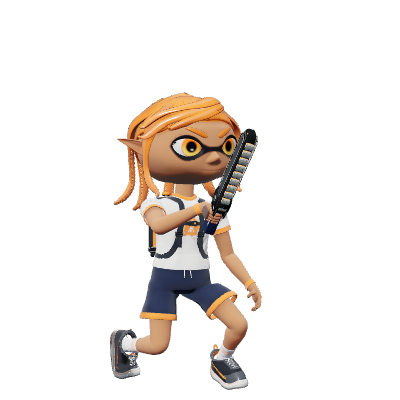
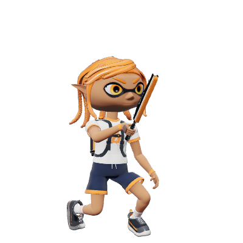
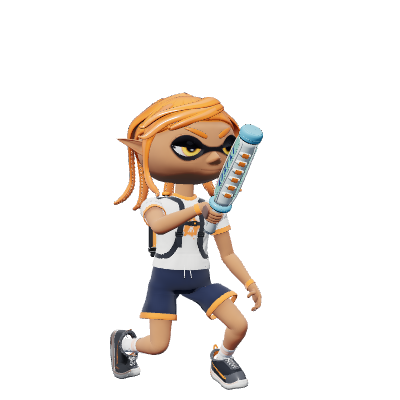

# ワイパーの個別レビュー — 2026-10-23

基準: main `26a4db4123d23162a3dbf8a12150b1b5bc6ccf64`。対象は公開版をproduction compositionしたコード。比較版は Splatoon 3 Ver.11.3.0、通常バトル。ギアなし・前入力あり/なし・地上/空中・通常/低インクを区別した。Switch実機との全項目一致を認定しない。

## 根拠

- [固定したLeanny 11.3.0抽出データ](https://github.com/Leanny/splat3/tree/7280ff9cde8bb1c5dcef46c700c326471584d2e6/data/parameter/1130/weapon) の `WeaponSaberLite/Normal/Heavy`。明示されたCoreIndex、OffsetArray、ParamArray、斬撃/波の別ダメージ、寿命、発生遅延を維持する。
- [攻略＆検証Wiki・ワイパー属](https://wikiwiki.jp/splatoon3mix/ブキ/ワイパー属)、2026-10-23閲覧。ヨコ斬り/タメ斬りとも、障害物に当たった判定より外側の同じ側の判定も消えるとの観察を今回の修正根拠にする。コミュニティ観察であり、任天堂のcollision実装そのものではない。
- [攻略＆検証Wiki・メインウェポン検証](https://wikiwiki.jp/splatoon3mix/検証/メインウェポン)。版がv10.0.1等の表を含むため、現行11.3.0の値へ無条件で読み替えない。
- [前回の個別監査](../new-families-1130-20261018/saber.md)、[サブ/アサリ投擲受付の後続修正](../../patches/splatoon3/reference/splatana-post-wave-throw-admission-2026-10-19.md)を引き継ぐ。

## 今回修正した差

`runtime/main-weapon-catalog.mjs` は地形に当たったlobeだけを退役させていた。5/7個の判定のうち内側が細い柱や段差へ当たっても、柱自体に触れない外側はその先のActorを攻撃できた。ジムのヨコ斬りでは本来消える外側に35ダメージが残る例を修正前に再現した。タメ斬りの上下方向とデンタルの左右方向でも同じ差があった。

CoreIndexから左右へ走査し、各翼の接触時刻を外側へ伝播させる。Actor接触の候補選択より先に処理するため、同じ60Hz tick内でも内側消滅後の外側hitを拒否する。中心・反対側・より内側の生きた判定は残す。内側の地形接触より前に生じた有効なActor hitは維持する。

消える外側が触れていない壁へ塗りを作らないよう、物理接触時刻 `terrainStop` と有効寿命 `stop` を分離した。既存の実接触候補に対するpaint seed予約は維持し、ghostでは同じ消滅を行うが塗り/HP権威を与えない。

再現: 5/7-lobeの内側だけが接触する細い柱を置き、最外側の経路に敵を置いて横/タメ斬り。遮蔽なしcontrolでは敵に当たり、柱ありでは外側消滅により当たらない。実際に発射したwave、production Physicsのswept sphere、Actor capsuleで確認し、前後の連続接触順・反対翼・30/60/120Hz・ghostも検査した。

## ブキごとの確認

| ベース（派生を含む） | Full charge | 刀身/波ダメージ（横、タメ） | 波の判定数と今回の修正 |
| --- | --- | --- | --- |
| ドライブ、デコ、RUST | 14F | 15/30、120/60 | 横3・タメ7。横は中間lobeなし、タメの上下cascadeを修正 |
| ジム、ヒュー、封 | 20F | 20/35、140/70 | 横5・タメ7。横の左右/タメの上下cascadeを修正 |
| デンタルミント、スミ | 20F | 30/40、160/80 | 横7・タメ7。両モードの左右cascadeを修正 |

| 領域 | レビュー・検証内容 | 状態 |
| --- | --- | --- |
| 入力/消費 | 横/タメ、weak costとcharge予約の差、ドライブ3%境界、無償攻撃防止 | 既存回帰を再実行 |
| 発生/刀身 | 原典offset、yaw、4F寿命、Actor/設置物の別受信形状、同一攻撃dedup | 既存回帰を再実行 |
| 波/障害物 | CoreIndex、部位別半径、地形/Actor/カサ/Bossとの接触順 | cascadeの残存外側を修正。既存の先行接触試験を再実行 |
| 塗り | 接地時の足元、独立落下飛沫、寿命終了時burst、床/壁と途中所有権 | 既存回帰＋架空の外側stampがないことを確認 |
| 移動/受付 | 生の前入力履歴、startupとKdによる踏込、硬直、サブ/アサリの投擲拒否 | 既存回帰を再実行。通常フルジャンプと区別 |
| モデル/通信 | 左右交互、タメmode、デンタルの横振り、step/side wire、legacy/不正/順序逆転 | 既存回帰＋描画確認。ghostのゲーム権威はなし |

全8キットが同一ベースrecordを継承する。ブラウザでは各ベース/派生の横・タメ/左右を確認し、横3-lobeのドライブ系は中間lobeのないcontrolとしてcascade対象から除く。

## 継続する未確認事項

`ReserveAcceptFrame` の先行入力、`WeakSwingASFrame` / `ChargeSwingASFrame`、ドライブ/ジムの省略step-add既定値、空中からの踏込受付、`MoveDistKd_OnSlideGnd`、slashのpitch/追従anchor、接触したlobeでの原典のActor貫通則は未回収。今回の変更は地形によるcascadeを扱い、Actor接触で同様の貫通方式を推測して追加しない。減った判定に対応する波の描画形状、原典の腕/刀身軌道・効果音、実通信での表示時刻も完全一致未立証のまま。

検証結果は [validation.json](validation.json)、弓側は [stringer.md](stringer.md)。

## 描画した射撃状態

 |  | 

production Character/Runnerによる制御シーンの1サンプル。[描画receipt](gallery.json)の6モデルすべてで非有限値なし。画像はモデル/構えの目視確認であり、原典の全関節曲線・武器軌道の一致判定ではない。
