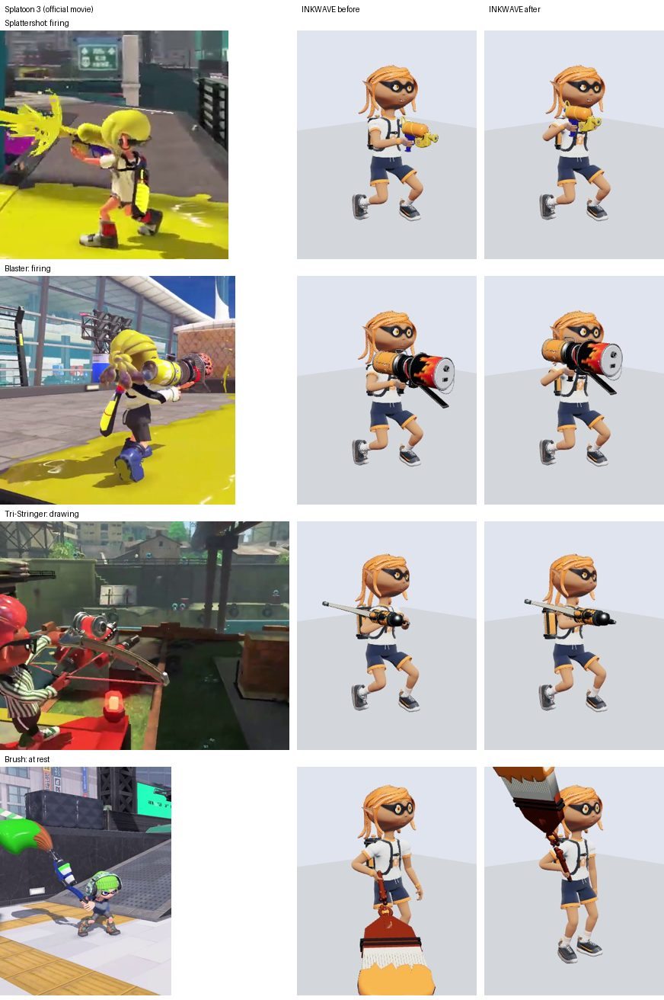

# ブキの持ち方・射撃中の動き・待機への戻し方（2026-10-17）

全11ブキ種の「持ち方・射撃中のブキの動かし方・射撃から待機へ戻す動き・ブキの大きさ・腕の置き方」を、任天堂公式のブキ紹介映像と INKWAVE の実ビルドで並べて比べ、差が確認できたものを直した。直した項目も含め、関節角・フレーム数は公式に公開されていないため、本家との完全一致は確認できていない（下の「確認状態」を参照）。

## 比較条件

- 本家：スプラトゥーン3 Ver.11.3.0 を参照版とする（`patches/splatoon3/profile.json`）。ただし下の映像の収録バージョン・ギア・入力は公開されていない。映像の姿勢を 11.3.0 の実機で測った値としては扱わない。
- 根拠：[任天堂公式 スプラトゥーン ブキ紹介](https://www.nintendo.com/jp/character/splatoon/fashion/index.html)（2026-10-17 取得）の全11種・66本の映像。ページの `js-media-*` 要素のメディア ID から公式の埋め込みページを開き、そこに書かれた公開 HLS（`media-assets.apps-jp.nintendo.com/media/splatoonbase/<id>.m3u8`）の 720p 版を取得した。制限の迂回はしていない。使った映像：

  | ブキ種 | メディア ID | 再生リスト | 見た区間 |
  | --- | --- | --- | --- |
  | シューター | `y7Zl26Zl12n` | `0000855_a2868da3…` | 8.4〜11.1 秒（射撃→待機） |
  | ブラスター | `3RVDozgk6XQ` | `0000876_64ce22dd…` | 0.5〜6.5 秒 |
  | チャージャー | `LR5D31Bl0xo` | `0000868_ee89ef69…` | 0〜16 秒 |
  | マニューバー | `0PQkeAEk294` | `0000865_ba6a4260…` | 2〜8 秒 |
  | ローラー | `AZLlvZRlJpm` | `0000879_07d0daef…` | 0〜2.5 秒 |
  | フデ | `vgGl1gaD7rb` / `EyKDWN7kgYb` / `XJql6EAj5yE` | `0000888_…` / `0000884_…` / `0000887_…` | 冒頭（待機）、`XJql6EAj5yE` 0.6〜3.8 秒（振り） |
  | スロッシャー | `xnGkyA7kgWr` | `0000893_24f341de…` | 0〜6 秒 |
  | スピナー | `AR1k41rDvXL` | `0000932_659d2b6f…` | 2〜6 秒 |
  | シェルター | `b1dl7EEDXYr` | `0000906_0e1e2a80…` | 0〜3 秒 |
  | ストリンガー | `8zdjp76DrAy` | `0000937_65871e74…` | 0.8〜3.2 秒、9〜11 秒 |
  | ワイパー | `5PKDAGQlreR` | `0000922_da621e81…` | 0〜6 秒 |

  どの映像がどの型番かは映像に書かれていない（例：フデの3本の型番）。持ち方の傾向だけを使い、型番ごとの差は扱わない。
- INKWAVE：本番と同じビルド（`scripts/build-inkwave.mjs`）を Chromium（SwiftShader）で描画した。実際の Actor・WeaponRunner・Projectiles・Character と、非同期読み込みのソースモーションを使う。ギアなし、静止、照準ピッチ 0、射撃は 60 フレーム目から押しっぱなし。
- 区別：数値は「ロジック単独（VM テスト）」と「ブラウザ描画」の測定で、どちらも Switch 実機との比較ではない。

## 差分と対応

| 項目 | 本家の根拠 | 修正前の INKWAVE（再現操作・実装箇所） | 変更と影響 | 確認状態 |
| --- | --- | --- | --- | --- |
| 射撃→待機の戻り | `y7Zl26Zl12n` 9.9〜10.3 秒：射撃をやめると、銃は数フレームかけて頬の高さから腰の両手持ちへ下りる | 撃つのをやめて 0.25 秒（チャージャーは 0.4 秒）たつと、上半身の担当がネイティブの構えから初代ソースの待機へ 1 フレームで切り替わり、銃口が 1 フレームで 0.29〜0.50 m 飛んだ（シューター 0.334、ブラスター 0.293、チャージャー 0.499、スピナー 0.463 m）。`runtime/source-weapon-owner.mjs` の判定、`source-controller.js` の `sourceUpper` | 新しい `runtime/weapon-handoff-motion.mjs` が最後に描いた上半身から 0.2 秒かけて待機へ移す。1 フレームの銃口の動きは 0.155 m 以下（武器自体の振りの範囲） | ブラウザ描画と VM テストで確認。0.2 秒は INKWAVE の校正値で、本家のフレーム数は未確認 |
| 待機→射撃の構え上げ | 同じ映像で、構えは素早く上がる（フレーム数は映像の 6 fps 抜き出しでは判定できない） | 撃ち始めの 1 フレームで同じ切り替えが起き、銃口が 0.29〜0.42 m 飛んだ | 同じモジュールで 0.1 秒かけて構えへ移す | 同上。0.1 秒は校正値 |
| 弾の発射位置（上の 2 行の影響） | ― | 弾は描画した銃口から出る（`weapons.js` `_muzzle`） | **変えない**。フェード中も、ゲームが読む銃口（`Character.getMuzzle`）はフェード前の姿勢で計算する。変更前後の全フレームで差 0.0 m（シューター・ブラスター・チャージャー・スロッシャー・スピナー、ブラウザ）。VM テストでも全フレーム一致 | ロジック単独とブラウザで確認 |
| シューターの射撃姿勢 | `y7Zl26Zl12n` 8.4〜9.9 秒：右頬の横で、肘を曲げて銃を顔の脇に引き寄せる。銃身は目〜口の高さ | 胸の高さで腕をほぼ伸ばして構えた（右手 0.71、肩 0.80、銃口 0.76 / 前方 0.56 m）。`character.js` `HOLD.shooter.aim` と各モデルの `hold.aim` | `weapon-models/family-holds.mjs` で全シューターの `aim` を右へ 0.15、上へ 0.12、手前へ 0.09 ずらす（モデル別の調整は相対的に保持）。右手 0.83（肩より上）、頭の中心から右へ 0.19 | 映像と描画で確認。関節角・距離は目測で未確認 |
| ブラスターの射撃姿勢 | `3RVDozgk6XQ` 0.5〜6.5 秒：後ろのタンクを右頬の横に置き、銃身は目の高さ。撃つ合間の移動中も下げない | 胸の高さ（右手 0.74） | 同じ方法で右へ 0.14、上へ 0.10、手前へ 0.06。右手 0.83、銃口 0.98 | 同上 |
| シューター・ブラスターの発射位置 | 本家の弾の発生位置は公開されていない | ― | 構えが変わったので、描画した銃口から出る弾の発生位置も動く：スプラシューター・ジェットスイーパーは 0.212 m（上 0.12・手前 0.09・右 0.15）、ホットブラスター 0.16 m、ノヴァブラスター 0.15 m。撃ち始めの1発目（照準姿勢の銃口から出す既存の規則）も同じだけ動く。弾は従来どおり照準点へ向けて撃つ | ロジック・ブラウザで計測。本家の発生位置との比較は実機計測が必要（未確認） |
| ストリンガーの持ち方 | `8zdjp76DrAy` 0.8〜3.2 秒：右手で弓の握りを前へ押し出し、左手で弦を胸元まで引く。9〜11 秒：撃たない時は右手だけで弓を体の横に縦に下げる | チャージャーと同じ銃の持ち方：両手で胸の前に抱え、左手は弓の前方。撃たない時も両手で斜めに抱え、弓は常に寝かせていた。`weapon-models/stringers.mjs` | 左手の位置を弦の矢筈（nock）へ移し、引き（`animateBow` の draw）に合わせて最大 0.17 m 後ろへ動かす（`adapter.mjs` の左手 IK に `supportZ` を追加）。構えは右腕を前へ伸ばし肩の高さ。待機は右手だけで体の横に縦に下げる。弓を寝かせるのは構え中だけ。発射位置は前へ 0.21 m、上へ 0.04 m 動く | 映像と描画で確認。引く量・弓の角度は未確認 |
| フデの待機 | `vgGl1gaD7rb`・`EyKDWN7kgYb`・`XJql6EAj5yE` の冒頭：右手で持ち、穂先を右肩の上へ立てて担ぐ | 穂先を右前の床すれすれに下げて持った。`weapon-models/brushes.mjs` `FAMILY_POSE` | 右肩の前で持ち、穂先を頭より上へ立てる | 映像と描画で確認 |
| フデの振り | `XJql6EAj5yE` 0.6〜3.8 秒：右手 1 本で横に振り、左腕は空いてバランスを取る | 両手で振った | 振りは右手だけ。左手は待機で体の横、振りで外へ出す。塗りながら走る（引きずり）の両手持ちは変えない（映像で手が判別できない） | 振りは映像と VM テストで確認。引きずりの手は未確認 |
| フデの発射位置 | ― | 振りの弾も描画した穂先から出る | 待機の持ち方が変わったため、振り始めの数フレームだけ穂先の位置が変わる。引きずり中・振り切りでは差 0.006 m 以下 | ブラウザで計測。振り始めに撃った弾の差は未計測 |

## 比べて差が見つからなかった・変えなかった項目

| ブキ種 | 本家（映像） | INKWAVE | 判断 |
| --- | --- | --- | --- |
| チャージャー | `LR5D31Bl0xo`：待機は銃口を前下へ向けて斜めに持つ。チャージ中は肩に当て、スコープを目の前に置き、体を横に向ける | 待機は斜め下、構えは頬の高さ（右手 0.88）、体を横に向ける | 変えない。スコープと目の距離は未確認 |
| マニューバー | `0PQkeAEk294`：両腕を前へ伸ばし胸の高さで構える | 胸の高さ（0.71）、腕を前へ | 変えない |
| ローラー | `AZLlvZRlJpm`：大きいドラムを背中に縦に担ぐ | 背中に担ぐ（2026-10-04 の大きさ校正どおり） | 大きさは変えない。担ぐ角度（本家はほぼ縦、INKWAVE は斜め）は既存記録どおり未確認 |
| スロッシャー | `xnGkyA7kgWr`：待機は片手で体の横に低く下げる。振り上げて前へ投げる | 片手で体の横（右手 0.44） | 変えない |
| スピナー | `AR1k41rDvXL`：腰の高さで両手 | 腰の高さ（0.53） | 変えない |
| シェルター | `b1dl7EEDXYr`：待機は閉じた傘を右手で下げる。撃つと開いて胸の前に構える | 同じ | 変えない（検証スクリプトに撃ち始めの押下を追加して確認） |
| ワイパー | `5PKDAGQlreR`：右手で持ち、待機は刃を下に。溜めで刃を立てる | 同じ傾向 | 変えない。振りの軌道は未確認 |

## 実装

- `runtime/weapon-handoff-motion.mjs`（新規）：`Character._applyPose` の外側で、上半身（背骨〜手）の担当がネイティブとソースの間で変わったフレームから、最後に描いた姿勢を 0.1 秒（構え上げ）/ 0.2 秒（待機へ）かけて薄める。両手持ちでは左手をグリップへ合わせ直す（ネイティブと同じ肩の押し出しを含む）。`getMuzzle` はフェード前の姿勢で評価するので、弾の位置・時刻・乱数は変わらない。キャラが非表示の間や、ブキ変更・イカ・ダンス・手動クリップでは働かない。
- `weapon-models/family-holds.mjs`（新規）と `registry.mjs` `weaponHold`：ブキ種ごとの構え位置の補正を、ネイティブ HOLD とモデル別の上書きの後に足す。シェルター・ワイパーは同じシューター種のモデルを使うが、挙動ブキ種で分けるので補正されない。
- `weapon-models/stringers.mjs`：左手の位置、引きへの追従、待機と構えの HOLD、構え中だけ弓を寝かせる。
- `weapon-models/brushes.mjs`：待機の担ぎ方、片手の振り、空いた左手。
- `adapter.mjs`：`character.js` の左手 IK の目標に `w.supportZ` を足す接続を 1 か所追加。

## 検証

- `patches/splatoon3/tests/weapon-hold-motion.test.mjs`（新規、実ソースバンクを読み込む VM）：持ち替えの最大移動が変更前より小さいこと、ゲームの銃口が全フレーム一致すること、30/60/120 Hz で同じフェード時間、シューター 3 種・ブラスターの構えが肩より上で頭の右、ストリンガーの左手が引きに追従、フデ 3 種の待機と片手の振り。
- `scripts/check-inkwave-weapon-models.mjs`（ブラウザ、既存）：7 種で攻撃中のネイティブ担当 100/100 フレーム、両手持ちの左手とグリップの距離は最大 0.39 mm（基準 6 mm）。変更途中の版では構え上げのフェード中に 8.9 mm 離れていたため、肩の押し出しを足して直した。
- 既存のパッチテスト全体（`scripts/check-inkwave-patches.mjs`）。結果は CI の該当コミットの結果を正とする。

## 残る差分と未確認事項

- 構え上げ 0.1 秒・戻し 0.2 秒、射撃をやめてから戻し始めるまでの既存の 0.25 秒（チャージャー 0.4 秒）は INKWAVE の校正値。本家のフレーム数は 6 fps の抜き出しでは決められない（60 fps でのコマ送りと実機計測が必要）。
- 戻る先の待機は初代（Wii U）ソースの姿勢のまま。本家の待機の細かい持ち方（銃口の角度など）との差は 2026-10-12 の記録どおり未確認。
- シューター・ブラスターの構えの高さ・横位置・肘の角度は映像からの目測。照準を上下に向けた時の構えの回り方、移動しながらの射撃の構えは比べていない。
- ストリンガーを空中で撃つ時（本家は弓を縦にする）は既存の動きのまま。引く量、弓の角度、左手の指の形は未確認。
- フデの引きずりの両手持ち、ローラーを担ぐ角度、スロッシャーの振りの軌道、ワイパーの振り、スピナーのチャージ中の姿勢は今回変えていない。
- ブキの大きさは今回変えていない（既存のモデル記録どおり）。映像との比較で明らかな差は見つからなかったが、寸法は測っていない。
- Switch 実機・iOS・実際のネットワーク試合での見た目は確認していない。
