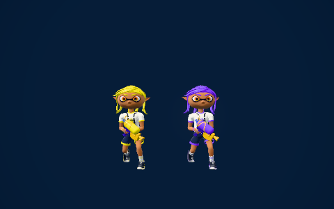

# Stable shared physical ink program identity

`getInkMaterial` now names its MeshPhysicalMaterial family `iw-ink-physical`. It keeps the existing per-hex cache, distinct team material instances, colors, sheen, clearcoat, shader hooks and disposal. This is a one-field production change in `inkwave-public/src/game/character-mats.js:1658`.

Previously the name included the team color. Three's shader cache key omits material names, so either team's first compilation/acquisition could label the same shared program. Its debug `SHADER_NAME` define and program metadata then depended on acquisition order. A full unchanged-source Mesa repeat observed that mismatch despite exact final pixels and all15 target colors; the strict preflight correctly rejected it. That old result remains rejected and does not establish a driver problem or resolve the older f151/SwiftShader pixel difference.

The source audit finds no production consumer of the color-suffixed ink material name. Three writes SHADER_NAME into four shader prefixes; its ShaderChunk and physical shader bodies do not read it. Its real program-key function excludes the name, while feature flags and custom shader cache identities remain separate.

Three source tests pass using the actual factory and real Three cache-key/acquisition functions. Reversing the two real team colors changes the old first compiler name but leaves the new name fixed. All serialized physical values except the intentional name and each instance's UUID remain identical. Hex caching and separate actual color owners are explicitly retained.

The controlled browser regression compares two source-verified common builds: a6/f3c32046 before and a09/fc0d620a after. Their builders are unchanged, and the complete declared build-input difference is exactly `upstream/src/game/character-mats.js`. It uses actual emitted Actor/Character, awaited source banks, two team-colored weapons, ordinary medium Renderer/postprocessing and identical fixed lighting. This is an automated isolated rendering regression, separate from full-match calibration and from the canceled manual Character QA workflow.

The full480×300 RGBA matches byte-for-byte:576000 bytes, SHA `88dc4afe0d5df0cc0107b769b3d1700a098fccad8c1961f6b232cd8a2185c4d3`. Both PNG files also match exactly. All bones/draw values,256 upload-source buffer receipts,14 texture receipts,40 mesh states,34 material states and13 observed post color targets match except the intentional ink material name. Both actual colors exercise one shared ink program among18 total programs. Every full actual shader text matches; the shared ink program differs only in the exact documented SHADER_NAME prefix line. All other program source bytes are unchanged. No GL errors, blank render or missing target receipt is accepted.

The two-build product regression explicitly admits its one intended debug-name change when comparing old/new metadata. The separate whole-game calibration retains every name/source-hash field and requires exact equality between repeats of the new source. No benchmark field, pixel, mask or tolerance was changed, and no native repeat or performance acceptance is inferred from this isolated regression. No gameplay constant or Splatoon 3 timing claim changes.

Node22.23.4, Chromium151.0.7922.34, ANGLE Mesa llvmpipe software rendering, sandbox enabled. Source/raw render/build receipts and hashes are in [receipts.json](receipts.json). Native calibration receipts remain on the independent DO NOT MERGE diagnostic branch.

