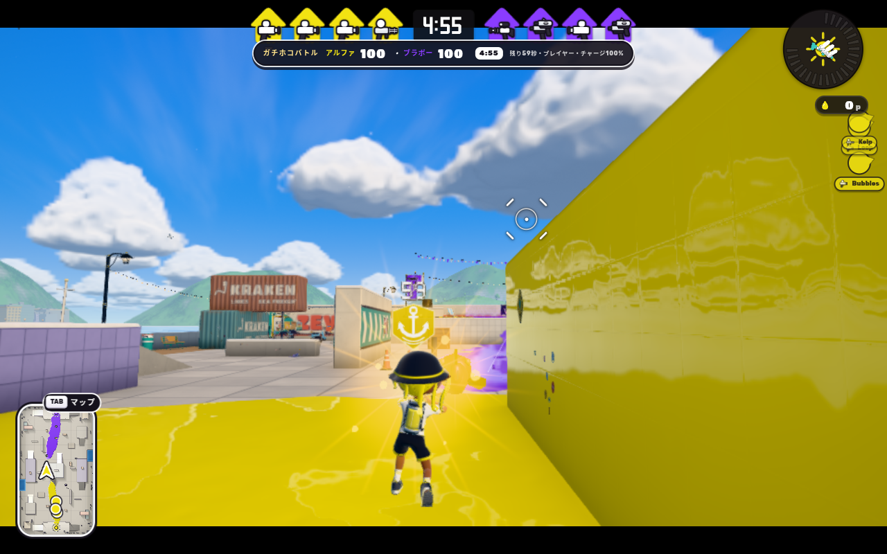
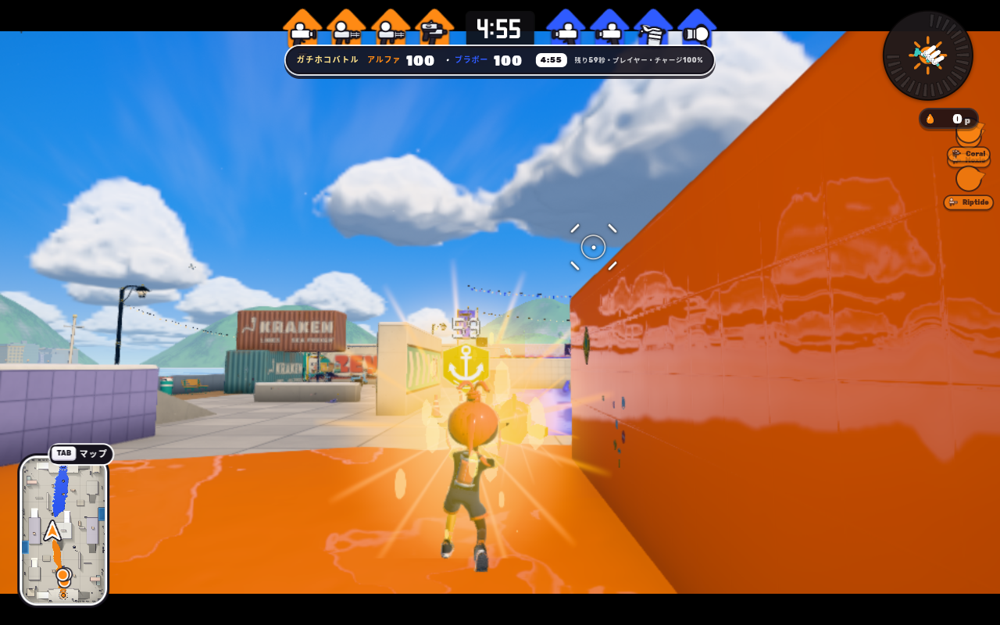
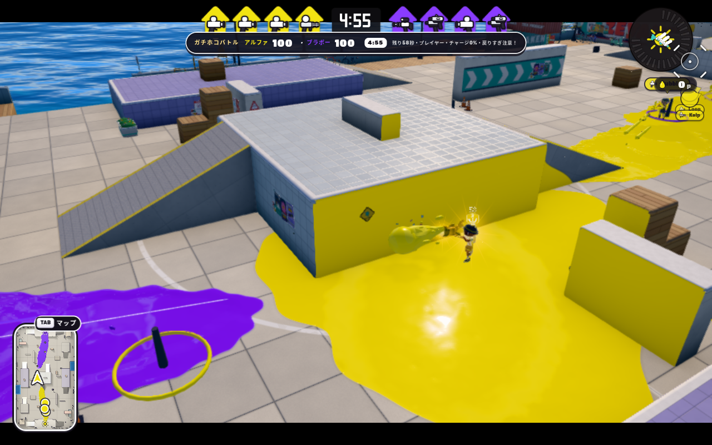
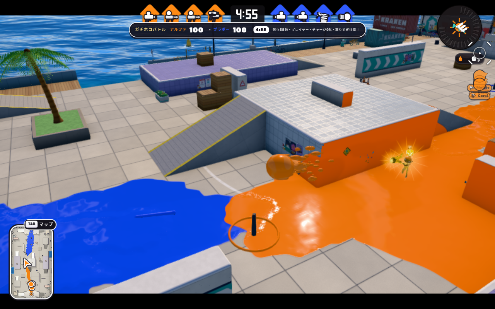
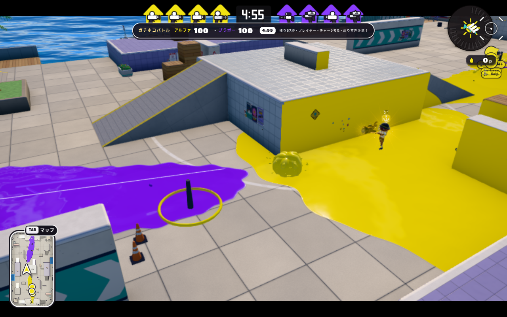
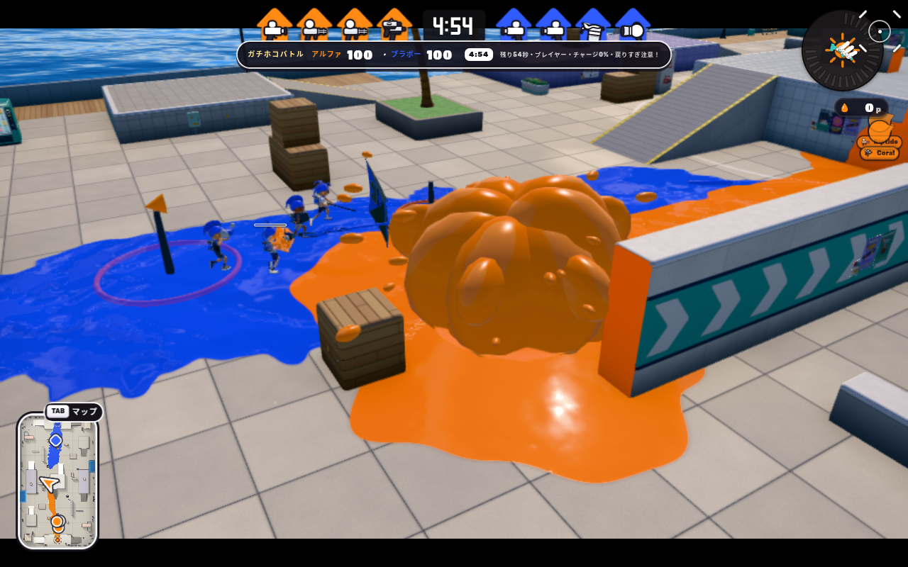
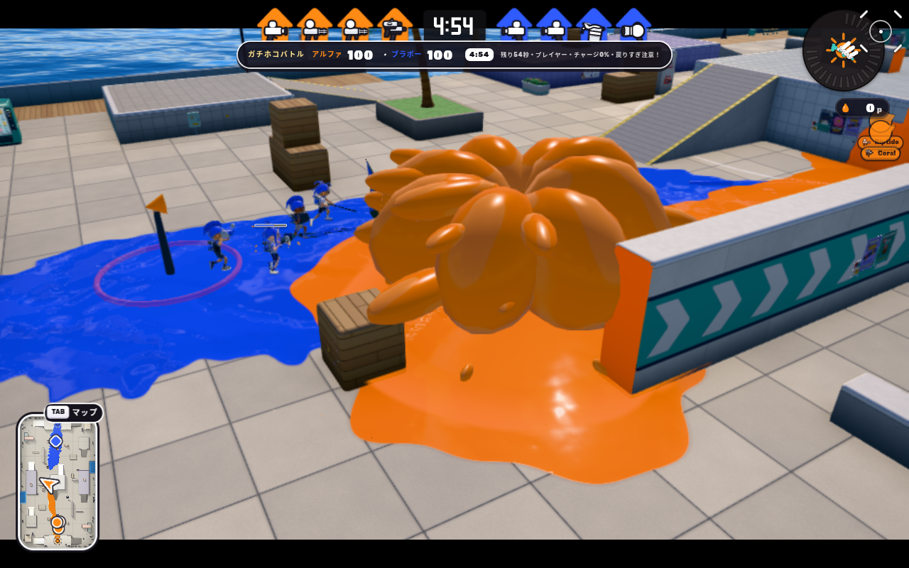

# ガチホコ攻撃：単位不整合と体光・飛沫の修正

比較基準は公開版 main `5d6480b2e2c1a8afa789bcc1415bae586e3156cb`。攻撃修正は `edfcd7c3d84b4af3cd5b162c1fcfedfc806634d3`、VFX仕上げ後の製品コードは `feab97625845680cf62f2dbc20fddf565e757dda`。専用 worktree / branch で変更し、別作業の未コミット変更・QA-only の PR #1927 / #1935 / #1924 は取り込んでいない。

## 原因と変更

`ranked/rainmaker.mjs` は Wiki の射程 **4.4 / 5.3 / 5.8 本の試し撃ち線**を world 座標の距離として送信していた。`ranked/combat.mjs` はその4.4 worldで弾の水平移動を停止していた。他のメインブキの既存ブリッジは1線=50 DU=5 worldなので、満充填の直撃射程を22 world、近/遠爆風の到達目安を26.5/29 worldへ換算した。部分チャージも2–3.4線を10–17 worldへ直す。

同時に、ネイティブのエンジン座標にすでに対応している速度・爆発距離・塗り半径へ、ガチホコだけ余分な0.2倍が掛かっていた。既存 `main-weapon-catalog.mjs` と同じ「native speed × 60」へ戻し、満充填初速18→90 world/s、上向き速度3.36→16.8、近/遠爆風半径0.92/1.4→4.6/7、着弾塗り半径1→5、飛行中の塗り半径0.48→2.4へ修正した。射撃反動も既存の速度解釈を維持して同じ座標ブリッジへ揃える。

爆発の処理自体は以前から存在した。小さな半径のため見た目・ダメージ・塗りが小範囲に限られていた。満充填では実接触で待機し、既存の0.2秒後に爆発する。弱弾が爆発しない仕様、60F充填・20F最小充填・回復・生きた銃口・所有者/life検査は保持する。

`rainmaker-visuals.mjs` の体光は胴の中心に置いた板がキャラクター自身に隠れやすかった。壁の深度検査を維持する薄い金色の体光、広がる光条、充填に応じた大きめの粒を追加した。初回候補の強い卵型の外縁は不採用とし、最終候補は外縁を消す柔らかい光にした。Actorの肌・服の材質を変更しない。弾頭をやや大きくし、飛行中の滴を12→32個、広がりと尾側の長さも増やす。爆発を実寸へ直すと以前の低分割球が岩の塊のように見えたため、共有滴を7×5分割から12×8分割へ滑らかにし、中央塊と上昇量を抑えて周囲の飛沫を見せる。8個の再利用プールは維持する。表示寸法・粒数・寿命・明るさは手続き的な較正である。

## 本家の根拠と境界

- [Leanny/splat3 11.3.0 固定パラメータ](https://github.com/Leanny/splat3/blob/7280ff9cde8bb1c5dcef46c700c326471584d2e6/data/parameter/1130/weapon/WeaponSpGachihoko.game__GameParameterTable.json)を再取得した。[保存した同一JSON](../patches/splatoon3/reference/rainmaker-1130-attack.json)をSHA-256で固定して回帰試験する。`MoveParam` の1.5 / 1.2 / 0.28、`BlastParamFullCharge` の1800@4.6 / 400@7 / PaintRadius5、`SplashPaintSpawnParam` の2.4が根拠。
- [任天堂の通常ホコショット図](https://www.nintendo.com/jp/bankara-king/assets_final/img/rule_step02_img_hoko.png)を再取得して実見。大きな艶のある弾頭、穴の開いた液状の尾、周りの細長い飛沫・粒を参照した。説明図なので投影寸法や時間の計測値には使わない。原作画像はゲーム・レポートへ転載しない。
- [S3mixホコ性能表](https://wikiwiki.jp/splatoon3mix/ガチホコバトル#rainmaker_stats)は今回HTTP 403。射程・充填時間・弱弾の爆発なしは、リポジトリの[従来の調査記録](inkwave-ranked-research-2026-10-11.md#rainmaker-ガチホコバトル)を引き継いだ。最新Wikiの再取得成功とは扱わない。試し撃ち線の単位は[全メインブキ照合](inkwave-main-weapons-wiki-audit-2026-10-11.md)および[オーバーフロッシャー弾道記録](inkwave-bloblobber-source-flight-2026-10-18.md)とも照合した。

既存の重力60 world/s²、水平到達上限での停止、0.2秒の着弾待機、球近似の命中判定はローカルの弾道実装であり、Nintendoの非公開実装を復元したものではない。今回の修正で単位不整合は解消するが、上向き/下向き全角度の弾道・反動曲線・爆発の形状・体光の正確な一致は未確認。Switch実機、実iPad、実オンライン通信、同時多数爆発のGPU時間を検証済みとはしない。

## 回帰試験

`rainmaker-attack-scale.test.mjs` は期待値だけのモック弾を送らず、実 `RainmakerRule` が取得→充填→解放したイベントを実 `createRankedEffects` へ渡し、製品 `Physics` の床線分衝突まで進める。30/60/120Hzで22 worldの接地、0.2秒後の爆発1回、横4 worldの標的180 / 横6 world40、塗りの特殊ポイントなしを確認。最小弾は10 world・爆発0。follower表示も塗り/ダメージを二重適用しない。

- source：攻撃単位・既存rule・combat、52/52成功。
- source：既存防御統合・実Actor銃口・VFX資源・scratch、61/61成功。Stamp / Splash Wall / Big Bubbler / 特殊装置を含む。旧低速の合成防御fixtureは以前の上向き速度3.36を明示し、全assertを維持した。製品の新しい数値は別の実rule→Physics試験で検査する。
- 確定コードの最適化生成物：攻撃単位・実Actor銃口、22/22成功。
- 基準版の最適化生成物へ同じ新攻撃試験を向ける負対照：8件中7件失敗、native JSONの固定1件だけ成功。速度・距離・爆風の従来不整合を実際に検出する。
- VFX仕上げ後のsource/最適化生成物：VFX資源・merge回帰、各8/8成功。
- quick checks、通常ビルド、起動予算、`git diff --check`成功。全領域CIの成功という意味ではない。

実行コマンド・生成物の内容ハッシュ・描画結果と画像は下の証跡に記録する。

## 本番描画の比較

Chromium / SwiftShader、1280×800、低画質、bloom無効。最適化した通常ビルドをHTTP配信し、**製品Rendererのpost stackを通して**描画した。基準/候補ともsetup用の `Math.random` を `0x12345678` で固定したが、別profileのパレット・装備・ロスターは同一になっていない。各receiptに実際のチーム色を記録し、画像の単純差を改善量として扱わない。初期位置とバリア被弾入力を設定した後は実Actor / Match / FXを60Hzで進め、取得・待機・部分充填・満充填・解放・接地・爆発・終了を確認する。通常の追従カメラも製品CameraRigで描く。これは固定時計とintentによる操作検証であり、Switchでの手動入力計測ではない。

対象の表示だけを隠した同じ停止画面とのframebuffer差を取り、体光・飛沫が実画素へ寄与することと、全GPUプログラムのリンク、効果終了後の画素差0を検査した。体光の新しい柔らかな部分だけを個別に隠す検査も行う。画素数は可視性の証拠であり本家への一致率ではない。射撃画像のカメラは実弾を追うため背景が変わる。飛距離は画像の見た目で推定せず、実銃口から記録した軌跡で判定する。

| 状態 | 基準版 | 修正後 |
| --- | --- | --- |
| 通常カメラの満充填 |  |  |
| 実弾の飛行 |  |  |
| 着弾後の爆発 |  |  |

爆発7tick後の展開した飛沫：



掲載画像は最終の12画面から選んだ。ブラウザのPNGから画素が完全一致することを照合したlossless WebP。原PNGは作業ツリーの `.browser-evidence/rainmaker-attack/` に保持する。

最終12画面は成功、実銃口からの最大水平距離は基準4.4→候補22 world。通常カメラの満充填は50,508画素（新しい柔らかな体光だけ8,826）、着弾13,580、爆発39,550、展開飛沫53,957画素へ寄与した。消去後はVFX可視ノード0、画素差0 / maxDelta0。全GPUプログラムがリンクし、ブラウザ/WebGLエラーは0だった。

仕上げの初回12画面では最後の消去の厳密な0画素assertだけが3画素差で失敗した。可視VFXは0で、他の描画段階・GPUリンクは成功していた。[初回failed receipt](rainmaker-attack-2026-10-30/finish-first-browser-result.json)を残した。新profileで再実行し、各停止カメラでnative callbacks / post targetsを事前に3回描画してから比較すると、厳密な閾値を変更せず0画素になった。profile間の装備・パレット差もあるため、事前描画が初回3画素差の唯一の原因・解消要因だったとは断定しない。ゲーム時計・Actor・FXは事前描画で進めない。初回差の具体的な内部要因をNintendoや描画エンジンの不具合へ断定せず、画素検査の成立条件として記録する。

生成物のGit入力・artifact照合は [build-identity.json](rainmaker-attack-2026-10-30/build-identity.json)、試験コマンドとソース版は [verification.json](rainmaker-attack-2026-10-30/verification.json)、基準/候補の実軌跡・イベント・画素・GPUは [基準receipt](rainmaker-attack-2026-10-30/before-browser-result.json) / [候補receipt](rainmaker-attack-2026-10-30/after-browser-result.json) に保存した。共有比較レポートへの追記案は [main-report-entry.md](rainmaker-attack-2026-10-30/main-report-entry.md)。

再実行：

```sh
CHROMIUM_PATH=/usr/bin/chromium node scripts/check-inkwave-rainmaker-attack.mjs \
  --site _site --phase candidate \
  --evidence-dir .browser-evidence/rainmaker-attack/fresh \
  --profile-dir .browser-evidence/rainmaker-attack/profile-fresh
```
