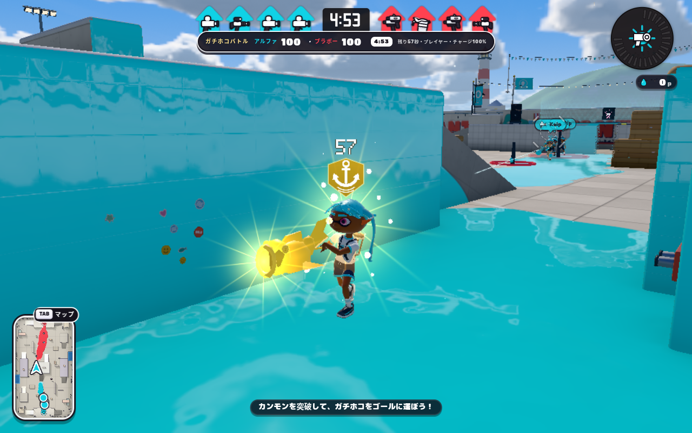
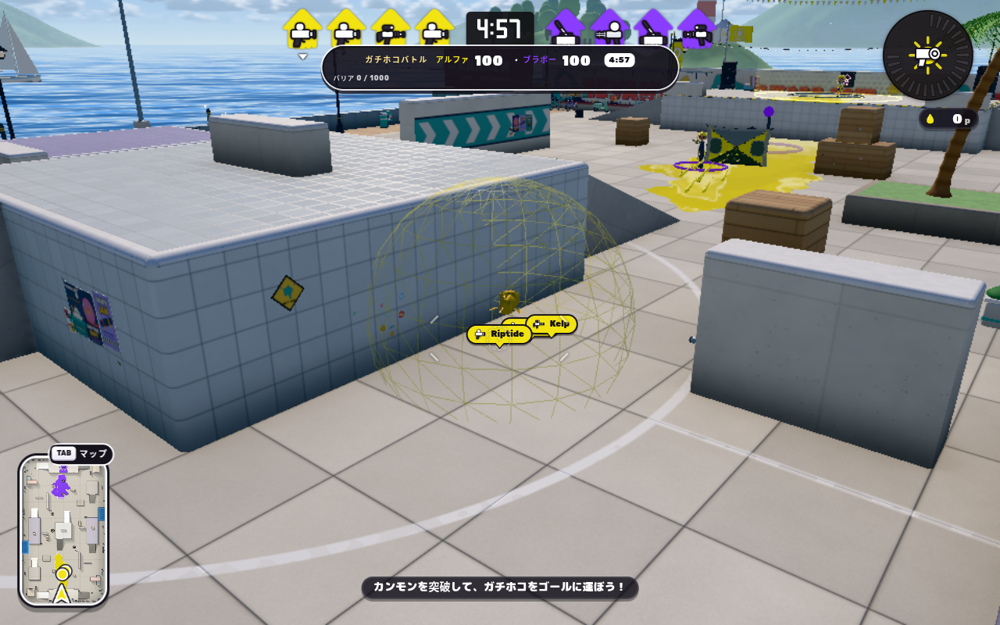
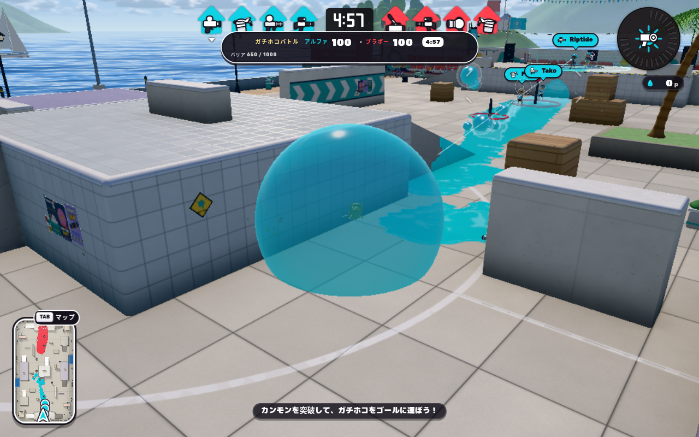
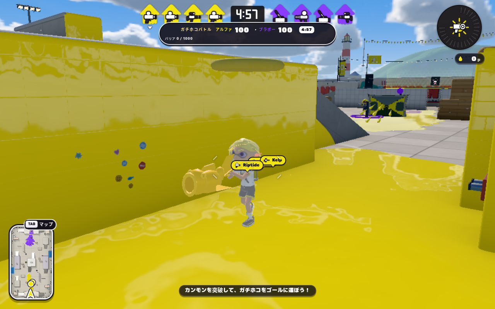
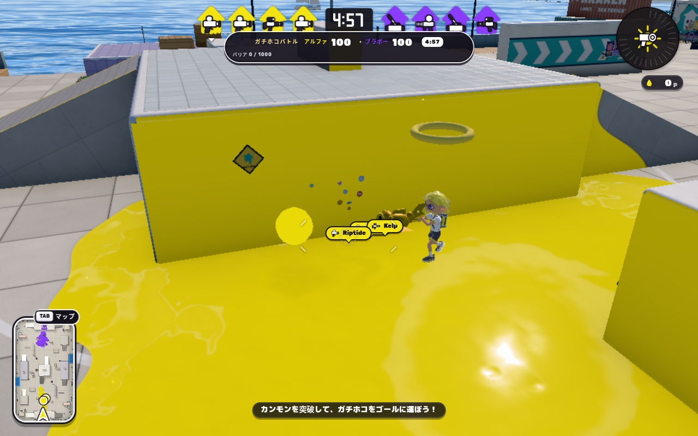
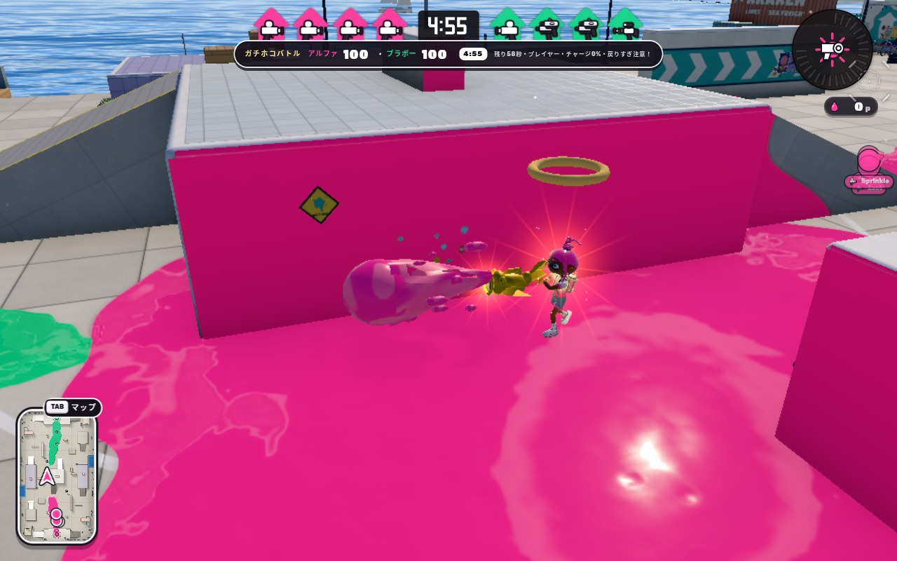
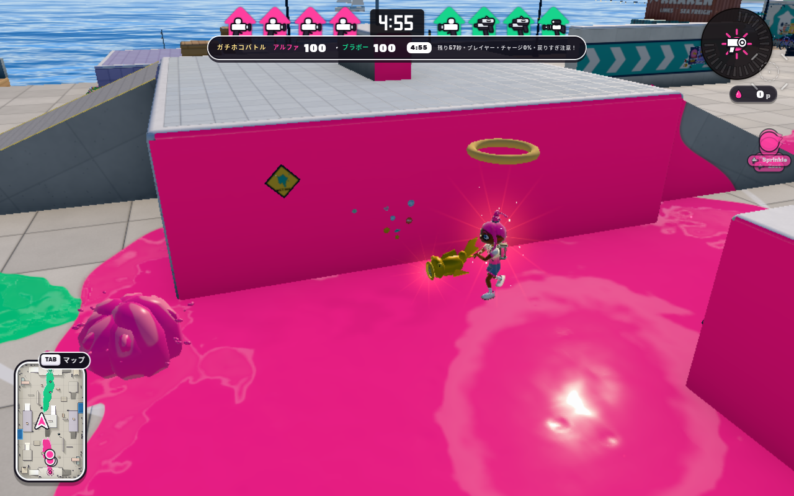

# ガチホコの短押し発射・バリア・発光・攻撃飛沫

比較元は `main` の `e67c636b81762df56b346a09ef570964d43084df`。対象は公開版の `patches/splatoon3/runtime/ranked/`。原作画像は実際に表示して確認し、ゲーム本体や配信物へ転載していない。

## 頭上の所持マークの再調整

従来の水平な金色のTorusを削除した。[任天堂掲載の実機画像](https://assets.nintendo.eu/video/private/f_auto%2Cq_auto/uvumuwlrx4ohvy2bftbv.jpg)と[ファミ通の画像](https://www.famitsu.com/images/000/277/040/y_632f91767b594.jpg)を拡大して実見し、白いイカリの入った金色の盾形バッジと、その上の所持残り秒数へ置き換えた。常にカメラへ正面を向け、頭のすぐ上に表示する。原作画像をテクスチャとして配信せず、形と数字は手続き的な近似で描く。寸法・フォント・精密な表示位置は実機からの抽出値ではない。

残り秒数は既存の `holderRemaining` を切り上げて読み、独自の時計を追加しない。未取得・死亡・所持解除では消える。sourceのworld/queue 14件と追補した所持・秒数・追従・解除の限定2件が成功。通常ビルド・quick checks・起動予算も成功。Chromiumの実ゲームで取得→60/58/57表示→フルチャージ→解除を進め、GPUリンク、マーク単独の画素寄与、解除後の画素寄与0を確認した。結果とハッシュは[carrier-marker-result.json](rainmaker-barrier-attack-2026-10-29/carrier-marker-result.json)。コマンドは `node scripts/check-inkwave-rainmaker-visuals.mjs --site .built-site/rainmaker-carrier-final --carrier-only --evidence-dir .browser-evidence/rainmaker/carrier-final --profile-dir .browser-evidence/rainmaker/profile-carrier-final`。

## バリア表面の再調整

初回候補の大きな淡色斑模様が不快に見えるとの指摘を受け、バリアにはショット用の模様shaderを使わず、滑らかな単色の膜、縁の反射光、小さい鏡面ハイライトへ変更した。灰色・クリーム色の塊を描かず、中立時の透け感と圧力に応じた濃さで見せる。先のバリア画像 `after-barrier.png` は初回候補の記録として残し、下の比較表は追補版へ差し替えた。

同じ原作画像を再確認した上での表面の近似で、膜の屈折率・厚さなどを抽出した実測ではない。球の位置・衝突半径・HP・色の反転条件は変えていない。低画質・bloom無効の実ゲームで、中立・650/1000・950/1000・相手色へ反転の4状態を描画し、全shaderのGPUリンクと画素への寄与を確認した。`rainmaker-visuals.test.mjs` 3件、quick checks、ビルド、起動予算も成功。結果は[smooth-barrier-result.json](rainmaker-barrier-attack-2026-10-29/smooth-barrier-result.json)、再実行は `node scripts/check-inkwave-rainmaker-visuals.mjs --site .built-site/rainmaker-smooth-final --barrier-only --evidence-dir .browser-evidence/rainmaker/smooth-final --profile-dir .browser-evidence/rainmaker/profile-smooth-final`。

## 初回PRのCIで検出した攻撃・観測の追補

回復時間を使い切ったtickで次のチャージを開始すると、回復中だけ押した入力から意図しない最小弾が生じ、静止標的・Splash Wallの厳密なダメージ検査が失敗した。残り時間がないtickでは次のチャージを始めないように修正し、30/60/120Hzで余分な弾が出ず、その後の本当の短押しは発射できることを確認した。また、Sceneの生成前に作るCPU用のeffectsがnullのSceneを捕まえていたため、描画資源を最初の描画イベントで生成するようにした。headlessでの時間切れのダメージ処理は継続する。

複合弾の位置はSceneへ追加する前に設定する。観測用ヘルパーには新しい弾の名前を認識させ、追加時点の不変な銃口原点・wrong-host・重複イベントの拒否を保った。旧単一球を前提にした資源テストは、弾頭・尾・滴の共有geometry、色の精度、インスタンスの解放を検査する形へ更新した。旧ルールとの完全snapshot比較は非射撃の所有・得点・時計・復元と、通常フルチャージの可変dt射撃で残し、意図的に変更した短押しは専用回帰で確認する。

この追補の限定検証は74件成功。コマンドと件数は[ci-followup.json](rainmaker-barrier-attack-2026-10-29/ci-followup.json)。前回のCIに残る4件の静的CIポリシー不一致は、クリーンな基準SHAの別worktreeでも再現した。workflow自体やその必須条件はこの変更で修正しておらず、PR全体のCI成功とは扱わない。

## 参照と確認条件

- [任天堂・ガチキング決定戦](https://www.nintendo.com/jp/bankara-king/index.html)の[通常ホコショット図](https://www.nintendo.com/jp/bankara-king/assets_final/img/rule_step02_img_hoko.png)：艶のある大きな球状インク、銃口へ伸びる穴の開いた液状の尾、周囲の細長い飛沫と粒を確認した。説明用の合成画像であり、投影寸法・時間の計測値としては扱わない。
- [任天堂の入門記事](https://www.nintendo.com/jp/ichikara/av5ja/03_en.html)と[任天堂掲載の実機画像](https://assets.nintendo.eu/video/private/f_auto%2Cq_auto/uvumuwlrx4ohvy2bftbv.jpg)：所持者周囲の金色の光、光条・光粒、バリア破裂の周囲塗りを参照した。取得直後の演出を含み、攻撃中の点灯時刻をこの静止画だけで確定しない。
- [GameWithの原作バリア画像](https://img.gamewith.jp/img/f33a5ad6da46ff301dd1b43dc5e16b0e.png)：膨張した膜、濃いチーム色と不規則な淡色部分、強い光沢、地面へ食い込む輪郭を確認した。
- [S3mixのホコ性能表](https://wikiwiki.jp/splatoon3mix/ガチホコバトル#rainmaker_stats)：ノーチャージ・半チャージと最小チャージ20Fの記述を参照した。既存の Ver.11.3.0 向け数値を維持し、Switchで新たなフレーム計測はしていない。公式画像の撮影版・ギアは未特定。

## 確定した問題と変更

| 対象 | 変更前 | 変更後・再現操作・影響 |
| --- | --- | --- |
| バリア | 薄いワイヤー球。膜や光沢が見えない | `world.mjs` と `rainmaker-visuals.mjs` で、光沢・淡色の流動模様を持つ膜へ変更。中央でバリアを撃つと既存の圧力・色・衝突半径に沿って膨張し、反対色への攻撃で縮む。被弾判定とHPは維持。 |
| 短押し攻撃 | 20F未満で離すと攻撃自体を破棄 | `rainmaker.mjs` が解放を保持して既存の最小チャージを完了する。素早く押して離すと弱弾を1発発射。再押下で強弾へ変わらず、泳ぎ・死亡・所持解除でキャンセルする。 |
| 発射位置 | 早期解放の時点で固定すると、移動後に後方から出るおそれ | `install.mjs` が実際の発射移行時に生きた銃口を採取。所有者・life検査、1F待機中の固定snapshot、通常の壁・防御判定を維持。旧snapshotは追加の `released` がなくても復元できる。 |
| 体の光 | フルチャージ時に魚の材質だけが発光 | 所持者と銃口へ金色の光条・光粒を追加。チャージと発射で強まり、潜伏・死亡・所持解除で消える。bloom無効でも描画し、元のキャラクター材質は変更しない。 |
| 発射飛沫 | 単色の小球だけ | 艶のある大きな弾頭、穴のある液状の尾、引き伸ばされた粒を描画。弱弾と強弾の見た目を分ける。弾道・ダメージ・塗りの数値は維持。 |
| 着弾 | 球が消え、爆発時のリングだけ | 待機中のインク塊、着弾飛沫、遅延爆発の盛り上がるインク塊と飛散を追加。8個の再利用プール、共有geometry/materialで寿命・GPU資源を管理。 |
| 水面と上階 | 弾の床検索が高さ上限を渡していない | `combat.mjs` から弾の高さを渡す。水面の上に別階があっても、その上階を水没位置の足場として扱わない。 |

## 検証

以下はCPU・ブラウザの再構成側検証であり、本家実機との一致判定ではない。

- `node --experimental-vm-modules --test patches/splatoon3/tests/{ranked-rainmaker,ranked-combat,ranked-rainmaker-shot-origin,ranked-engine,ranked-rainmaker-motion,queue-combat-scratch}.test.mjs`：107件成功。短押し・再押下・移動中の生きた銃口・取消・復元・水面を30/60/120Hzで確認。既存の通常強弾、壁・防御物・host/follower判定も保持。
- `ranked-combat.test.mjs`・`ranked-world.test.mjs`・`rainmaker-model.test.mjs`：source 29件成功。
- `queue-gameplay-local-20261026.test.mjs`・`rainmaker-model-actor.test.mjs`・`rainmaker-visuals.test.mjs`：source 13件成功。Checkpoint表示、既存モデルの両手支持・頭部干渉、発光の銃口位置、飛沫プールの上限・解放を確認。
- `check-inkwave-patches.mjs --quick`、`inkwave-source-migration-audit.mjs`、通常ビルドと起動予算チェックは成功。
- 最適化生成物を指定した銃口・短押しテストは14件成功、同じ生成物の `ranked-world.test.mjs` は表示1件成功・6件失敗。後者の6件はクリーンな基準SHAから別worktreeでビルドしても同じように失敗した。内訳はネイティブマップを含む一覧と5マップ前提の不一致、GPU paint用mock rendererの不足4件、scorchの旧床fixture1件。この既存のfixture非互換を修正していない。source版の同ファイル7件は通過している。

初回版の全演出ブラウザ実行は成功。画像・生成物のハッシュは[verification.json](rainmaker-barrier-attack-2026-10-29/verification.json)、実行結果は[browser-result.json](rainmaker-barrier-attack-2026-10-29/browser-result.json)を参照。通常のオフライン tidewater を起動し、最初の配置とバリアへの被弾入力を設定した後、実Actor/Matchの固定60Hz処理で取得・チャージ・発射・着弾・消去を進めた。取得後45tickでバリア破裂の飛沫を落ち着かせてから所持中の光を比較した。`?shadercheck=1` によるGPUプログラムのリンク検査に加え、同じ停止画面で対象効果だけを隠したframebufferとの差を測り、実際の画素への寄与を確認した。低画質・bloom無効のChromium 151.0.7922.34 / SwiftShader、1280×800。pressure49,566・idle24,440・half34,452・full39,401・flight8,145・impact2,999・blast10,560画素が変化し、飛沫消去後の差は0。これらは可視性の検証であり、本家との一致率やGPU時間ではない。

初回版の配信物のcontentHashは `b3a3c652b54b6cdd1d4821505026045fc21ccadcc1ba8c0653c45d49a8c9a5bf`、inputHashは `9211d96ae99c3cef480781302b1aa2acf5f85aaf72989bafd40a45e8cd78dfdd`。再実行コマンドは `node scripts/check-inkwave-rainmaker-visuals.mjs --site .built-site/rainmaker-final --phase candidate --evidence-dir .browser-evidence/rainmaker/final --profile-dir .browser-evidence/rainmaker/profile-final-settled`。

## 実ゲームの比較画像

| 表示 | 変更前 | 最新表示（発射行のみ初回版） |
| --- | --- | --- |
| 膨張したバリア |  |  |
| フルチャージ |  |  |
| 発射中 |  |  |

着弾後の遅延爆発：

ローカル調査中の初回候補ではGLSL予約語 `patch` により膜・弾のシェーダーが無効になった。修正後の候補と区別し、見えない旧候補は成功として扱っていない。最終版では予約語を除去し、同じ不具合を見逃さない描画検証を残す。

## 確認の限界

原作の通常ショットの明瞭な着弾フレームを今回取得できておらず、爆発の立体形状・粒数・寿命は原作測定値ではない。膜の模様、発光の大きさ・時刻、弾の表示寸法も手続き的な近似であり、完全一致を主張しない。Switch実機、実iPad、実オンライン通信、多数同時爆発時のGPU時間、広域CI全体はこの限定検証の対象外。基準画像と候補のチームパレット・味方装備はランダムで、画像の単純な差分値を改善量とは扱わない。

## 追加統合・CI依存修復（2026-10-29）

作者の53149347/c2b69a77のバリア・所持マーク・recovery中phantom tap修正を保持し、#1908の共通runtime/CI修復を通常mergeした。旧f8adは一括適用せず、ranked-worldのgenerated fixtureと実出生がhost記録muzzleに一致するassertionだけ追加。source49/49、queue/visual26/26、delayed-origin3/3、emitted ranked-world7/7が成功。旧1/7・6failureは履歴として保持する。

新metadata verifierで既存buildを現在mergeheadへ無変更照合し、2241artifacts/1529inputsが成功した。これはCPU/生成物の検証で、以前の画像の再撮影やSwitch実機一致の主張ではない。新headのhostedCIはpush後の最新runを参照。[共通検証ledger](issue-resolution-20261029/final-batch/ledger.json)。mainはマージしない。
