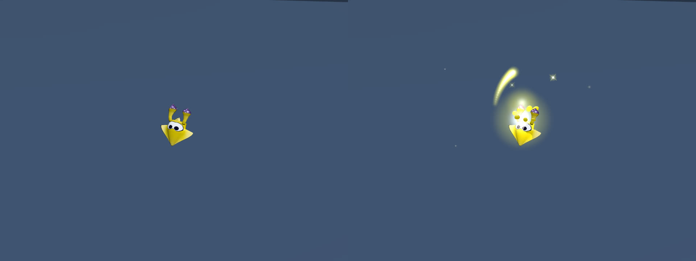
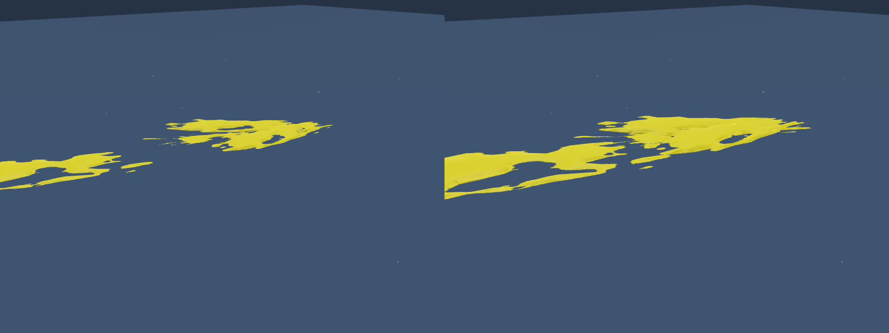

# イカロールのFXとヒッセンの空中表示倍率 — 2026-10-29

基準main: `0ddfda32230f54e69a5d791e4d0d6178b1c2074d`。ユーザー指定は、イカ本体のアニメーションを変更せずイカロールの欠けたエフェクトを追加すること、ヒッセンの飛行中の各飛沫を見た目だけ約50%拡大すること、CIを回さずmainへ直接反映すること。

## 本家との比較

- [任天堂の操作説明](https://www.nintendo.com/jp/topics/article/af825de6-16d5-4653-ba00-a7e775cc54b9)は、十分な速さのイカダッシュから逆方向入力＋Bで回転して飛び出し、直後のダメージを軽減する動作を説明する（記事条件は2024-04-01）。
- [任天堂UKの解説](https://www.nintendo.com/en-gb/News/2024/September/Beginner-basics-for-Splatoon-3-tips-for-improving-in-battle-2640849.html)に結び付いた[公式映像](https://assets.nintendo.eu/video/private/wcmuyl6pzsbbnxukgtk1.mp4)を2026-10-29に再取得。SHA-256 `fb7a3ca80ed3f6ecd268ef0980c2520cf9cffc12ad929e0cd830b57980fd7561`、1920×1080・60fps。112–166番付近の連続フレームで、離水の飛沫、白〜金色の強い初期発光、回転に沿う光跡、周囲へ散る粒が見える。画像・映像そのものはリポジトリへ追加していない。
- 本家の操作条件は自インク中の高速泳ぎから反転ジャンプ、映像では黄色の自インク・床からのロール。正確なゲーム版、ブキのキット、ギアAP、スティック時刻は不明。ロールのFXがあることは確認できるが、その寸法・持続フレーム・明るさを実機計測したとは扱わない。
- INKWAVEには`movement.mjs`の床／壁ロール・防御状態と`movement-motion.mjs`／`squidroll-motion.mjs`の本体回転がある。一方、`fxHooks.js`にロール専用の購読・表示がなく、通常の離水飛沫だけでは発動時の光と回転光跡が出なかった。再現は、自インク中で最高速まで泳ぎ、逆方向とジャンプを入力する。

## 変更

`runtime/squidroll-effects.mjs`を本番installerへ接続。既存ロール状態を読み、開始時の非塗り飛沫と短い白金色の閃光、ロール中の部分的な光跡と小さな輝点を既存FXプールに送る。防御HP／防御時間の失効で継続発光を停止し、着地・死亡・変身・壁登り・SP・スーパージャンプ・非表示では新規出力を止める。遠隔は既存`remoteSquidrollVisual`を読み、途中参加のスナップショットから離水の閃光を再生しない。

Characterのメッシュ・材質・アニメーション・pivot・骨・入力・移動・防御判定を変更しない。FX側にも新しいGPU資源・乱数呼び出し・塗り・衝突・リップルを追加しない。既存プールの上限と36WU距離制限を使い、満杯では追加cosmeticを省く。光跡の曲線・色・寸法は映像に基づくINKWAVE表示校正であり、本家の抽出パラメーターではない。

ヒッセンは`WeaponSlosherDiffusion`（基本・ヒュー・ASH）だけに表示倍率1.5を適用する。全主飛沫の幅・長さ・厚さを、通常volumeとcontour LOD、未ロード時のhistory代替描画の双方で拡大する。空中の床塗り用子滴も同じ1.5倍。飛沫ごとの位置・方向・元のDrawSizeParam・弾道・衝突半径・威力・塗り半径・インク消費・wireは保持する。バケットスロッシャーとモップリンには適用しない。この倍率はユーザーの見た目調整であり、本家のサイズ一致の認定ではない。

## ローカル検証

```sh
node --experimental-vm-modules --test \
  patches/splatoon3/tests/squidroll-effects.test.mjs \
  patches/splatoon3/tests/hissen-presentation-scale.test.mjs \
  patches/splatoon3/tests/squidroll-motion.test.mjs \
  patches/splatoon3/tests/projectile-visuals.test.mjs \
  patches/local-quality/tests/ink-volume-recipes.test.mjs
node scripts/check-inkwave-patches.mjs --quick
node scripts/build-inkwave.mjs inkwave-public _site
node scripts/check-inkwave-startup-budget.mjs _site
INKWAVE_BUILT_SITE="$PWD/_site" node --experimental-vm-modules --test \
  patches/splatoon3/tests/squidroll-effects.test.mjs \
  patches/splatoon3/tests/hissen-presentation-scale.test.mjs
python3 -m http.server 8000 --bind 127.0.0.1 --directory _site
# 別シェルで実行
CHROMIUM_PATH=/usr/bin/chromium node scripts/check-inkwave-roll-hissen.mjs \
  --url http://127.0.0.1:8000/ --out .browser-evidence/roll-hissen
```

ソース回帰67件、最適化生成物の新規回帰6件、quick check、本番ビルド、起動予算を確認する。回帰は30/60/120Hz、既存モーションの復帰・中断・連続ロール、乱数とゲーム状態の不変、ヒッセン全キット・通常volume／contour／history／子滴の表示を含む。

ブラウザはChromium＋SwiftShaderで実際のnative Character、既存FXシェーダーと、実Actor／WeaponRunnerで発射を受理したヒッセンを描画する。ロールは同じposeでFX rootの表示を切り替えた比較、ヒッセンは同一volleyで表示行列だけ1.0／1.5にした比較。ゲーム全体の実入力・実機比較・端末FPS測定ではない。ブラウザのsource内容・粒子数・GPU提出数・エラーは[receipt](browser-receipt.json)に保存する。





CIと公開サイトのデプロイは実行しない。mainのコミットには`[skip ci]`を付ける。
