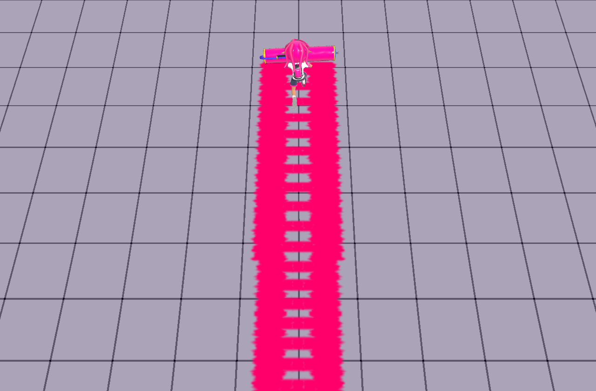
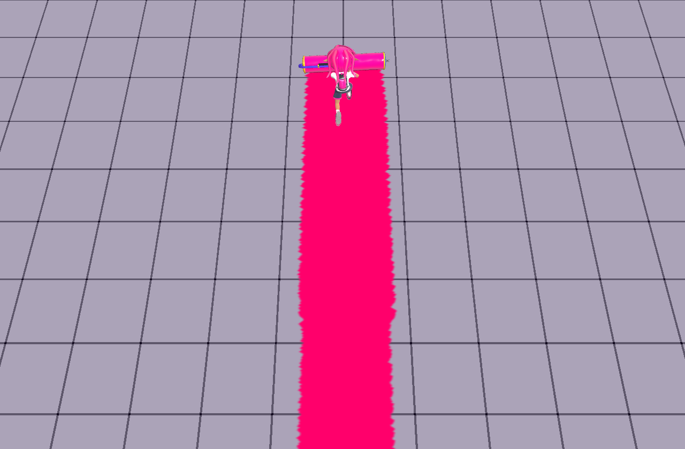

# ローラーの塗り幅・接地点・中央の抜け

基準: main `00b8994711809ba6d0469723c858ddef6805e2ae`。対象は公開版の基本ローラーと追加ローラー4種。比較画像は同じ操作・カメラ・乱数種の実Character / Actor / Physics / PaintSystemを使い、制御された平面に実WebGLアトラスを表示したもの。通常ステージの照明や床材を再現した画像ではない。

| 修正前 | 修正後 |
| --- | --- |
|  |  |

## 原因と修正

- 基本ローラーの中央3スタンプは半径だけ0.3倍になっていたが、発行間隔は0.28のままだった。床投影後の前後方向の全長は約0.198しかなく、左右の帯だけがつながり、中央に穴が残った。CPU・GPUとも、中央253点中95点の抜けを再現した。
- 塗り位置は基本ローラーが体の前方0.75、追加ローラーは0.6の固定値だった。実ドラム中心はブキによって異なり、基本ローラーの検証終端では前方約1.055だった。
- ブキの最終接地姿勢が確定した後、実ドラムのインクを載せる円筒部分から幅・中心・軸を取得する。キャップや枠は幅に含めない。速度に対する幅の比率は既存の補間を保持する。
- 中央と左右の別々の帯を、既存の`ink-contact`輪郭を使う一本の連続帯に置き換える。前端をドラム位置に置き、幅に応じて重ねて発行する。床接触は既存の連続支持面判定を通す。イカ化・中断・停止・支持面変更では古い軌跡をつながない。
- インク消費の距離積算、ダメージ、横振り・縦振りの時計は既存処理が所有する。モデルなしのロジック検証と縮小インストーラーは従来の解析的な塗り経路を保持する。

## 本家の比較条件と限界

数値表は既存のSplatoon 3 **11.3.0**固定参照。基本・カーボン・ダイナモ・ヴァリアブル・ワイドのギア効果なし、接地してZRを保持し前進する条件を検証した。30/60/120Hzは描画間隔であり、ゲーム処理は既存の60Hz FixedClockを使用する。

[任天堂のローラー紹介](https://www.nintendo.com/jp/switch/av5ja/customize/index.html)の[接地画像](https://www.nintendo.com/jp/switch/av5ja/assets/images/customize/sp/buki/card/main_weapon_2.png)を取得・表示し、円筒の接地点から中央が埋まった帯が続くことを確認した。画像SHA-256は`1a00e0d186af98fea52b7f9fbf571ecaefc6f1c2c0bc6ea81ad8ca380cc38482`。本家画像の撮影バージョン、ギア、入力履歴は不明。既存モデルの幅への校正であり、本家のメートル換算やエンジンの塗りマスクを復元したものではない。Switch実機、iPad Safari、全地形での完全一致は未計測。

## 確認

- 基本ローラーの実CPU/GPU中央欠損: **95/253 → 0/253**。[修正前](baseline.json)、[修正後](native-after.json)。既存の塗り位置とドラムの前端基準の誤差約0.538は修正後0になった。
- 5ローラー×30/60/120Hz、計15ケース: CPU/GPUとも中央の抜け0、先端と円筒中心の誤差は最大`1.4e-17`。ワイドは円筒原点ではなく実形状の中心を基準に測る。[全ケース](gpu-cases.json)。各ケース150固定tick、seed `0x524f4c4c`。
- 既存の8転がしブキ×8方向×3描画間隔: **192ケース成功**。実Character、実Physics、CPU PaintSystem、グリップとドラム接地・進行方向を検証。
- 関連ロジック219件成功。ローラー近傍143件成功。#263の実Characterテストには実床支持を与え、新しい接地輪郭を観測するよう更新した。
- 実マスク検証: source合成版とminify配信版が一致。124ケース、body 1094ケース、1512 hash照会。CPU/GPUの非境界不一致0（境界tie 17）。quick checks、通常ビルド、起動予算チェック成功。
- `main-ink-footprints.test.mjs`の既存2件（ネット権限のない記録fixture、Chargerのcredit fixture）は基準mainでも同じ失敗を確認。本件のローラー修正に混ぜて変更せず、全リポジトリのCI成功とは扱わない。

再現コマンド:

```sh
node scripts/build-inkwave.mjs inkwave-public _site
node scripts/check-inkwave-roller-contact-browser.mjs _site .browser-evidence/contact roller 60
node scripts/check-inkwave-rolling-paint-browser.mjs _site .browser-evidence/rolling.json
node scripts/check-inkwave-paint-mask.mjs --site _site --evidence-dir .browser-evidence/masks --profile-dir .browser-profile-masks --executable /usr/bin/chromium
```

`--diagnostic`を付けた接地チェッカーは修正前の失敗数も保存できる。通常実行では穴、位置ずれ、円筒幅の超過、JS例外を失敗にする。各JSONの`contentHash`は検証した配信物を識別する。
