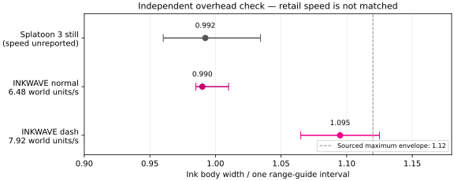
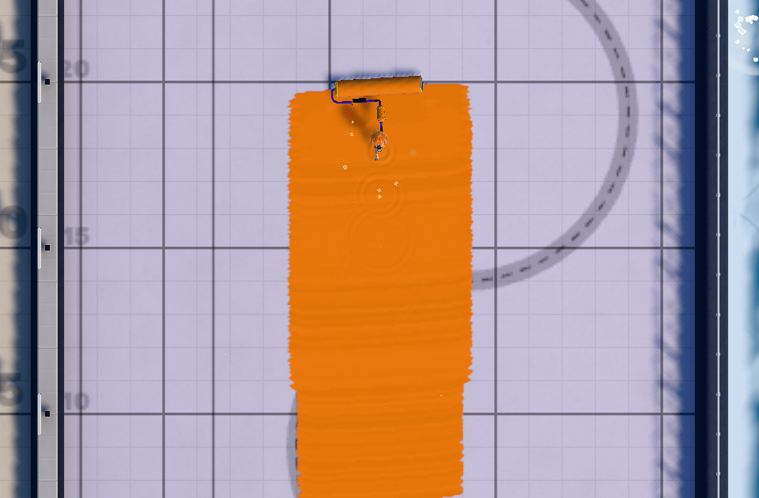
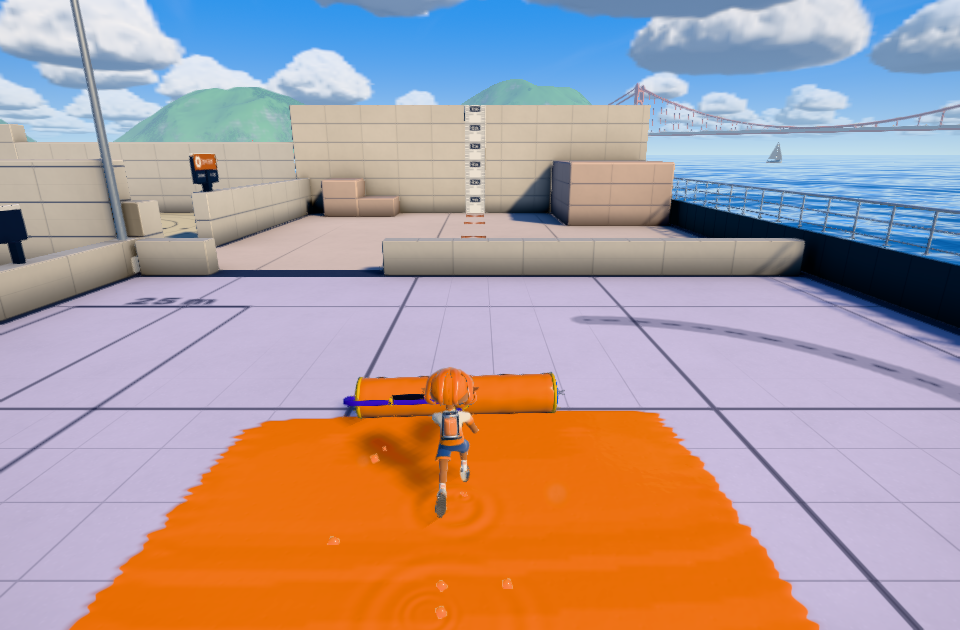
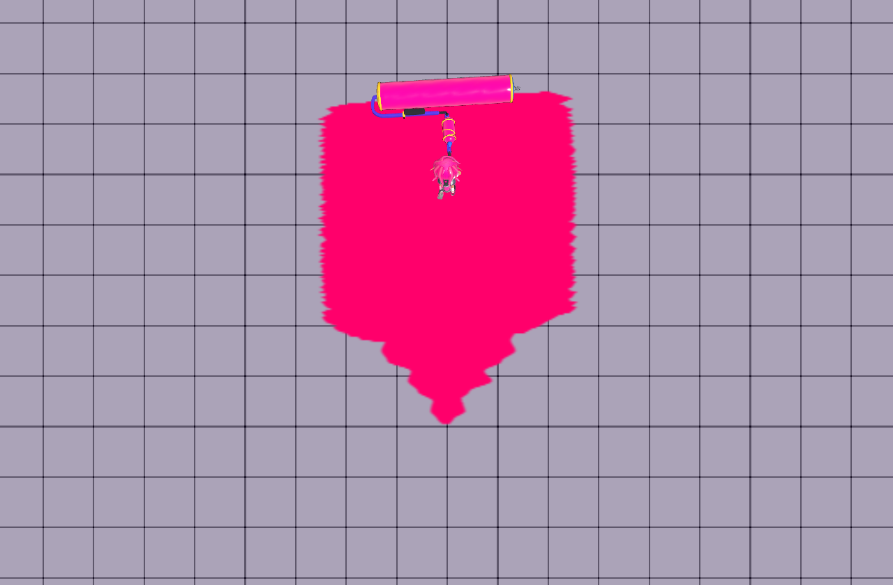

# ローラーの俯瞰チェックと接地塗りの奥行き

ユーザー指摘は「塗り幅がまだ広い」。本家スプラローラーの上からの塗り跡を、**チェック専用**として追加した。画像・射影行列・測定結果をゲームの幅やモデルの倍率へ入力していない。今回、表示モデルの寸法は変更していない。

## 本家の俯瞰資料

[GAME Watchの実プレイ記事](https://game.watch.impress.co.jp/docs/kikaku/1460351.html)、2022-12-01の[元画像24.jpg](https://asset.watch.impress.co.jp/img/gmw/docs/1460/351/24.jpg)。記事のキャプションが通常型を奥、ワイドを手前と明記する。測定するのは、間に未塗装の隙間がある**奥の通常型の帯のみ**。ワイドの帯と、通常型の丸い始端・遠端・離れた飛沫を除外した。

床のガイドと横の継ぎ目の4交点だけから射影変換を求める。インクの端は校正に使わない。未使用の右側ガイドの誤差は0.0106区間。手動交点を±2px動かした測定も保存した。[チェックの入力と出典](../../patches/splatoon3/reference/roller-overhead-2026-10-20.json)、[断面ごとの結果](reference-measurement.json)。元画像は製品へ追加しない。

本家の帯の中央幅はガイド間隔の**中央値0.992、断面範囲0.960〜1.034**。交点の±2pxの揺らぎで中央値は0.977〜1.010。これはこの静止画の測定結果で、最高速の幅や本家の補間式を確定するものではない。ギア、スティック入力と経過時間は掲載されていない。記事は2.0.0配信時期だがキャプチャ内のバージョン表示はない。固定抽出の2.0.0と11.3.0では通常型のPaintParamの明示値は同じ（SpeedMax 0.132、WidthHalfMax 2.8）。



上図の本家の速度は未報告。通常速と最高速の両方を同じ基準で合格にした図ではない。INKWAVEの太線間隔は5 world単位という既存規約で換算した。

## 実装で確認した差

通常型の低速幅は旧表示用rollWidthから求めた任意の基点、追加ローラーの低速幅は最大幅固定だった。また、実ドラムへの接地塗りは、半幅Rと同じ数値を奥行きにも使っていた。最大時の通常型では一枚の帯の全長が1.2R=**3.36**となり、横幅が広がると後方の重なりまで増えていた。

[公開のパラメータ型調査（固定版550190）](https://splatoonwiki.org/w/index.php?title=User:XarrotD/paramtable&oldid=550190#Rollers)にある省略時の値はWidthHalfMin=1.3、SpeedMin=0、Depth=1.5。カーボンとワイドは11.3.0の個別テーブルにもDepth=1.5が明示される。省略時の値を11.3.0実行ファイルで独立確認したものではない。

通常型と追加ローラーの速度幅を同じ関数へ接続し、奥行き1.5は横幅から独立させた。既存のstretchの数値フィールドで接地帯のみ対称圧縮し、CPU判定・GPU描画と送受信後の数値が対応する。幅方向の描画領域が圧縮で切れないよう、両側の半幅を含む領域を保持する。接地帯の前端は現在のドラムに合わせ、サンプリング間隔は奥行きにも制限する。

**最大半幅2.8／パラメータ全幅5.6は引き下げていない。** 本家静止画の約1区間へ数値を合わせて最高速まで縮める変更はしていない。これは奥行き・低速既定値・幅の検証方法の修正であり、「まだ広い」という最大幅の懸念まで解消した証拠にはならない。

## 実測と確認範囲

基準mainは6941aa1d。比較前後は同じ制御用床、実Actor・Character・Physics・PaintSystem、同じ150tickの入力。幅は最近の安定した帯をGPUから読み、初動の細い端を中央値へ混ぜない。

| 条件 | 旧GPU中央値 | 新GPU中央値 | 旧GPU最大横幅 | 新GPU最大横幅 | 旧一枚の奥行き | 新一枚の奥行き |
| --- | ---: | ---: | ---: | ---: | ---: | ---: |
| 通常型、通常速6.48 | 4.925 | 4.950 | 5.025 | 5.050 | 2.980 | 1.500 |
| 通常型、最高速7.92 | 5.525 | 5.475 | 5.625 | 5.625 | 3.360 | 1.500 |

上限幅の大幅縮小は観測していない。前回の「内部数値が揃ったので本家一致」という説明を繰り返さない。

- 5ローラー×30/60/120Hzの15ケースでCPU/GPU中央欠損0、前端誤差は浮動小数点誤差内。入力から150tickであり、ダイナモは振りの移行が長く、この条件では通常速5.28・塗り全幅6.022。5種すべて最高速を測ったと扱わない。
- 8種×8方向×30/60/120Hzの192ケースで姿勢、移動方向、CPU塗りが一致。
- 実際の通常メニューから練習場に入り、D床・製品の入力・60Hzの180tickでも確認。97断面で中央欠損0、前端誤差0、奥行き1.5、GPU最大横幅5.6。俯瞰画像はカメラだけを真上へ変更。[実Gameの記録](native-range.json)。
- CPUの単一スタンプ検査が、奥行き1.5と横幅5.6を別々に確認。負の圧縮値は実際の交渉済みJSON塗りパケットで往復確認。既存の地形支持・速度幅・本体・描画・接触の回帰検査も実行する。

[全15ケース・192ケースの要約とビルドID](verification.json)。最終ソースのビルドとの結び付きは同ファイルのfinalBindingを参照。







## 再実行

```sh
python scripts/check-inkwave-roller-overhead.py /path/to/original-24.jpg /tmp/roller-reference.json
node scripts/check-inkwave-roller-contact-browser.mjs /path/to/built-site /tmp/roller-normal roller 60 --ticks 60 --overhead
node scripts/check-inkwave-roller-scale-range.mjs /path/to/built-site /tmp/roller-range
```

本家の最高速の俯瞰・スティック条件を揃えた比較、Nintendoの塗りマスクと補間則、実行時モデル倍率、キャラとの寸法比、Switch/iPad実機での一致は未確認。完全一致の判定は保留。
