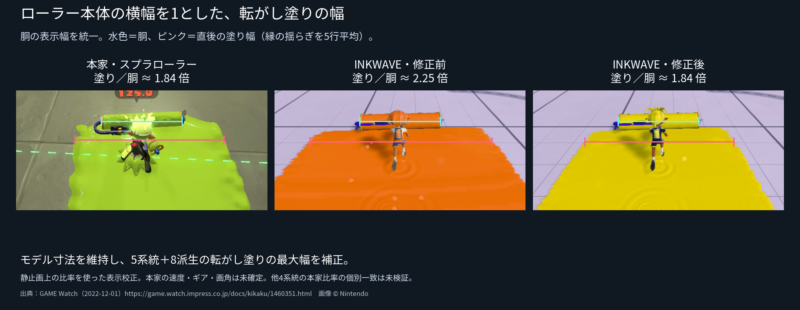
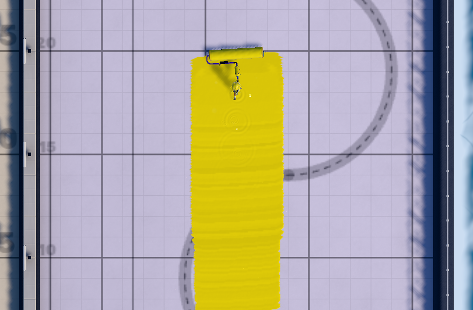

# ローラーモデルに対する転がし塗り幅の修正



ユーザーから、通常型だけでなく他のローラーにもモデル幅との比率の修正を適用し、mainまで反映するよう依頼された。通常型の後方画像で確認した比率を基準に、**転がし塗りの最大横幅へ0.8103533592449264を掛ける表示校正**を5系統に適用した。種類ごとの幅と速度区間は維持する。デコ・コラボなど8派生も元ブキの処理を継承する。

モデル寸法を変更せず、最小半幅1.3から補正後の最大半幅へ速度で補間する。最小幅は、独立した接地奥行き1.5が低速でも収まる値を維持する。CPU所有権・GPU描画・送受信は同じ最終半幅を使用する。振り塗り、接触ダメージの候補範囲、速度、インク消費、床ライン間隔は変更しない。

## 後方画像での確認

本家は[GAME Watchの2022-12-01の記事](https://game.watch.impress.co.jp/docs/kikaku/1460351.html)の[通常型スプラローラーの転がし画像25](https://asset.watch.impress.co.jp/img/gmw/docs/1460/351/25.jpg)。画像 © Nintendo。ギア・入力・速度・キャプチャ内バージョン表示は未掲載。記事の配信時期は2.0.0だが画像内の版を断定しない。

単一断面は縁の凹凸で数px変わるため、本家・修正前・修正後すべて同じ方法で、注釈位置の前後2行を含む**5行の平均幅**を取った。胴は元画像の横幅で正規化し、拡大は縦横比を維持する。ゲーム画像の色は元のまま。カラーをそろえる加工はしていない。

| 後方画像 | 胴の表示幅 | 塗りの5行平均幅 | 塗り／胴 |
| --- | ---: | ---: | ---: |
| 本家 | 214px | 394.0px | 1.84112 |
| INKWAVE修正前 | 200px | 449.6px | 2.24800 |
| INKWAVE修正後 | 200px | 367.8px | 1.83900 |

選択した静止画の比率との差は約0.12%。元の1行だけの測定では修正前2.255、修正後1.860。揺らぐ輪郭を含む画像測定であり、1行の幅や全フレームの幅が一定になるという意味ではない。[全断面・画像ハッシュ](image-measurement.json)。校正の初回係数と追加調整は[根拠データ](../../patches/splatoon3/reference/roller-paint-ratio-2026-10-20.json)に記録する。

右の画像は実Gameの通常メニューから試し打ちへ入り、D床で製品の前進＋攻撃を180tick進めたもの。修正前と位置・向き・速度は同条件。後方画像は製品カメラ、俯瞰画像は検査時のカメラ変更のみ。[実行記録](native-range.json)。GPUの97断面で中央欠損0、接地前端のドラム中心からの誤差0、奥行き1.5。GPU最大横幅4.55、パラメータから算出した最大全幅4.53798。

## 他のローラーへの適用と検証範囲

| 系統 | 旧パラメータ全幅の上限 | 補正後の全幅上限 | モデル横幅 |
| --- | ---: | ---: | ---: |
| スプラローラー | 5.6 | 4.537979 | 2.5712 |
| カーボンローラー | 4.4 | 3.565555 | 2.5664 |
| ダイナモローラー | 6.8 | 5.510403 | 2.5816 |
| ヴァリアブルローラー | 5.2 | 4.213837 | 2.6044 |
| ワイドローラー | 6.8 | 5.510403 | 3.2560 |

5系統×通常速／最高速×30・60・120fpsの30ケースが通過。すべてCPU/GPU中央欠損0、接地前端誤差は浮動小数点誤差内。各系統・各速度のGPU幅の中央値も3つのfpsで一致した。速度は実Actorが到達した値を記録し、ダイナモの最高速は210tickまで進める。ワイドの通常速は44tickだと初動の振り塗りが記録末尾に残るため、60tickへ進めて転がしを測る。速度や塗りロジックを置き換えて検査を通したものではない。[最終ビルドと全ケース](verification.json)。

これは指定された後方静止画の比率に合わせたINKWAVEの校正であり、Nintendoの実行時の換算式を復元したものではない。生の11.3.0データは変更しない。本家画像とINKWAVEの速度・カメラ条件は完全にはそろっておらず、他4系統に同じ補正を適用したことは、それぞれの本家比率の個別一致を証明しない。別画像のカーボン・ダイナモも画角・速度条件が異なり、今回の通常型の係数から全種の実機一致を断定しない。

公開先の配信を止めていたCIの参照ファイル不足も修正した。Pagesの疎なチェックアウトに、既存の`squid-heading-frame`検査が読み込む`tools/squid-heading-qa`を追加する。対象の2検査と、チェックアウト契約の検査が通過。幅・地形・派生・足跡・パケット等の96検査が通過し、派生ブキの外部raw表が未指定の任意検査1件はskip。最終ビルドの容量・起動依存チェックも通過した。

## 再実行

```sh
node scripts/build-inkwave.mjs inkwave-public /path/to/site
node scripts/check-inkwave-roller-scale-range.mjs /path/to/site /tmp/native-range
node scripts/check-inkwave-roller-contact-browser.mjs /path/to/site /tmp/normal roller 60 --ticks 60 --overhead
node scripts/check-inkwave-roller-contact-browser.mjs /path/to/site /tmp/dynamo-max s3-roller-heavy 60 --ticks 210 --overhead
python scripts/make-inkwave-roller-ratio-comparison.py
```

画像比較の再生成には、保存した本家元画像とこの報告の`gameplay.png`を使う。測定コードに本家の幅へ画像を変形する処理はない。


