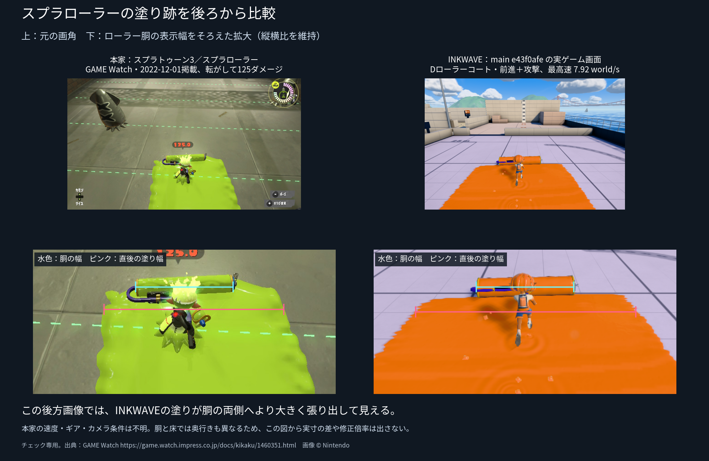

# スプラローラーの塗り跡・後方画像の比較

**この後方画像では、INKWAVEの塗り跡のほうがローラー胴の両側へ広く張り出して見える。まだ本家と一致したとは判断できない。** 上段は元の画角、下段は胴の画面表示幅だけをそろえた拡大。縦横比を維持し、塗り幅には合わせていない。水色は胴、ピンクはすぐ後ろの帯の横幅を示す。

左は[GAME Watchの実プレイ記事](https://game.watch.impress.co.jp/docs/kikaku/1460351.html)（2022-12-01）の[画像25](https://asset.watch.impress.co.jp/img/gmw/docs/1460/351/25.jpg)。記事のキャプションがスプラローラーと明記しており、転がしてダミーを倒した直後の125.0表示がある。カーボンやワイド、振り塗りの画像ではない。バージョン表示、ギア、スティック入力、転がし開始からの時間・速度は記載されていない。画像 © Nintendo。

右はmain e43f0afeのコードを使った[実ゲームの後方画像](../roller-overhead-20261020/gameplay.png)。通常メニューから試し打ちへ入り、Dローラーコートで製品の前進＋攻撃入力を180tick進めたもの。通常型、最高速7.92 world/s、最大半幅2.8。[操作・GPU塗り・ビルドの記録](../roller-overhead-20261020/native-range.json)。制御用の別床を使った画像ではない。

胴は床より高く、カメラの俯角も異なる。画面の胴幅をそろえても、床の射影や移動速度までそろうわけではない。したがって**画面上の差から実寸の差や修正倍率は算出しない**。この比較だけを根拠に塗りパラメータやモデルを縮めていない。中央に長く連なる未塗装の穴は右の画像では見えず、同じ実行のGPU検査でも97断面の中央欠損は0だった。これは本家との幅の一致判定とは別の確認。

2026-10-20の公開先確認では、Pagesのビルドはa946c46a（revision 1b30d25e）で、上のmain画像のビルド16b66efdとは異なった。[main反映後のPages実行](https://github.com/rhgrive3/actions/actions/runs/39413153785)はBuild optimized siteで失敗していた。この右画像を「現在の公開版の画面」とは呼ばない。

[出典・画像ハッシュ・注釈座標](inputs.json)。画像はチェック用の報告資料に限り、ゲームへ読み込まない。再生成は `python scripts/make-inkwave-roller-rear-comparison.py`。本家の元画像は `.reference-data/roller-scale/gamewatch25-full.jpg` に別途保存する。
