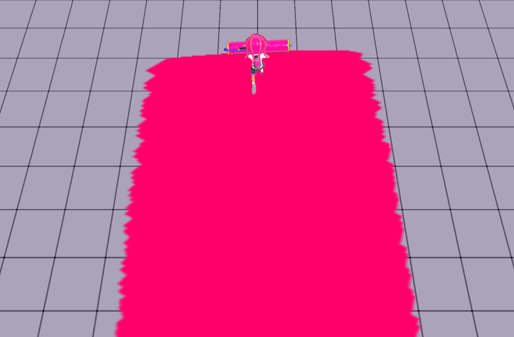
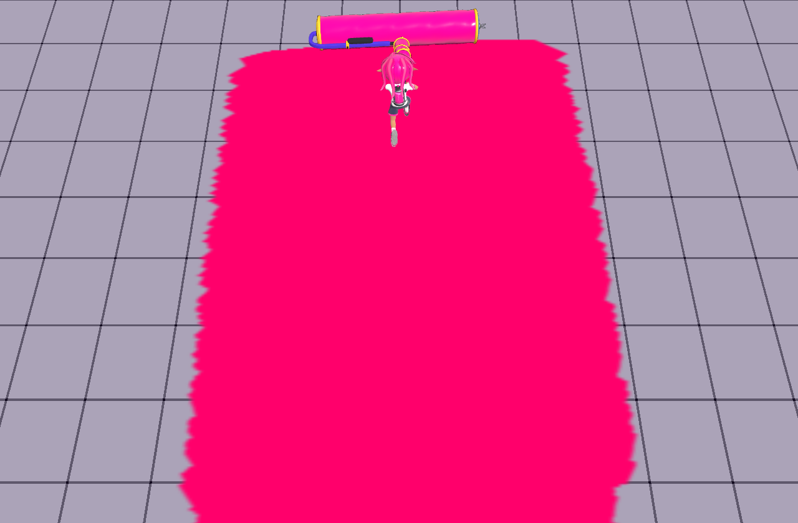
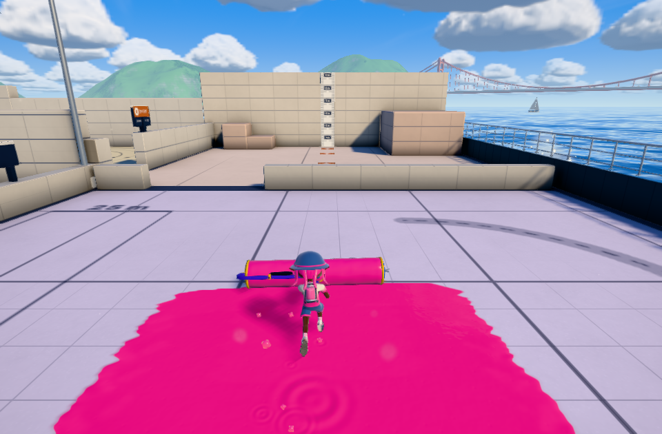
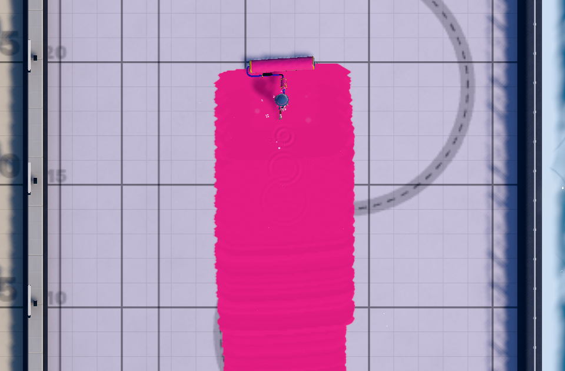

# ローラー・塗り・床ラインの尺度（2026-10-19）

前回の全幅5.6は原典の最大塗り幅の数値だが、表示ドラムの1.5は画像校正だった。両者の対応を調べず本家一致と説明したのは誤り。「1.12」は試し撃ちラインの本数であり、モデル幅への倍率ではない。

## 根拠と変更

塗りの数値はSplatoon 3 **11.3.0**、[固定抽出の参照記録](../roller-width-20261019/references.json)。[距離の単位説明](https://wikiwiki.jp/splatoon3mix/システム詳細仕様)と照合し、1ライン=5原典単位、プロジェクト内換算=1を明示した。太線は従来から5ゲーム単位で、今回は間隔を共有定数へ接続した。線を描き直して一致したことにはしていない。

表示寸法は独立して、[KiTrix固定コミット](https://github.com/kirakira-dev/KiTrix/tree/0611f51b35c9736ee986fb2218461e2585b7875e/models/weapons)のBFRES→OBJ変換から取得。`scripts/measure-inkwave-roller-source.mjs`が指定Roll材質の**描画する三角形の頂点のみ**を測る。未使用頂点を混ぜると通常型2.5756、カーボン2.5772など別の値になるため、測定対象を固定した。URL・SHA-256・対象名・境界は[測定記録](../../patches/splatoon3/reference/roller-source-scale-2026-10-19.json)。元メッシュ・テクスチャは製品へ追加しない。

| ブキ | ドラム幅（変換メッシュ座標） | 最大塗り全幅（原典値） | 塗り全幅/5（ライン本数） | 塗り全幅/ドラム幅 |
| --- | ---: | ---: | ---: | ---: |
| スプラローラー | 2.5712 | 5.6 | 1.12 | 2.178 |
| カーボン | 2.5664 | 4.4 | 0.88 | 1.714 |
| ダイナモ | 2.5816 | 6.8 | 1.36 | 2.634 |
| ヴァリアブル | 2.6044 | 5.2 | 1.04 | 1.997 |
| ワイド | 3.2560 | 6.8 | 1.36 | 2.088 |

右端は**抽出パラメータと変換メッシュの比**で、本家の最終塗り輪郭を実機で測った倍率ではない。以前のINKWAVEの通常型は5.6/1.5=約3.733だった。

registryは完成したローラー（派生ブキを含む）をこの独立した幅へ校正する。ドラムだけ横へ引き伸ばさず、フレーム・キャップ・放出口・ヒンジを一緒に変換。折り畳みの別の座標所有者、ヴァリアブルの伸びも追従する。塗り半径はメッシュから求めない。接地点、床支持の判定、隙間のない塗りは維持する。インク・ダメージ・攻撃時計のパラメータは変更しない。表示放出口はモデルと一緒に移る。

## 確認

- 基準は`9b0e4023`。同一ビルドで新しいモデル校正だけ無効化した[負例](negative-control.json)は、ドラム1.5、塗り5.6、中央欠損0、接地点誤差0を再現し、新設の独立したドラム寸法検査で失敗する。過去のビルド全体の再構築ではない。
- 実Actor・Character・Physics・PaintSystemでworld幅、半径、GPU実横幅、CPU/GPU中央欠損、現在のドラムとの接地点を別々に検査。5種×30/60/120Hzと移動方向を含む192ケースの結果は[検証記録](verification.json)。
- 床の太線はproduction adapterで5単位。`roller-source-scale.test.mjs`がprofileと共有距離定数の対応を確認。通常Gameの練習場・コントローラ・固定入力は`check-inkwave-roller-scale-range.mjs`で別に確認する。

通常メニューの実クリックから練習場へ入り、初期プロフィールでローラーへ交換。製品のKeyW・攻撃入力と固定60Hzデバッグステップを180tick使用した。最初の90tickは振り→転がし、その後の塗りだけを測定。Dの実床で97断面、中央欠損0、接地点誤差0、表示ドラム2.57119989、末尾の塗り半幅2.8、GPU最大横幅5.7だった（低速区間の最小4.875を含む）。[実Gameの記録](range.json)。画像用のカメラ以外に床・シェーダー・物理・キャラ・コントローラを置き換えていない。

この起動確認で、現在mainのロード停止も再現した。dispose後にthis.match/G.matchだけを空にしていたため、継続処理のflow.current()が偽になっていた。dispose後の既存の所有権検査を先に通し、flow.matchも同時に空へ引き継ぐ。dispose中に別の開始操作が再入した場合の拒否は保持する。検査用の常にtrueを返すflowを実際の述語へ置き換え、offline/online・初回・再入を確認した。

## 完全一致と区別する点

変換メッシュが11.3.0そのものか、本家の実行時に追加のモデル倍率が掛かるかは未確認。今回そろえたのは**同じ原典座標でのドラム幅・パラメータ上の塗り幅・床の目盛り**。プロシージャルな形状・キャラの体格・低速の幅曲線・任天堂の最終塗りマスク・実機/iPadの表示まで完全一致したとは判定しない。これらを確認せず「完璧に本家と同じ」とは言えない。
