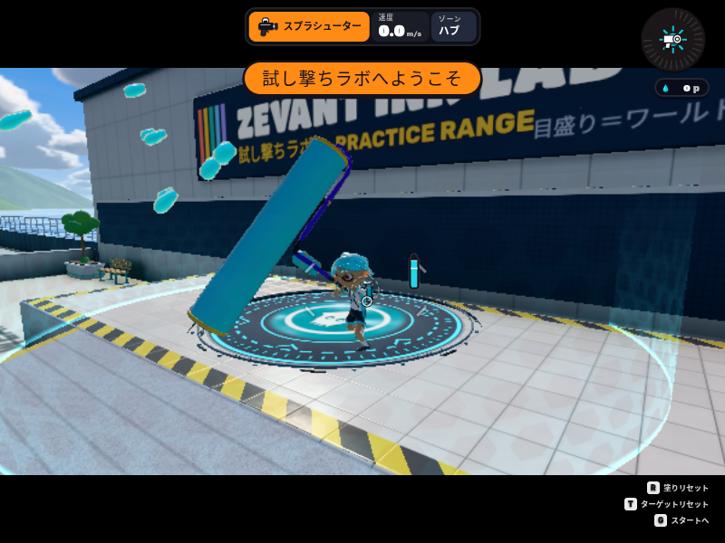
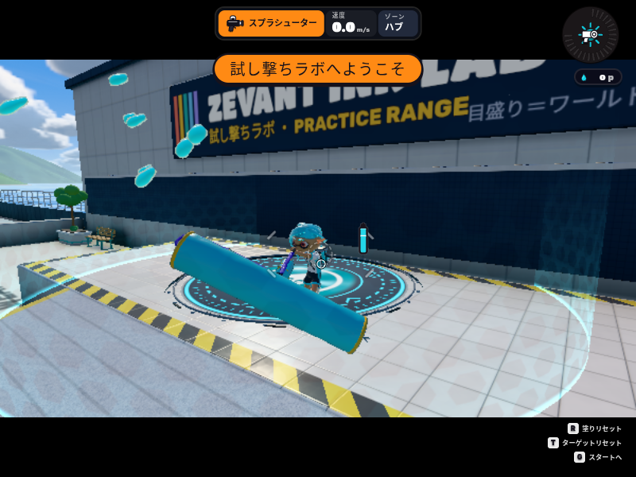

# ローラー縦振りの発射後接続：部分修正候補

本家一致の完了報告ではない。通常ローラーの発射後、着地やZR解除で回復先が切り替わる瞬間の姿勢ジャンプを修正した。継続中の振り抜き・戻り全体の軌道、本家映像と同じカメラ・照準・動作位相での新規比較は未完。マージしない。

基準は公式 main `726e338ac256ba9609086ce65e25a68ddd99df85`。作業枝は `fix/roller-vertical-recovery-20261023`、runtime候補を最初に保存したcommitは `51dcd0e5ffd5c5488741900610d183eb874a6e17`。通常のCodex cloud `/workspace/actions` で作業し、Workやサブエージェントは使用していない。#1854 `2e8d90b8afb6aac057edfbb988fae789ef36cfd3`、#1852、#1853を事前に読み、変更していない。ヒッセンの床飛沫、髪・キャラクター形状・skin・meshも対象外。

## 実装と再現

通常ローラーでジャンプ縦振り→40tickに着地→ZRを48tickで離す。`roller.mjs` は毎回の `holdRoll` をそのまま `verticalRollerPose` へ渡していた。回復終盤の同じ経過時刻でも、末尾キーが ROLL/READY 間で変わり、腕の目標位置・角度・合成重みが不連続になった。既存の `roller-vertical-curve.test.mjs` は各曲線内の連続性を検査するが、途中で曲線の宛先が変わる条件を検査していなかった。

`roller-vertical-recovery.mjs` は Character ごとの WeakMap に表示用補正を持つ。発射後に宛先が変わった時点で、旧曲線の位置・速度との差を取得し、既存の戻り区間と各ブキの終了時刻の範囲内でHermite補正をゼロへ戻す。変更がなければ元の姿勢値と同じ。新しい攻撃identity、時刻巻き戻し、ブキ変更、resetでは旧補正を破棄する。`roller.mjs` の縦振り表示呼び出しとキャンセル接続だけに取り付け、横振り・既存の左右握り／接地IKは変更していない。

新しい本家の関節角や発生時間は追加していない。補正時間の上限は既存の `VERTICAL_ROLLER_SWING.ret` であり、攻撃全体を同じ長さへ置き換えるものではない。通常型31/56tick、カーボン12/33、ダイナモ55/76、ヴァリアブル42/63という現在の個別ゲーム時計を維持する。既存ダイナモ表示の終了86tickも維持する。これらは固定データと現在のINKWAVE実装の値で、今回実機から測った値ではない。

発射、インク、移動、サブ・変身・着地・キャンセルの許可、弾のbirth・威力・射程、network serializationには変更を加えていない。2つのruntime入力だけが変わったことを [verification.json](verification.json) に記録した。

## 参照アクセスの境界

通常のHTTPS GETは次の2件で **HTTP 403 / denied** となった。拒否後の再試行、Referer/認証の追加、別経路による同じ動画の取得はしていない。

- `https://www.nintendo.com/jp/ichikara/av5ja/index_en.html`
- `https://media-assets.apps-jp.nintendo.com/contents/embed/NablZy7jqxO`

既存の [2026-10-21比較記録](../inkwave-splatoon3-behavior-2026-10-02.md) は公式動画のデコード425–426付近に放出、430–440に低い振り抜き、442–448に構えへの戻りを記録している。映像のゲーム版、ギア、入力開始tick、編集速度、FOVは不明である。この記録を新規映像確認や今回の角度・時間の合格根拠には使わない。**デコード番号426は、INKWAVEの入力後31tickと別の座標系**である。任天堂メディアはリポジトリに含めていない。

## 確認できたこと

- 元の本番minify生成物に、新しい本番pose hook回帰を当てると姿勢channel54で失敗する: [old-fails.tap](old-fails.tap)。候補はソース4/4、実minify生成物4/4: [source](source.tap)、[emitted](emitted.tap)。元ビルドに新runtimeを注入した試験ではない。
- 通常・カーボン・ダイナモ・ヴァリアブル×30/60/120Hz、各120tickの実Actor/Runner/Character、両握り、空中・着地・保持・解除・reset・再押下を確認。固定60Hzのpose列がrender cadence間で一致し、元／候補の記録したインク・クールダウン・攻撃時計・rollingが一致した。CPU試験のsource-motion動的読込はVMで実行しないため、ブラウザとの区別を維持する。
- 既存の縦曲線・ローラー本体・detail中断・holding pivot・発射後入力ゲート・振り中移動は39/39成功: [focused.tap](focused.tap)。既存閾値を緩めていない。
- 生成物をcommitの全入力blobへ照合するpackagingは10/10成功: [packaging.tap](packaging.tap)。新moduleのcommit前は「untracked build input」で失敗し、commit後に再実行した。テスト側の判定は変更していない。
- quick compatibility check、本番build、startup budget成功。CIの既存コマンドを維持し、新しいsource/emitted回帰を追加した。workflow契約33/33成功: [ci-contracts.tap](ci-contracts.tap)。リモートCIとは別である。
- [load.json](load.json) は8万回のsampler操作／宛先切替のABBA smoke。baseline約31–36ms、候補約45–55ms。有限値と有界動作の確認で、全ゲームFPS、hardware GPU、メモリ長時間耐久の合格値ではない。geometry・particle・装飾処理は増やしていない。

### 最初の60Hz実ブラウザ比較

Chromium/SwiftShaderの実練習場、実Actor/Runner/Character/IK/Projectiles、800×600、水平照準、root相対カメラ(3,1.8,4)、40tick着地、48tick ZR解除。制御した飛行経路で、実機ジャンプの計測ではない。初回の [元receipt](before/initial-60hz-receipt.json.gz) と [候補receipt](candidate/initial-60hz-receipt.json.gz) は保存するが、作業中にcheckerファイルが更新されたため、その中の終了時script hashを実行時コードの厳密な証明には使わない。最終行列の別receiptを参照する。

| tick | 元のドラム中心の1tick移動 | 候補 |
| --- | ---: | ---: |
| 48 | 0.3076 | 0.0509 |
| 49 | 1.1057 | 0.1744 |
| 50 | 0.7190 | 0.7776 |
| 51 | 0.7139 | 0.9095 |
| 56 | 0.0361 | 0.0418 |

値はINKWAVEの座標単位であり、実測メートルではない。切替直後のジャンプは減るが、その後の大きな戻りは残る。改善した2tickだけで全軌道の一致を主張しない。

| 元49tick | 候補49tick |
| --- | --- |
|  |  |

## 残る確認と再実行

1. 正規にアクセスできるSplatoon 3映像／実機で、通常ローラーの発射後のpivot・軌道・両腕・振り抜き・減速・戻りを同じカメラ／照準／動作位相で照合する。現状 **denied** の参照アクセスが阻害要因。
2. 継続入力での回復曲線と接地補正の引き渡しを調べる。今回の部分修正でも後半に大きなドラム移動が残る。ダイナモ縦の既存形状も本家照合が必要。
3. 公開する正確なheadのリモートCIと全体ブラウザ受入を完了する。ローカルのfocus検査を代用にしない。

```
node scripts/build-inkwave.mjs inkwave-public work/roller-candidate
node --experimental-vm-modules --test patches/splatoon3/tests/roller-vertical-recovery.test.mjs
INKWAVE_BUILT_SITE=work/roller-candidate node --experimental-vm-modules --test patches/splatoon3/tests/roller-vertical-recovery.test.mjs
node scripts/check-inkwave-roller-recovery-browser.mjs work/roller-candidate work/roller-browser matrix
```

元は別checkoutのmain `726e338a`から `work/roller-before` へbuildし、同じcheckerをそれぞれに使用する。出力先を共用しない。最初の行列はscreenshot timeoutで中断した記録をローカル `.roller-recovery/before/matrix*` に残し、合格に数えない。最終行列と公式ref/tree/blob読み戻しの結果は後続の証拠に記録する。13:27 UTC時点では最終行列は進行中。旧検証器の30/60Hz計6条件成功は記録し、120Hz撮影timeoutを合格にしない。各描画でGPU完了を待つ修正版を別出力先で実行している。
