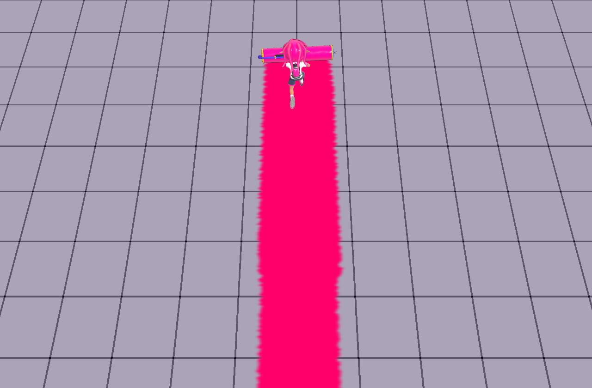

# ローラーの塗り幅を表示モデルから切り離す

**追加訂正**: この報告の5.6はパラメータ上の全幅であり、表示モデルや本家実機まで同じ尺度になった証拠ではなかった。表示ドラムの原典寸法を独立に測定し、床ラインと共通の距離規約へつなぐ[後続の校正](../roller-scale-20261019/README.md)を追加した。本家の最終マスク・実行時の倍率・キャラの体格まで完全一致とは扱わない。

前回 `b75bc56e` はドラムの表示幅を塗りの上限にした。その結果、基本ローラーの最大幅は1.5だったが、既存の原典→world換算（1:1）で`BodyParam.PaintParam.WidthHalfMax=2.8`を使うと全幅は5.6になる。前回の「モデル幅以下」というテストは、本家の塗り幅を検証していなかった。

## 根拠

Splatoon 3 **11.3.0**、Leanny/splat3固定コミット`7280ff9cde8bb1c5dcef46c700c326471584d2e6`の[WeaponRollerNormalパラメータ](https://raw.githubusercontent.com/Leanny/splat3/7280ff9cde8bb1c5dcef46c700c326471584d2e6/data/parameter/1130/weapon/WeaponRollerNormal.game__GameParameterTable.json)を再取得した。`CollisionParam.WidthHalf=1.4`と`PaintParam.WidthHalfMax=2.8`は別の値。さらに本プロジェクトの表示用ドラム1.5は、過去の画像校正で決めた値であって塗り幅の原典ではない。

| ブキ | 原典の最大半幅 | 原典の全幅 | 攻略・検証Wikiの塗り進み幅（ライン） |
| --- | ---: | ---: | ---: |
| スプラローラー | 2.8 | 5.6 | 1.12 |
| カーボン | 2.2 | 4.4 | 0.88 |
| ダイナモ | 3.4 | 6.8 | 1.36 |
| ヴァリアブル | 2.6 | 5.2 | 1.04 |
| ワイド | 3.4 | 6.8 | 1.36 |

各原典ファイルのURL・SHA-256・値は[参照記録](references.json)。カタログの固定値と全5種が一致する。[スプラ](https://wikiwiki.jp/splatoon3mix/ブキ/スプラローラー)、[カーボン](https://wikiwiki.jp/splatoon3mix/ブキ/カーボンローラー)、[ダイナモ](https://wikiwiki.jp/splatoon3mix/ブキ/ダイナモローラー)、[ヴァリアブル](https://wikiwiki.jp/splatoon3mix/ブキ/ヴァリアブルローラー)、[ワイド](https://wikiwiki.jp/splatoon3mix/ブキ/ワイドローラー)の別公開表とも、1ライン=5原典単位で整合した。ただし同じ抽出データに由来する可能性があり、独立した実機計測とは扱わない。

## 変更と確認

- 実ドラムから読むのは接地点と向きだけにし、幅は原典の塗りパラメータで決める。モデルの寸法から塗り面積を逆算する処理と、追加ローラーの0.3倍校正を削除した。
- 基本ローラーも既存の原典→world換算へ揃えた。速度による幅の比率の補間は維持し、原典の最大幅に到達させる。未抽出の低速端・中間曲線を本家の式だと主張しない。
- 前回の連続した中央塗り、ドラムに合う前端、支持面確認を保持した。筆の校正、インク消費、振り・ダメージの数値は変更していない。
- ブラウザ検証の期待値は表示モデル幅ではなく、上表の固定原典値。イベントの数値だけでなく、実GPUアトラスの塗られた横幅を走査する。格子の斜め投影・輪郭・テクセルを考慮した許容幅は全幅の下限93%、上限+0.15 world単位。中央のCPU/GPU欠損0と前端位置も引き続き検査する。
- `--baseline-ref b75bc56e`は前回の幅を所有する3runtimeだけを現行の床検証に重ねる負例。前回の全サイトを再構成する比較ではない。前回はイベント全幅1.5、実GPU最大幅約1.475で、新しい幅条件に失敗する。

比較画像は実Character / Actor / Physics / PaintSystemを使った制御平面。GPUアトラス1024、最大密度30、CPU cell 0.05、seed `0x524f4c4c`、150固定tick、ギア効果なしの前進。通常ステージの床材・照明や、本家映像の画角を再現したものではない。

| 前回のモデル幅上限 | 原典幅へ修正 |
| --- | --- |
|  |  |

再現:

```sh
node scripts/build-inkwave.mjs inkwave-public _site
node scripts/check-inkwave-roller-contact-browser.mjs _site .browser-evidence/width roller 60
node scripts/check-inkwave-roller-contact-browser.mjs _site .browser-evidence/old-width roller 60 --baseline-ref b75bc56e
node scripts/check-inkwave-rolling-paint-browser.mjs _site .browser-evidence/rolling.json
```

上から2つ目は成功し、3つ目は原典の幅条件で失敗しなければならない。全ケースと実行結果は[検証記録](verification.json)。原典のスカラー幅への適合と、Nintendo実機の最終マスク・速度補間・見た目の完全一致は区別する。公式の動画プレイヤーは今回HTTP 403で再取得できず、未確認の映像寸法を根拠として追加していない。Switch実機・実iPadの比較も未実施。

## 最新mainとの統合

幅実装を変えずにmain `80f19b43`を取り込んだところ、main側のnativeロード音対策が、FixedClock化で既に消えた`src/main.js`のattract更新行を探して通常ビルドが停止した。停止条件を実際の`runtime/clock.mjs`へ置き、遅延リセットは既存のmatch/flow所有者チェックへpaused条件を追加して接続し直した。起動中の旧試合停止・破棄・両owner解除は保持する。nativeロード・実FixedClock・既存attract寿命の回帰23件が成功し、通常ビルドと起動予算も通過した。VM fixtureにも現在の音楽モジュールが使う標準URL構築と`import.meta.url`を供給した。統合後の実GPUで基本ローラー全幅5.6、中央欠損0、接地点誤差0を再確認した。
