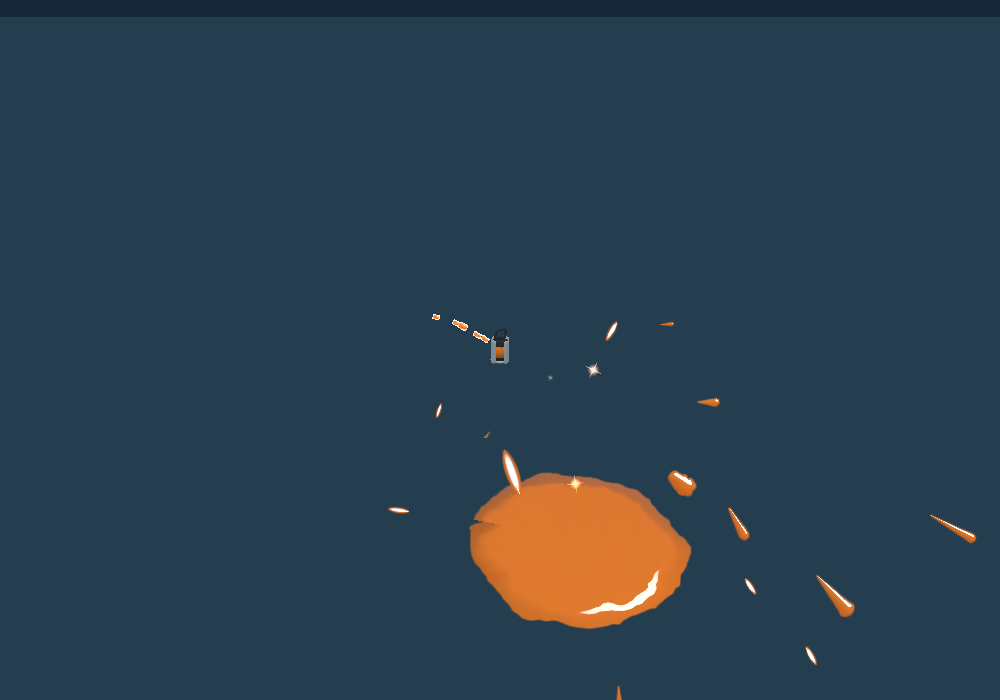
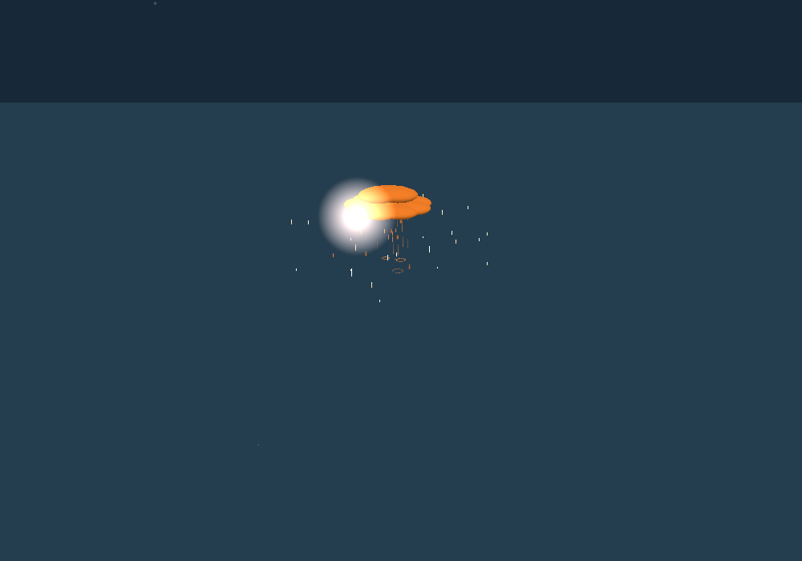

# Independent Storm held-release browser transport acceptance — 2026-10-23

**PASS within the small diagnostic scope.** The frozen baseline rejects legitimate native releases at input ticks 2, 30 and 600. The exact supplied three-file candidate admits one remote Storm canister and cloud for each. Duplicate relay delivery and extra release edges produce no additional Storm. Native death/respawn retires the old authorization; a fresh-life control admits one new Storm canister/cloud.

## Frozen source and emitted build

- Repository: `rhgrive3/actions`.
- Baseline: `726e338ac256ba9609086ce65e25a68ddd99df85`. Original checkout still clean; preserved separate `before` and `after` private archives. Existing author task `01a1686d-5fbb-71c9-ac73-4d04e0d1c004` was not inspected, stopped, or modified.
- Reconstructed supplied patch SHA256: `d33f44474820e07cf090e427e6c347ea719b2e52b7bf0745c3357d5a9c32bd57`; exact match.
- Only these runtime/source files differ between the private archives:

- `patches/network-replication/adapter.mjs`: `aaabac7d788db42436f338e0364f8bd48340862140cec297619bcb6cae95bd5a`
- `patches/splatoon3/runtime/kit-subs.mjs`: `d96dcaa7b458119d16db54fb42d11dad5610fa913836b18e0569c0b6d19dbea3`
- `patches/splatoon3/storm-effects-adapter.mjs`: `4c8ab7df9306cbcdb3ac40057256cf559d465a50c7981a1014d029768be9adbc`

The after hashes match the supplied private `2951287af00aa42edfd3e13623dfc64825ca3a87` identities. That private commit was not independently fetched. No additional boundary-cache/newshape implementation was applied.

| Build | Input SHA256 | Emitted content SHA256 |
| --- | --- | --- |
| before | `350b861c6d2ca16e5430ffc5b4f7e39cfbefc9df67290de1746b077ae256eb81` | `dacf1240f2e9ebf76a9a755de05bed9818c31b42506dbc909a534e4655baa922` |
| after | `bbc60631e7a8abe02805ab12eda1dd8feb6d90ce83fb22d6f6fe044f367859d1` | `6c07e2876c0ad78bf9e932848a5668fe90cbfa9d43f618c542c2c40f2f11d14d` |

Both builds used `INKWAVE_BUILD_UNMINIFIED=1 node scripts/build-inkwave.mjs inkwave-public <separate-site-dir>`: the normal production source adapters, explicit `none-offline` optimization. Build manifests' source inputs and every emitted artifact were SHA256 checked; served browser artifact bytes were also checked against the manifests. Complete identities and harness/Worker hashes are in [identity.json](identity.json). Node v24.19.0, Playwright 1.62.1, Chromium 154.0.8037.57, ws 8.22.0; installed `/usr/bin/chromium`. No browser installation or new browser flags/settings were introduced. Model identity is not asserted by this diagnostic.

## Real transport and input path

Inspected and reused `scripts/check-inkwave-network-browser.mjs`, `patches/network-replication/tests/browser-fixture.mjs`, and `scripts/lib/inkwave-local-relay-fixture.mjs`. Two isolated persistent browser contexts use genuine browser WebSockets, emitted Transport → NetSession → NetMatch, real room membership/owner-clock challenges and replies, and production Worker `fetch` / `RoomDurableObject`. The existing Node shim supplies only Cloudflare platform/upgrade adaptation. Owner-clock envelopes and nonces generated by the runtime are preserved in [acceptance.json](acceptance.json) and compressed wire logs.

This is a small flat diagnostic arena with actual emitted Actor gameplay, WeaponRunner, Physics, Projectiles and FX. A Character display shell, menu shell and paint sink replace full character/UI/audio/world work. Every diagnostic simulation tick calls the renderer; the canister/cloud are ordinary native emitted meshes. No full-game render suppression was used or claimed. The arena floor/bounds extend to ±200 world units so the baseline's much longer flight can contact the floor. The after canister close-up only changes the diagnostic camera around the existing native mesh.

Independent cases use native `spawnAt` and controlled full charge/ink, then direct native Actor intent edges: special press at relative tick 0; sub press at hold−1; sub release at hold. Actor.update owns activation/hold/release; the producer emits `special:use`, authenticated `tr/throw`, and `b/storm`. No manual ghost creation, admitted-packet fabrication, authority/nonce/sequence assignments, peer-clock changes, or performance.now replacement. Native ticks are `round(G.time*60)`; the browser performance clock remains native. Tick 2 is the earliest explicit press/release after activation used here.

## Results

Remote counts are **canisters / clouds**. Sequence columns list native special-use, throw and birth sequence numbers. Full events, owner/life proofs, receiver authorization before/after and input edges are in [acceptance.json](acceptance.json).

| Hold/input release tick | Before native ticks / life / sequences | Before remote | After native ticks / life / sequences | After remote | After count following duplicate |
| --- | --- | --- | --- | --- | --- |
| 2 | 36 → 38 / life 2 / seq 1, 2, 3 | 0 / 0 | 36 → 38 / life 2 / seq 1, 2, 3 | 1 / 1 | 1 |
| 30 | 170 → 200 / life 3 / seq 15, 16, 17 | 0 / 0 | 170 → 200 / life 3 / seq 34, 35, 36 | 1 / 1 | 1 |
| 600 | 332 → 932 / life 4 / seq 29, 30, 31 | 0 / 0 | 332 → 932 / life 4 / seq 67, 68, 69 | 1 / 1 | 1 |

Before producer owner: `p_ue1d843`. After release producer owner: `p_ghizhqy`. Equipped registered kit: `charger_scope`. Each case produced exactly one local Storm cloud. The after receiver records `releaseTick` equal to the emitted throw/birth tick, one `releaseSeq`, one `birthSeq`, `used:true`, matching owner/life and a current private epoch. Baseline use and birth ticks differ, and the receiver refuses the birth.

Each release case sends two additional physical sub edges during the same throw. It also redelivers the captured original relay envelope **byte-for-byte to the original receiving socket**, without editing timestamp/tick/sequence/authentication. The accepted Storm count remains one after, zero before. This proves these tested duplicate/release paths; it does not imply an exhaustive forged-packet security proof.

| Final dedicated lifecycle control | Observed remote Storm count |
| --- | --- |
| Real held-use authority established; original native release held at relay delivery boundary; native owner `splat` produces accepted dead snapshot | authority null; 0 old-life replicas |
| Original release delivered after death | 0 |
| Native `respawn`, new life observed, original release replayed again | 0 |
| Fresh native activation and held release in new life | 1 canister / 1 cloud |

Lifecycle producer owner: `p_g8a9bng`. Native event chains:

```json
[[8.459,"ev","special:use",{"actor":{"n":0},"id":"storm"},36,1],[9.257,"tr",0,"throw",0,69,2],[9.259,"b",0,"storm",-5,1.45,0,0,14.4,67.2,{"stormDuration":8},"",0,69,3],[12.214,"ev","special:use",{"actor":{"n":0},"id":"storm"},167,32],[12.944,"tr",0,"throw",0,198,45],[12.944,"b",0,"storm",-4.09,1.45,0.62,0,14.4,67.2,{"stormDuration":8},"",0,198,46]]
```

Fresh charge is controlled only after the older local canister has deployed, because its genuine cloud-start path can restart the gauge lock even across respawn. Before release, the dedicated control waits at most 90 diagnostic frames for actual receiver hold authorization. These are fixture setup/observation controls; receiver admission remains native.

## Received native objects






The main three cases used aim pitch 0.05 radians. Native floor contacts after were approximately z=16.216399 m locally and z=16.217194 m remotely (about 0.000795 m difference from wire quantization), y≈0. Baseline contact used the pre-sweep-endpoint position y≈−0.192064 in these conditions. This supports the swept-contact copy in this controlled arena. Practice scale is 1 world unit = 1 m. These are diagnostic coordinates, not a repeat of the separately reported GP0≈15.709586 m / GP57≈23.564379 m controlled calibration conditions, and not retail measurement.

## Scope, attempts and remaining gaps

- Accepted: frozen held-release admission, native canister/cloud emission over genuine browser/local production Room transport, tested duplicate/release paths and native life retirement.
- Still outside acceptance: full production Game/Match/stage/Character/UI controls, reverse-direction Storm production, deployed public relay, device frame pacing/performance, broader loss/jitter cases and exact retail equivalence.
- The frozen drag/gravity calibration is explicitly inferred from pinned 11.3.0 Mission/Rival fields, not confirmed versus-engine defaults or exact retail proof. The reported prior GP distances were not remeasured here.
- The existing latest-inactive/dead-snapshot limitation remains: a very late birth can be rejected. This diagnostic does not claim to fix it; old-life deliveries here were expected to be rejected.
- Setup/instrumentation attempts failed while adapting the existing small harness (installed executable path, display-shell interface, actual equipped Storm kit, a wrapper return value and arena bounds). Counted release traces were taken after those fixes. Later lifecycle assertions also exposed premature presentation observation and charge setup before an older canister deployed. Their failed raw evidence is retained locally. The release run's three cases passed before its subsequent fixture assertion failed; the final separate dedicated lifecycle run passed. The raw release result therefore intentionally retains `status:failed` for that later fixture assertion; [acceptance.json](acceptance.json) makes the passed case assertions and separate final lifecycle result explicit.
- No runtime publication, main/PR edits, force pushes, public-relay deployment, authentication/proxy/access changes, native subagents, Nintendo media, support/character/hair edits, or interaction with the original author workspace/task.

## Evidence and reproducibility

- [acceptance.json](acceptance.json): compact exact cases, authentication/event records and lifecycle results.
- [before raw result](before-raw-result.json.gz), [after release raw result](after-release-raw-result.json.gz), [final lifecycle raw result](after-lifecycle-raw-result.json.gz).
- [before wire](before-wire.json.gz), [after release wire](after-wire.json.gz), [final lifecycle wire](lifecycle-wire.json.gz): original recorded envelopes.
- [before harness](before-harness.mjs.txt), [after release harness](after-release-harness.mjs.txt), [final lifecycle harness](after-lifecycle-harness.mjs.txt), [before fixture](before-fixture.mjs.txt), [after fixture](after-fixture.mjs.txt). Sources are stored as text evidence; runtime patch implementation is not published by this report.
- Harnesses retain the private diagnostic workspace root `/workspace/storm-independent`; copy them to `scripts/independent-storm.mjs` and `scripts/storm-diagnostic-fixture.mjs` in separate archived before/after trees with the exact identities, installed existing dependencies and builds described above. Execute `node scripts/independent-storm.mjs` for the release harness; `node scripts/independent-storm.mjs --lifecycle-only` for the final dedicated lifecycle control. No source suites were repeated.

This branch adds report/evidence files only to the frozen baseline. It does not contain the private runtime candidate. Local source/build/manifests, setup-attempt evidence and complete screenshots are preserved at `/workspace/storm-independent/`.
