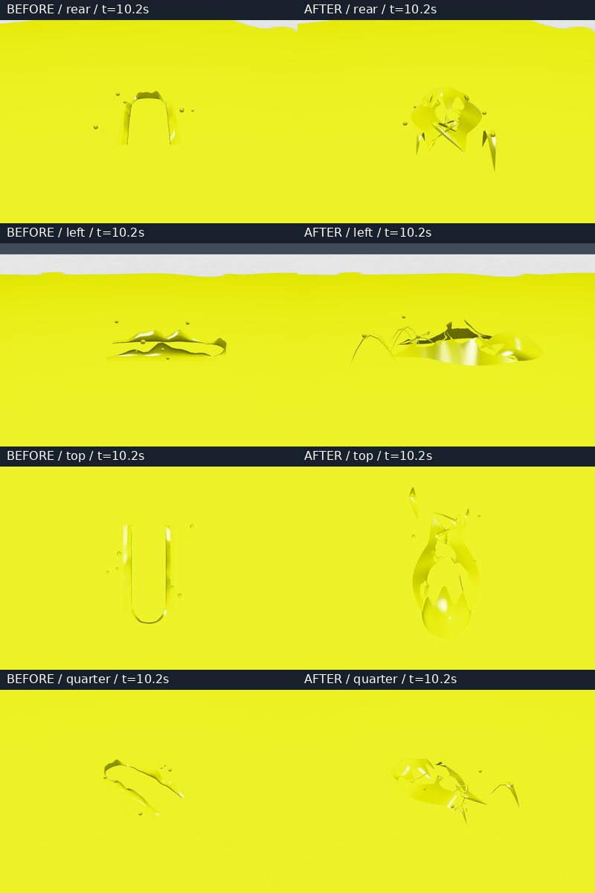
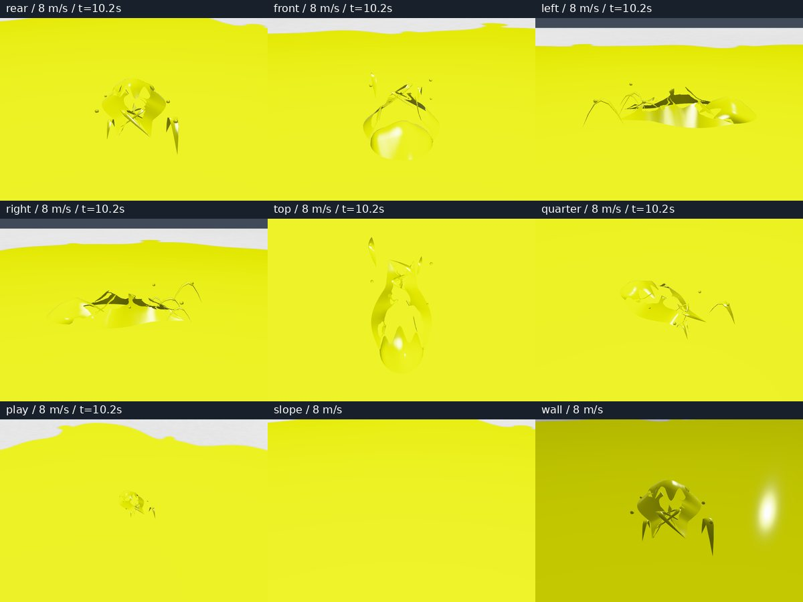
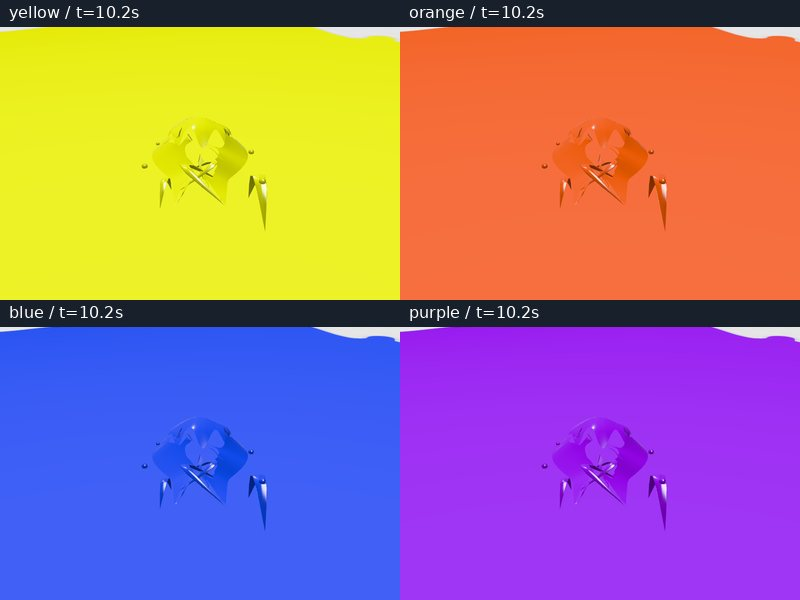

# 泳ぎ飛沫の多方向比較 — 2026-10-30

基準: `rhgrive3/actions` main `5b722cba888cb86a7a21f29596bd54eaf16b01fd`。
通常のイカ移動で左右の滑らかな縁が残り、飛沫が泳者に付いた部品のように見える点を調整した。

## 本家の観察

- 任天堂 [Splatoon 3 イカ／ヒト紹介](https://www.nintendo.com/jp/switch/av5ja/index.html) の [modal_pc.mp4](https://www.nintendo.com/jp/switch/av5ja/assets/images/index/ikatohito/movie/modal_pc.mp4): 1100×780、60000/1001fps、12.829秒。SHA-256 `294c6713400be43793f989f897dfae633bcc2744a369849bd0ec14c77b28e807`。
- 任天堂 [これからはじめるスプラトゥーン](https://www.nintendo.com/jp/games/feature/splatoon/index.html) の [ika.mp4](https://www.nintendo.com/jp/games/feature/splatoon/assets/mov/ika.mp4): 1280×720、60000/1001fps、7.591秒。SHA-256 `b800628c57f15edf5e250d95d3b3337418ad40bb3644237ae9a38be01467c038`。

冒頭1秒を元のフレームレートでデコードし、modalの0–11Fを1F刻み、冒頭1秒を4F刻みで観察した。ikaの冒頭の高い俯瞰と、その後の後方カメラも確認した。両素材には同じ場面が含まれるため、独立した実機計測2件とは数えない。

先頭の低い盛り上がりから、左右・後方に薄い膜と細い接続が伸びる。連続フレームでは開口と後縁の形が変わり、細い部分が戻る。粒の列、左右の一定形状のレール、固定した大きな板の輪郭を主成分にしない。映像の実行版・ブキ・ギア・入力・FOVは不明。映像内のフレームを入力後のtick数やメートル寸法へ換算していない。Nintendo画像はリポジトリに追加していない。

## 実装

`patches/local-quality/swim-surface.mjs` の固定プールを維持して形状を調整した。

- 全頂点の `filmData.z` が `6` だったため、膜の破れ用シェーダーへ入らなかった。部位IDを正しく渡す。基準版では11部位中10部位が不一致になる負例を確認した。
- 前端は低い盛り上がりで埋め、後縁を崩す。左右は内側へ巻き込む曲面とし、後方に4本の戻る接続を置く。独立した小滴は8個から4個へ減らした。
- 開口を巻いた曲面の高さに沿って抜き、カメラを回したとき裏側の面が穴をふさぐ問題を抑えた。穴が時間帯によって一か所へ集まらないよう、前後方向の分布を保って移流する。
- 1人687頂点・1,040三角形（基準635頂点・928三角形）。描画は従来と同じ1メッシュ／人、最大4人、35m制限。移動・塗り・ダメージ・本体アニメーション・通信を変更しない。

曲線・寸法はINKWAVEの表示調整値であり、原作VFXから抽出した値ではない。

## 描画比較

[変更前後](before-after.jpg)は同じ時計・カメラ・色・速度の実ブラウザ描画。







`scripts/check-inkwave-swim-multiview.mjs` は生成物の実Actor／FX／塗り材質を読み、7方向の各6時点、後方・横・真上の各36連続フレーム、4色、床・坂・壁の0.5/3/8/11.8m/s、方向変更、停止、Ninjaを撮る。床・壁の支持面、非表示のイカ本体、汎用滴プールの増加なしも確認する。追加の穴を閉じた／開いた対照描画で、シェーダーの開口が実画素へ反映されることを確認する。

通常のゲーム起動と練習場は既存の `check-inkwave-swim-film.mjs` でも別途検証する。上記の詳細カメラは一定速度の制御状態で、ネイティブ入力のリプレイではない。

## 検証

- source: 泳ぎ表示、開口・接続、30/60/120Hz、画面外からの復帰、床の既存表現とゲーム状態の保持 — 10/10 pass。
- emitted: 同じ形状・表示・寿命とFX空プールの関連テスト — 10/10 pass。
- quick checks、通常の最適化ビルド、startup budget — pass。
- Chromium/SwiftShader: 多方向177画像、ページ／シェーダーエラー0。[候補receipt](browser.json)、[基準receipt](baseline-browser.json)。制御した状態の確認で、Switch/iPadの性能測定ではない。

本家との物理寸法・位相・反射の完全一致、未公開の原作VFX曲線、Switch／iPad実機の見え方・負荷は未確認。既存のSplatoon 3 Ver.11.3.0 gameplay比較の未確認項目を解消扱いにしない。

再実行:

```sh
node scripts/build-inkwave.mjs inkwave-public _site
node scripts/check-inkwave-swim-multiview.mjs _site .browser-evidence/swim-multiview --verify-tears
node scripts/check-inkwave-swim-film.mjs _site .browser-evidence/swim-game
node --experimental-vm-modules --test patches/local-quality/tests/swim-film-breakup.test.mjs patches/local-quality/tests/swim-film-offscreen.test.mjs patches/local-quality/tests/swim-surface-fps.test.mjs patches/local-quality/tests/swim-presentation.test.mjs patches/splatoon3/tests/flow-swim-surface.test.mjs
```
