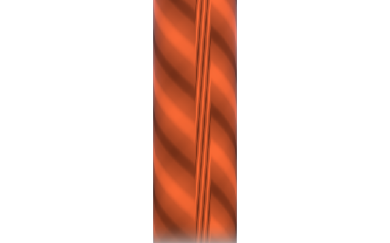
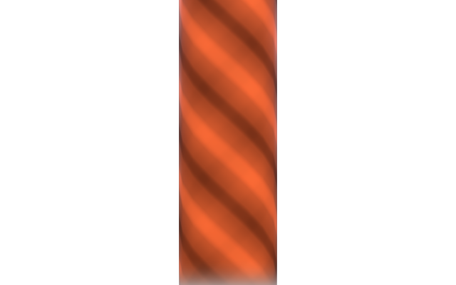
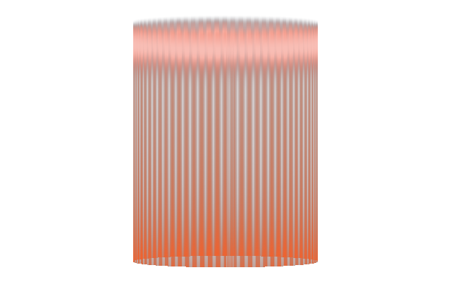
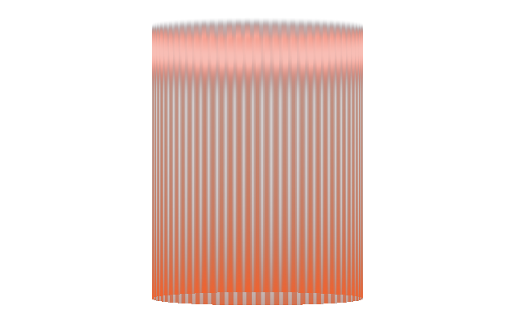
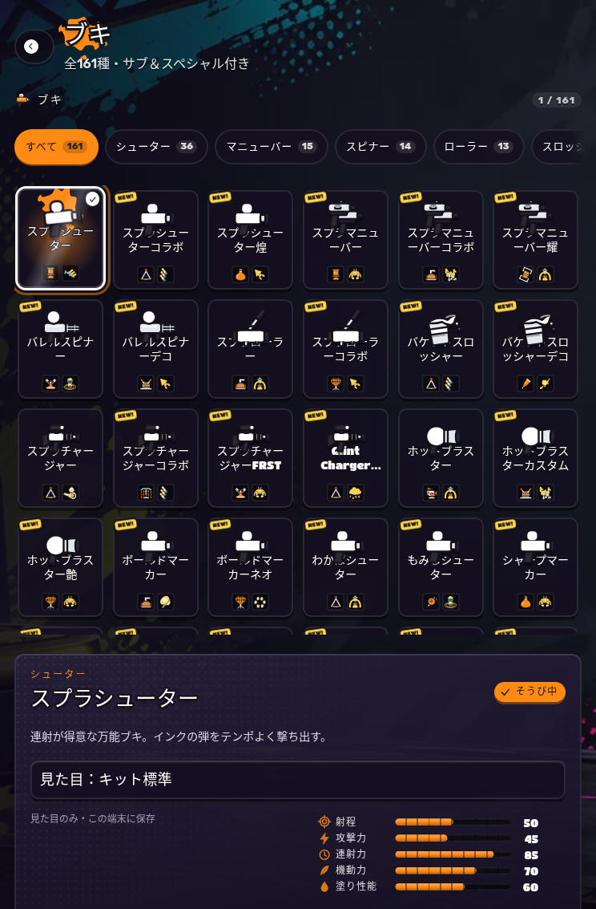
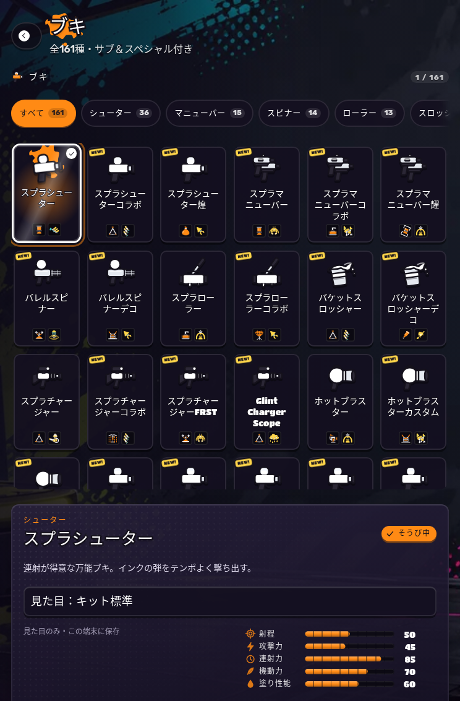

# INKWAVE visual quality review — 2026-10-31

## 対象と方針

Drive の `INKWAVE-main-b1f571da-20261016-edit` を起点に、GitHub `main` の
`fdb74165bc1a1668afe6f674db064474655fd05f` と一致する最新版へ適用した表示品質の改善です。
Drive の差分 ZIP と全8ファイルの SHA-256 を検証しました。
[ソース記録](receipts/source.json)

3担当がキャラクター／武器の材質、インク／特殊演出、UIを並列に調査し、相互レビューを行いました。
最新の髪型・眉、キャラクター形状、アニメーション、ステージを保持し、再現・比較できる表示上の問題を修正しています。
「商用品質」は目標であり、全端末での絶対的な品質保証や実機FPSの測定結果を意味しません。

## 変更した見た目

| 領域 | 修正内容 | 比較結果 |
| --- | --- | --- |
| 金属素材 | ピクセルより細かいブラッシング模様を微分でフィルタし、中距離でのちらつきを抑制 | 近距離の5位置はRGBA完全一致。中距離の小さなカメラ移動で平均フレーム差が0.853→0 |
| キャラクター材質 | 肌、布、髪、目、イカ、ゴースト、武器素材の逆向き `smoothstep` を定義された補数表現へ正規化 | 顔の近接像は完全一致。正面／斜め像の差は各1,638,400チャンネル中7／6チャンネル、最大1階調 |
| ビーム・渦状演出 | 円筒角度の補間を連続するUVへ変更し、継ぎ目の不自然な縦筋を除去 | ビーム6スタイル、バンド5スタイルを両方向から比較。描画回数・三角形数は不変 |
| インク飛沫 | 花弁状の飛沫が寿命の終端で徐々に縮み、突然消える印象を軽減 | 初期フェードと低い初期アルファは完全一致。正規化寿命の約87%以降だけ形状の表示範囲を縮小 |
| 通常FX・画面FX | 逆向き `smoothstep` を順序の正しい式へ置換 | 161条件・10,551,296 RGBAチャンネルで画素差0 |
| 武器一覧 | アイコンの実サイズに合う配置、長い日本語名称の自然な折り返し、文字ストローク用の余白 | 161名称×5画面サイズで名称の欠け0。フォント最小サイズとアイコンサイズは維持 |
| タッチ画面の一覧移動 | 可変行高の確定後に、フォーカスされたカードを一度だけ再配置 | スムーズスクロール終了と省アニメーションの両方を検査。手動入力と画面破棄で待機を取り消す |

円筒形エフェクトの比較（左が変更前、右が変更後）：

| 変更前 | 変更後 |
| --- | --- |
|  |  |
|  |  |

武器一覧の比較：

| 変更前 | 変更後 |
| --- | --- |
|  |  |

[長い名称へ移動した後のタブレット画面](images/ui-longnames-after.png)と
[スマートフォン縦画面](images/ui-phone-after.png)でも、選択カード全体が収まっています。

## ステージとゲーム挙動の保護

変更前後のソース合成結果を614ファイルで照合しました。表示結果へ差分があるのは
`character-mats.js`、`fx.js`、`screenfx.js`、`special-vfx-kit.mjs`、
`menu-layout.mjs`、`ui.css` の6ファイルです。
[全ファイルのハッシュと分類](receipts/stage-and-gameplay-composition.json)

| 照合範囲 | ファイル数 | 差分 |
| --- | ---: | ---: |
| ワールド | 34 | 0 |
| ネイティブステージ | 50 | 0 |
| 練習場ステージ | 5 | 0 |
| コア（レンダラーを含む） | 10 | 0 |
| 通信 | 4 | 0 |
| ゲーム処理（キャラクター材質以外） | 38 | 0 |

ステージの形状、素材、照明、環境設定、レンダラー設定に変更はありません。
特殊VFXはシェーダー定数以外のJavaScriptが完全一致し、63ケースで粒子状態、ジオメトリー、
アップロードされるバッファ、描画回数、三角形数の一致を確認しています。
飛沫の終端収縮は表示の変更であり、粒子の寿命や位置計算の変更ではありません。

## 描画とUIの証跡

| 証跡 | 内容 |
| --- | --- |
| [キャラクター・武器材質](receipts/character-materials.json) | 前後を別ページ・別WebGLRendererで描画。15シェーダープログラムすべてコンパイル成功、GLエラー0。描画回数、三角形数、ジオメトリー数、テクスチャ数は一致 |
| [特殊VFX](receipts/special-vfx.json) | 63ケース。明示的な不変対照36ケースはRGBA完全一致（全件集計では39ケースが完全一致）。生成直後と低アルファの12追加ケースを含む |
| [通常FX・画面FX](receipts/fx-shaders.json) | puff 36、glow 12、ring 60、beam 8、screen 45条件でRGBA完全一致、GLエラー0 |
| [名称レイアウト](receipts/ui-labels.json) | PC、タブレット縦横、スマートフォン縦横の805組。変更前の欠けは2／10／0／0／10件、変更後は全0件 |
| [最終配信UI](receipts/ui-production.json) | ソース差し替えなし。5画面×通常／省アニメーションで1,610名称の欠け0、40移動すべて全体可視、手動スクロール10ケースへの干渉0、ブラウザー例外0 |
| [ゲーム本体](receipts/production-browser.json) | exact-source検査付きfull-active PASS。65キットの実入力選択、14の既定外観、HUD、移動・塗り、描画、ミニマップを検査。841応答を照合し、例外・console error・未検証リクエスト失敗はいずれも0 |
| [既存最適化との互換性](receipts/wave67-adapter-parity.json) | 既存の初回変換と旧形式の再適用は文字列完全一致。既知の正規化済み完成形だけを追加で受け入れる |

ブラウザー描画比較は Chromium / ANGLE SwiftShader による決定的な検査です。
タブレット／スマートフォンの画面サイズとタッチ条件を模擬していますが、iPad実機や
Nintendoハードウェアの性能・描画一致を測定したものではありません。
日本語レイアウト検査には検査環境だけでNoto Sans CJK JPを用い、本番へフォント依存を追加していません。

## 実装と継続検証

4つの新しいソース変換モジュールはビルド時専用です。配信ファイルから除外し、
変更をビルドIDへ反映するための入力ハッシュには登録しています。
キャラクター材質は変更した7種類のプログラムキーも更新し、古いシェーダーのキャッシュを再使用しません。
一覧スクロール補正は画面単位で所有し、常時のアニメーションループを追加していません。

新しい材質、FX、円筒継ぎ目、カード移動、既存変換との互換性の回帰テストは、
通常の `quality` CIへ登録しています。ソース同定の修正では、既存の固定ハッシュを
書き換えず、throw-prediction導入後のinstallerを別の厳密な後継世代として検証します。

最終ローカル検査は [集計](receipts/local-gates.json) に記録しています。
通常品質テスト88件と、配信後のパッケージ検査11件はfail・skipとも0でした。
過去fixtureと現在mainの世代差で元から失敗していた比較も、元の固定SHAを保持する
可逆投影で修復しています。モーション／形状の3ファイルは21件すべて成功し、
実Characterを30／60／120Hzで合計867回比較しました。
ネイティブ面のテストは手書きの模倣コードから実メソッドの検査へ強化し、
塗りの比較は独立した固定scannerで世代を揃えています。実行時のステージ・塗り処理は不変です。

CI契約テストのroot実行では、rootが書込禁止ディレクトリーへ書けるため権限の
negative caseが1件失敗しました。同じテストと依存をバイト一致コピーし、
capabilityを持たないnobodyユーザーで実行すると、同ファイルの3件すべてが成功しました。
このためテストの判定条件は変更していません。

主な再実行コマンド（リポジトリーのルートから）：

```bash
node scripts/ci/check-composition-preflight.mjs
node scripts/check-inkwave-patches.mjs --quick
node scripts/ci/run-inkwave-test-suite.mjs quality
node scripts/build-inkwave.mjs inkwave-public _site
node scripts/check-inkwave-startup-budget.mjs _site
INKWAVE_BUILT_SITE=_site node --experimental-vm-modules scripts/tests/inkwave-build-packaging.test.mjs
node scripts/compare-inkwave-character-visual-stability.mjs --site _site --out /tmp/iw-character --chromium /path/to/chrome
node scripts/check-inkwave-menu-card-layout.mjs --site _site --evidence-dir /tmp/iw-menu-cards
```

通常FXの元シェーダーは [圧縮済み比較入力](receipts/composed-before.json.gz) に固定しています。
`scripts/verify-fx-shader-stability.mjs` へ展開したJSONと出力先JSONを渡すことで再比較できます。
`smoothstep` の正規化は [Khronos の仕様](https://github.com/KhronosGroup/OpenGL-Refpages/blob/main/gl4/smoothstep.xml)
で未定義となる逆順エッジを避け、従来のHermite曲線の向きを補数で保持するものです。
